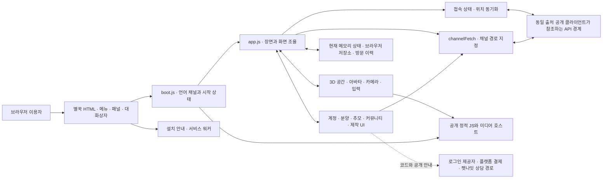

# 별꾹 공개 웹 클라이언트 아키텍처

확인일은 2026년 11월 23일 KST다. 대상은 [별꾹 공개 웹](https://starkkuk.com/)의 HTML, 배포된 JavaScript, 기존 비로그인 동작과 요청 메타데이터다.

별꾹은 **한 웹 페이지에서 3D 장면을 유지하면서 HTML 패널·대화상자를 열고 닫는 구조**다. `app.js`가 장면, 캐릭터, 선택한 추모함과 반려동물, 패널을 조율한다. 각 기능 모듈에 상태 조회 함수와 콜백을 전달하고, 모듈에서 발생한 화면 이벤트는 입력과 카메라 상태에도 영향을 준다. 동행 산책처럼 별도 문서로 이동하는 경로와, 편집기처럼 필요할 때 공개 모듈을 읽는 경로도 있다. [app.js](https://starkkuk-media.asdfstudio-cs.workers.dev/builds/2300b2b383d429b089959a6f/app.js) 430~460·496~596·1921~1983·2083~2093행.

**확인 범위**는 초기 REA 세션의 420건 거래 중 스크립트 요청 280건, 경로 기준 중복을 정리한 **272개 스크립트**, DOM의 **대화상자 33개**, 기존 및 이번 증거에서 본문을 확인한 **46개 공개 소스**다. 초기 분석에는 정상 방문이 자동 발생시킨 트래픽만 사용했다. 이번에는 렌더링 기술과 모델 내부를 다시 조사하지 않고, 기존에 요청된 16개 공개 스크립트를 문서로 열어 빈 영역을 확인했다. 전체 권한·언어·시즌에서 가능한 화면의 전수 실행 여부는 미확인이다.

### A. 전체 서비스 시스템 구성도

  
실선은 공개 코드에서 연결이 확인된 구조다. 점선은 외부 연결을 제공하는 UI·안내가 있다는 뜻이다. API 뒤 내부 서비스, 저장소 구성, 권한 검증 구현은 도식 범위 밖이다.

### 읽는 순서

| 문서 | 다루는 범위 |
|---|---|
| [화면 지도](Architecture/Screen_Map.md) | 메뉴 그룹, 장면과 대화상자, 실제 공개 진입점과 화면 이동. C 다이어그램. |
| [모듈 목록](Architecture/Module_Inventory.md) | 12개 영역별 역할·함수·이벤트·관찰 범위와 272개 요청 경로 부록. |
| [모듈 의존 관계](Architecture/Module_Dependencies.md) | import, 콜백, 이벤트, 동적 로딩과 3D 입력 연결. B·E 다이어그램. |
| [데이터 흐름](Architecture/Data_Flow.md) | 인증·추모함·프로필·추모 기록·접속 상태·제작·결제와 캐시. D 다이어그램. |

### 판정 기준

- **실행 관찰**은 이전 REA 또는 공개 브라우저에서 화면 진입이나 요청 상태를 관찰한 경우다. **DOM 등록**은 HTML에 요소가 존재했다는 뜻이며 화면 오픈이나 가시성을 보장하지 않는다.
- **코드 확인**은 본문에서 함수·이벤트·import·주소를 확인한 경우다. **요청만 관찰**은 모듈 후보로 남기며 파일명으로 실행이나 역할을 확정하지 않는다.
- **추정**은 위 단서의 해석이다. **미확인**에는 인증 후 행위, 지역별·기간별·권한별 가용성, 제공자 내부 처리, 미관찰 지연 모듈을 포함한다.

### 증거와 기존 보고서

| ID | REA Evidence | 읽은 범위 |
|---|---|---|
| R1 | `ev_e8e4a74b0ad89f009cd896d4d38573ee8cb6e03418c2bdd911dda03a3f21cc28` | 기존 첫 방문의 DOM, 접근성, 요청 메타데이터 |
| R2 | `ev_bf9168a52ef048976158750eba958a21a49ff8411b2fc03b095161b79a4089ed` | 기존 부트·앱·기본 아바타·텍스처·렌더 프로필 |
| R3 | `ev_53a9f49586a9d154814c453379219f76767ec9f0e10b9e7778ee579d5a3e5ca7`, `ev_d8e00b9775e0399e05ce5fce6eebd953f3bcdd5c9bbf12610117be442e7960e4` | 기존 캐릭터 편집·맞춤 제작·리그 관련 공개 코드 |
| R4 | `ev_792a4cd774733aac85e78344682d9115983fa5cfcccb6a6a0fae6885ce5f20ef`, `ev_fb5cfa57e7fd4533a6c48abe7b588bd20fe97c3203b5376e7b3ed56a058454ff` | 이전 공개 UI 조사와 메뉴·분양·후원·설치 코드 |
| R5 | `ev_f06b2c128254f6a13fc1c9871b23d3abff7b67eee56dcb14a26b4f7152f82b78` | 계정·로컬 상태·추모 기록·목록·사진 촬영·추모·통신·광장 8개 공개 모듈 |
| R6 | `ev_2fa62100d46ca5cdaa95b62db5cb34a56749e8862823f7d35cb57687f3fc3219` | 접속 상태·산책 안내·쓰다듬기·카메라·언어·펫나잇·관 선택 7개 공개 모듈 |
| R7 | `ev_e96707ada38a85aa02155848faf9b3f5c9fb108e653187e7b7d6a054de4f43bb` | 서비스 워커 스크립트의 문서 조회 |

연결 메모리의 증거 식별자는 영구 링크가 아니다. 링크와 행 번호는 파악한 배포본을 가리키며, 이미 열었던 동작과 과거 배포 코드 사이에 차이가 있을 수 있다. 예를 들어 화면에서 천문관이 11관으로 표시됐지만 관 선택 소스의 내부 번호는 12다. 화면 설명은 각 증거가 말해 주는 범위에서 작성했다. [기술 스택](01_Tech_Stack.md), [캐릭터 시스템](02_Character_System.md), [제작·이용·가격](03_Service_Flow_Pricing.md).

전체 묶음으로 추가 조회하는 첫 시도는 해석 가능한 결과를 돌려주지 않았다. 이후 이전에 요청된 공개 파일만 소그룹으로 조회해 본문을 확보했다. 새로 연 정적 스크립트는 분석용 문서로 읽었으며, 사이트 상호작용이나 API 호출을 추가 재현하는 데 사용하지 않았다. 원본 사진·모델·사용자 레코드를 내보내지 않았다.

### 조사되지 않은 영역과 상세 분석 권장 순서

1. **계정·소유권·공간 배정.** 현재 UI의 인증 복귀, 본인·가족·방문자 구분, 자리 경쟁과 이사·공유의 클라이언트 상태를 우선 정리한다. 이후 모든 쓰기 기능의 전제다. 일반 공개 조사에서는 코드 경로와 안내까지 확인한다.
2. **추모 기록.** 원본 사진 관리, 장면 사진, 보호자 편지와 방문객 추모글을 분리해 버전 변경이 어느 화면까지 반영되는지 확인한다. 기존 자료에서는 주요 분기와 데이터 유형을 파악했다.
3. **실시간·커뮤니티.** HTTP 동기화에서 소켓으로 전환하는 조건, 방 이동과 목록 제거, 플랫폼별 복귀, 별친·광장 글·댓글·신고의 실패 상태는 후속 영역이다.
4. **부가 공간과 활동.** 수목원, 광장 시설, 산책 가이드, 의식·시즌 이벤트, 게임, 제휴 공간의 지연 모듈을 우선순위별로 분리한다. 목록에 등장하는 운영·개발 도구는 공개 사용자 화면으로 확정하지 않는다.
5. **맞춤 3D·수익화.** 실제 모델 승인·적용·호환성, 한국 스토어 판매와 웹 신청 금액은 기존 보고서의 미확인 항목이다. 운영자 공개 자료 또는 별도 권한을 받은 테스트 자료가 필요하다.
6. **모바일과 회복 동작.** iOS·Android 기기, 인앱 브라우저, 홈 화면 실행, 네트워크 끊김, 탭 중단과 WebGL 문맥 손실을 나눠 검증한다. 이번 범위에서는 브라우저별 안내 분기와 서비스 워커 코드에 한정했다.

