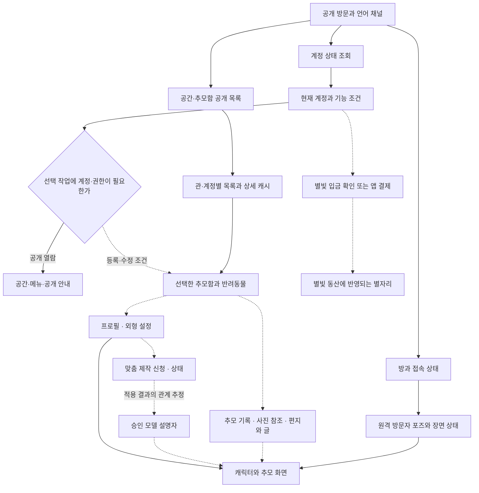

# 별꾹 공개 웹 데이터 흐름

2026년 11월 23일 KST 기준 [공개 웹](https://starkkuk.com/)에서 관찰한 초기 네트워크 메타데이터와 공개 JavaScript의 요청 경로를 정리했다. ‘관찰’은 기존 브라우저가 정상 페이지 이용 과정에서 발생시킨 요청이다. ‘코드’는 호출 가능 경로만 뜻한다. API 주소는 요청을 재현하기 위한 목록이 아니라 클라이언트 책임과 결합 관계의 근거다.

## D. 주요 사용자 데이터 흐름

  
점선은 인증 후 실행을 관찰하지 못한 코드·안내 경로다. 신청 결과에서 승인 설명자에 이르는 서버 연결은 구조상 추정이며, 클라이언트에서 서로 다른 화면 상태로 존재한다. 도식의 API 경계 뒤 구현은 판정하지 않았다.

## 실제 관찰된 초기 요청

아래는 초기 REA 기록의 동일 출처 `/api/` 요청 17건을 메서드와 경로로 묶은 결과다. 값이 포함된 쿼리·헤더·본문은 옮기지 않았다. 초기 트래픽에 포함된 POST는 페이지가 자동으로 보낸 것이며 신청·등록·결제나 글쓰기 동작을 재현한 것이 아니다.

| 메서드와 경로 | 횟수 | 상태 |
|---|---:|---|
| `GET /api/temple-ceremony` | 1 | 200 |
| `POST /api/telemetry` | 1 | 200 |
| `GET /api/site` | 2 | 200 |
| `GET /api/auth/me` | 1 | 200 |
| `GET /api/channel-language` | 1 | 200 |
| `GET /api/pet-chat` | 1 | 401 |
| `GET /api/construction/status` | 1 | 200 |
| `GET /api/lockers` | 2 | 200 |
| `POST /api/presence` | 2 | 200 |
| `GET /api/plaza-pets` | 1 | 200 |
| `GET /api/plaza-boards` | 1 | 200 |
| `GET /api/today-stars` | 1 | 200 |
| `GET /api/attendance` | 1 | 200 |

`/api/pet-chat`의 401은 비로그인 초기에 보였던 한 요청 결과다. 다른 범주의 권한 정책이나 로그인 뒤 기능의 가용성을 이 상태로 해석하지 않는다. `/api/lockers`는 공개/개인 맥락을 선택하는 코드가 있다. 정상 페이지가 초기화 중 해당 요청을 보냈다는 사실만 기록했으며 응답 레코드나 권한이 필요한 뷰의 본문을 열지 않았다.

## 계정과 채널

| 단계 | 데이터·요청 | 화면·모듈 연결 |
|---|---|---|
| 시작 | 언어 채널을 경로에서 읽고 `/api/` 요청과 일부 저장 키에 채널 스코프를 적용한다. | [channel-client.mjs](https://starkkuk-media.asdfstudio-cs.workers.dev/builds/9a4d2ac2d547be4a1f8aa637/channel-client.mjs) 1~17행. 정적 에셋 참조는 해당 래퍼의 API 경로 분기와 별개다. |
| 계정 조회 | `GET /api/auth/me`로 계정 가용성, UI 권한, 요청용 토큰을 읽는 코드. | [auth.js](https://starkkuk-media.asdfstudio-cs.workers.dev/builds/638a587348d25d3c651a65c5/auth.js) 66~80행. 앱과 기능 UI가 `accountReady`, `isSignedIn`, `accountHeaders`를 사용한다. |
| 로그인과 복귀 | 계정창의 제공자 선택은 로그인 시작 주소로 이동한다. 필요한 경우 기존 추모함 진입이나 프로필 복귀 정보를 세션 저장소에서 이어받는다. 로그아웃은 POST 선언. | [auth.js](https://starkkuk-media.asdfstudio-cs.workers.dev/builds/638a587348d25d3c651a65c5/auth.js) 31~52·80~96·112~135행, [app.js](https://starkkuk-media.asdfstudio-cs.workers.dev/builds/2300b2b383d429b089959a6f/app.js) 532~558행. 로그인 왕복, 쿠키·토큰 보존과 서버 검증은 미확인. |
| 제한·오류 | 일부 API 401은 로그인 안내 이벤트로 전환한다. 특정 콘텐츠 제한 403 코드에서 방문 이름을 정리하고 안내 문서로 이동하는 경로가 있다. | [memorial.js](https://starkkuk-media.asdfstudio-cs.workers.dev/builds/8303386815792b082ce80924/memorial.js) 10~14행, [locker-feed.js](https://starkkuk-media.asdfstudio-cs.workers.dev/builds/f3f2bdc9099ea5ec46fbdbe8/locker-feed.js) 22~32행, [channel-client.mjs](https://starkkuk-media.asdfstudio-cs.workers.dev/builds/9a4d2ac2d547be4a1f8aa637/channel-client.mjs) 15~27행. |

## 추모함·프로필·사진과 기록

| 작업 | 코드에 선언된 데이터나 요청 | 화면 반영과 검증 범위 |
|---|---|---|
| 빈자리 확인 | `GET /api/locker-availability` 및 관 선택, 직전 자리 상태 재확인. | [app.js](https://starkkuk-media.asdfstudio-cs.workers.dev/builds/2300b2b383d429b089959a6f/app.js) 610행, [allocation-ui.js](https://starkkuk-media.asdfstudio-cs.workers.dev/builds/1b90e0457106e26665d40d1b/allocation-ui.js) 22~75행. 공개 목록·자리 선택 안내를 관찰했다. 제출 직전 재확인과 경쟁 상황은 코드 확인. |
| 목록·상세 조회 | `GET /api/lockers`의 관별 요약, 개인 목록, 상세를 분리한다. 세션/관/계정이 달라지면 진행 중 요청의 결과를 폐기할 수 있다. | [locker-feed.js](https://starkkuk-media.asdfstudio-cs.workers.dev/builds/f3f2bdc9099ea5ec46fbdbe8/locker-feed.js) 8~94행, [app.js](https://starkkuk-media.asdfstudio-cs.workers.dev/builds/2300b2b383d429b089959a6f/app.js) 784~838·1547행. 초기 요청은 관찰됐다. 개인·상세 응답 본문은 미확인. |
| 분양·이사 | `POST /api/lockers` 및 `POST /api/lockers/move` 코드. 선택한 자리와 기존 버전·배정 식별자를 사용한다. | [app.js](https://starkkuk-media.asdfstudio-cs.workers.dev/builds/2300b2b383d429b089959a6f/app.js) 680·764·838·2093~2115행. 상태를 변경하는 단계는 미실행. |
| 반려동물 프로필 | `/api/locker-pets`에 등록 POST 또는 수정 PUT, 외형 업데이트. 기존 버전과 선택한 동물 키를 사용한다. | [app.js](https://starkkuk-media.asdfstudio-cs.workers.dev/builds/2300b2b383d429b089959a6f/app.js) 698~704·854~902·2083행, [pet-profile-ui.js](https://starkkuk-media.asdfstudio-cs.workers.dev/builds/3a3f10267566a34e124eacc2/pet-profile-ui.js) 45~56행. 목록 무효화 후 화면과 아바타를 다시 준비하는 코드. |
| 추모 기록·등록 사진 | `/api/memorial`에서 동물·추모함 기준 조회. 사진 변경, 글, 댓글 설정, 삭제 분기가 소스에 있다. | [memorial.js](https://starkkuk-media.asdfstudio-cs.workers.dev/builds/8303386815792b082ce80924/memorial.js) 10~22·31~76행. `onPhoto/onRecord`를 통해 앱이 현재 기록을 반영한다. 이미지 전처리나 글 작성 성공은 미관찰. |
| 공개 글과 편지 | 보호자 편지·방문객 글의 입력 경로를 분리하고, 민감한 상태 변경은 화면의 자격 조건과 버전 검사 이후 요청을 구성한다. | [memorial.js](https://starkkuk-media.asdfstudio-cs.workers.dev/builds/8303386815792b082ce80924/memorial.js) 43~76행. 실제 열람 범위, 보존 기간 및 모든 신고 처리 결과는 미확인. |
| 추모 액션 | `GET/POST /api/tributes`로 현재 기록 또는 클릭 결과를 처리하는 코드. 유효 기록인지 확인한 뒤 카운터와 연출에 전달한다. | [tribute-ui.js](https://starkkuk-media.asdfstudio-cs.workers.dev/builds/5706ec2a3d8affa9b3887175/tribute-ui.js) 4~28행, [app.js](https://starkkuk-media.asdfstudio-cs.workers.dev/builds/2300b2b383d429b089959a6f/app.js) 2615행. 추모 액션 전송은 미실행. |
| 장면 사진 | 캔버스 촬영 결과, 브라우저 미리보기, 공유 또는 다운로드와 자원 해제 흐름. 추모 기록의 대표 사진 업로드와 별도다. | [niche-photo.js](https://starkkuk-media.asdfstudio-cs.workers.dev/builds/8976452c83343942dffbf241/niche-photo.js) 8~49행, [app.js](https://starkkuk-media.asdfstudio-cs.workers.dev/builds/2300b2b383d429b089959a6f/app.js) 2567행. 촬영·저장·공유 미실행. |

## 접속 상태·광장·기타 활동

- **접속 상태.** 클라이언트는 탭 단위 방문 참조, 방문명, 장면/방과 위치·자세 및 활동 상태를 구성한다. 동일 출처 `POST /api/presence`를 초기 관찰했다. 코드에는 HTTP 응답 헤더가 허용할 때 같은 경로의 WebSocket으로 접속하고, 연결 실패 후 대기 및 HTTP 재사용을 하는 분기가 있다. 응답은 현재 방과 가시성 세대가 일치할 때 반영한다. 특정 클라이언트의 소켓 전환 성공, 서버 브로드캐스트와 다중 사용자 간 권한 처리는 미확인이다. [presence.js](https://starkkuk-media.asdfstudio-cs.workers.dev/builds/cb6a99e7c4103839707d0ab5/presence.js) 35~74·128~205·266~272행, [presence-transport.mjs](https://starkkuk-media.asdfstudio-cs.workers.dev/builds/157cf728c4c673d5eb3c3ae2/presence-transport.mjs) 4~33행.
- **사용자 활동.** 돌봄·달리기 등 `POST /api/social` 분기에는 요청별 참조와 중복 처리용 값이 있다. 상태를 쓰는 활동은 실행하지 않았다. 다른 사람 표시 설정이나 접속 종료가 UI와 전송 백오프에 미치는 일부 영향은 공개 코드에서 확인된다. [presence.js](https://starkkuk-media.asdfstudio-cs.workers.dev/builds/cb6a99e7c4103839707d0ab5/presence.js) 68·198~205·227~247행.
- **광장·커뮤니티.** 초기 `GET /api/plaza-boards`, `GET /api/today-stars`, `GET /api/plaza-pets`를 관찰했다. 광장 게시 모듈은 목록·프로필 탐색·페이지 더 보기, 쓰기 POST 및 별도 콘텐츠 확인 경로를 선언한다. 성공 후 월드의 게시 자료를 다시 읽도록 앱 콜백을 전달한다. 글·댓글·사진의 본문은 조사 결과에 포함하지 않았다. [plaza-boards-ui.js](https://starkkuk-media.asdfstudio-cs.workers.dev/builds/57d83d47ccb6428364f3da4b/plaza-boards-ui.js) 14~33·61~84행, [app.js](https://starkkuk-media.asdfstudio-cs.workers.dev/builds/2300b2b383d429b089959a6f/app.js) 2745행.
- **동행 산책.** 현재 채널과 복귀 문맥을 세션에 기록하고 별도 문서로 이동한 뒤, 브라우저 이력과 세션 문맥을 사용해 돌아오는 경로가 있다. 일반 걷기/쓰다듬기 입력 자체를 네트워크 작업과 동일시하지 않는다. [app.js](https://starkkuk-media.asdfstudio-cs.workers.dev/builds/2300b2b383d429b089959a6f/app.js) 430~460·2877행, [walk-together-entry.js](https://starkkuk-media.asdfstudio-cs.workers.dev/builds/e45c858a27d4f28552bb4433/walk-together-entry.js) 59~83행, [petting.js](https://starkkuk-media.asdfstudio-cs.workers.dev/builds/f2eb0aa75380bb5e2abcfe01/petting.js) 29~65행.

## 맞춤 제작과 후원·결제

| 영역 | 공개 코드 및 이용 조건 | 미확인 |
|---|---|---|
| 맞춤 제작 | `/api/pet-models` GET·POST·PUT 조건부 선언. 신청 데이터, 사진 참조, 입금 확인 정보, 진행·수정 상태를 처리한다. 앱은 별도의 프로필 모델 설명자를 보고 일반 화면에서 `approved`를 확인한다. [pet-model-request.js](https://starkkuk-media.asdfstudio-cs.workers.dev/builds/724d6a8dea87aaad1417f9f4/pet-model-request.js) 54~95·107~125행, [pet-avatar.js](https://starkkuk-media.asdfstudio-cs.workers.dev/builds/3445e8a7e6c22ced351a4a69/pet-avatar.js) 184~215행. | 서버에서 누가 상태를 바꾸고 어떤 경로로 프로필이 갱신되는지, 특정 모델의 다운로드, 실제 결제액과 원가. |
| 웹 별빛 | `/api/site`에서 일부 안내 가시성을 확인한다. `/api/support`의 조회·POST, 입금 확인·보완 상태, 세션의 작업 임시본 경로가 있다. [support.js](https://starkkuk-media.asdfstudio-cs.workers.dev/builds/4f012c7cc92c341c3cd61ee0/support.js) 55~66·93~107·127~136행. | 실제 결제, 운영자 검수와 게시 완료. |
| 앱 결제 | Android 앱 조건에서 구매·이력·복구를 호출하는 UI가 있다. 웹과 앱이 서로 다른 UI 분기를 보여 준다. [play-support.mjs](https://starkkuk-media.asdfstudio-cs.workers.dev/builds/ebf0c4b3891317cc9c1d0435/play-support.mjs) 5~16·30~37·52~83행. iOS·Google 구매 정보 처리는 공식 정책에 기재된다. [개인정보 처리방침](https://starkkuk.com/privacy.html) | 앱에서의 구매 완료, 스토어별 실제 판매 조건, 환불 반영 검증. |
| 펫나잇 | 공개 코드에 인증 화면, `POST /api/petnight/verify`, 계정 갱신 뒤 입장 콜백, 앱의 전용 공간 읽기 분기가 있다. [petnight-customer.js](https://starkkuk-media.asdfstudio-cs.workers.dev/builds/a4eeafe30447621e26141b4b/petnight-customer.js) 6~33행, [app.js](https://starkkuk-media.asdfstudio-cs.workers.dev/builds/2300b2b383d429b089959a6f/app.js) 1637~1643행. | 입장 성공, 업체 시스템 내부 조회, 제휴 매출·계약 등. |

## 저장소, 갱신 및 실패 복구

| 위치 | 용도와 경계 | 확인 근거 |
|---|---|---|
| 페이지 메모리 | 현재 장면·패널·좌석·동물·포즈, 응답/작업의 임시 상태, 모델·재질 자원. 현재 화면을 바꾸면 이전 요청 콜백이 무시되거나 자원이 정리될 수 있다. | [app.js](https://starkkuk-media.asdfstudio-cs.workers.dev/builds/2300b2b383d429b089959a6f/app.js) 698~760·1547·1921~1983·2089~2093행, [locker-feed.js](https://starkkuk-media.asdfstudio-cs.workers.dev/builds/f3f2bdc9099ea5ec46fbdbe8/locker-feed.js) 8~19행. |
| 로컬 저장소 | 채널별 기본 상태·선물 보관함·방문 이름·설치 안내 상태를 유지한다. 일부 첫 화면 로컬 상태는 입력을 정상화하고 저장 실패를 메시지로 알린다. | [state.mjs](https://starkkuk-media.asdfstudio-cs.workers.dev/builds/5fa3b0edd438780bfc581b2a/state.mjs) 25~55행, [app.js](https://starkkuk-media.asdfstudio-cs.workers.dev/builds/2300b2b383d429b089959a6f/app.js) 598·912·1174행, [presence.js](https://starkkuk-media.asdfstudio-cs.workers.dev/builds/cb6a99e7c4103839707d0ab5/presence.js) 70~71행, [install.js](https://starkkuk-media.asdfstudio-cs.workers.dev/builds/801e78d0be6a1bb3a11b5d87/install.js) 7~8·47~66행. |
| 세션 저장소 및 방문 이력 | 로그인 이전 목적지, 프로필 복귀, 탭 참조, 산책 복귀, 후원 작업 임시본. 공유 주소와 뒤로 가기를 별도로 다룬다. | [auth.js](https://starkkuk-media.asdfstudio-cs.workers.dev/builds/638a587348d25d3c651a65c5/auth.js) 31~38·80행, [app.js](https://starkkuk-media.asdfstudio-cs.workers.dev/builds/2300b2b383d429b089959a6f/app.js) 430~460·496~596행, [presence.js](https://starkkuk-media.asdfstudio-cs.workers.dev/builds/cb6a99e7c4103839707d0ab5/presence.js) 40행, [support.js](https://starkkuk-media.asdfstudio-cs.workers.dev/builds/4f012c7cc92c341c3cd61ee0/support.js) 135~136행. |
| 애플리케이션 캐시 | 목록은 ETag/304, 공개 델타와 전체 스냅샷 재시도, 상세 요청 공유, 계정이나 관 변경 시 무효화를 사용한다. Cache-Control의 실제 운영 기간과 서버 저장 구조는 알 수 없다. | [locker-feed.js](https://starkkuk-media.asdfstudio-cs.workers.dev/builds/f3f2bdc9099ea5ec46fbdbe8/locker-feed.js) 8~94행. |
| 서비스 워커 | 등록 코드와 별도 스크립트 요청을 확인했다. 스크립트는 같은 출처의 루트 또는 언어 루트 GET 탐색에서 네트워크 요청을 사용하고, 실패 시 안내를 반환한다. API·사진·JS를 Cache Storage에 넣는 로직은 확인되지 않는다. 이 워커와 브라우저 HTTP 캐시는 서로 다른 계층이다. | [install.js](https://starkkuk-media.asdfstudio-cs.workers.dev/builds/801e78d0be6a1bb3a11b5d87/install.js) 58~68행, [sw.js](https://starkkuk.com/sw.js) 1~9행. 오프라인 재현과 활성화 여부는 미검증. |
| 실패 흐름 | 인증 상태 재조회, 401 로그인 안내, 네트워크 타임아웃, 오래된 화면 세대 무시, 변경 충돌 문구, 모델 로딩 실패 시 기본형, 화면 닫힘의 입력 해제가 기능별로 있다. | [auth.js](https://starkkuk-media.asdfstudio-cs.workers.dev/builds/638a587348d25d3c651a65c5/auth.js) 66~80행, [locker-feed.js](https://starkkuk-media.asdfstudio-cs.workers.dev/builds/f3f2bdc9099ea5ec46fbdbe8/locker-feed.js) 20~73행, [memorial.js](https://starkkuk-media.asdfstudio-cs.workers.dev/builds/8303386815792b082ce80924/memorial.js) 76행, [pet-avatar.js](https://starkkuk-media.asdfstudio-cs.workers.dev/builds/3445e8a7e6c22ced351a4a69/pet-avatar.js) 189~215행. |

REA 초기 요청 근거는 `ev_e8e4a74b0ad89f009cd896d4d38573ee8cb6e03418c2bdd911dda03a3f21cc28`이다. 새로 확인한 공개 통신·상태 코드는 `ev_f06b2c128254f6a13fc1c9871b23d3abff7b67eee56dcb14a26b4f7152f82b78`와 `ev_2fa62100d46ca5cdaa95b62db5cb34a56749e8862823f7d35cb57687f3fc3219`, 워커는 `ev_e96707ada38a85aa02155848faf9b3f5c9fb108e653187e7b7d6a054de4f43bb`다. 이 문서는 기존 비로그인 결과와 공개 코드에서 확인한 상태만 기록한다. 서버 데이터베이스, 배포 단위, 백그라운드 작업, 정산·검수 시스템의 내부 구조는 미확인이다.

[전체 구조](../00_Service_Architecture.md) · [모듈 목록](Module_Inventory.md) · [모듈 의존 관계](Module_Dependencies.md) · [화면 지도](Screen_Map.md)

