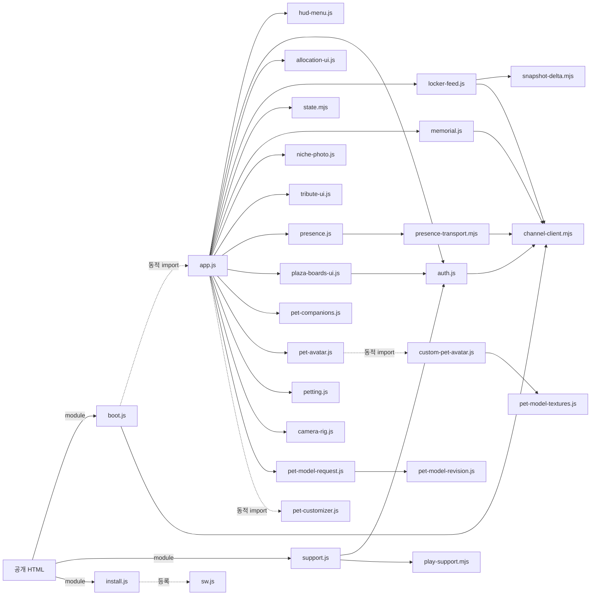
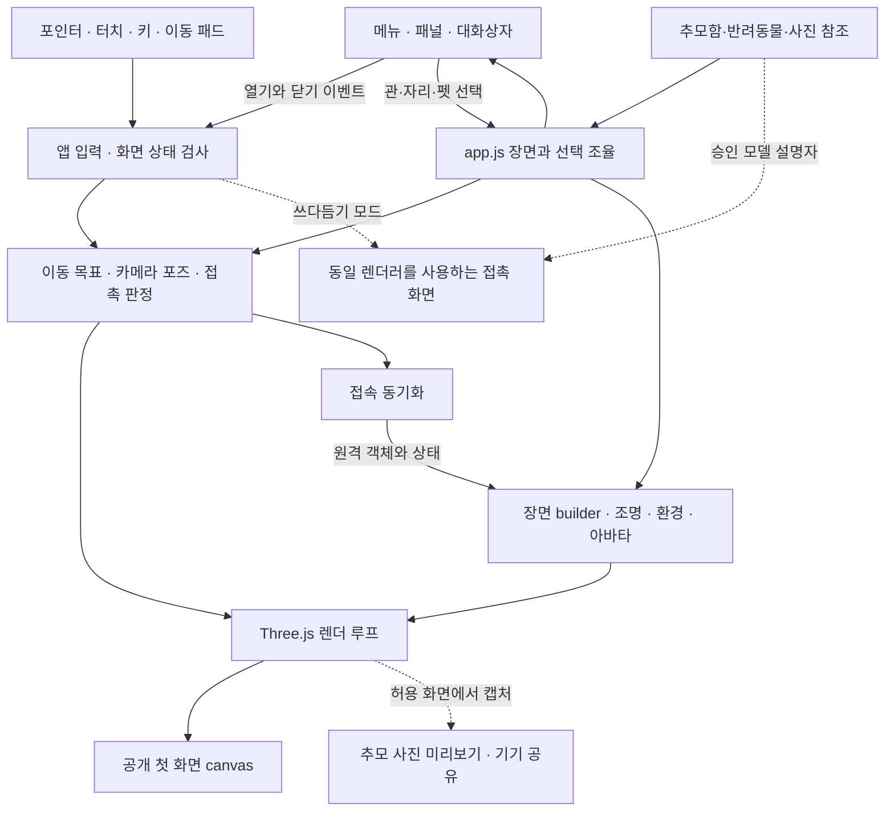

# 별꾹 공개 웹 모듈 의존 관계

2026년 11월 23일 기준 [별꾹](https://starkkuk.com/) 공개 JavaScript에서 확인한 import, 초기화 콜백, 이벤트 연결이다. 초기 요청에 존재하는 모듈을 모두 실행했다고 간주하지 않았다. 파일 전체 목록은 [모듈 목록](Module_Inventory.md)에 있다.

## B. 주요 JavaScript 의존 관계

  
실선은 HTML의 모듈 선언이나 공개 소스의 정적 import다. 점선은 동적 import 또는 서비스 워커 등록이다. 이 그래프는 주요 직접 연결이며, 아래 콜백·이벤트는 별도 관계로 설명한다.

| 연결 | 코드 위치 | 역할 |
|---|---|---|
| 부트 → 앱 | [boot.js](https://starkkuk-media.asdfstudio-cs.workers.dev/builds/9eb79b05d000f37c9762986b/boot.js) 1~4·46행 | 채널과 브라우저 안내를 먼저 준비하고 앱 모듈을 불러와 준비를 기다린다. |
| 앱 → 계정·채널·상태 | [app.js](https://starkkuk-media.asdfstudio-cs.workers.dev/builds/2300b2b383d429b089959a6f/app.js) 26·58·200·306행, [auth.js](https://starkkuk-media.asdfstudio-cs.workers.dev/builds/638a587348d25d3c651a65c5/auth.js) 1~7·66~80행 | 로그인 상태를 읽어 계정 UI와 각 기능 분기에 전달하고, 채널 경로와 로컬 기본값을 사용한다. |
| 앱 → 분양·추모함 캐시 | [app.js](https://starkkuk-media.asdfstudio-cs.workers.dev/builds/2300b2b383d429b089959a6f/app.js) 88·172·416·2629~2635행, [locker-feed.js](https://starkkuk-media.asdfstudio-cs.workers.dev/builds/f3f2bdc9099ea5ec46fbdbe8/locker-feed.js) 1~6·8~94행 | 요청 함수와 콜백으로 분양 UI를 조립한다. 계정·관 스코프의 목록, 상세, 델타를 담당하는 피드는 앱에 상세 갱신을 콜백으로 돌려준다. |
| 앱 → 개인 기록과 촬영 UI | [app.js](https://starkkuk-media.asdfstudio-cs.workers.dev/builds/2300b2b383d429b089959a6f/app.js) 126·152·270·2165·2567·2615행, [memorial.js](https://starkkuk-media.asdfstudio-cs.workers.dev/builds/8303386815792b082ce80924/memorial.js) 1~22행 | 추모글 패널과 API, 장면 사진과 공유, 추모 횟수와 연출을 각각 연결한다. |
| 앱 → 환경·이동·카메라 | [app.js](https://starkkuk-media.asdfstudio-cs.workers.dev/builds/2300b2b383d429b089959a6f/app.js) 202~206·276~292·1921~1983행, [camera-rig.js](https://starkkuk-media.asdfstudio-cs.workers.dev/builds/4c30cab07bf2bd8a893903b3/camera-rig.js) 3~17행 | 장면 builder와 이동 제약을 조립하고 현재 위치·장애물로 카메라 포즈를 결정한다. |
| 앱 → 동행·접촉 | [app.js](https://starkkuk-media.asdfstudio-cs.workers.dev/builds/2300b2b383d429b089959a6f/app.js) 72·198·2557·2657·2867행, [petting.js](https://starkkuk-media.asdfstudio-cs.workers.dev/builds/f2eb0aa75380bb5e2abcfe01/petting.js) 1~15·29~65행, [walk-together-entry.js](https://starkkuk-media.asdfstudio-cs.workers.dev/builds/e45c858a27d4f28552bb4433/walk-together-entry.js) 58~83행 | 상태·프로필·렌더러를 주입한다. 쓰다듬기는 캐릭터 생성 함수와 열기·닫기 훅을 사용하며, 산책 안내는 콜백으로 별도 문서 이동을 요청한다. |
| 앱 → 접속 상태 → 전송 | [app.js](https://starkkuk-media.asdfstudio-cs.workers.dev/builds/2300b2b383d429b089959a6f/app.js) 294행, [presence.js](https://starkkuk-media.asdfstudio-cs.workers.dev/builds/cb6a99e7c4103839707d0ab5/presence.js) 4~7·128~205행, [presence-transport.mjs](https://starkkuk-media.asdfstudio-cs.workers.dev/builds/157cf728c4c673d5eb3c3ae2/presence-transport.mjs) 1~33행 | 위치·방·활동을 보내고 응답을 현재 방에 반영한다. 전송 모듈이 HTTP와 선택적 WebSocket을 관리한다. |
| 광장 위치·게시 UI → 계정·게시 API | [app.js](https://starkkuk-media.asdfstudio-cs.workers.dev/builds/2300b2b383d429b089959a6f/app.js) 2745행, [plaza-boards-ui.js](https://starkkuk-media.asdfstudio-cs.workers.dev/builds/57d83d47ccb6428364f3da4b/plaza-boards-ui.js) 1~14·26~33·78~84행 | 거리와 위치에 따라 먼저 이동시키거나 패널을 열고, 로그인 상태로 게시·댓글·콘텐츠 검사 경로를 결정한다. |
| 신청 UI → 상태·사진·수정 | [app.js](https://starkkuk-media.asdfstudio-cs.workers.dev/builds/2300b2b383d429b089959a6f/app.js) 136·2847행, [pet-model-request.js](https://starkkuk-media.asdfstudio-cs.workers.dev/builds/724d6a8dea87aaad1417f9f4/pet-model-request.js) 6~7·16~20·81~83행 | 폼 본문과 상태를 관리하고 참고 사진·수정 요청 하위 모듈을 붙인다. |
| 캐릭터 → 맞춤 로더 | [pet-avatar.js](https://starkkuk-media.asdfstudio-cs.workers.dev/builds/3445e8a7e6c22ced351a4a69/pet-avatar.js) 184~215행, [custom-pet-avatar.js](https://starkkuk-media.asdfstudio-cs.workers.dev/builds/057d202915dcdedf4e952f7e/custom-pet-avatar.js) 3~7·203~214행 | 승인 설명자를 받았을 때 조건부 모듈을 불러온다. 신청 UI가 직접 모델을 생성하는 경로는 근거가 확보되지 않았다. |
| 후원 UI → 앱 구매·계정 | [support.js](https://starkkuk-media.asdfstudio-cs.workers.dev/builds/4f012c7cc92c341c3cd61ee0/support.js) 1~8·35~46행, [play-support.mjs](https://starkkuk-media.asdfstudio-cs.workers.dev/builds/ebf0c4b3891317cc9c1d0435/play-support.mjs) 5~16·52~83행 | 웹 후원 화면·앱 전용 UI를 분기하고 인증·상품 목록·구매 확인과 연결한다. |

## 확인한 동적 import

아래 목록은 읽은 공개 코드의 리터럴 import를 기준으로 한다. 일반 접속에서 해당 UI가 가시적이었는지, 옵션이 현재 활성화되어 있는지는 별도 조건이다.

| 호출 파일과 위치 | 로드 대상 | 범위 |
|---|---|---|
| boot.js 46행 | [app.js](https://starkkuk-media.asdfstudio-cs.workers.dev/builds/2300b2b383d429b089959a6f/app.js) | 본문 확인 |
| app.js 870행 | [pet-customizer.js](https://starkkuk-media.asdfstudio-cs.workers.dev/builds/855cc44fc89a36f2b21ae765/pet-customizer.js) | 본문 확인 |
| app.js 2623행 | [tree-home.js](https://starkkuk-media.asdfstudio-cs.workers.dev/builds/bacb744aa9b616aa612cf114/tree-home.js) | 정적 참조 확인 |
| app.js 2797행 | [partner-center.js](https://starkkuk-media.asdfstudio-cs.workers.dev/builds/244ed923b69de2adc7a274fb/partner-center.js) | 정적 참조 확인 |
| app.js 2827행 | [constellation.js](https://starkkuk-media.asdfstudio-cs.workers.dev/builds/0aa8fa22ac8269889ed9406d/constellation.js) | 정적 참조 확인 |
| app.js 2927행 | [reunion-game.js](https://starkkuk-media.asdfstudio-cs.workers.dev/builds/210d8082448b2a57f3c90804/reunion-game.js) | 정적 참조 확인 |
| app.js 2993행 | [hide-seek-game.js](https://starkkuk-media.asdfstudio-cs.workers.dev/builds/06af66f17571e9c52b6b533a/hide-seek-game.js) | 정적 참조 확인 |
| pet-model-textures.js 6행 | [vendor/KTX2Loader.js](https://starkkuk-media.asdfstudio-cs.workers.dev/builds/bfb4433aef4294a3e4fcd0eb/vendor/KTX2Loader.js) | 정적 참조 확인 |
| pet-avatar.js 185행 | [custom-pet-avatar.js](https://starkkuk-media.asdfstudio-cs.workers.dev/builds/057d202915dcdedf4e952f7e/custom-pet-avatar.js) | 본문 확인 |

## 이벤트와 콜백

| 발생점 | 연결된 동작 | 근거 |
|---|---|---|
| 메뉴 열기/닫기 | `tailstar:hud-menu-open/close`. HUD 그룹 가시성 재평가, 메뉴에서 다음 버튼으로 포커스, 장면 이벤트와 분리. | [hud-menu.js](https://starkkuk-media.asdfstudio-cs.workers.dev/builds/0e5af2d2eae1750b3f989600/hud-menu.js) 67~101행 |
| 패널 열기/닫기·포인터 인터럽트 | 앱의 `openPanel/closePanel`이 현재 패널·이동·선물 배치 등을 정리한다. 일부 오버레이가 열릴 때 포인터 캡처, 입력, 경로가 취소된다. | [app.js](https://starkkuk-media.asdfstudio-cs.workers.dev/builds/2300b2b383d429b089959a6f/app.js) 2089~2093·2253~2317행 |
| 관 선택 | `tailstar:hall-select-open/close`와 `onChoose`. 입력 정리 후 선택된 관을 `setScene`으로 넘긴다. | [hall-select.js](https://starkkuk-media.asdfstudio-cs.workers.dev/builds/38d6e325217e8b5fd7f70518/hall-select.js) 22~32행, [app.js](https://starkkuk-media.asdfstudio-cs.workers.dev/builds/2300b2b383d429b089959a6f/app.js) 2635·2759~2761행 |
| 별빛·후원 | `tailstar:support-open/close`. 앱에서 이동·대상·카메라 조작 상태를 정리하고 닫힌 뒤 화면 제어를 복구한다. | [support.js](https://starkkuk-media.asdfstudio-cs.workers.dev/builds/4f012c7cc92c341c3cd61ee0/support.js) 38~51행, [app.js](https://starkkuk-media.asdfstudio-cs.workers.dev/builds/2300b2b383d429b089959a6f/app.js) 2755~2765행 |
| 맞춤 3D 신청 | `tailstar:pet-model-open/close`와 초기화 콜백으로 다른 패널과 활동을 정리한다. | [pet-model-request.js](https://starkkuk-media.asdfstudio-cs.workers.dev/builds/724d6a8dea87aaad1417f9f4/pet-model-request.js) 123~126행, [app.js](https://starkkuk-media.asdfstudio-cs.workers.dev/builds/2300b2b383d429b089959a6f/app.js) 2847행 |
| 사진과 추모 | `onPhoto/onRecord` 콜백이 추모 화면·표시 상태를 이어 주고 추모 기록은 촛불 배경의 카운터와 연결된다. | [memorial.js](https://starkkuk-media.asdfstudio-cs.workers.dev/builds/8303386815792b082ce80924/memorial.js) 17~42·76행, [app.js](https://starkkuk-media.asdfstudio-cs.workers.dev/builds/2300b2b383d429b089959a6f/app.js) 2165·2615행 |
| 방문 이력과 화면 상태 | `popstate`/ `pageshow`에서 추모함 주소와 산책 복귀, 별자리·제휴·재회 모드 상태를 다룬다. | [app.js](https://starkkuk-media.asdfstudio-cs.workers.dev/builds/2300b2b383d429b089959a6f/app.js) 430~460·496~596·2877행 |
| 탭 가시성 | `visibilitychange`, `pagehide`에 입력·접속 갱신·카메라 조작을 정리한다. 접속 모듈의 leave 경로는 비콘 전송을 선언한다. | [app.js](https://starkkuk-media.asdfstudio-cs.workers.dev/builds/2300b2b383d429b089959a6f/app.js) 2257·2535행, [presence.js](https://starkkuk-media.asdfstudio-cs.workers.dev/builds/cb6a99e7c4103839707d0ab5/presence.js) 198~205행, [petting.js](https://starkkuk-media.asdfstudio-cs.workers.dev/builds/f2eb0aa75380bb5e2abcfe01/petting.js) 65행 |

## E. 3D 시스템과 일반 UI의 연결

  
장면을 바꾸는 `sceneName`, 패널을 가리키는 `panelName`, 현재 사물함인 `selectedNiche`와 동물인 `selectedPetId`가 서로 다른 상태 축이다. 추모함 내부의 사진, 배경, 카메라 및 입력 설정은 이 축의 조합을 사용한다. 쓰다듬기나 추모 촬영이 열리면 앱의 일반 이동과 업데이트가 그대로 동작한다고 볼 수 없다. 일부 장면은 별도 카메라, 렌더 호출 또는 프레임 중간의 분기를 사용한다. [app.js](https://starkkuk-media.asdfstudio-cs.workers.dev/builds/2300b2b383d429b089959a6f/app.js) 1921~1983·2089~2199·2535~2567행.

## 해석 한계

정적 import나 로드 기록은 각 export의 호출 성공을 보장하지 않는다. 공개 JS로 확인한 의존 관계는 서버의 서비스 분리, 관리자 연결 상태나 데이터 모델 전체를 보여 주지 않는다. 이 문서는 기존 REA `ev_bf9168a52ef048976158750eba958a21a49ff8411b2fc03b095161b79a4089ed`와 이번 추가 기록 `ev_f06b2c128254f6a13fc1c9871b23d3abff7b67eee56dcb14a26b4f7152f82b78`·`ev_2fa62100d46ca5cdaa95b62db5cb34a56749e8862823f7d35cb57687f3fc3219`에 연결한다. [전체 구조](../00_Service_Architecture.md) · [화면 지도](Screen_Map.md) · [데이터 흐름](Data_Flow.md).

