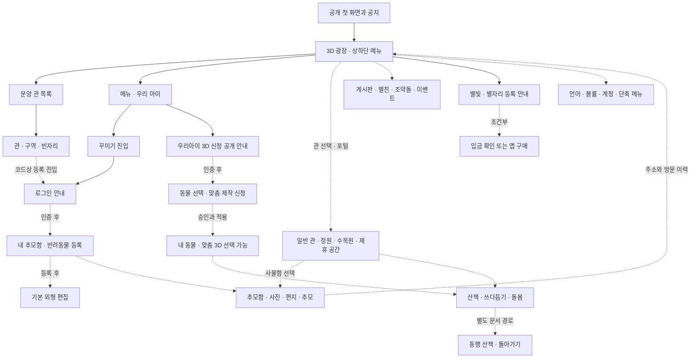

# 별꾹 화면 및 메뉴 지도

2026년 11월 23일 KST 기준 [공개 웹](https://starkkuk.com/)의 기존 비로그인 관찰, 초기 DOM, 공개 코드에서 화면·메뉴를 정리했다. **실행 관찰**은 실제 화면을 열었거나 초기 화면에 표시된 경우다. **DOM 등록**은 요소가 만들어졌다는 뜻이다. **코드 확인**은 화면이나 이동 조건이 소스에 존재하는 경우다.

## 첫 화면과 메뉴

| 위치 | 화면과 항목 | 확인 범위 |
|---|---|---|
| 시작·공지 | 별꾹 소식, 시작 실패/연결 안내, 개인정보 변경 안내, 홈 화면 제안, 출석 안내 | 공지·출석·설치 제안 관찰. 시작 실패 화면은 코드 확인. [boot.js](https://starkkuk-media.asdfstudio-cs.workers.dev/builds/9eb79b05d000f37c9762986b/boot.js), [install.js](https://starkkuk-media.asdfstudio-cs.workers.dev/builds/801e78d0be6a1bb3a11b5d87/install.js) 9~68행. |
| 상단 | 홈 로고, 위치·활동/방문 이름, 서비스 통계, 별자리·별빛 동산, 별빛, SNS, 알림, 메뉴 | 첫 화면 버튼 관찰. 별빛 등록 화면 오픈 관찰. 알림 기록과 별자리 탐방은 이번 범위에서 실행 미확인. [hud-menu.js](https://starkkuk-media.asdfstudio-cs.workers.dev/builds/0e5af2d2eae1750b3f989600/hud-menu.js) 22~31행, [support.js](https://starkkuk-media.asdfstudio-cs.workers.dev/builds/4f012c7cc92c341c3cd61ee0/support.js) 11~47행. |
| 맵과 조작 | 3D 공간, 마을 안내, 이동 패드, 선택 위치 안내, 상황별 버튼 | 초기 HUD 관찰. 이동·충돌·관 이동 전수 실행은 확인하지 않음. [app.js](https://starkkuk-media.asdfstudio-cs.workers.dev/builds/2300b2b383d429b089959a6f/app.js) 1921~1983·2253~2320행. |
| 공간 하단 | 추모관, 함께 산책, 쓰다듬기, 선물, 우리 아이 | 첫 화면 레이블 관찰. 선물·개인 활동 상태를 변경하는 동작은 미확인. [app.js](https://starkkuk-media.asdfstudio-cs.workers.dev/builds/2300b2b383d429b089959a6f/app.js) 2083~2093·2557행. |
| 분양 | 분양받기 → 관 목록 → 구역·빈자리 → 등록 안내 | 관·구역까지 실행 관찰. 자리 확정과 등록 폼 제출은 미실행. [allocation-ui.js](https://starkkuk-media.asdfstudio-cs.workers.dev/builds/1b90e0457106e26665d40d1b/allocation-ui.js) 22~75행, [app.js](https://starkkuk-media.asdfstudio-cs.workers.dev/builds/2300b2b383d429b089959a6f/app.js) 2093~2115행. |

메뉴의 영역은 소스와 실제 가시 항목이 다를 수 있다. `hud-menu.js`는 장면·이벤트·항목의 숨김 여부에 따라 그룹을 구성하며, 앱에서도 메뉴와 하단 버튼을 상태에 맞춰 갱신한다. 아래는 R1 초기 DOM과 코드에서 확인한 항목의 합집합이다. [hud-menu.js](https://starkkuk-media.asdfstudio-cs.workers.dev/builds/0e5af2d2eae1750b3f989600/hud-menu.js) 16~19·33~65·71~89행.

| 그룹 | 확인한 항목 | 비고 |
|---|---|---|
| 공간 | 관 선택, 산책길 안내, 수목원, 사물함 목록에서 찾기, 함께 짓는 마을, 별빛 법당, 함께하는 천도재, 별빛 추모기도회 | 일부 항목은 이벤트·장면 조건부. |
| 우리 아이 | 울애기, 내 사물함 보기, 아이와 걷기, 추억 메시지, 우리아이 3D 신청, 우리 아이 모습 꾸미기 | 맞춤 제작과 꾸미기 진입은 기존 브라우저에서 관찰. 꾸미기에서 로그인 안내 확인. |
| 꾹키 | 우리 아이 보러가기, 숨바꼭질, 왕공 굴리기, 꾹키 상점 | 메뉴 코드의 구성과 초기 DOM이 부분적으로 겹친다. 활동 완료·보상은 미실행. |
| 이벤트 | 출석체크, 꼬순내 결과 발표, 장생원 | 출석 안내는 관찰. 기간 제한이 있을 수 있다. |
| 소통 | 별친 목록, 오늘의 별, 조약돌, 별스토리, 접속 랭킹 | 초기 메뉴·모듈 선언 관찰. 게시·친구·랭킹 액션 미실행. |
| 설정 및 안내 | 다른 사람 표시, 아바타, 볼륨 조정, 언어와 채널 선택, 내 계정, 이용 안내, 추모관 소개 | 공개 계정창 확인. 계정 변경과 설정 저장은 미실행. |
| 추모함 관리 | 가족 초대하기, 사물함 비우기, 사물함 신고하기, 상황별 이사·공유 | 코드·DOM 등록. 소유·가족·방문자 조건은 각 기능에 의존한다. |

## 장면과 별도 문서

| 컨텍스트 | 구성 | 증거 |
|---|---|---|
| 초기 홈과 광장 | 광장, 마을 지도, 게시 공간, 오늘의 별 표식, 가족을 기다리는 동물 계열 UI, 시설 진입점 | 홈·초기 API 요청 관찰. 세부 시설 진입은 코드/DOM. [app.js](https://starkkuk-media.asdfstudio-cs.workers.dev/builds/2300b2b383d429b089959a6f/app.js) 1791·2745·3035행. |
| 일반 관 | 추모관, 햇살동산, 별빛해변, 구름마을, 무지개너머 마을, 햇살눈꽃 마을, 달콤구름 마을, 숲결 중정, 달빛이 머무는 정원, 기억서재, 별들의 천문관 | 분양 관 목록에서 화면 표시 관찰. 일부 만석. 이동은 `setScene` 코드 기준. 화면 순번과 내부 키는 구분한다. [hall-select.js](https://starkkuk-media.asdfstudio-cs.workers.dev/builds/38d6e325217e8b5fd7f70518/hall-select.js) 2~32행, [app.js](https://starkkuk-media.asdfstudio-cs.workers.dev/builds/2300b2b383d429b089959a6f/app.js) 1947~1983행. |
| 추모함 상세 | 빈자리 등록, 방문 상세, 내 추모함 관리, 편지·사진·촛불·국화·선물, 이사·비우기·신고·가족 초대 | 상세 구성 코드 및 DOM 등록. 타인 상세 레코드 미열람. [app.js](https://starkkuk-media.asdfstudio-cs.workers.dev/builds/2300b2b383d429b089959a6f/app.js) 698~760·2089~2199행. |
| 산책·숲 | 정원·동산, 수목원 채널, 산책길 안내, 나무·조약돌·돌봄, 선물·카페 등 주변 활동 | 장면 키 `garden`, `grove`와 관련 로그인·상태 가드가 코드에 있다. 실제 활동 완료 미확인. [app.js](https://starkkuk-media.asdfstudio-cs.workers.dev/builds/2300b2b383d429b089959a6f/app.js) 1793·1947~1979·2657행. |
| 제휴·별도 장면 모드 | 펫나잇관, 포캣멍관, 별빛 동산, 우리 아이 보러가기, 숨바꼭질, 나무집 | 전용 공간·액터와 동적 코드 경로. 권한·이벤트별 모드는 관찰 범위 밖. [app.js](https://starkkuk-media.asdfstudio-cs.workers.dev/builds/2300b2b383d429b089959a6f/app.js) 1637~1643·2623·2797~2833·2927~2997행. |
| 별도 문서 | 언어 채널 루트, 동행 산책 문서, 가벼운 추모 목록, 정책 페이지 및 제한 안내 페이지 | 동행 산책·제한 안내는 직접 URL 이동 코드 확인. 목록 링크는 시작 장애 안내에서 확인. 페이지 전체의 연결 상태는 미확인. [app.js](https://starkkuk-media.asdfstudio-cs.workers.dev/builds/2300b2b383d429b089959a6f/app.js) 430~460행, [boot.js](https://starkkuk-media.asdfstudio-cs.workers.dev/builds/9eb79b05d000f37c9762986b/boot.js), [channel-client.mjs](https://starkkuk-media.asdfstudio-cs.workers.dev/builds/9a4d2ac2d547be4a1f8aa637/channel-client.mjs) 15~27행. |

## 대화상자와 공용 패널

초기 DOM에 나온 네이티브 대화상자 33개를 기능별로 묶었다. ID나 레이블이 없는 항목도 포함한 개수다. 아래 이용자 이름은 확인된 제목이나 레이블을 사용했으며, 불명확한 항목은 식별자를 적었다.

| 묶음 | 등록된 대화상자 예 | 관찰 |
|---|---|---|
| 계정·설정·공통 | 계정, 언어·채널, 공지, 볼륨, 단축 메뉴 편집 | 계정·공지 실제 관찰. 나머지는 DOM 등록. |
| 추모함·가족 | 추모 사진, 장식, 사물함 신고·비우기, 반려동물 삭제, 가족 초대 | DOM 등록. 사진 촬영·신고·삭제 미실행. |
| 캐릭터·산책 | 안을 동물 선택, 우리아이 3D 신청, 동행 산책 초대, 추억 메시지, 선물 보관함 | 신청창과 세부 안내 실제 관찰. 나머지는 DOM 등록. |
| 장소·광장 | 관 선택, 여행 목적지, 마을 지도, 광장 게시판, 광장 동물 카드, 별꾹 베이커리 | 분양 패널의 관 선택 실제 관찰. 관 이동 대화상자 자체는 별도 구현. |
| 공동체·이벤트 | 나무에 남긴 마음, 마음의 조약돌, 경연 결과, 출석, 랭킹, 오늘의 별, 별친 | 출석 안내 관찰. 나머지는 DOM 등록. |
| 결제·기타 | 별자리 등록 및 제목/ID가 없는 초기 대화상자 | 별자리 등록 실제 오픈. 결제는 미실행. |

공용 패널은 같은 `#panel`을 상태값으로 다시 그린다. 초기 대화상자 숫자와 합산할 때 구분해야 한다. 코드에서 확인한 호출 키는 `share`, `niches`, `allocation`, `visit`, `move`, `claim`, `pet`, `pet-add`, `petnight-help`, `visitor`, `help`, `petnight-intro`, `photo`, `letters`, `move-confirm`, `zones`다. 편집·게임 등의 지연 로딩 화면은 처음 방문 DOM 개수에 포함된다고 가정할 수 없다. [app.js](https://starkkuk-media.asdfstudio-cs.workers.dev/builds/2300b2b383d429b089959a6f/app.js) 2083~2199행.

## 초기 DOM 대화상자 전체 목록

번호는 R1 DOM의 등장 순서다. ID가 없으면 클래스 또는 레이블 참조를 적었다. 운영 권한이나 조건에 따라 나타나는 요소의 일반 사용자 진입은 확인되지 않았다.

| 번호 | ID 또는 클래스 | 이름 또는 역할 | 범위 |
|---:|---|---|---|
| 1 | pet-carry-choose | 어떤 아이를 안을까요? | 운반 선택 |
| 2 | account-dialog | 아이의 공간을 오래 간직해요 | 공개 계정 안내 관찰 |
| 3 | support-dialog | 별자리 등록 | 공개 동작 관찰 |
| 4 | language-settings | 언어와 채널 | DOM 등록 |
| 5 | site-notice-dialog | 별꾹 소식 | 초기 표시 관찰 |
| 6 | milk-review-confirm (첫 번째) | 보호자에게 적용 | DOM 등록. 접근·권한 미확인 |
| 7 | milk-review-confirm (두 번째) | 초기 제목 미확인 | DOM 등록. 접근·권한 미확인 |
| 8 | niche-photo-preview | 추모 사진 | DOM 등록 |
| 9 | locker-decor-panel | 장식 편집 | DOM 등록. 레이블 참조로 분류 |
| 10 | locker-report-dialog | 사물함 신고 | DOM 등록 |
| 11 | locker-clear-dialog / locker-clear-title | 사물함을 영구적으로 비울까요? | DOM 등록 |
| 12 | pet-remove-dialog | 이 아이 삭제 | DOM 등록 |
| 13 | forest-notes-dialog | 나무에 남긴 마음 | DOM 등록 |
| 14 | pebble-experience | 마음의 조약돌 | DOM 등록 |
| 15 | grove-dialog | 초기 제목 미확인 | DOM 등록. 수목원 계열 후보 |
| 16 | hall-select-dialog | 어느 공간으로 갈까요? | DOM 등록. 분양 관 목록은 별도 공용 패널 |
| 17 | music-settings | 볼륨 조정 | DOM 등록 |
| 18 | cafe-menu | 별꾹 베이커리 | DOM 등록 |
| 19 | family-dialog | 가족 초대하기 | DOM 등록 |
| 20 | pet-chat-dialog | 추억 메시지 | DOM 등록. 초기 heading은 아이의 이름 |
| 21 | plaza-map | 마을 한눈에 보기 | DOM 등록 |
| 22 | kkosunnae-contest | 꼬순내 결과 발표 | DOM 등록과 메뉴 레이블 |
| 23 | plaza-board-dialog | 광장 게시판 | DOM 등록. 레이블 참조로 분류 |
| 24 | plaza-pet-card | 가족을 기다리는 아이 | DOM 등록 |
| 25 | pet-model-request | 우리아이 3D 신청 | 공개 동작 관찰 |
| 26 | gift-inventory-dialog | 선물 보관함 | DOM 등록 |
| 27 | walk-together-invite | 아이와 잠깐 걸을까요? | DOM 등록 |
| 28 | travel-menu | 어디로 떠나볼까요? | DOM 등록 |
| 29 | attendance-dialog | 출석체크 | 안내 대화상자 표시 관찰 |
| 30 | visit-ranking-dialog | 접속 랭킹 | DOM 등록 |
| 31 | today-stars-dialog | 오늘의 별 | DOM 등록 |
| 32 | star-friends-dialog | 별친 목록 | DOM 등록과 메뉴 레이블 |
| 33 | hud-shortcuts-dialog | 단축 메뉴 편집 | DOM 등록 |

## C. 전체 화면 이동 흐름

  
실선은 첫 화면 UI와 이전 공개 관찰에서 연결이 확인된 경로다. 점선은 공개 코드로 확인한 경로이며 조건을 모두 충족해 화면을 실행한 기록은 없다. 산책·쓰다듬기 메뉴 표시 자체는 첫 화면에서 관찰했다.

## 증거와 남은 화면

초기 DOM·요청은 REA `ev_e8e4a74b0ad89f009cd896d4d38573ee8cb6e03418c2bdd911dda03a3f21cc28`를 사용했다. 이전 비로그인 세션에서 실제로 연 화면은 [제작·이용·가격 보고서 2절](../03_Service_Flow_Pricing.md)에 있다. 이 지도는 초기 발견 범위와 코드상 진입의 합집합이다. 계정 상태·장면·서버 제공 목록·이벤트 날짜에 따른 동적 가시성, 앱 전용 화면, 제휴 공간 내부, 신청·결제 성공 화면은 미확인이다. 기능별 API는 [데이터 흐름](Data_Flow.md), 전체 공개 스크립트 목록은 [모듈 목록](Module_Inventory.md)을 참조한다.

