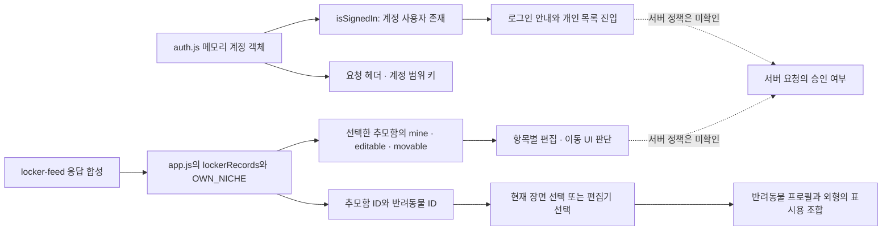
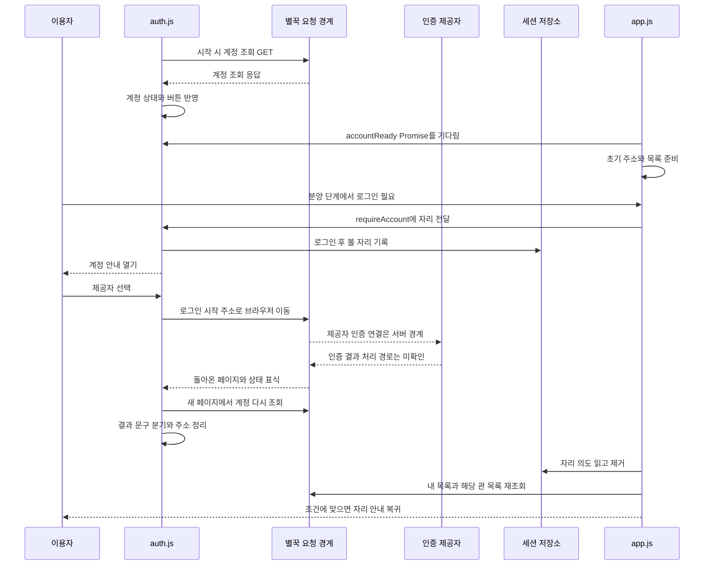

# 별꾹 계정·소유권·프로필 시스템

확인일은 2026년 11월 23일 KST다. [별꾹 공개 웹](https://starkkuk.com/)의 배포 코드와 기존 비로그인 관찰을 바탕으로 작성했다. 여기서 **계정**은 로그인한 회원을, **추모함 소유권**은 개별 자리의 권한을, **반려동물 프로필**은 그 자리에 연결된 동물의 데이터와 외형을 가리킨다. 세 값은 쓰임이 다르다.

**실행 관찰.** 기존 REA 초기 요청에서 `GET /api/auth/me` 200과 추모함 목록 요청을 확인했다. 기존 비로그인 조작에서 ‘우리 아이 모습 꾸미기’를 눌러 계정 안내를 열었다. 로그인 이후 성공 화면, 제공자 인증과 복귀, 계정 연결·삭제, 저장은 **코드 확인**이다. 소유권 판정과 세션 검증의 서버 내부 구현은 **확인 불가**다.

## 1. 계정 및 소유권 구조도

  
실선은 소스에서 이어지는 클라이언트 관계다. 점선은 서버 응답에 의존하지만 내부 검증 코드를 확보하지 못한 경계다. 계정 상태, 저장 요청의 인가, 표시 소유권을 같은 값으로 간주할 수 없다. [auth.js](https://starkkuk-media.asdfstudio-cs.workers.dev/builds/638a587348d25d3c651a65c5/auth.js) 66~80행, [app.js](https://starkkuk-media.asdfstudio-cs.workers.dev/builds/2300b2b383d429b089959a6f/app.js) 402·416·600~606·660행.

| 상태 | 코드에서 읽은 필드 | 의미와 경계 |
|---|---|---|
| 계정 모듈 상태 | `account.user`, `csrf`, `providers`, `origin`, 별도 `loaded`·`failure` | 시작값의 `user`는 null이다. 응답 JSON으로 계정 객체를 교체한다. `account.providers`는 로그인 버튼 가용성에 쓰고, `account.user.providers`는 로그인된 계정의 연결 목록에 쓴다. |
| 사용자 정보 | `id`, `name`, `email`, `emailVerified`, 연결 제공자·프로필 확인 후보, 역할 관련 플래그 | 계정 화면과 기능 분기에 읽는 필드다. 회원 번호나 이메일 실값은 수집하지 않았다. |
| 추모함 레코드 | `lockerRecords[id]`, 응답의 `mine`·`mineIds`, 행별 `mine`·`editable`·`movable`, `shared`, `allocation`, `version` | 응답의 상위 `mine`을 앱의 `OWN_NICHE`에 대입한다. 행별 `mine`은 별도다. `mineIds`를 사용하는 목록 병합과 행 필터가 있다. 예약이나 특수 자리 제약도 편집·선택과 별도로 평가한다. |
| 월드 선택 | `selectedNiche`, `selectedPetId`, `currentMemorial`, `memorialRevision` | 화면에서 보는 대상이다. 다른 공개 추모함을 방문해도 이 선택으로 소유권이 생기지 않는다. |
| 편집기 선택 | `selection = {id, petId, version, lockerVersion, allocation, add}`의 구조 | 반려동물 편집기의 사본이다. 월드에서 보고 있는 대상과 동일할 필요가 없다. 요청별로 대상과 버전을 캡처한다. |

[auth.js](https://starkkuk-media.asdfstudio-cs.workers.dev/builds/638a587348d25d3c651a65c5/auth.js) 8·17~22·60~80·86~93행, [locker-feed.js](https://starkkuk-media.asdfstudio-cs.workers.dev/builds/f3f2bdc9099ea5ec46fbdbe8/locker-feed.js) 63~71행, [app.js](https://starkkuk-media.asdfstudio-cs.workers.dev/builds/2300b2b383d429b089959a6f/app.js) 402·600~606·660·784~802행, [pet-profile-ui.js](https://starkkuk-media.asdfstudio-cs.workers.dev/builds/3a3f10267566a34e124eacc2/pet-profile-ui.js) 11~20·38~41행.

### 소유·편집·이동은 다른 판정이다

- `ownedNiches()`는 목록 행에서 `row.mine`인 키를 모은다. `canEditNiche(id)`는 레코드 존재를 전제로 `editable`, `mine`, `id === OWN_NICHE` 가운데 하나를 만족하는지 평가한다. 예를 들어 코드상 편집 가능한 행과 ‘내 아이’ 편집기의 `row.mine` 필터는 범위가 다를 수 있다.
- `canMoveNiche(id)`는 `movable`과 특별 자리 제외 조건을 확인한다. `canEnterPetnight`, `isPetnightManager`, `isPartnerCenterAdmin`은 각 계정 플래그와 관리자 플래그를 읽는 별도 도우미다.
- `familyPets(id)`는 `row.pets` 배열을 사용한다. 배열이 없는 기존 형태에서는 상위 행 필드에서 `primary` 하나를 합성한다. `companionLockers`는 앱이 `row.mine`으로 거른 목록을 받아 관리자 동행에 쓸 추모함을 제한한다. 일반 계정은 원래 목록을 반환하고, 관리자에게 VIP 이외 항목이 있으면 그 목록을 우선한다. 이 동작으로 가족 권한의 실제 부여 방식을 알아낼 수는 없다.

[app.js](https://starkkuk-media.asdfstudio-cs.workers.dev/builds/2300b2b383d429b089959a6f/app.js) 600~606·660·694~718·2083행, [auth.js](https://starkkuk-media.asdfstudio-cs.workers.dev/builds/638a587348d25d3c651a65c5/auth.js) 73~78행, [companion-lockers.mjs](https://starkkuk-media.asdfstudio-cs.workers.dev/builds/4ffbc87bf375a7b80467c498/companion-lockers.mjs) 2~5행.

## 2. 첫 방문과 로그인 복귀

  
첫 계정 조회는 **실행 관찰**이다. 화면에서 제공자를 선택한 뒤의 흐름은 양쪽 클라이언트 분기를 연결한 것이다. 제공자 왕복, 서버 세션 확립, 정확한 리다이렉트 횟수는 **미확인**이다. 비로그인 계정창에서 실제 제공자 인증을 시작하지 않았다.

1. **첫 방문 → 모듈 실행 → 계정 조회.** `auth.js`가 평가될 때 `accountReady = refresh()`가 한 번 시작한다. `app.js`는 `ready = accountReady.then(initializeLockerAddress)`로 계정 조회가 끝난 뒤 초기 화면을 정한다. `refreshAccount()` 호출은 별도 새 요청을 만들 수 있다. 이미 만들어진 `accountReady`가 새 Promise로 바뀌지는 않는다.
2. **계정 버튼 → click → 계정창.** `openAccount`를 이벤트 핸들러로 직접 연결한다. DOM의 클릭 이벤트 객체는 `prompt === true`가 아니므로 일반 계정창이 열린다. 가져오는 중, 실패, 로그인 전후에 따라 내용이 바뀐다. 준비 상태가 꺼진 제공자 버튼은 비활성화한다.
3. **새 자리에서 인증 필요 → 자리 의도 보관.** `requireAccount(niche)`는 초기 계정 조회를 기다린다. 로그인돼 있으면 true다. 아니면 자리 인자가 있을 때 채널별 세션 키에 저장하고 계정창을 연 뒤 false를 반환한다. 여기서 인증 완료까지 기다리지 않는다.
4. **제공자 버튼 → 전체 페이지 이동.** 제공자 준비가 된 버튼을 누르면 브라우저를 로그인 시작 경로로 이동시킨다. 내장 브라우저에서 Google을 고르면 외부 브라우저 안내 분기로 빠진다. 로그인은 단순히 JSON 응답을 받아 화면 안에서 끝내는 요청과 다르다.
5. **돌아온 주소 → 인증 상태 읽기 → 복귀.** 계정 모듈은 쿼리의 `auth`·`auth_error`를 읽고, 조회 완료 시 결과 문구나 프로필 확인 분기를 결정한다. `history.replaceState`로 두 표식을 주소에서 지운다. 앱의 초기화는 세션에 남은 자리 의도를 읽고 지운다. 명시적인 공유 주소가 있으면 그것을 먼저 고려하며, 세션의 자리로 복귀하려면 로그인 상태와 알려진 자리인지 확인한다. 로그인 상태라면 내 목록을 먼저 조회한다. 이후 관 목록을 읽은 상태에서, 복귀 대상이 계속 비어 있고 조건에 맞을 때만 분양 시작 UI를 이어갈 수 있다. 복귀 자체가 등록 완료를 뜻하지 않는다.

[auth.js](https://starkkuk-media.asdfstudio-cs.workers.dev/builds/638a587348d25d3c651a65c5/auth.js) 66~96·125~138행, [app.js](https://starkkuk-media.asdfstudio-cs.workers.dev/builds/2300b2b383d429b089959a6f/app.js) 532~562·760·2103~2115·2751행.

### 계정 관련 주요 함수 교재

| 함수와 위치 | 입력 → 반환 | 처리, 부수 효과와 예외 |
|---|---|---|
| `refresh` / `refreshAccount`, auth 66~72 | 인자 없음 → `Promise<user 또는 null>` | 채널 fetch로 캐시 없는 GET을 보내고 8초 제한을 둔다. HTTP 성공 후 JSON을 계정 상태로 교체하고 `loaded`, `failure`, 상단 버튼을 업데이트한다. 초기 오류는 실패 메시지를 남긴다. 나중 재조회 실패 시 기존 계정 객체를 지우는 대입은 없다. 열려 있는 계정창은 삭제 플로우가 아니면 다시 그린다. `catch`가 오류를 흡수하므로 Promise가 끝났다는 것만으로 요청 성공을 뜻하지 않는다. |
| `isSignedIn`·`signedInMemberId`·`accountHeaders`, auth 73~78 | 인자 없음 → boolean, ID 또는 null, 헤더 객체 | 현재 메모리 스냅샷을 동기적으로 읽는다. 헤더 객체를 만드는 일과 인증 또는 서버 검증은 별도다. |
| `openAccount`·`requireAccount`, auth 79~80 | 선택적 안내 플래그 또는 자리 → `undefined` / `Promise<boolean>` | `showModal`과 재렌더를 담당한다. 브라우저 저장이 불가능해도 계정창은 연다. 이 경우 자리 복귀 힌트를 잃을 수 있다. |
| `render`, auth 81~124 | 인자 없음 → `undefined` | 계정 상태에 맞는 UI를 만들고 클릭 핸들러를 붙인다. 초기 로드 실패의 재시도 버튼은 `refresh`를 연결한다. 로그아웃은 중복 조작을 잠그고 POST 성공 후 채널 홈으로 이동하며 오류는 문구로 반영한다. |
| `profileNeedsUpdate`·`profileReturnAddress`, auth 17~30 | 사용자 또는 주소 → boolean / 경로 또는 null | 이메일·이름과 연결 제공자 정보로 계정 정보 확인 안내를 판단한다. 복귀 주소는 현재 출처·채널의 대상 경로와 검증한 선택 쿼리만 남긴다. 예외 시 null이다. |
| `bindProfileRefresh`·`restoreProfileReturn`, auth 31~58 | 버튼 이벤트 또는 저장된 복귀 힌트 → 핸들러 등록 / boolean | **일반 첫 로그인과 별도**다. 안내 버튼으로 프로필 확인 요청을 보내고 응답 주소의 HTTPS와 기대 제공자를 확인한다. 현재 회원과 최근 시각의 재사용 가능한 복귀 힌트만 소비한다. 주소가 다르면 replace로 이동한다. 오류는 안내와 재시도로 이어진다. |
| `initializeLockerAddress`, app 532~586·2751 | 이벤트에서 읽은 주소와 세션·계정 상태 → 완료를 나타내는 Promise | 저장된 자리 읽기 → 개인 목록 → 관 목록 → 장면 및 자리 선택 → 초기 UI 정리. 사용할 수 없는 주소는 기본 진입 경로로 돌린다. 실제 로그인 왕복 결과는 미관찰이다. |
| `channelPath`·`channelStorageKey`·`channelFetch`, channel 1~27 | 상대 경로·언어·요청 옵션 → 경로 / 저장 키 / `Promise<Response>` | `ko/en/vi` 경로와 키를 구분한다. 문자열 API 경로에 채널을 붙이고 옵션은 fetch에 전달한다. fetch는 4xx·5xx도 Response로 반환할 수 있다. 특별한 403은 복제한 응답의 코드만 읽어 안내 경로를 선택하고, 보통은 각 호출자가 `ok`를 확인한다. 문자열의 허용 경로 검사와 서버 접근 권한은 별도다. |

**실패 읽기.** 로그인 결과 문구에는 만료, 취소, 실패, 제공자 미준비, 계정 충돌 등이 있다. `claim_conflict`는 이전 방문의 사물함을 자동 합치지 않았다는 사용자 안내다. 서버가 어떤 규칙으로 충돌을 결정하는지는 미확인이다. **관련 모듈.** `auth.js` 112행은 계정 연결 UI에 현재 회원·세션을 읽는 함수를 전달한다. 추가로 읽은 `account-link-ui.mjs`는 작업 당시 계정·세션과 현재 값이 일치하는지 비교하는 공개 상태 흐름을 확인했다. 실제 연결 처리와 계정 삭제 내부는 조사하지 않았다. [auth.js](https://starkkuk-media.asdfstudio-cs.workers.dev/builds/638a587348d25d3c651a65c5/auth.js) 65·108~138행, [account-link-ui.mjs](https://starkkuk-media.asdfstudio-cs.workers.dev/builds/36e555caa7872847b53f5e47/account-link-ui.mjs) 19~44·104행.

## 3. 반려동물 프로필과 외형 저장

### 사용자 행동에서 UI 반영까지

| 사용자 행동 | 이벤트 → 함수 | 요청과 상태 반영 |
|---|---|---|
| ‘우리 아이’ 열기 | `openPanel('pet') → renderPetProfilePanel → mount`. 앱이 `list/getProfile/refresh/onRecord/onPhoto` 콜백을 주입한다. | 계정 조회 완료 확인 → 미로그인이면 계정창과 편집기의 재시도 안내 → 로그인 상태면 `refreshOwnedLockers`. 이 목록에서 행별 `mine`인 반려동물을 추린다. |
| 동물 선택·새 아이 추가 | `choose → edit(item, add)`. 동물이 한 마리면 곧바로 편집할 수 있다. | 현재 자리와 동물의 버전을 기억한다. 입력은 `dirty`로 표시하고 종이 바뀌면 귀·무늬의 UI 조건을 다시 평가한다. 선택만 바꿔서는 저장 요청이 없다. |
| 정보 저장 | form `submit`에서 기본 동작을 막고 이름·날짜 확인 → `FormData` 계열 파싱 → busy 잠금. | 새 동물은 POST, 기존 동물은 PUT으로 `/api/locker-pets` 요청을 구성한다. 성공 후 `onRecord(result, chosen)`가 추모함 행을 바꾸고 목록·사진 캐시를 정리한다. 활성 편집기는 응답의 새 버전을 받아 새로 그린다. |
| 사진 선택과 저장 | 파일 `change`에서 비동기 전처리 후 초안을 저장한다. | 선택 자체는 초안이다. 나중에 프로필 요청이 성공한 경우에만 `onPhoto`가 저장된 동물과 새 버전을 받아 `savePetPhoto → memorialRequest`를 호출한다. 현재 추모 레코드가 없으면 읽은 뒤 사진 PUT을 보낸다. |
| 세부 외형 저장 | 편집기에서 꾸미기 → `openPetCustomizer` → 지연 모듈 → 저장 버튼의 `onSave`. | 정규화 외형을 `profile.appearance`로 보내는 별도 PUT이 있다. 반환된 자리로 목록을 갱신한다. 월드의 자리와 동물이 일치하면 로컬 표시 상태와 아바타도 갱신한다. |

[pet-profile-ui.js](https://starkkuk-media.asdfstudio-cs.workers.dev/builds/3a3f10267566a34e124eacc2/pet-profile-ui.js) 12~22·31~64·69~76행, [app.js](https://starkkuk-media.asdfstudio-cs.workers.dev/builds/2300b2b383d429b089959a6f/app.js) 854~908·2071~2097·2211~2215행, [pet-customizer.js](https://starkkuk-media.asdfstudio-cs.workers.dev/builds/855cc44fc89a36f2b21ae765/pet-customizer.js) 56~64행.

### 주요 함수와 성공·실패의 경계

| 함수·위치 | 입력과 결과 | 이해할 점 |
|---|---|---|
| `createPetProfileUI`, profile 12~21·69~76 | 패널 DOM과 콜백 객체 → `mount/close/requestClose` | 클로저에 선택과 `epoch`, `busy`, `dirty`가 남는다. `mount(returnTo)`는 비동기로 새 목록을 읽고 돌아갈 동물 또는 선택 화면을 정한다. 실패 시 현재 세대에서만 재시도를 그린다. `close`는 세대를 증가시킨다. |
| `edit(item, add)`와 `form.onsubmit`, profile 38~64 | 동물과 자리 행, 추가 플래그, 폼 이벤트 → 편집 DOM과 저장 부수 효과 | 선택을 복사한 뒤 네트워크를 기다린다. 저장 결과는 `onRecord`로 반영한 뒤 화면이 아직 같은 세대일 때만 버튼·선택·문구를 바꾼다. `finally`는 여전히 활성인 폼의 잠금을 푼다. |
| `renderPetProfilePanel`·`syncPetProfileRecord`, app 2071~2087 | DOM 또는 저장 응답과 직전 선택 → UI 갱신 | 앱이 관리하는 `lockerRecords`를 응답으로 바꾼다. 열린 추모함이 같은 자리일 때만 그 자리의 선택·기록 버전을 갱신한다. 동행·제목·메시지 UI도 최신 상태에 맞춰 다시 계산한다. |
| `savePetProfile(profile, add)`, app 896~908 | 프로필과 추가 플래그 → `Promise<boolean>` | 앱의 별도 프로필 폼에서 쓰는 저장 경로다. `canEditNiche`·`placementBusy`를 먼저 확인한다. 같은 장면과 선택일 때 응답의 동물을 적용하고, 실패 시 목록 무효화·재조회·메시지를 사용한다. |
| `openPetCustomizer(chosen)`, app 854~894 | 선택적 편집기 선택 → 편집기 열기 또는 조기 반환 Promise | 열기 중·활성·렌더러·편집권을 확인한다. 동적 import 후 선택·권한을 다시 확인한다. 저장 콜백은 응답 성공 후 레코드와 UI를 갱신한다. 정상화와 저장 실패 메시지는 편집기와 앱 콜백 각각에서 처리한다. |
| `savePetPhoto(photo,id,petId,expectedVersion)`, app 2211~2215 | 사진 초안 또는 제거값과 대상·기대 버전 → `Promise<boolean>` | 먼저 편집 가능 여부를 검사한다. 필요하면 기록을 읽고 사진 변경을 보내며 새 기록을 적용한다. 오류를 안내하고 false를 돌려준다. 프로필 편집기에서는 앱 콜백이 이 false를 예외로 바꾼다. |

**부분 성공.** `onRecord`가 프로필 성공을 반영한 뒤에 사진을 보낸다. 따라서 사진 경로에서 실패 문구가 나와도 앞서 성공한 프로필이 바뀌어 있을 수 있다. 클라이언트에 앞의 저장을 되돌리는 코드는 확인되지 않았다. 두 HTTP 요청을 서버가 하나의 트랜잭션으로 묶는다는 증거도 없다. 서버 버전 충돌의 응답 상태나 멱등성은 미확인이다. [pet-profile-ui.js](https://starkkuk-media.asdfstudio-cs.workers.dev/builds/3a3f10267566a34e124eacc2/pet-profile-ui.js) 54~63행, [app.js](https://starkkuk-media.asdfstudio-cs.workers.dev/builds/2300b2b383d429b089959a6f/app.js) 2071~2083·2211~2215행.

### 데이터의 우선순위와 로컬 저장

`readNiche(id, petId)`는 내 대표 동물인 경우에만 로컬 데이터를 읽을 수 있다. 로컬값 위에 대상 프로필과 확인된 사진·이름 등을 올리고 `normalize`로 표시값을 만든다. 이후 날짜와 맞춤 모델 설명자를 붙인다. 관계 표시는 클라이언트의 편집 권한 조건을 적용한다. 참조한 동물이 없으면 가족 목록의 첫 항목을 선택할 수 있으며, 이를 원격 레코드가 생겼다는 뜻으로 해석하지 않는다.

`normalize(data)`는 배열·문자열·종·색·크기 등을 기본값과 허용 집합에 맞춘 새 객체를 만든다. 저장 전에 필요한 모양을 맞추는 **클라이언트 정규화**다. `save()`는 현재 선택이 내 대표 동물일 때만 브라우저 로컬 저장소에 쓴다. 저장 대상이 아니라면 실제 쓰기 없이 true를 돌려줄 수 있고, 예외면 메시지와 false다. 서버 저장 완료 반환값으로 볼 수 없다. [state.mjs](https://starkkuk-media.asdfstudio-cs.workers.dev/builds/5fa3b0edd438780bfc581b2a/state.mjs) 25~26·43~46행, [app.js](https://starkkuk-media.asdfstudio-cs.workers.dev/builds/2300b2b383d429b089959a6f/app.js) 598·694~706·1174행.

| 데이터 예 | 생성·사용 위치 |
|---|---|
| 동물 기본 정보 | 이름, 관계, 생일, 별이 된 날. 요청의 상위 필드와 표시 프로필에 쓰인다. |
| 렌더·외형 정보 | 종, 색, 귀, 무늬, 크기와 `appearance`의 모양·부위 색·색칠 관련 값. 기본 정보 저장과 세부 외형 저장은 요청 구성 범위가 다르다. |
| 사용 중인 버전 | 대표 동물은 추모함 버전, 추가 동물은 동물 버전을 사용한다. 편집기는 응답에서 증가한 값으로 다음 요청을 준비한다. |
| 사진 초안·참조 | 편집기에서 `photoDraft`와 `photoChanged`를 별도로 둔다. `undefined`와 명시적으로 제거하는 null을 요청 의도에서 구별한다. |
| 백엔드 데이터 구조 | 서버의 테이블과 실제 관계, 불변 조건, 소유권 부여·철회 경로, 세션 쿠키 속성 및 보존 기간은 미확인이다. |

## 4. 코드 출처와 관찰 범위

| 파일 | 확인한 위치 |
|---|---|
| [auth.js](https://starkkuk-media.asdfstudio-cs.workers.dev/builds/638a587348d25d3c651a65c5/auth.js) | 8~58행 상태·프로필 복귀, 60~124행 조회·계정창, 125~138행 이벤트·결과 |
| [app.js](https://starkkuk-media.asdfstudio-cs.workers.dev/builds/2300b2b383d429b089959a6f/app.js) | 402~424행 상태·피드, 496~606행 초기 주소·소유 판정, 694~718행 표시 프로필, 854~908행 저장, 2071~2087·2211~2215·2751행 연결 |
| [pet-profile-ui.js](https://starkkuk-media.asdfstudio-cs.workers.dev/builds/3a3f10267566a34e124eacc2/pet-profile-ui.js) | 11~22·31~64·69~76행 |
| [pet-customizer.js](https://starkkuk-media.asdfstudio-cs.workers.dev/builds/855cc44fc89a36f2b21ae765/pet-customizer.js) | 56~64행 |
| [state.mjs](https://starkkuk-media.asdfstudio-cs.workers.dev/builds/5fa3b0edd438780bfc581b2a/state.mjs) | 25~26·43~46행 |
| [channel-client.mjs](https://starkkuk-media.asdfstudio-cs.workers.dev/builds/9a4d2ac2d547be4a1f8aa637/channel-client.mjs) | 1~32행 |
| [companion-lockers.mjs](https://starkkuk-media.asdfstudio-cs.workers.dev/builds/4ffbc87bf375a7b80467c498/companion-lockers.mjs) · [account-link-ui.mjs](https://starkkuk-media.asdfstudio-cs.workers.dev/builds/36e555caa7872847b53f5e47/account-link-ui.mjs) | 2~5행 · 19~44·104행 |

기존 초기 방문 `ev_e8e4a74b0ad89f009cd896d4d38573ee8cb6e03418c2bdd911dda03a3f21cc28`, 앱 코드 `ev_bf9168a52ef048976158750eba958a21a49ff8411b2fc03b095161b79a4089ed`, 편집기 `ev_d8e00b9775e0399e05ce5fce6eebd953f3bcdd5c9bbf12610117be442e7960e4`, 인증·로컬 상태 `ev_f06b2c128254f6a13fc1c9871b23d3abff7b67eee56dcb14a26b4f7152f82b78`, 채널 `ev_2fa62100d46ca5cdaa95b62db5cb34a56749e8862823f7d35cb57687f3fc3219`, 추가 정적 코드 `ev_b00e341ca3ae69c4648e6cf544c5529bae64e6137f9d998bc35873a6acb15e2c`을 재사용·참조했다. 공개 클라이언트의 저장 요청을 재현하거나 계정·모델·사진의 원본 데이터를 읽은 기록은 없다.

[추모함 배정과 캐시](Locker_Allocation.md) · [독립 JavaScript 교재](../Learning/Account_Locker_Code_Study.md) · [기존 사용자 흐름](../03_Service_Flow_Pricing.md)

