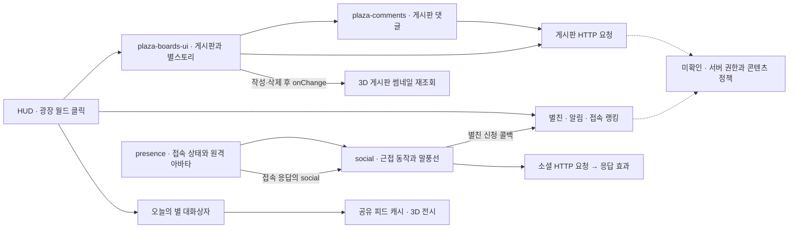
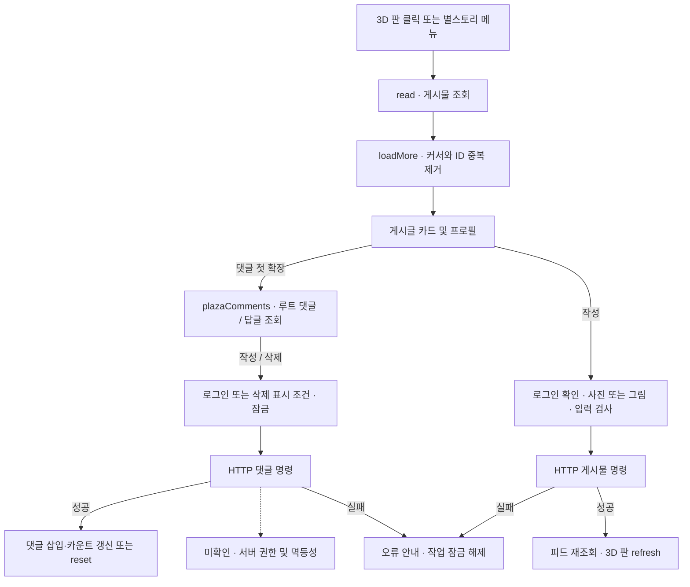

# 별꾹의 광장 게시판·댓글·별친·소통

확인일 **2026-11-25 (한국시간)** · [별꾹 공개 웹 클라이언트](https://starkkuk.com/) · 7차 분석

별스토리는 광장의 사진 게시판과 HUD 메뉴 양쪽에서 열린다. 사진 게시물과 댓글은 HTTP로 읽고 쓰며, 광장에 세워진 3D 게시판은 작은 사진을 별도 주기로 갱신한다. 별친 목록·알림과 접속 랭킹에도 각각 조회 루프가 있다. 가까운 캐릭터에게 보내는 토닥임·포옹·정해진 메시지는 소셜 요청과 접속 응답을 통해 장면에 반영된다.

## 화면·DOM·코드 증거

기존 초기 화면·네트워크 증거와 [화면 지도](../Architecture/Screen_Map.md), [요청·데이터 흐름](../Architecture/Data_Flow.md), [모듈 목록](../Architecture/Module_Inventory.md)을 우선 대조했다. 아래의 ‘관찰’은 예전 초기 비로그인 화면이나 요청 메타데이터의 범위다. 7차에서 새로 읽은 JS는 이미 식별된 공개 CDN 파일을 문서로 열어 확인했다. 게시물·댓글·위치 이력이나 사용자 정보는 수집하지 않았다.

| 기능 | 실제 공개 화면·요청 관찰 | DOM·메뉴 등록 | 공개 본문 확인 및 한계 |
|---|---|---|---|
| 광장과 게시판 | 광장·초기 메뉴 및 `GET /api/plaza-boards` 200 관찰. 게시판 상세 진입·글 본문 미관찰 | `#plaza-board-dialog` 등록 | 낙서판·전단지·별스토리·경연 결과 분기, 상세/피드, 작성·삭제·신고와 댓글 핸들러 확인. 결과 미관찰 |
| 별스토리 | 개별 프로필·친구 피드 미관찰 | HUD 별스토리 및 광장 게시 위치 | 전체·별친·내 프로필, 작성자 프로필 격자·개별 게시물, 별 남기기 확인. 별친 대상의 실제 필터 규칙 미확인 |
| 별친·알림 | 신청·수락·찾아가기 미관찰 | `#star-friends-dialog`, 별친 목록 및 알림 진입 | 목록·신청·수락·거절, 위치 응답 사용, 읽음 처리 구현 확인. 공개 범위·자격·위치 보존 미확인 |
| 오늘의 별 | 초기 `GET /api/today-stars` 200 관찰. 카드·개별 추모 동작 미관찰 | `#today-stars-dialog`와 HUD 메뉴 | 새로 등록된 아이·기념일 분류, 광장 전시, 등록 공개 설정과 촛불 코드 확인. 서버 선정 기준·게시 동의 기본값 미확인 |
| 소셜 활동 | 다른 이용자 대상 동작 미관찰 | 대상 버튼·포옹 초대·마음 전하기 UI를 만드는 코드 확인 | 토닥임·감사·포옹 요청과 응답, 정해진 말, 역할 전용 채팅 분기 확인. 일반 공개 자유 채팅이나 사용자 차단은 확인되지 않음 |
| 접속 랭킹 | 랭킹 본문·이용자 목록 미관찰 | `#visit-ranking-dialog`와 HUD 메뉴 | 대화상자 열린 동안 조회, 상위 30행 표시, 서버 기준 시각·표시 인구 수 사용 확인. 실제 순위 산정 미확인 |
| ‘내 글 보기’와 관련 코드 | 목록 열람 미관찰 | 게시판·추모 패널에서 버튼을 만드는 코드 확인 | 현재 사용자가 남긴 글을 종류별로 조회. 광장 쓰기 권한이나 편집 이력과는 다른 기능 |
| 경연 결과 등 보조 모듈 | 관련 상세 화면 미관찰 | 광장 게시판의 경연 분기 | 모듈 본문이 입증하는 것은 경연 전용 UI로 위임하는 경로다. `contest-results.mjs` 등 일부 보조 모듈은 기존 요청 목록과 import 대상까지만 확인했다. |

## A. 전체 커뮤니티·실시간 시스템

실선은 공개 코드에서 확인한 호출·데이터 전달이다. 점선은 서버 정책을 확인하지 못한 경계다. 원격 캐릭터와 소켓은 [실시간 접속 보고서](Realtime_Presence_Networking.md)에 설명한다.

## 광장 게시판의 함수와 이벤트

| 코드 위치 | 호출 시점·입출력·처리 순서 |
|---|---|
| [plaza-boards-world.js](https://starkkuk-media.asdfstudio-cs.workers.dev/builds/b2842ee2f9e04ad927430932/plaza-boards-world.js) 7~20·35~40행 · `createPlazaBoardsWorld` | 광장 구성 시 Three.js 그룹·판·클릭 가능한 메시를 만든다. 메시의 `userData.action`과 판 ID를 읽어 앱이 대응 핸들러를 고른다. 반환 인터페이스에 게시물 참조 조회·갱신·해제가 있다. |
| [app.js](https://starkkuk-media.asdfstudio-cs.workers.dev/builds/2300b2b383d429b089959a6f/app.js) 1791·2271·2741~2745행, [plaza-entry.js](https://starkkuk-media.asdfstudio-cs.workers.dev/builds/26612745a41aa3a485239c79/plaza-entry.js) 3~25행 · `activateWorldInteraction` / `createPlazaEntry` | 3D 판 클릭은 게시판 ID로 `open`, 지도에서 고른 항목은 `onWalk`로 전달한다. 판이나 시설의 거리 조건에 따라 이동하거나 대화상자를 연다. 새 글이 반영될 때 앱은 `plazaWorld.refreshBoards()`를 호출하도록 연결한다. |
| [plaza-boards-ui.js](https://starkkuk-media.asdfstudio-cs.workers.dev/builds/57d83d47ccb6428364f3da4b/plaza-boards-ui.js) 21~28·83~88행 · `open(id)` / `openFeed()` / `close` | 월드 판은 광장과 거리 8을 점검해 멀면 먼저 이동한다. HUD는 이벤트를 보내 별스토리 피드를 직접 연다. 일반 닫기는 저장 중 차단하거나 저장하지 않은 내용을 확인하고, 장면을 떠나는 월드 대화상자는 강제로 정리할 수 있다. HUD 경로는 `fromMenu` 플래그로 구분한다. |
| [plaza-boards-ui.js](https://starkkuk-media.asdfstudio-cs.workers.dev/builds/57d83d47ccb6428364f3da4b/plaza-boards-ui.js) 30~37행 · `api(query, body)` | GET 또는 JSON POST를 보내 Promise로 파싱된 응답을 돌려준다. POST에는 계정 헤더, 요청에는 `cache:'no-store'`와 25초 제한을 적용한다. 네트워크·타임아웃, HTTP 413, JSON 파싱 오류를 사용자가 읽을 수 있는 문구로 바꾼다. |
| [plaza-boards-ui.js](https://starkkuk-media.asdfstudio-cs.workers.dev/builds/57d83d47ccb6428364f3da4b/plaza-boards-ui.js) 53~72행 · `read(at, postId)` / `loadMore` | 선택 게시판과 별스토리 범위에 맞는 DOM을 새로 구성한다. 선택된 글 ID가 있으면 먼저 단건을 확인하고 피드를 요청한다. 다음 페이지는 응답의 `next`를 `before`로 보낸다. `seen` 집합은 같은 ID의 중복 추가를, `loading`은 진행 중 추가 조회를 막는다. 스크롤 여유 300px의 `IntersectionObserver` 또는 더 보기 버튼으로 이어진다. 화면 세대가 바뀌면 응답을 적용하지 않고 오류 시 자동 관찰을 끈 뒤 다시 불러오기 버튼을 표시한다. |
| [plaza-boards-ui.js](https://starkkuk-media.asdfstudio-cs.workers.dev/builds/57d83d47ccb6428364f3da4b/plaza-boards-ui.js) 25~28·39~51행 · `postCard(item)` / `openProfile` | 글 ID, 작성자 표시 이름·프로필 참조, 날짜, 제목, 본문, 사진·썸네일, 게시물 별/댓글 수를 쓰는 DOM을 구성한다. 이름 첫 글자를 기본 아바타로 쓰고 별스토리에서 작성자 참조가 있을 때만 프로필 이동이 연결된다. 일부 항목은 추모함 링크를 제공한다. 별 남기기는 로그인 확인과 잠금 후 응답으로 개수와 버튼 상태를 바꾼다. |
| [plaza-boards-ui.js](https://starkkuk-media.asdfstudio-cs.workers.dev/builds/57d83d47ccb6428364f3da4b/plaza-boards-ui.js) 73~82행 · `signed` / `write` / `report` | 작성·신고는 로그인 확인 후 폼을 연다. 게시 시 사진 또는 캔버스 준비와 빈 입력을 확인하고, 폼 상태와 등록 버튼을 잠근다. 성공 후 월드 갱신 콜백 및 피드 재조회, 실패 후 현재 폼에 안내와 재시도 경로를 둔다. 신고는 대상 글과 최대 500자 사유를 전송하도록 구현돼 있다. 응답의 중복 신고 플래그는 UI가 읽지만 신고 처리 결과는 미관찰이다. |

### 게시글의 쓰기·수정·삭제·사진

- **작성.** POST의 `action:'create'`는 판 종류, 제목, 본문, 장소·연락 방법 및 사진을 전달한다. 제목 최대 80자, 별스토리·전단지 본문 최대 2,000자, 전단지 장소·연락 방법은 각각 최대 120자다. 전단지는 연락 방법이 방문자에게 공개된다고 폼에서 안내한다. 게시글에 별도의 전체 공개·비공개 선택은 조사한 폼에서 확인하지 못했다. [plaza-boards-ui.js 75~81행](https://starkkuk-media.asdfstudio-cs.workers.dev/builds/57d83d47ccb6428364f3da4b/plaza-boards-ui.js)
- **수정·삭제.** 게시 후 글 수정 이벤트나 업데이트 명령은 조사한 게시판·내 글 목록에서 확인되지 않았다. 삭제 버튼은 `item.canDelete`가 참일 때 나타난다. 확인창과 버튼 비활성화 뒤 삭제 명령을 보내며, 성공 시 카드 제거와 월드 갱신을 하고 별스토리 또는 빈 피드는 다시 읽는다. 버튼 조건만으로 실제 본인·운영자별 쓰기 권한을 확정할 수 없다. [plaza-boards-ui.js 39~50행](https://starkkuk-media.asdfstudio-cs.workers.dev/builds/57d83d47ccb6428364f3da4b/plaza-boards-ui.js) · [my-posts.js 6~18행](https://starkkuk-media.asdfstudio-cs.workers.dev/builds/7921bbb166a9588a8c16965a/my-posts.js)
- **사진·그림.** 별스토리와 전단지는 파일 한 장이 필요하다. 파일 변경에서 `preparePhoto(file,{board:true})`를 호출해 미리보기를 갱신한다. 준비 중 제출은 대기시키고 오래된 디코딩 결과는 파일 세대와 폼 연결 상태로 걸러낸다. 기존 사진 분석 기준 광장 모드의 한도는 입력 20 MiB, 긴 변 1,400px 및 인코딩 문자열 400,000자다. 낙서판은 포인터/터치 입력과 2D 캔버스, 되돌리기 및 글씨 입력을 쓰며, 저장 시 그림 캔버스 출력의 문자열 한도는 600,000자다. [plaza-boards-ui.js 75~81행](https://starkkuk-media.asdfstudio-cs.workers.dev/builds/57d83d47ccb6428364f3da4b/plaza-boards-ui.js) · [plaza-drawing.js 1~16행](https://starkkuk-media.asdfstudio-cs.workers.dev/builds/babafb60eb43060120ccd220/plaza-drawing.js) · [사진 처리 보고서](Photo_Media_Pipeline.md)
- **검사·신고·차단.** 낙서판에 *글씨 넣기*를 눌렀을 때만 확인된 별도 콘텐츠 검사 요청이 있다. 검사 ACK 이후 캔버스에 문자 작업을 적용한다. 게시물 신고 경로는 확인했으며, 개별 댓글 신고·사용자 차단·사진/본문의 서버 검사 정책은 확인하지 못했다. 403 등의 UX나 폼 검사만으로 서버가 어떤 콘텐츠를 차단하는지 알 수 없다. [plaza-boards-ui.js 46·74~81행](https://starkkuk-media.asdfstudio-cs.workers.dev/builds/57d83d47ccb6428364f3da4b/plaza-boards-ui.js) · [plaza-drawing.js 15~16행](https://starkkuk-media.asdfstudio-cs.workers.dev/builds/babafb60eb43060120ccd220/plaza-drawing.js) · [plaza-comments.js 9~55행](https://starkkuk-media.asdfstudio-cs.workers.dev/builds/9c7780c2d88aef845fe4edcc/plaza-comments.js)

### 댓글·답글의 데이터와 갱신

`plazaComments({host,id,api,signed,onCount,onProfile})`는 해당 게시물의 댓글 영역을 만들고 초기 `load()` Promise를 반환한다. 첫 확장 때만 마운트되고, 루트 댓글은 게시물 ID와 `threaded=1`로, 답글은 게시물 ID와 부모 댓글 ID로 각각 조회한다. `row.parent`가 있는 글에서 답글을 선택하면 스레드 루트를 쓰는 코드를 확인했다. 답글의 모든 서버 제약은 미확인이다. [plaza-boards-ui.js 48~50행](https://starkkuk-media.asdfstudio-cs.workers.dev/builds/57d83d47ccb6428364f3da4b/plaza-boards-ui.js) · [plaza-comments.js 3~34·36~45행](https://starkkuk-media.asdfstudio-cs.workers.dev/builds/9c7780c2d88aef845fe4edcc/plaza-comments.js)

| 경로 | 식별자와 화면 반영 |
|---|---|
| 광장 댓글 | 게시물 `id`, 댓글 `row.id`, `parent` 및 `replyCount`로 스레드를 구성한다. `author`, `authorProfile`, `memorial`, `created`, `body`, `canDelete`를 읽는 코드가 있다. 내 표시 이름은 서버의 `viewerName`을 읽고 작성 폼은 본문만 받는다. |
| 댓글 게시 | 로그인 확인과 공백·HTML 최대 1,000자 조건을 적용한다. 같은 본문·부모를 재시도할 때 이미 만든 `nonce`를 사용한다. 성공 시 응답 댓글을 앞에 붙이고 카운트를 변경한다. 실패 시 입력값은 남기고 버튼을 다시 연다. 이 코드만으로 서버 멱등성이 증명되지는 않는다. |
| 댓글 삭제 | `canDelete`가 참인 행의 삭제 확인 뒤 게시물 ID·댓글 ID로 명령을 보낸다. 응답 카운트를 적용하고 `reset`으로 캐시 역할의 ID 집합과 스레드를 비운 뒤 다시 읽는다. 실패는 해당 버튼과 상태 안내로 처리한다. 수정 이벤트는 미확인이다. |
| 추모함 방문 글 | 추모함·아이 기록 안의 `record.comments[]`와 연결된다. 별도 광장 게시물 키나 스레드 요청과 동일한 모델로 볼 근거가 없다. |

[plaza-comments.js 9~55행](https://starkkuk-media.asdfstudio-cs.workers.dev/builds/9c7780c2d88aef845fe4edcc/plaza-comments.js) · [추모 기록·편지 보고서](Memorial_Gallery_Letters.md)

### 브라우저 요청의 경계

| 경로 | 공개 코드에서 확인한 읽기·쓰기 |
|---|---|
| `/api/plaza-boards` | 3D 판의 요약 GET, 필터·커서 기반 피드 GET, 단건 GET. POST는 생성·삭제·별 남기기·게시물 신고·댓글 생성/삭제에 같은 래퍼를 사용한다. |
| `/api/plaza-boards`의 댓글 쿼리 | `comments`는 게시물 키다. `threaded`는 루트 목록, `parent`는 특정 스레드, `before`는 더 읽을 위치를 지정한다. |
| `/api/content-check` | 낙서 패널에서 캔버스에 넣으려는 글씨를 계정 헤더와 함께 검사 요청으로 전달한다. |
| `/api/star-friends`와 하위 요청 | 회원 요약, 목록, 알림, 친구 추모함, 찾아갈 위치에는 각각 별도 조회 경로가 있다. 친구 신청·응답과 알림 읽음 등은 코드상 쓰기 동작이다. |
| `/api/today-stars` · `/api/visit-ranking` · `/api/my-posts` | 공개 피드와 회원 상태, 열린 랭킹, 현재 사용자의 게시 이력을 조회하는 경로다. 오늘의 별 회원 설정과 촛불은 별도 변경 요청이다. |

[plaza-boards-ui.js 30~37·53~81행](https://starkkuk-media.asdfstudio-cs.workers.dev/builds/57d83d47ccb6428364f3da4b/plaza-boards-ui.js) · [plaza-comments.js 25~55행](https://starkkuk-media.asdfstudio-cs.workers.dev/builds/9c7780c2d88aef845fe4edcc/plaza-comments.js) · [star-friends.js 31~49·54~69·89~125행](https://starkkuk-media.asdfstudio-cs.workers.dev/builds/52a07091160d03a9687bb409/star-friends.js) · [today-stars.js 23~58행](https://starkkuk-media.asdfstudio-cs.workers.dev/builds/293fd53262524135b49b2a09/today-stars.js) · [visit-ranking.js 24~41행](https://starkkuk-media.asdfstudio-cs.workers.dev/builds/ba9302ff0ad75bbb15fa9866/visit-ranking.js) · [my-posts.js 6~18행](https://starkkuk-media.asdfstudio-cs.workers.dev/builds/7921bbb166a9588a8c16965a/my-posts.js)

## B. 게시글·댓글의 조회와 작성 흐름

**캐시 차이.** 상세 피드는 `no-store`로 조회하며 한 화면에서만 중복 ID를 거른다. 3D 판은 별도 GET에서 `ETag`를 기억하고 `If-None-Match`를 보낼 수 있다. 304에서는 이전 판을 유지한다. 기본 25초 경과 후 갱신을 시도하며 앱의 갱신 콜백도 받는다. 사진을 읽던 중 새 글로 바뀌면 이전 이미지 로드 콜백이 판을 덮지 못하도록 ID를 대조한다. 이미지 오류는 ID와 ETag를 비워 다음 갱신 여지를 남긴다. [plaza-boards-ui.js 30~37·53~72행](https://starkkuk-media.asdfstudio-cs.workers.dev/builds/57d83d47ccb6428364f3da4b/plaza-boards-ui.js) · [plaza-boards-world.js 22~40행](https://starkkuk-media.asdfstudio-cs.workers.dev/builds/b2842ee2f9e04ad927430932/plaza-boards-world.js)

## 별친·오늘의 별·소셜 활동·랭킹

| 코드 위치 | 진입, 입력·출력, 상태·복구 |
|---|---|
| [star-friends.js](https://starkkuk-media.asdfstudio-cs.workers.dev/builds/52a07091160d03a9687bb409/star-friends.js) 23~49·67~89·112~132행 · `createStarFriends` / `requestFriend` / `respond` | HUD나 원격 아바타 버튼에서 진입한다. 로그인 계정과 초기 계정 세대를 비교하고 같은 요청 키는 이전 요청을 취소한다. 친구 신청은 상호작용 대상과 탭 참조를 받아 대상별 진행 중 Promise를 재사용한다. 수락·거절은 받은 요청 ID와 버전을 포함한다. 계정 변경·401·숨김에서 이전 요청을 정리하고 열린 패널은 약 12초, 닫힌 상태는 약 30초 후 갱신을 예약한다. 실제 요청 자격은 미확인이다. |
| [star-friends.js](https://starkkuk-media.asdfstudio-cs.workers.dev/builds/52a07091160d03a9687bb409/star-friends.js) 54~65·76~88·91~111행 · `chooseMemorial` / `goToFriend` / `loadNotifications` | 친구 추모함 선택과 현재 위치 조회는 서로 다른 경로다. 찾아가기 버튼은 온라인이고 서버 응답의 `canLocate`가 참일 때 활성화된다. 앱은 목적지 장면 허용 목록과 도착 지점 여유를 확인하고 장면·카메라·접속을 갱신한다. 알림은 커서와 ID 중복 제거를 사용하고, 미열람 항목을 가져오면 읽음 요청을 보낼 수 있다. [app.js 3057~3083행](https://starkkuk-media.asdfstudio-cs.workers.dev/builds/2300b2b383d429b089959a6f/app.js) · [star-friends-navigation.mjs 4~14행](https://starkkuk-media.asdfstudio-cs.workers.dev/builds/b26dd5ed6aae99c94f054598/star-friends-navigation.mjs) |
| [today-stars.js](https://starkkuk-media.asdfstudio-cs.workers.dev/builds/293fd53262524135b49b2a09/today-stars.js) 23~70행 · `api` / `load` / `openSettings` | 메뉴나 광장 진입점에서 연다. 공개 분류·페이지 피드와 회원별 촛불 상태를 병렬 조회할 수 있다. 날짜가 바뀐 페이지는 목록을 다시 읽는다. 회원별 촛불과 게시 동의는 별도 쓰기 경로다. 설정은 배정·버전·활성화 값으로 저장하고 캐시를 비운다. 메시지 버튼은 방문과 추모 패널 콜백에 연결된다. [app.js 3035행](https://starkkuk-media.asdfstudio-cs.workers.dev/builds/2300b2b383d429b089959a6f/app.js) |
| [today-stars-feed.js](https://starkkuk-media.asdfstudio-cs.workers.dev/builds/418c498ec132549ef8fc832f/today-stars-feed.js) 2~10행 · `todayStarsFeed` / `clearTodayStars` · [today-stars-world.js](https://starkkuk-media.asdfstudio-cs.workers.dev/builds/cb798f7e537ba4766d08a40f/today-stars-world.js) 8~22행 | 종류·오프셋별 메모리 캐시를 15초 안에 재사용하고 동시 조회 Promise를 합친다. 광장 표식은 전시용 조회를 별도로 선택하고 전시 캔버스의 작은 텍스처를 갱신한다. 전시 갱신 조건은 코드에서 약 30초다. 기존 초기 경로의 요청 세부 쿼리는 이 보고서에서 추가 수집하지 않았다. |
| [social.js](https://starkkuk-media.asdfstudio-cs.workers.dev/builds/85ceca4c296ca59271744cf0/social.js) 20~29·84~119·123~149행 · `act` / `receive` / `openTarget` | 가까운 상호작용 대상이 클릭되면 범위·화면·가시성을 확인한다. 토닥임·감사·포옹, 프리셋 말은 전달받은 `send`로 전송한다. 포옹 초대·응답이 들어오면 대화 UI를 바꾸고, 소셜 이벤트 ID가 이미 처리됐는지 확인한 후 애니메이션·말풍선을 만든다. `finally`에서 중복 전송 잠금을 푼다. 관리자 자유문 입력은 역할 조건부 경로이며 일반 사용자 기능으로 보지 않는다. [presence.js 67~69·188행](https://starkkuk-media.asdfstudio-cs.workers.dev/builds/cb6a99e7c4103839707d0ab5/presence.js) |
| [visit-ranking.js](https://starkkuk-media.asdfstudio-cs.workers.dev/builds/ba9302ff0ad75bbb15fa9866/visit-ranking.js) 17~50행 · `open` / `refresh` / `row` | 대화상자 열기 → 순위 요청 → 값 검증 → 상위 30행과 기준 시각 렌더. 진입 시점과 응답 현재 시각으로 체류 시간을 표시한다. 열린 채 보일 때 완료 후 8초마다 재시도하며 7초 요청 제한, AbortController와 세대 검사로 닫기·숨김 시 오래된 응답을 정리한다. 실제 순위·인구 수 계산 규칙은 미확인이다. |
| [my-posts.js](https://starkkuk-media.asdfstudio-cs.workers.dev/builds/7921bbb166a9588a8c16965a/my-posts.js) 6~18행 · `myPostsButton` / `openMyPosts` | 게시판 종류로 내 글을 페이지 단위 요청한다. 피드의 커서 방식과 달리 페이지 번호와 응답의 `hasMore`를 사용한다. 요청 실패는 현재 페이지 재시도를 제공한다. 별스토리 내 프로필 격자는 별도 진입이고 일반 판 헤더가 이 버튼을 연결한다. [plaza-boards-ui.js 25~28행](https://starkkuk-media.asdfstudio-cs.workers.dev/builds/57d83d47ccb6428364f3da4b/plaza-boards-ui.js) |

## 확인된 사실과 미확인 범위

- **관찰.** 초기 광장·메뉴, 게시판·오늘의 별의 초기 HTTP 성공은 이전 캡처로 확인했다. DOM 등록이나 공개 스크립트 200은 상세 화면이나 실제 수행 성공과 별도로 표시했다.
- **코드 확인.** 게시글은 유형별 피드, 광장 댓글은 게시물별 스레드, 별친과 순위는 별도 조회 루프다. 소셜 이벤트는 접속 응답과 명령의 즉시 응답에서 모두 들어올 수 있어 ID 중복 제거가 사용된다.
- **해석.** 3D 판의 ETag와 작은 텍스처는 네트워크·렌더 비용을 줄이기 위한 것으로 보인다. 이번 조사에서 절감량을 측정하지 않았다.
- **미확인.** 일반 글·댓글 수정, 개인 차단, 개별 댓글 신고, 실제 인증 권한과 공개 범위, 운영자의 제재·콘텐츠 검사 결과, 알림·글의 서버 보관과 삭제 규칙. 서버 내부 동작과 재시도 성공 여부는 입증되지 않았다.

### 증거 기록과 8차 출발점

기존 초기 캡처 `ev_e8e4a74b0ad89f009cd896d4d38573ee8cb6e03418c2bdd911dda03a3f21cc28` 및 기존 게시·통신 요약 `ev_f06b2c128254f6a13fc1c9871b23d3abff7b67eee56dcb14a26b4f7152f82b78`를 재사용했다. 이번 정적 증거는 게시판 묶음 `ev_b1a914bd83154f727a4ba7f9f38e71ce2adc8ce9f6827e3649f8ceeb8b8e4d52`, 앱·광장 `ev_e0372954d3510cc68d6bd8d96e538e4f2684c06a11a1751141fd933a88456f69`, 소셜 JS `ev_aeea3f6866077cf118dd7e7330526046e8671d9f4d8b4c76d366bcef0a87bcd0`의 첫 단계, 별친·오늘의 별·랭킹·HUD `ev_2241549dc30da633b2991e7f753fbedf616198cf9745cb49d54b43f40ae546ce`, 모션·광장 레이아웃 `ev_0e92ec95fa2325ea0d5a25d51e23fefc47a5f624bfe804fca88e1a918905e511`, 전시·낙서 보완 `ev_5c5d7fbc69d842aa4689b10e209b60c43fd0848e3216d43ef168fdb3c861d7ae`이다. 소셜 묶음은 첫 단계에서 소셜 파일 본문을 확보했다. 뒤 단계의 URL 오류로 누락된 별친·오늘의 별·랭킹·HUD는 별도 완료 캡처로 확인했다. 행 번호는 링크한 배포본의 원문 기준이다.

8차에서는 광장 표식의 `clickTargets`와 `userData.action`이 포인터 광선 검사에서 이동·카메라·패널로 분기하는 지점, 장면 전환에서 광장·전시 객체와 텍스처를 정리하는 지점을 우선 추적한다. [app.js 1791·1921~2023·2271·2741~2745행](https://starkkuk-media.asdfstudio-cs.workers.dev/builds/2300b2b383d429b089959a6f/app.js) · [plaza-world.js 174~177행](https://starkkuk-media.asdfstudio-cs.workers.dev/builds/f71da449ab11b071c789ad08/plaza-world.js)
