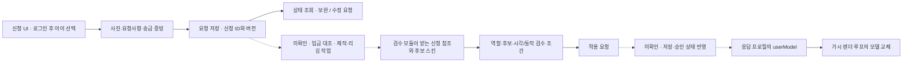
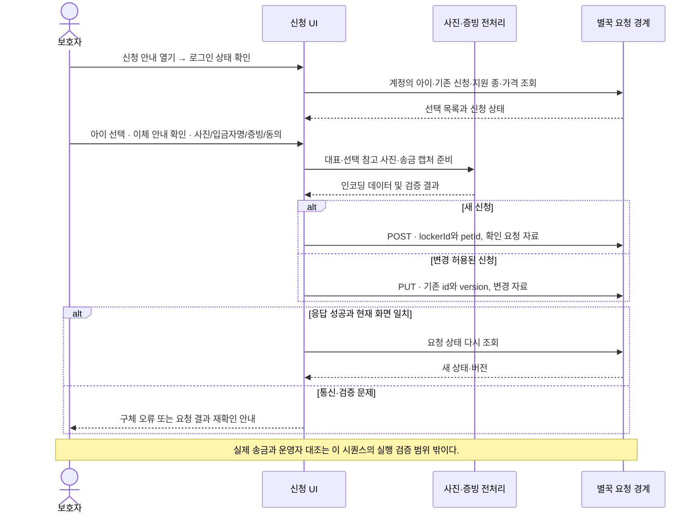
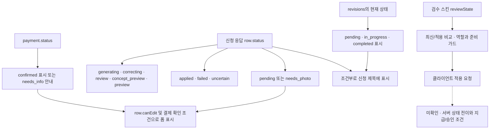
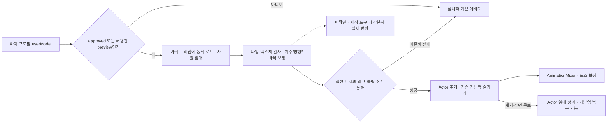

# 맞춤 3D 제작 신청·검수·승인·적용

확인일 **2026-11-25 (한국시간)** · 9차 · [별꾹 공개 웹](https://starkkuk.com/)

**제작 신청과 활성 모델은 다른 상태 객체다.** 신청서는 추모함·반려동물 키로 시작하고, 기존 신청의 수정에는 신청 ID·버전이 들어간다. 검수 UI에는 신청에 연결된 여러 스킨과 현재 적용·최신 여부가 표시된다. 일반 렌더는 반려동물 프로필의 `userModel`을 읽고, 그 모델이 표시 조건을 만족할 때만 기존 기본형 위에 붙인다.

기존 비로그인 관찰에서는 ‘우리아이 3D 신청’의 안내, 약 1~2일과 베타 조기 종료 가능성, 유료·수정 안내까지 확인했다. 이 단계에서 실제 신청, 영수증·사진 제출, 관리자 화면 실행, GLB 다운로드는 수행하지 않았다. 공개 홈의 색인 가능한 텍스트와 공개 자료에서 현재 실결제액은 찾지 못했다. 소스의 **12,900원은 기본값**이다. [이전 이용 흐름](../03_Service_Flow_Pricing.md) · [결제와 후원](Payment_Sponsorship.md)

## A. 제작 요청에서 모델 표시까지

실선은 클라이언트 코드에서 추적한 연결이다. 점선은 서버 내부를 읽을 수 없는 경계다. 한 POST의 성공이 모델 제작 완료나 실제 입금 성공을 의미하지 않는다.

## B. 신청·입금 확인 요청 시퀀스

## 핵심 함수와 입력 A–N

| 단계 | 함수·위치 | 입력 → 처리 → 반영 또는 실패 |
|---|---|---|
| A. 진입·자격 | [hud-menu.js](https://starkkuk-media.asdfstudio-cs.workers.dev/builds/0e5af2d2eae1750b3f989600/hud-menu.js) 22~45행 · [app.js](https://starkkuk-media.asdfstudio-cs.workers.dev/builds/2300b2b383d429b089959a6f/app.js) 2847행 · [pet-model-request.js](https://starkkuk-media.asdfstudio-cs.workers.dev/builds/724d6a8dea87aaad1417f9f4/pet-model-request.js) 16~22·54~67·123~126행 | 앱은 `enabled:true, existingOnly:false`로 초기화한다. `open()`은 일반 메뉴를 닫고 새 dialog를 연 뒤 `accountReady`를 기다리며 비로그인이면 로그인 안내를 그린다. 컴포넌트 자체에 `existingOnly` 모드도 있다. 이 모드의 기존 신청 소유 필터는 앱에서 실제 넘긴 값과 구분한다. |
| B. 아이 선택 | [pet-model-request.js](https://starkkuk-media.asdfstudio-cs.workers.dev/builds/724d6a8dea87aaad1417f9f4/pet-model-request.js) 13·21~43·70~75·92~97행 | `petModelKey`는 `lockerId:petId`다. 응답의 `pets`에서 선택 키를 고른다. 하나만 있으면 자동 선택할 수 있다. 종 필터 `supportedSpecies`에 없는 경우 금액·제출 폼 대신 지원 불가 안내를 보여준다. 다른 보호자의 신청은 편집 가능하도록 표시되지 않을 수 있다. |
| C–E. 사진·검증·요청사항 | [pet-model-request.js](https://starkkuk-media.asdfstudio-cs.workers.dev/builds/724d6a8dea87aaad1417f9f4/pet-model-request.js) 76~83·99~120행 · [pet-model-reference-photos.js](https://starkkuk-media.asdfstudio-cs.workers.dev/builds/88c24b0a1f03efec708410d2/pet-model-reference-photos.js) 1~32행 | 대표 1장은 필수, 선택 참고 슬롯은 2개, 요청사항은 공백 제외 필수·폼 최대 1,000자다. 참고 슬롯의 이전 이미지 유지 `keep`, 제거 `null`, 새 인코딩 값은 서로 다르게 표현한다. 파일 변경 뒤 렌더 세대가 바뀌면 표시를 건너뛴다. 제출에서 미처 준비되지 않은 FileList를 다시 검사한다. |
| F–G. 가격·증빙·결제 표시 | [pet-model-request.js](https://starkkuk-media.asdfstudio-cs.workers.dev/builds/724d6a8dea87aaad1417f9f4/pet-model-request.js) 20·69~80·95·118~121행 · [support-receipt-input.mjs](https://starkkuk-media.asdfstudio-cs.workers.dev/builds/b07e38f2cfb63bedfcfa8125/support-receipt-input.mjs) 4~22행 | 기존 신청의 `payment.amount` → 서버에서 받은 `price` → 기본 12,900원 순으로 사용한다. 미확인 상태에서는 입금자명 최대 40자와 증빙, 외부 제작·공개 동의가 필요하다. 확인된 결제의 사진 보완에는 결제 필드를 다시 받지 않는다. 실제 이체가 이루어지는 결제창은 이 폼에서 확인되지 않았다. |
| H. 상태 조회 | [pet-model-request.js](https://starkkuk-media.asdfstudio-cs.workers.dev/builds/724d6a8dea87aaad1417f9f4/pet-model-request.js) 26~40·54·72~75·88·92~97행 | `load()`는 현재 계정·패널 세대를 잡고 신청 응답을 표시한다. `row.status`와 `payment.status`는 별개다. 상태 다시 보기·저장 직후 새로고침 코드가 있다. 신청 ID·버전이 달라진 초안을 폐기하고 사용자가 다른 아이를 고를 때에는 유효한 메모리 초안을 되살린다. |
| I–K. 외형·동작 검수, 적용 요청 | [milk-skin-review.js](https://starkkuk-media.asdfstudio-cs.workers.dev/builds/615fda2a30b8591a337453b7/milk-skin-review.js) 18~39·51~59·81~122행 · [app.js](https://starkkuk-media.asdfstudio-cs.workers.dev/builds/2300b2b383d429b089959a6f/app.js) 1801~1823행 | 서버가 연결해 준 신청 참조 `source.id`로 스킨을 묶는다. `source.applied`와 `source.latest`가 다른 경우 기존/신규 비교를 제공한다. 공개 코드는 산책/쓰다듬기 맥락의 역할 조건과 미리보기 준비도, 수동 확인 체크를 읽는다. 적용 명령은 선택 스킨과 신청 쪽 버전을 보낸다. 상세 서버 승인 절차는 미확인이다. |
| L. GLB 적용 | [app.js](https://starkkuk-media.asdfstudio-cs.workers.dev/builds/2300b2b383d429b089959a6f/app.js) 698~704·794~804·822~832·1827행 · [pet-avatar.js](https://starkkuk-media.asdfstudio-cs.workers.dev/builds/3445e8a7e6c22ced351a4a69/pet-avatar.js) 184~215행 | 해당 아이의 프로필에서 `userModel` 참조로 내려온다. 프로필·추모함 정보가 새로 들어오면 동행 객체를 재구성할 수 있다. 현재 화면이 적절한 순간 로더를 호출한다. 신청 다이얼로그의 상태 문자열에서 직접 모델 파일을 구성한다고 볼 근거는 없다. |
| M. 완성 모델 수정 | [pet-model-revision.js](https://starkkuk-media.asdfstudio-cs.workers.dev/builds/342bae9be0d1200b21b46ec9/pet-model-revision.js) 1~35행 · [pet-model-request.js](https://starkkuk-media.asdfstudio-cs.workers.dev/builds/724d6a8dea87aaad1417f9f4/pet-model-request.js) 38~40·82~83행 | `row.canRequestRevision`이 참이면 별도 수정 폼을 연다. 메시지는 필수이며 참고 사진은 선택이다. 신청 `id/version`을 붙여 수정 요청을 저장하고 다시 읽는다. 최신 수정 상태가 신청 표시 제목에 우선할 수 있다. |
| N. 모델 교체·복구 | [milk-skin-status.mjs](https://starkkuk-media.asdfstudio-cs.workers.dev/builds/027266a918d6943f45ecc744/milk-skin-status.mjs) 15~32행 · [milk-skin-review.js](https://starkkuk-media.asdfstudio-cs.workers.dev/builds/615fda2a30b8591a337453b7/milk-skin-review.js) 18~39·114~122행 · [pet-avatar.js](https://starkkuk-media.asdfstudio-cs.workers.dev/builds/3445e8a7e6c22ced351a4a69/pet-avatar.js) 188~215행 | 기존 적용 모델과 신규 미적용 후보를 보여 주는 경로가 있다. 승인 이후 새 프로필 참조가 도착해야 새 모델을 읽는다. 지연·실패·캐시 제외에는 절차적 기본형 표시가 남거나 복구된다. 이전 승인 GLB로 서버가 자동 롤백하는지는 미확인이다. |

**이미지 전처리.** 대표·참고·수정 사진은 `preparePhoto(file,{model:true})`에서 최대 입력 100 MiB, 긴 변 최대 2,048px, 인코딩 문자열 900,000자 범위를 적용한다. 신청 증빙은 `prepareSupportReceipt(file,{model:true})`로 입력 100 MiB, 긴 변 1,600px, 420,000자 한도를 사용한다. JPEG·PNG·WebP·HEIF 계열을 파일 헤더로 확인하며, 실제 디코드 지원은 브라우저에 달렸다. 증빙 처리기는 캔버스 출력의 해시도 반환하지만 맞춤 신청 경로는 `.image`를 사용한다. 증빙에 보이는 추가 개인정보를 가리라는 UI 설명은 확인했고 실제 보존기간과 외부 전달된 원본의 범위는 미확인이다. [photo-input.mjs 3~21행](https://starkkuk-media.asdfstudio-cs.workers.dev/builds/904f7c0ddf5b269cc8d5a851/photo-input.mjs) · [support-receipt-input.mjs 4~22행](https://starkkuk-media.asdfstudio-cs.workers.dev/builds/b07e38f2cfb63bedfcfa8125/support-receipt-input.mjs) · [pet-model-copy.mjs 29~32행](https://starkkuk-media.asdfstudio-cs.workers.dev/builds/a443b0eeaf6817eb5a6321b0/pet-model-copy.mjs)

## C. 코드에 나타나는 상태와 전환 조건

| 상태 층 | 확인한 값과 실제 분기 | 확인되지 않은 것 |
|---|---|---|
| 신청 `row.status` | 문구표의 `pending, needs_photo, generating, correcting, review, concept_preview, preview, applied, failed, uncertain`. 수정 가능 조건에 직접 쓰는 것은 주로 `pending/needs_photo`다. | 생성→보정→검수의 순서를 화면이 안내하지만 모든 서버 전이·재시도의 실제 그래프는 미확인이다. |
| 결제 `row.payment.status` | 비교식은 `confirmed` 및 `needs_info`를 직접 사용한다. 신청이 `pending`이고 결제 확인이 끝났으면 제목에 `confirmed` 문구를 쓸 수 있다. | 이체 대사, 환불과 주문 ID의 DB 관계, 증빙 도용·중복 결제 제거 방식 |
| 수정 `row.revisions[].status` | `pending, in_progress, completed` 문구와 이력 렌더. `row.canRequestRevision`이 버튼 조건이다. | 반려 시 회차 추가·수정 횟수 제한·추가 요금 |
| 검수 스킨 `reviewState` | `pending, applied, rejected, needs_review, old, original`을 라벨·필터에 사용한다. `all`은 필터다. 비교 후보에 별도 표시가 있다. | 운영자 승인·반려의 실제 이력과 검수 정책 |
| 모델 `descriptor.status` | 일반 `approved`, 허용된 미리보기의 `preview`가 렌더 조건이다. `avatar.customModelReady`와 `avatar.customModelError`는 로컬 로더 상태다. | 승인 시 서버가 갱신하는 테이블·처리 시각·기기별 전파 지연 |

[pet-model-copy.mjs 33~41행](https://starkkuk-media.asdfstudio-cs.workers.dev/builds/a443b0eeaf6817eb5a6321b0/pet-model-copy.mjs) · [pet-model-request.js 38~40·72~75행](https://starkkuk-media.asdfstudio-cs.workers.dev/builds/724d6a8dea87aaad1417f9f4/pet-model-request.js) · [milk-skin-status.mjs 1~32행](https://starkkuk-media.asdfstudio-cs.workers.dev/builds/027266a918d6943f45ecc744/milk-skin-status.mjs)

## D. 승인 모델의 로딩과 3D 적용

- **공급자 원본.** `custom-pet-avatar.js`에는 Tripo 원본의 색 맵 해상도를 유지한다는 주석과 `descriptor.providerOriginal===true` 분기가 있다. 원본 모드에서 보조 맵만 별도의 한도로 축소하며, 장면 검증은 텍스처의 최대 크기·자원 예산을 확인한다. 일반·군집 로드는 서로 다른 축소 정책을 쓸 수 있다. 외부 제작 서비스 전송과 결과 공개는 제작 동의 문구에 있다. 이 근거로 **Tripo 원본을 처리하는 클라이언트 경로**는 확인했으나, 모든 신청의 AI 생성·수작업·자동/수동 리깅 방식이나 공급자의 실운영 계약은 확인할 수 없다. [custom-pet-avatar.js 35~83·203~214행](https://starkkuk-media.asdfstudio-cs.workers.dev/builds/057d202915dcdedf4e952f7e/custom-pet-avatar.js) · [pet-model-copy.mjs 32행](https://starkkuk-media.asdfstudio-cs.workers.dev/builds/a443b0eeaf6817eb5a6321b0/pet-model-copy.mjs)
- **모델과 동작 검증.** `inspectRig`는 실제 스킨과 걷기 트랙에서 움직이는 뼈 조건, 머리 뼈나 상호작용 클립 등을 평가한다. `walkUrl`이 있으면 별도 에셋의 애니메이션 트랙을 합친다. Box3의 치수, 중심, 바닥 좌표와 `rotationY`로 표시 크기·방향을 정규화한다. 애니메이션의 시간·바닥 보정과 설정값 적용은 코드 자동 처리이며, 사람이 선택·검토·확정하는 UI와는 다른 단계다. idle·trot·pet·rest는 탐지 및 대체 분기가 있어 모든 클립을 무조건 요구한다고 볼 수 없다. [custom-pet-avatar.js 121~201·203~214행](https://starkkuk-media.asdfstudio-cs.workers.dev/builds/057d202915dcdedf4e952f7e/custom-pet-avatar.js) · [pet-motion-settings.mjs 2~24행](https://starkkuk-media.asdfstudio-cs.workers.dev/builds/4d89711d294b5863e59ea2e5/pet-motion-settings.mjs)
- **KTX2와 생동감.** 지원 확장을 확인하면 KTX2Loader를 조건부 로드하고, 적합한 에셋에서 압축판을 시도한 뒤 원래 로더로 복귀할 수 있다. `createPetLifelike`는 정책 함수의 조건에 따라 머리·몸 포즈의 미세 움직임을 추가한다. 정책에 승인·버전·비교 대상 분기가 있지만 개별 이용자의 식별자는 기록하지 않았다. [pet-model-textures.js 3~16행](https://starkkuk-media.asdfstudio-cs.workers.dev/builds/f0681877323a5639b914e43b/pet-model-textures.js) · [custom-pet-avatar.js 59~75행](https://starkkuk-media.asdfstudio-cs.workers.dev/builds/057d202915dcdedf4e952f7e/custom-pet-avatar.js) · [pet-lifelike.js 8·55~61행](https://starkkuk-media.asdfstudio-cs.workers.dev/builds/6bd905dcf58b329203753766/pet-lifelike.js) · [pet-lifelike-policy.mjs 103행](https://starkkuk-media.asdfstudio-cs.workers.dev/builds/9c4fb190811e25a83fdcba98/pet-lifelike-policy.mjs)
- **검수와 관련 모듈의 범위.** `milk-skin-formation.js`는 적용 스킨을 선별해 대열로 로드하고 상태·카메라를 갱신한다. `milk-formation-assets.js`는 일부 모델의 참조 매핑이며 작업자 원본 파일을 확보한 증거가 아니다. `pet-management-ui.js`의 날짜·프로필 폼·동물 제거 UI는 아이 등록의 보조 기능이다. 제작 신청 폼이나 품질 검수 UI는 위 별도 모듈에서 담당한다. [milk-skin-formation.js 4~17·23~69행](https://starkkuk-media.asdfstudio-cs.workers.dev/builds/1b2fea7fa9d3f38f80df6532/milk-skin-formation.js) · [milk-formation-assets.js 1행](https://starkkuk-media.asdfstudio-cs.workers.dev/builds/325c4b9fd48d143a2dde6fd0/milk-formation-assets.js) · [pet-management-ui.js 5~32행](https://starkkuk-media.asdfstudio-cs.workers.dev/builds/2e155a3e2c904bd70ef0d019/pet-management-ui.js)

**근거.** 신청·사진·수정 `ev_bf03d7aaa51a8ffb7ecefa534ded7854acdd5c2679ec687e7ac1cdf8598a8bb7`, 반려동물 관리·검수 `ev_67356fc1e8d868a6733aa917e8a4870a12471c482f1be793f13a47a3c411d216`, 모델 적용 `ev_ce465912a6ecb1a7e58670a1578001c0da3fd801edd9b239046bad2f74ee9ea3` 및 기존 [3D 캐릭터 분석](Pet_Character_Animation.md)을 사용했다. 변환·승인·파일 교체 성공률, 사람별 납기, 업로드·보관·삭제 정책의 실제 이행은 미확인이다.
