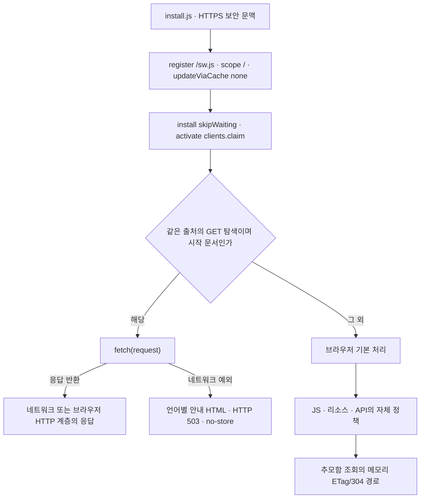
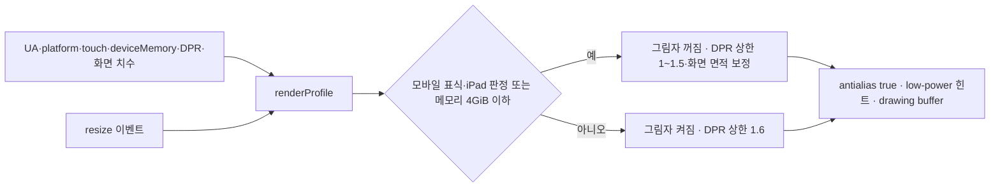
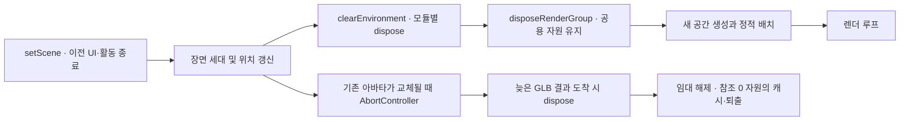

# 초기 로딩·캐시·3D 성능

확인일 2026-11-25 KST. 측정은 정상적인 공개 웹 시작 세션뿐이다. 코드가 설정한 상한, 관찰 도구가 셌던 이벤트, 일반적인 성능 효과를 독립적으로 기록했다. 모델·텍스처·이용자 데이터를 별도로 받지 않았다.

## 초기 배포와 두 종류의 로딩

| 구간 | 공개 증거 | 의미와 한계 |
|---|---|---|
| HTML → 부트 | `/boot.js?v=20261101-ios`가 현행 해시 URL로 302, 현행 `app.js`·manifest·CSS가 정상 응답했다. HTML의 ES Module/import map은 이전 공개 HTML 근거, 부트의 동적 import는 현행 소스 근거다. [boot.js](https://starkkuk-media.asdfstudio-cs.workers.dev/builds/1e41c00bd11390449702df86/boot.js) 36~49행, [1차 자료](../01_Tech_Stack.md). | 해시 형태의 빌드 URL로 모듈 버전을 참조한다. 각각의 CDN 응답이 무조건 immutable이라고 확정할 헤더 근거는 없다. |
| 앱 준비와 첫 렌더 | 모듈 정적 import가 선행하고, 초기 렌더러가 Canvas를 붙인다. `accountReady → initializeLockerAddress`가 장소와 로커 상태를 선택하고 첫 `renderer.render`, 프레임 예약, 로딩 제거 순서로 진행한다. 초기 라우팅은 다이얼로그와 지연 안내에도 영향을 받는다. [app.js](https://starkkuk-media.asdfstudio-cs.workers.dev/builds/badddc113c1ef830a03b6dd9/app.js) 532~564·1195~1208·2752행. | Canvas 가시 시간은 첫 표시 프레임 시각이나 LCP가 아니다. |
| 장면 전환 중 모듈·텍스처 로딩 | 메인 앱이 정적 모듈과 공유 지오메트리를 사용한다. 별자리·센터 등의 진입 기능에는 별도 동적 import가 있다. TextureLoader의 정적 이미지, 오디오 모듈, 선택된 모델의 바이너리가 각각 다른 준비 경로를 탄다. 앱 시작에 모든 환경 자산이 포함된다고 볼 수 없다. [app.js](https://starkkuk-media.asdfstudio-cs.workers.dev/builds/badddc113c1ef830a03b6dd9/app.js) 1282~1284·1922~1980·2797~2836행, [환경과 오디오](World_Environment.md). | URL 수는 모듈 수와 바이트 수 모두와 다르다. 공개 미디어 헤더 전수 조사와 인코딩별 크기 비교는 하지 않았다. |
| 보이는 맞춤 모델 | `buildPetAvatar`는 절차적 모델을 먼저 만든다. 승인된 참조와 가시성 조건에서 로더를 동적으로 부른다. 실패나 차단 시 기본형을 남기고 메모리 제한 일부 경우에는 다시 시도한다. 현재 클라이언트 본문에서 참조하는 맞춤 로더는 9차 흡수본과 다른 CDN URL이다. [pet-avatar.js](https://starkkuk-media.asdfstudio-cs.workers.dev/builds/a61b9ce5a1a1f3754dc842e6/pet-avatar.js) 184~215행, [custom-pet-avatar.js](https://starkkuk-media.asdfstudio-cs.workers.dev/builds/b8b364569998c23aa4780b9b/custom-pet-avatar.js) 98~118·203~216행, [빌드 정정](../Architecture/Corrections_Log.md). | 이 로더의 import 경로를 확인했다. 고객 GLB, 압축 대체 URL 응답, 모델별 납기와 화면의 품질은 관찰하지 않았다. |

## C. Service Worker와 캐시 처리

- **설치와 활성화.** `register`는 보안 문맥에서만 실행한다. `skipWaiting`과 `clients.claim`으로 새 워커가 빠르게 활성화·제어할 수 있는 코드다. 등록 오류는 잡아서 넘기며, 메시지 기반 새로고침·알림·사용자 트리거의 강제 reload를 이 두 파일에서 발견하지 않았다. `updateViaCache:'none'`은 워커 갱신 검사 설정이다. 현재 실행의 SW 스크립트 200은 요청 관찰이며 등록 객체·활성 컨트롤러는 미검증이다. [install.js](https://starkkuk-media.asdfstudio-cs.workers.dev/builds/04ac9ef5e12baa98fef30b13/install.js) 67~68행, [sw.js](https://starkkuk.com/sw.js) 1~6행.
- **탐색 조건.** 같은 출처 `GET`, `mode=navigate`, `/`·`/index.html` 또는 `/en/`·`/vi/`의 루트/인덱스만 이 처리기에 들어간다. `fetch(request)`가 reject 될 때만 재연결 안내 HTML을 503 및 `Cache-Control:no-store`로 생성한다. 일반 HTTP 오류 코드 응답 자체가 오프라인 폴백으로 바뀌는 분기는 확인되지 않는다. 기타 요청에 `respondWith`를 호출하지 않는다. [sw.js](https://starkkuk.com/sw.js) 4~9행.
- **Cache Storage와 HTTP 캐시.** 현재 워커는 `caches.open`·`put`·`keys/delete`·precache 및 캐시 이름/버전 관리가 없다. 워커 코드의 정책은 시작 문서 네트워크 시도와 오류 안내까지다. 앱 JS·사진·개인 API를 저장하는 오프라인 전용 Cache Storage 경로는 이 워커에서 확인되지 않는다. 이 동작은 브라우저 HTTP 캐시나 CDN 저장 정책, 애플리케이션의 메모리 캐시와 독립이다. [sw.js](https://starkkuk.com/sw.js) 1~10행, [런타임 키의 경계](Privacy_Data_Lifecycle.md).
- **ETag와 304.** 현행 `locker-feed.js`는 메모리 `views`를 관·뷰별로 저장하고, 값이 있으면 `If-None-Match`를 붙인다. `cache:'no-store'` 요청에서도 앱이 직접 조건부 값을 붙인 경우 서버가 304를 줄 수 있다. 304이면 메모리 본문을 재사용하고, 공개 델타 해석 실패 시 조건 없는 스냅샷으로 다시 읽는 분기가 있다. 계정·관·상세 캐시의 무효화가 따로 있다. 이번 실행의 특정 응답을 304로 귀속하거나 반복 새로고침을 통한 오프라인 검증은 하지 않았다. [locker-feed.js](https://starkkuk-media.asdfstudio-cs.workers.dev/builds/59f6a087dbd27f69d544cc4e/locker-feed.js) 8~35행.
- **압축·크기.** 에셋 전송 압축, 미디어 콘테이너, GPU 압축 텍스처는 측정 단위가 다르다. GLB를 스트림으로 읽을 때 `Content-Length`와 누적 수신 버퍼를 모두 확인한다. `petTextureLoader`의 KTX2는 지원 확장 검사와 GPU용 로더의 동적 import를 따르고, 적합한 참조에서 압축판 우선 시도 및 실패 시 일반 로딩을 제공한다. 이 선택의 실제 전송량, 디코딩 시간과 GPU 절감량은 측정하지 않았다. [custom-pet-avatar.js](https://starkkuk-media.asdfstudio-cs.workers.dev/builds/b8b364569998c23aa4780b9b/custom-pet-avatar.js) 59~83행, [pet-model-textures.js](https://starkkuk-media.asdfstudio-cs.workers.dev/builds/bbc9c8fcbb822e9b279892d2/pet-model-textures.js) 3~16행.

## D. 화면 조건과 렌더링 설정

`renderProfile`은 CSS의 폭만으로 모바일을 판단하지 않는다. 모바일 상한은 `max(1,min(1.5,sqrt(1500000/(width*height))))`, 실제 DPR은 기기 입력과 상한의 작은 값이다. 넓은 고밀도 화면에서 픽셀 수가 커지는 속도를 줄이되, 150만을 엄격한 전체 버퍼 상한으로 해석할 수는 없다. 생성 시 `antialias:true`, `alpha:false`, GPU 힌트 `low-power`를 사용한다. 비모바일 초기 그림자는 PCFSoft이며 sRGB 출력, ACES 필믹 톤 매핑과 노출 0.95가 설정된다. 리사이즈에서 카메라와 렌더 버퍼를 다시 계산하며 현재 GPU 선택·그림자 활성 결과는 실측하지 않았다. [render-profile.mjs](https://starkkuk-media.asdfstudio-cs.workers.dev/builds/cd18146b6d19e993d020232f/render-profile.mjs) 1~6행, [app.js](https://starkkuk-media.asdfstudio-cs.workers.dev/builds/badddc113c1ef830a03b6dd9/app.js) 1195~1212·2528~2530행.

| 최적화 조건 A | 코드 증거 | 일반적 효과 C |
|---|---|---|
| 정적 배치 및 InstancedMesh | `batchStatic`이 같은 자원·셀의 호환 정적 Mesh를 묶고 움직이거나 숨겨진 대상·일부 속성을 제외한다. 공간별 셀 크기를 조정하며 공유 geometry/material을 재사용한다. [static-batch.js](https://starkkuk-media.asdfstudio-cs.workers.dev/builds/29617a6f29e55d9c6b62567d/static-batch.js) 3~48행, [app.js](https://starkkuk-media.asdfstudio-cs.workers.dev/builds/badddc113c1ef830a03b6dd9/app.js) 1516~1544·1792행. | 개별 오브젝트의 드로 콜을 줄일 수 있다. 셀의 크기에 따라 한 번에 컬링되는 범위가 달라진다. |
| 프러스텀·거리·원격 표시 제한 | 동행 모델 후보를 거리순으로 선별하고 일부 공간에서 원격 반려동물 표시를 최대 12개로 제한한다. 카메라 프러스텀과 구를 비교하며 원거리 원격 반려동물의 포즈 업데이트는 24 유닛 너머에서 1/15초 기준으로 구분한다. 접속 사용자 목록의 정렬·제한은 별도다. [pet-companions.js](https://starkkuk-media.asdfstudio-cs.workers.dev/builds/5fe19a95f540ae4cd25ee8ec/pet-companions.js) 142~163·241~242행, [presence.js](https://starkkuk-media.asdfstudio-cs.workers.dev/builds/59d9f0b49f2ec6ffd1900960/presence.js) 156~158행. | 애니메이션 계산·렌더·모델 로딩을 줄일 수 있다. 전 씬에 공통 12명 제한이나 실측 15fps를 뜻하지 않는다. |
| 렌더 자원 임대·예산 | 로더가 최대 64 MiB 모델 입력, 6만 삼각형·24 재질·160 본, 4,096 텍스처 변을 코드에서 검사한다. 사용 중 모델에 참조를 붙이며 우선순위에 따라 추산 메모리 256/384 MiB 총 풀 제한, 미사용 정리와 필요시 낮은 우선순위 축출을 사용한다. 공유 대기 작업은 마지막 관찰자가 떠날 때 취소할 수 있다. [custom-pet-avatar.js](https://starkkuk-media.asdfstudio-cs.workers.dev/builds/b8b364569998c23aa4780b9b/custom-pet-avatar.js) 9~11·64~118·203~216행. | 경합 중 중복 파싱·과도한 자원 사용을 낮출 수 있다. 수치는 계산 기준이며 실제 GPU 점유량이 아니다. |
| 자원 계층마다 정리 | `disposeRenderGroup`은 공간 소유 자원과 공용 geometry/material을 구분하고, 장면별 dispose는 동적 오브젝트·인터랙션 UI를 정리한다. 모델 액터의 dispose는 mixer, cloned skeleton, 임대 해제를 거친다. 공유 GLB 자원은 마지막 사용 후 예산·캐시 조건에서 해제된다. [app.js](https://starkkuk-media.asdfstudio-cs.workers.dev/builds/badddc113c1ef830a03b6dd9/app.js) 1382~1394행, [custom-pet-avatar.js](https://starkkuk-media.asdfstudio-cs.workers.dev/builds/b8b364569998c23aa4780b9b/custom-pet-avatar.js) 19~23·90~119·194~216행, [pet-avatar.js](https://starkkuk-media.asdfstudio-cs.workers.dev/builds/a61b9ce5a1a1f3754dc842e6/pet-avatar.js) 198~215행. | 기존 씬을 떼는 것과 모든 GPU 자원 삭제의 시점은 다를 수 있다. |

## E. 장면 전환과 GPU 자원 정리

`setScene`은 촬영·활동·선물 UI를 닫고 공간별 렌더 리소스를 재구성한다. 앱 공용 리소스까지 일괄 해제하지는 않는다. 같은 아바타가 다음 공간에 재사용될 수도 있어, 장면 전환만으로 모든 로더 요청이 취소된다고 단정할 수 없다. [app.js](https://starkkuk-media.asdfstudio-cs.workers.dev/builds/badddc113c1ef830a03b6dd9/app.js) 1382~1394·1828·1922~1982행, [pet-avatar.js](https://starkkuk-media.asdfstudio-cs.workers.dev/builds/a61b9ce5a1a1f3754dc842e6/pet-avatar.js) 188~215행.

## 관찰 수치 B

| 공개 접속 1회씩 | 시작 단계 시간 | Canvas 대기 단계 | 전체 관찰 창 요청 이벤트 |
|---|---:|---:|---:|
| 1280×720, DPR 1 | 2,385 ms | 4,154 ms | 444 · 종료 440 · 미완료 4 |
| 390×844, DPR 3 | 2,391 ms | 4,189 ms | 450 · 종료 448 · 미완료 2 |

REA의 각 단계 시간이다. 관찰 창에는 리다이렉트와 후속 UI 시도 및 정상 페이지의 네트워크 활동이 포함된다. 좁은 화면 추가 실행에서 로딩 레이어 제거까지의 **대기 단계**는 6,201ms였다. Chrome/Chromium 158.0.8127.88, Windows에서 실행한 헤드리스 격리 세션, 신규 브라우저 프로필, 대역폭 조절 없음, 기존 사용자 캐시 사용 없음. 서버·CDN 캐시와 네트워크 상태는 통제하지 않았다. 이 수치로 모바일과 데스크톱의 속도 차이를 결론 내리지 않는다. 전송량·압축률·FPS·GPU 메모리·드로 콜의 실제 수치는 미측정이다. [실행 증거 ID](../Architecture/10_Module_Coverage.md).
