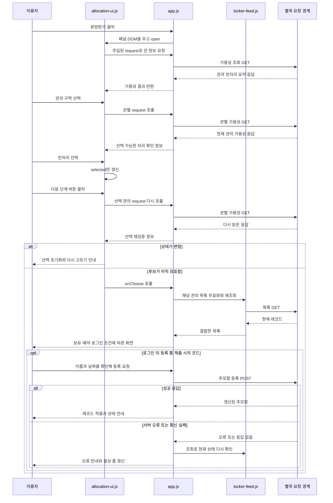
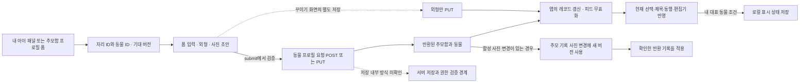
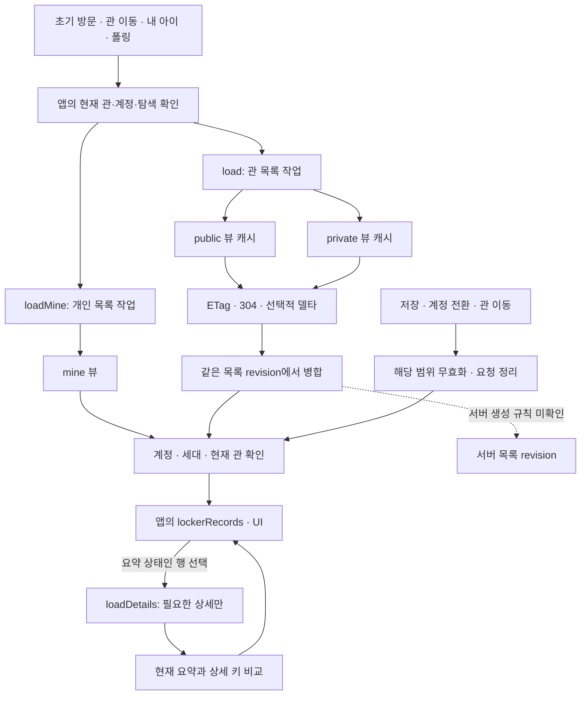

# 별꾹 추모함 배정·목록 조회·캐시

확인일은 2026년 11월 23일 KST다. [별꾹 공개 웹](https://starkkuk.com/)의 비로그인 관·구역 화면과 REA에 확보된 공개 코드를 바탕으로 분석했다. 이 시스템을 읽을 때는 **빈자리 표시**, **선택한 자리 재확인**, **등록 요청**, **갱신된 목록이 현재 화면에 유효한지 판단**을 차례로 구분해야 한다.

기존 브라우저 조사에서 관 목록과 관을 연 다음의 구역·빈자리 안내를 확인했다. 클릭을 통한 자리 확정 및 등록 폼 제출은 실행하지 않았다. 처음 페이지 방문 도중에는 `GET /api/lockers` 2건을 확인했다. 아래 시퀀스에서 등록과 갈등 해결 부분은 **코드 확인**이다. 서버의 잠금·트랜잭션·권한 검증·스키마는 **확인 불가**다.

## 1. 자리 탐색과 배정 시퀀스

  
시퀀스의 상반부 중 관·구역이 열리는 화면까지 관찰했다. 화살표는 코드에서 선언된 호출이며 다음 단계·제출·응답 분기는 실행 관찰이 아니다. 가용성 읽기는 앱에서 주입한 `request`를 경유한다.

### 탐색과 신청의 실제 함수 연결

1. **분양 버튼 → 공통 패널.** `#allocation-launcher`의 클릭이 `openPanel('allocation')`을 부른다. `renderPanel`은 패널 본문을 `allocationPicker.open(body)`에 준다. `open`은 DOM 참조를 저장하고 `load(hall)`을 호출한다. 초기 `hall`은 null로 관 목록을 뜻한다. [app.js](https://starkkuk-media.asdfstudio-cs.workers.dev/builds/2300b2b383d429b089959a6f/app.js) 2089~2097·2629~2633행, [allocation-ui.js](https://starkkuk-media.asdfstudio-cs.workers.dev/builds/1b90e0457106e26665d40d1b/allocation-ui.js) 22~30·86~90행.
2. **관·구역·자리 선택 → 화면용 선택값.** 컨테이너에 붙인 클릭 핸들러는 `event.target.closest('button')`으로 자식 아이콘 클릭도 버튼으로 해석한다. `data-hall` 버튼은 새 가용성 조회를 일으킨다. 구역의 `change`는 선택을 지우고 다시 그린다. `data-seat` 선택 자체는 `selected`를 바꾸고 포커스를 되돌릴 뿐이다. [allocation-ui.js](https://starkkuk-media.asdfstudio-cs.workers.dev/builds/1b90e0457106e26665d40d1b/allocation-ui.js) 38~56·75~84행.
3. **다음 단계 → 가용성 재확인.** `choose()`는 로딩 중·진행 중·미선택·사용 불가를 먼저 확인한다. 현재 선택값과 세대 번호를 잡고 같은 관의 가용성을 다시 읽는다. 사이에 닫거나 다른 화면을 열었다면 응답을 쓰지 않는다. 선택이 사라지거나 분양을 잠시 쉬는 상태면 다음 단계로 가지 않는다. 여전히 유효한 경우에만 주입된 `onChoose(id)`를 기다린다. [allocation-ui.js](https://starkkuk-media.asdfstudio-cs.workers.dev/builds/1b90e0457106e26665d40d1b/allocation-ui.js) 28~56행.
4. **앱의 선택 확인 → 등록 준비.** `chooseAllocation(id)`는 현재 패널인지 확인하고 해당 관의 목록을 새로 읽는다. 그 사이 이동한 사용자를 이전 화면으로 되돌리지 않도록 `lockerNavigation`을 비교한다. 일반 분양 픽커 경로에서 이미 내 자리가 있으면 내 사물함 목록으로 보낸다. 기존 레코드·예약·VIP 등 선택 제한을 확인한 뒤 `allocationClaim`을 놓고 `selectNiche`를 호출한다. 이 가드와 등록 폼에 보이는 관별·특수 자리·최대 개수 조건은 서로 다른 진입 분기에서 평가된다. 전 계정의 최종 분양 가능 횟수는 이 한 분기에서 일반화할 수 없다. [app.js](https://starkkuk-media.asdfstudio-cs.workers.dev/builds/2300b2b383d429b089959a6f/app.js) 616~634·2037·2103~2115행.
5. **선택된 자리 → 방문/등록/로그인 분기.** `selectNiche(id, claim=true)`는 필요한 목록과 상세 데이터를 준비한 다음 `selectedNiche`와 `selectedPetId='primary'`를 바꾼다. 사진·기록 세대와 이전 기록·선물 선택을 초기화하고 상세 장면으로 전환한다. 이미 등록된 자리는 기록 로딩, 조건을 만족하는 빈자리는 등록 패널, 게스트는 로그인 안내로 이어진다. 공유 주소에서 `claim=false`로 열 때 방문과 분양 시도를 분리한다. 분양 픽커를 쓴 권한과 특별 자리 분기는 소스에서 확인했으나, 해당 전용 화면에 진입하지 않았다. [app.js](https://starkkuk-media.asdfstudio-cs.workers.dev/builds/2300b2b383d429b089959a6f/app.js) 516~554·754~760행.
6. **폼 제출 → 실제 배정 요청.** `submit` 핸들러가 기본 제출을 막고 이름 입력과 날짜 관계를 검사한다. `claimLocker`는 중복 조작을 막는 `placementBusy`를 세운 뒤 `lockerRequest('POST', data)`를 사용한다. 응답이 성공하면 반환 행과 조건부 소유 참조를 앱 상태에 적용한다. 그 뒤 `selectNiche(id)`를 다시 호출하지만 이 호출을 `await`하지는 않는다. 성공 안내 시점과 후속 상세 화면 조회가 끝나는 시점은 같다고 할 수 없다. 실패 시 쓰기 재시도 대신 목록을 읽고 활성 패널과 메시지를 갱신한다. [app.js](https://starkkuk-media.asdfstudio-cs.workers.dev/builds/2300b2b383d429b089959a6f/app.js) 764·838·2093~2115행.

### 배정 관련 함수의 계약

| 파일·함수·위치 | 입력 → 반환 또는 결과 | 순서와 오류 |
|---|---|---|
| allocation 22~30·86~90행 `createAllocationPicker` | `{request,onChoose,onError,mode}` → `open/reset/close` | 관, 구역, 선택, 세대와 오류 상태를 클로저에 보관한다. 앱이 조회와 선택 결과 처리 방식을 주입한다. 닫기와 초기화는 세대를 증가시킨다. |
| allocation 28~36행 `accept(data,nextHall)` | 응답과 관 → 일반적으로 undefined | 배열 형태와 관 일치를 확인한 뒤 허용된 관을 추리고 사용 불가 자리의 Set을 만든다. 선택이 더 이상 유효하지 않으면 비운다. 응답 모양이 기대와 다르면 throw 한다. |
| allocation 38~56행 `load(nextHall)`, `choose()` | 관 또는 현재 선택 → 작업 완료 Promise | load는 선택을 초기화한 후 조회하고 choose는 기존 선택을 다시 확인한다. 둘 모두 현재 세대의 응답만 반영한다. 오류는 패널 상태에 저장한다. choose 오류는 `onError`도 호출한다. |
| app 608~614행 `allocationRequest(hall)` | null 또는 관 → `Promise<가용성 응답>` | 일반/관별 GET, JSON 읽기, 8초 timeout과 HTTP 성공 여부 검사. 호출한 UI가 오류를 처리한다. |
| app 616~634행 `chooseAllocation(id)` | 자리 ID → 완료 Promise 또는 예외 | 패널 종류, 관 목록 갱신, 이미 보유한 자리·경합·예약을 확인하고 선택 화면으로 연결한다. 상태 변화로 이탈한 경우 조기 반환할 수 있다. |
| app 760행 `selectNiche(id,claim)` | 자리와 등록 진입 플래그 → 유효 경로의 탐색 번호 또는 조기 반환 Promise | 범위 확인, 필요시 읽기, 레이스 및 예약 확인, 선택·상세 장면 전환. 상세 읽기 실패는 토스트와 반환으로 처리한다. |
| app 764·838행 `lockerRequest`, `claimLocker` | 메서드·요청 데이터, 자리 또는 프로필 → 응답 Promise / 완료 Promise | GET은 피드 읽기다. 쓰기는 요청 전후 피드 무효화, 상태 검사, 401 계정창. claim은 반환 레코드로 상태를 바꾸고 실패하면 읽기로 회복한다. |

**경쟁 상황 해석.** 같은 자리를 다른 이용자가 먼저 잡으면 사전 재조회 또는 등록 요청 이후 오류로 드러날 수 있다. `renderPanel`은 선택한 대상에 편집권 없는 레코드가 생겼을 때 다른 자리 고르기를 제안한다. 클라이언트의 순서상 가용성 확인은 좌석 잠금의 증거가 아니며, 중복 신청의 실제 HTTP 상태나 서버의 원자적 처리 방식은 미확인이다. [allocation-ui.js](https://starkkuk-media.asdfstudio-cs.workers.dev/builds/1b90e0457106e26665d40d1b/allocation-ui.js) 28~55행, [app.js](https://starkkuk-media.asdfstudio-cs.workers.dev/builds/2300b2b383d429b089959a6f/app.js) 630·838·2103행.

## 2. 반려동물 등록 데이터 흐름

  
`pet-profile-ui`의 폼은 대상·버전을 캡처하고 성공 응답의 `locker`와 `pet`을 앱에 전달한다. 사진을 바꾼 경우 프로필 성공 후 추가 요청이 있다. 그림의 `활성 사진 변경`은 제출 시점의 `photoChanged`를 뜻한다. 첫 요청과 사진 요청을 통합해서 성공으로 처리하는 증거는 없다. `appearance` 저장은 독립 PUT이고 기본 등록 요청과 페이로드가 다르다. [pet-profile-ui.js](https://starkkuk-media.asdfstudio-cs.workers.dev/builds/3a3f10267566a34e124eacc2/pet-profile-ui.js) 38~63행, [app.js](https://starkkuk-media.asdfstudio-cs.workers.dev/builds/2300b2b383d429b089959a6f/app.js) 854~908·2071~2087·2211~2215행.

| 키 | 역할 |
|---|---|
| `id` | 자리 식별자. 관·구역·자리 선택으로 얻는다. |
| `petId` | 자리 안 동물의 식별자. 대표 동물 `primary`와 추가 동물 구분. |
| `allocation` | 동일 자리의 현재 배정 건을 가리키는 응답 필드. 이전 권한이나 사진·포즈 캐시 정리에 사용한다. |
| `version` / `lockerVersion` | 대표 또는 추가 동물 및 추모함의 버전 참조. 개별 요청마다 포함하는 필드가 다르다. 서버 저장소 자료형이나 원자성은 미확인이다. |
| `profile` | 이름·날짜 등 상위 필드와 별개로 종·색·귀·무늬·크기 등 표시 옵션을 보낸다. 세부 편집기의 PUT에는 `profile.appearance`가 있다. |
| `mine` / `editable` / `movable` | 특정 자리의 클라이언트 표시와 동작 조건. 목록의 상위 `mine` 및 `mineIds`는 행의 boolean과 구분한다. |

실패한 반려동물 저장의 경우 프로필 패널은 현재 세대에 메시지를 표시하고 버튼 잠금을 푼다. 별도의 앱 저장 경로는 피드를 무효화하고 목록을 다시 읽는다. 저장 지연 중 화면이 바뀌어도 해당 응답을 새로운 폼에 그리는 조건은 충족되지 않는다. [계정과 프로필 분석](Authentication_Profiles.md)

## 3. 목록·상세 캐시 구조

  
세 종류 번호의 역할은 서로 다르다. **목록 revision**은 공개·개인 목록을 동일한 스냅샷으로 합칠 수 있는지 확인한다. **ETag**는 같은 뷰의 HTTP 캐시 확인에 쓰인다. **generation과 navigation**은 각각 피드와 앱에 있는 로컬 번호로, 화면과 계정이 달라졌을 때 응답이 아직 유효한지 확인한다. 동물·자리의 `version`은 행도 그대로인지 판단하거나 쓰기 요청의 기대 버전으로 사용하는 별도 값이다. [locker-feed.js](https://starkkuk-media.asdfstudio-cs.workers.dev/builds/f3f2bdc9099ea5ec46fbdbe8/locker-feed.js) 8~32·63~71행, [app.js](https://starkkuk-media.asdfstudio-cs.workers.dev/builds/2300b2b383d429b089959a6f/app.js) 808~834·876행.

### 조회와 갱신의 주요 함수

| 함수·코드 위치 | 입력 → 반환 | 처리 순서 |
|---|---|---|
| `createLockerFeed/getAccountKey/current`, feed 8~18행, app 416행 | 계정 조회 콜백과 오류·상세 전달 콜백 → 피드 API 객체 | 앱은 게스트 또는 계정 요청 상태에서 얻는 키를 공급한다. 피드는 요청 시작 때의 세대와 키를 현재와 비교한다. 키의 실값과 서버 세션 구현은 분석 대상에 포함하지 않았다. |
| `invalidate/setHall/isCurrent`, feed 13~18·93행 | 이벤트, 관 번호 또는 반환 객체 → 캐시 갱신 또는 판정 | invalidate는 세대 증가, 진행 중 목록 중지, 개인 캐시와 상세·마지막 결과 정리를 수행한다. 공개 뷰의 캐시 전체를 지우지 않는다. setHall은 관이 달라지면 목록 요청 수명과 적용 결과를 정리한다. isCurrent는 WeakMap에 기록한 결과 객체의 세대, 관, 계정 키를 검사한다. |
| `read(view,controller,id,key,hall)`, feed 19~32행 | 뷰, 중단 제어, 식별 값 → `Promise<{data,revision,etag}>` | cache:no-store로 보내면서 자체 Map의 ETag를 조건부 요청에 사용한다. 304에는 이전 객체를 재사용한다. 공개 뷰는 델타를 요청할 수 있다. 401은 앱 콜백이 로그인 상태 재조회와 안내를 담당한다. 파싱·유효성·세대 검사 실패는 예외가 된다. |
| `loadMine()`, feed 34~51행 | 현재 계정·관 → 개인 데이터 결과 Promise | 이미 시작한 동일 개인 작업은 같은 Promise를 돌려준다. 새 개인 조회는 기존 전체 목록보다 우선한다. 타임아웃 없는 일시 오류는 한 번 더 시도할 수 있다. 성공할 때는 목록 revision이 필요하다. |
| `load(hall)`, feed 53~77행 | 관 → 합성한 목록 Promise | 개인 작업이 먼저 진행 중이면 끝난 뒤 다시 판단한다. 같은 목록 작업은 Promise를 공유한다. `Promise.all`로 공개·개인 뷰를 함께 읽고 목록 revision이 같을 때만 병합한다. 동일한 참조의 스냅샷이면 마지막 결과를 돌려줄 수 있다. 오류 시 중지를 시도하고, 세대가 바뀌지 않은 경우 제한된 한 번의 재시도가 있다. |
| `applySnapshotDelta(previous,next,etag,field)`, delta 1~11행 | 기존 스냅샷·새 응답·기준 ETag·목록 키 → 응답 또는 새 결합 객체 | 델타 표식이 없으면 그대로 반환한다. 기준 ETag, 삭제·추가/갱신 목록, 선택 순서를 확인한다. Map에 삭제와 추가 반영을 한 새 결과를 구성한다. 잘못된 델타는 예외가 되고, 피드가 해당 캐시를 지워 다음 성공 조회에서 전체 스냅샷을 받을 수 있게 한다. |
| `loadDetails(ids)`, feed 79~91행 · summary 1~5행 | 자리 ID 배열 → `Promise<채택된 상세 행 배열>` | 요약 상태인 중복 없는 항목 최대 64개를 요청한다. 같은 관과 ID 집합의 작업은 공유한다. 현재의 요약과 응답 상세에서 만든 요약 키가 맞을 때만 적용한다. 확인한 상세 캐시는 768개 상한이다. 세대와 관이 다르면 이전 응답을 무시하거나 예외로 처리한다. |
| `refreshOwnedLockers()/refreshLockers(...)`, app 784~836행 | 현재 계정 또는 관·탐색 정보 → `Promise<boolean>` | 내 목록 갱신은 개인 행을 합성하고 사라진 권한과 배정을 정리한다. 전체 갱신은 유효한 결과를 화면 상태에 적용한다. 같은 결과, 다른 관으로 이동한 응답 등은 생략한다. 실패 시 기존 화면이 여전히 유효한 백그라운드 갱신이면 알림을 줄이는 경로가 있다. |
| `applyLockerDetails(rows,hall)`, app 1547~1555행 | 채택된 상세 행과 관 → 앱 상태·보이는 셀 부분 반영 | 현재 피드 관에 속할 때 레코드와 셀을 바꾼다. 현재 추모함의 상세가 바뀌면 선물 배치도 다시 읽는다. |
| `createLockerPoll({refresh,canRefresh})`, poll 1~20행, app 2659행 | 갱신과 허용 조건 함수 → `dispose` | 평소 15초 지연으로 타이머를 예약한다. 오류가 연속되면 다음 지연의 기본값을 늘리고 짧은 무작위 지연을 더한다. 진행 중, 숨김, 페이지 이탈에서는 새로 예약하지 않는다. 앱은 움직임·오버레이·준비 상태 등으로 시점을 제한한다. 실측 요청 빈도는 아니다. |

### 다른 화면으로 이동했을 때

- `setScene`은 관·탐색 참조를 바꾸고, 주소 초기화 뒤 새 장면의 관 데이터가 필요한 경우 목록을 다시 요청한다. 같은 관에 남았다고 해서 항상 새 네트워크 요청을 보내지는 않는다.
- 뒤로 가기 `popstate`는 `openLockerAddress`와 `selectNiche`를 통해 현재 주소의 목적지를 복원한다. 명시적 공유 주소는 방문으로 열 수 있고, 회원 로그인 복귀 의도와 의미가 다르다.
- ‘우리 아이’ 패널 재진입은 `refreshOwnedLockers` 연결을 사용한다. 사물함 목록의 새로고침 버튼은 `refreshLockers` 후 아직 그 패널이면 다시 그린다. 날짜가 오래된 요청을 무시하는 것과 네트워크 자체를 중지하는 것은 별개다.
- 기존 `mine` 행이 사라지거나 배정이 달라지면 `resetLockerState`가 관련 로컬·사진 상태를 정리한다. 해당 자리를 현재 보고 있을 때에는 기록, 선택, 패널을 초기화한다.

[app.js](https://starkkuk-media.asdfstudio-cs.workers.dev/builds/2300b2b383d429b089959a6f/app.js) 496~596·766~804·1921~2025·2071~2087·2167행.

## 4. 오류 처리와 사실 구분

| 상황 | 공개 코드의 UI 및 상태 결과 | 관찰 또는 확인 불가 |
|---|---|---|
| 게스트 또는 401 | 로그인 안내, 일부 목록 오류의 계정 상태 재조회. | 비로그인 UI 관찰. 로그인 왕복·다른 API의 실제 권한 응답은 미검증. |
| 빈자리 경쟁 | 읽기 결과로 선택 지우기, 이미 할당됐으면 다른 자리, 저장 실패 뒤 목록 갱신. | 중복 등록을 일으키지 않았다. 서버 경쟁 처리·잠금·상태 코드는 미확인. |
| 목록 revision 차이·잘못된 델타 | 합성 거부, 잘못된 캐시 항목 제거, 제한된 재조회와 안내. | 코드 확인. 초기 관찰에서 실제 304·델타의 왕복은 확인하지 않았다. |
| 관 이동이나 계정 전환 도중 응답 | 세대·관·계정 키가 어긋난 결과는 적용하지 않는다. 목록은 중단 요청을 보낼 수 있다. | 코드 확인. 이미 전송된 요청의 서버 실행이나 취소 성공까지는 알 수 없다. |
| 저장·로컬 저장 실패 | 폼 busy 해제 및 오류 표시, 앱의 목록 재조회 또는 로컬 저장 실패 안내. | 이전 프로필이 성공하고 사진만 실패할 수 있다. 서버가 무엇을 커밋했는지는 성공 응답을 확보하지 않았다. |

## 5. 근거 위치

| 공개 파일 | 코드 위치 |
|---|---|
| [allocation-ui.js](https://starkkuk-media.asdfstudio-cs.workers.dev/builds/1b90e0457106e26665d40d1b/allocation-ui.js) | 22~56·75~90행 |
| [app.js](https://starkkuk-media.asdfstudio-cs.workers.dev/builds/2300b2b383d429b089959a6f/app.js) | 402~424·496~606·608~634·694~706·754~838·854~908·1174·1547~1555·1921~2025·2071~2115·2167·2211~2215·2629~2635·2659행 |
| [locker-feed.js](https://starkkuk-media.asdfstudio-cs.workers.dev/builds/f3f2bdc9099ea5ec46fbdbe8/locker-feed.js) | 8~94행 |
| [locker-summary.mjs](https://starkkuk-media.asdfstudio-cs.workers.dev/builds/173badde4100b4933be1e0c6/locker-summary.mjs) | 1~5행 |
| [snapshot-delta.mjs](https://starkkuk-media.asdfstudio-cs.workers.dev/builds/09a385d34e94f5359f8f58f3/snapshot-delta.mjs) | 1~11행 |
| [locker-poll.js](https://starkkuk-media.asdfstudio-cs.workers.dev/builds/10de7f10ee12ae264f3bc477/locker-poll.js) | 1~20행 |
| [pet-profile-ui.js](https://starkkuk-media.asdfstudio-cs.workers.dev/builds/3a3f10267566a34e124eacc2/pet-profile-ui.js) | 38~64·69~76행 |
| [state.mjs](https://starkkuk-media.asdfstudio-cs.workers.dev/builds/5fa3b0edd438780bfc581b2a/state.mjs) · [channel-client.mjs](https://starkkuk-media.asdfstudio-cs.workers.dev/builds/9a4d2ac2d547be4a1f8aa637/channel-client.mjs) | 25~26·43~46행 · 6~27행 |

REA 초기 관찰 `ev_e8e4a74b0ad89f009cd896d4d38573ee8cb6e03418c2bdd911dda03a3f21cc28`, 앱 `ev_bf9168a52ef048976158750eba958a21a49ff8411b2fc03b095161b79a4089ed`, 분양 UI `ev_fb5cfa57e7fd4533a6c48abe7b588bd20fe97c3203b5376e7b3ed56a058454ff`, 피드 `ev_f06b2c128254f6a13fc1c9871b23d3abff7b67eee56dcb14a26b4f7152f82b78`, 요약·델타·폴링 `ev_b00e341ca3ae69c4648e6cf544c5529bae64e6137f9d998bc35873a6acb15e2c`를 참조했다. 추가로 확인한 파일은 기존 요청에서 발견한 공개 JavaScript이며, 이 분석에서 서비스의 API를 직접 호출하지 않았다.

[계정·소유권·프로필](Authentication_Profiles.md) · [독립 코드 교재](../Learning/Account_Locker_Code_Study.md) · [기존 데이터 흐름](../Architecture/Data_Flow.md)

