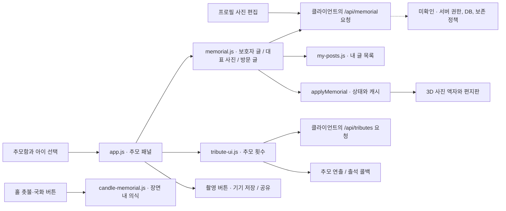
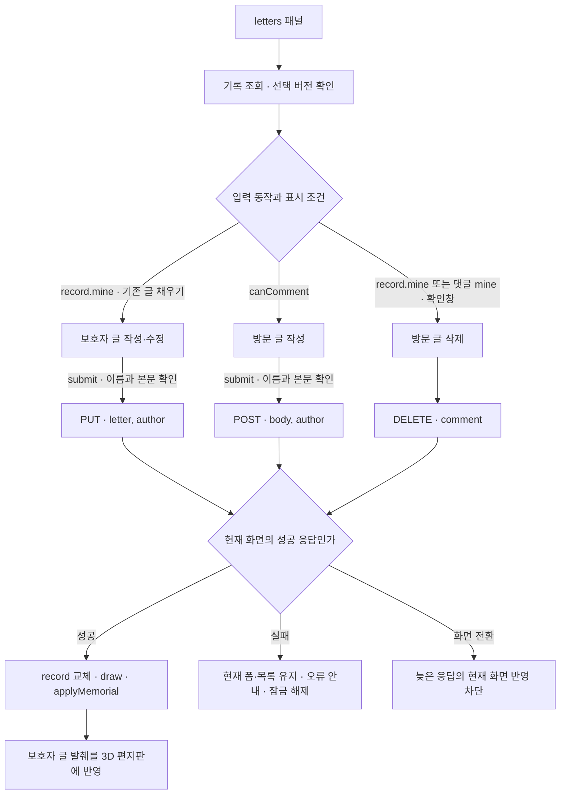
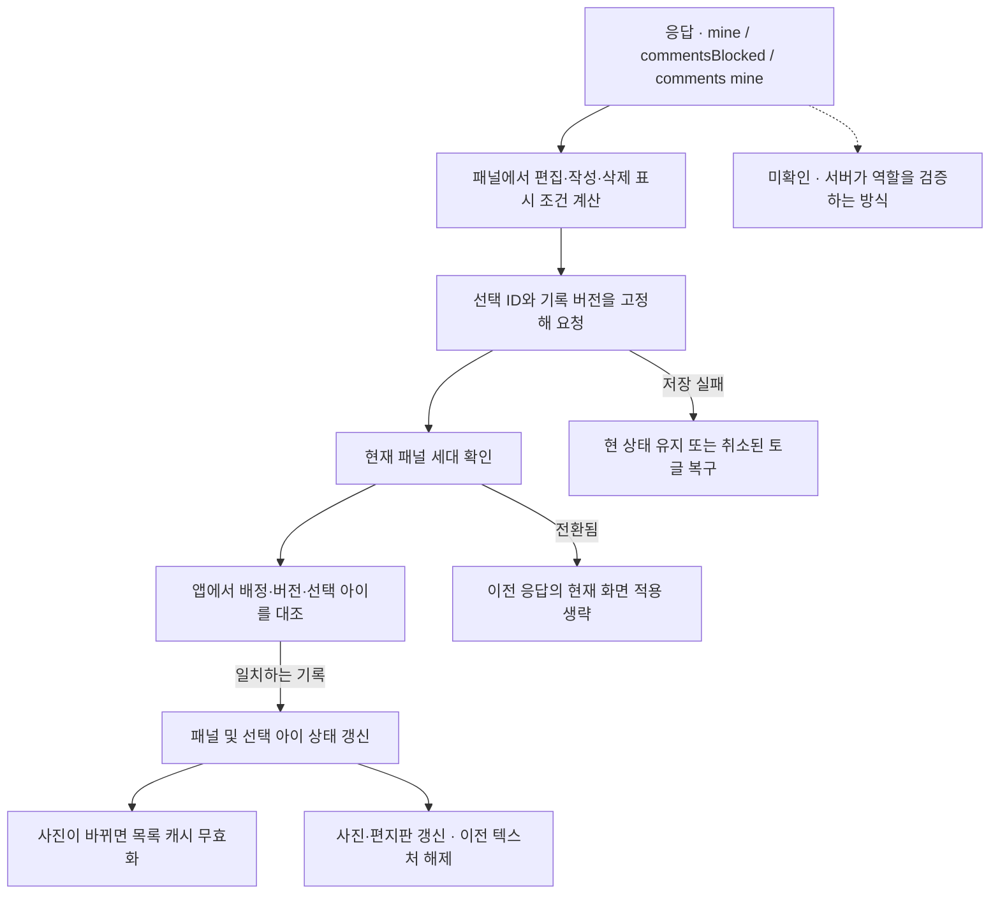

# 별꾹의 추모 기록·편지·방문 추모글

확인일 **2026-11-24 (한국시간)** · 범위 [별꾹 공개 웹 클라이언트](https://starkkuk.com/) · 6차 코드 학습

## 핵심 발견

- 추모함에서 선택한 아이의 기록에 대표 사진 하나, 보호자의 글 하나, 방문객 추모글 목록이 연결된다. 추모 피드의 사진 확대는 단일 이미지의 표시 크기를 바꾼다. 독립적인 사진 갤러리·편지함, 여러 사진 첨부, 편지 이력은 조사한 진입점과 데이터 모델에서 확인되지 않았다.
- 보호자의 글은 편집 전후의 같은 필드인 `record.letter`에 저장된다. 방문객 추모글은 `record.comments` 목록에 추가된다. 3D 공간의 편지판에는 보호자의 글에서 잘라낸 일부 줄이 그려진다.
- ‘추모하기’의 횟수 기록과 3D 추모 연출은 응답을 경계로 분리된다. 광장에서 쓰는 사진 게시물, 홀에서 수행하는 촛불·헌화 연출, 3D 공간 촬영도 각각 다른 코드 경로다.

## 근거 범위와 A–G 확인표

**화면 관찰**은 기존 비로그인 초기 캡처에 보이는 UI, **DOM 등록**은 초기 HTML에 존재했던 노드, **코드 확인**은 공개 빌드의 구현, **미확인**은 동작이나 서버 결과를 확인하지 못한 경우다. 초기 접근성 트리에서 ‘추모하기’ 그룹을 관찰했다. 등록·작성·변경·삭제·신고·촬영·공유의 완료 화면은 관찰하지 않았다. 기존 캡처와 아키텍처·계정·배정 보고서의 증거를 먼저 대조했다. [초기 화면 지도](../Architecture/Screen_Map.md) · [기존 모듈 인벤토리](../Architecture/Module_Inventory.md) · [계정·프로필](Authentication_Profiles.md) · [추모함 배정](Locker_Allocation.md)

| 구분 | 화면 관찰·DOM 등록 | 공개 코드 확인 | 미확인 |
|---|---|---|---|
| A. 반려동물 프로필 사진 | 이전 비로그인 화면의 계정 진입 조건 관찰. 프로필 안의 사진 편집은 미관찰 | 계정 내 프로필 편집기와 공간 프로필에 사진 선택·제거 경로가 있다. 대표 사진이 변경된다. | 인증 계정의 완료 UI와 가족별 실행 권한 |
| B. 추모 기록에 첨부되는 사진 | 추모 진입 버튼과 프리뷰 관련 DOM이 등록돼 있다. 상세 피드는 미관찰 | 피드에 단일 `record.photo`가 들어가며 사진 등록은 이 필드를 교체한다. 각 방문객 글에 별도 사진을 넣는 필드는 확인되지 않았다. | 한 게시물에 여러 장 첨부, 댓글 사진, 이전 사진 이력 |
| C. 추억 갤러리·사진 모음 | 독립 갤러리 메뉴는 기존 초기 관찰 범위에 없다. | 추모 피드 사진 확대, 가족 반려동물별 대표 사진, ‘내 글 보기’ 목록, 광장 사진 게시물은 별도 경로다. | 서비스 전체나 인증 후 영역의 독립 갤러리 |
| D. 보호자의 편지 | `#niche-write`, `#niche-letter-preview` 등록. 실제 편집기 미관찰 | ‘보호자의 글 남기기/수정’은 선택된 아이의 단일 글을 수정한다. 편지판에는 발췌를 그린다. | 독립 편지함, 초안의 영구 보관, 다건 편지·삭제 이력 |
| E. 방문객 추모글·댓글 | 추모 진입 DOM 등록. 실제 방문 글과 댓글 폼 미열람 | 방문 글 추가·삭제, 작성자의 추모함 방문 버튼, 내 글 목록, 소유자 작성 차단 설정을 확인했다. | 비로그인 제출 허용, 방문 글 수정, 답글 계층, 개별 글 신고 UI |
| F. 촛불·헌화 등 | ‘추모하기’ 그룹 관찰. `#candle-action`, `#flower-action`, `#tribute-ceremony-ui` 등록 | 추모함 횟수 저장과 홀의 촛불·국화 연출이 각각 확인된다. | 반복·날짜 기준의 서버 처리, 홀에 놓은 물체의 공유·영구 보존 |
| G. 3D 촬영·저장·공유 | `#niche-photo-controls`, `#niche-photo-preview` 및 저장·공유 관련 레이블 등록. 촬영은 미관찰 | 브라우저가 장면을 PNG로 인코딩해 다운로드 또는 운영체제 공유를 제공한다. | 기기별 공유 지원, 사진 앱에 저장되는 위치, 공유 대상 |

행 번호는 링크한 버전의 원문 기준이다. 위 판정의 코드 근거는 아래 함수 표와 [사진 처리 보고서](Photo_Media_Pipeline.md)에 연결했다.

## A. 전체 추모 기록 시스템

실선은 공개 코드의 연결이다. 점선은 이번 조사에서 경계까지만 확인한 부분이다. API 경로는 소스에 쓰인 요청 위치이며 실제 응답을 직접 요청해서 검증하지 않았다.

## 주요 함수와 상태 변화

| 위치 | 입력·출력, 호출 시점 및 처리 순서 |
|---|---|
| [app.js](https://starkkuk-media.asdfstudio-cs.workers.dev/builds/2300b2b383d429b089959a6f/app.js) 2503, 2165행 · `openPanel` 연결 | `#niche-write`의 `click`으로 ‘letters’ 패널을 연다. 호출 시점의 추모함·아이 ID, 프로필 정보, 기대 버전, 방문 및 기록 갱신 콜백을 고정한다. `write`가 전달되지만 조사한 렌더 함수에서 그 값만으로 보호자 편집기가 자동으로 열리는 분기는 확인되지 않았다. |
| [memorial.js](https://starkkuk-media.asdfstudio-cs.workers.dev/builds/8303386815792b082ce80924/memorial.js) 10~14행 · `memorialRequest(id, method, data)` | `Promise`로 기록 객체를 반환한다. GET은 추모함 키와 필요 시 추가 아이 키를 쿼리에 넣는다. 변경은 요청 본문을 JSON으로 만들고 12초 타임아웃을 사용한다. JSON 파싱·HTTP·응답 모양을 점검하고 사진·썸네일 참조를 정규화한다. 401은 로그인 필요 이벤트도 발행한다. 여기서의 객체 확인은 전체 필드별 스키마 검증과 구분된다. |
| [memorial.js](https://starkkuk-media.asdfstudio-cs.workers.dev/builds/8303386815792b082ce80924/memorial.js) 17~42, 75~76행 · `renderMemorial` / `draw` | 패널 DOM과 고정된 대상을 받아 조회 후 화면을 그리는 비동기 함수다. 정수 형태의 기대 버전이 있으면 첫 응답과 대조한다. 불일치나 실패는 패널 오류·다시 불러오기로 표시한다. `WeakMap`의 렌더 세대와 활성 패널 이름을 확인해 오래된 응답의 DOM 반영을 막는다. `draw`는 현재 기록을 `onRecord`에 넘기고 HTML을 다시 만들며 새 노드에 핸들러를 연결한다. 글·이름 등은 전달받은 이스케이프 함수로 출력한다. |
| [memorial.js](https://starkkuk-media.asdfstudio-cs.workers.dev/builds/8303386815792b082ce80924/memorial.js) 43~44, 67~74행 · `editor(kind, focus)` | 보호자 버튼 클릭 또는 방문 글 입력 영역 렌더 시 호출한다. DOM을 구성하며 별도의 데이터 반환은 없다. 보호자 글은 기존 본문을 채운다. 방문 글은 `viewerName`이 있으면 읽기 전용 이름을, 그 외에는 호출자 닉네임 등을 초깃값으로 사용한다. `submit`에서 기본 폼 이동을 막고 공백 입력과 중복 요청을 차단한다. 이름 64, 보호자 글 3,000, 방문 글 1,000자는 HTML 입력 제한이다. 공백 검사에는 `trim()`을 사용하고 요청에는 원래 폼 값을 전달한다. 성공하면 응답으로 화면을 다시 그리고 실패하면 현재 폼에서 오류를 보여 준다. |
| [memorial.js](https://starkkuk-media.asdfstudio-cs.workers.dev/builds/8303386815792b082ce80924/memorial.js) 45~64행 · 차단 토글과 삭제 핸들러 | 차단 토글은 이전 값과 설정 버전을 기억하고 PUT 완료 후 응답값으로 확정한다. 실패하면 화면의 체크값을 되돌린다. 삭제는 확인창 뒤 선택 글 ID를 DELETE 요청에 넣고 응답으로 목록을 다시 그린다. 두 경로 모두 진행 중 버튼을 잠그고 `finally`에서 푼다. |
| [app.js](https://starkkuk-media.asdfstudio-cs.workers.dev/builds/2300b2b383d429b089959a6f/app.js) 722~752, 754~760행 · `applyMemorial` / 공간 전환 | 기록과 추모함·아이 키, 선택적 변경 전 버전을 받는다. 반환값을 소비하는 형태보다 상태에 적용하는 콜백이다. 현재 배정·신고 식별자와 어긋나거나 오래된 버전은 무시한다. 허용되는 저장 응답은 가족 목록과 사진 캐시, 현재 추모함 기록을 갱신한다. 다른 아이의 응답은 선택 아이의 편지를 대체하지 않는다. 공간 전환과 별도 조회에도 세대 검사가 있다. |
| [app.js](https://starkkuk-media.asdfstudio-cs.workers.dev/builds/2300b2b383d429b089959a6f/app.js) 1653~1673행 · `updateNicheLetter` · [letter-excerpt.mjs](https://starkkuk-media.asdfstudio-cs.workers.dev/builds/ef084faf9bf4165084a7ed21/letter-excerpt.mjs) 1~11행 · `letterLines` | 선택된 현재 글에서 기본 12글자 폭과 최대 4줄을 계산하고 필요 시 말줄임표를 붙인다. 2D 캔버스 위에 발췌 글을 그려 Three.js `CanvasTexture`에 반영하고 접근성용 텍스트도 갱신한다. 실제 서식과 원문은 패널에서 읽는 경로다. 장면 편지의 기본 길이와 편집기 저장 길이는 별개다. |
| [my-posts.js](https://starkkuk-media.asdfstudio-cs.workers.dev/builds/7921bbb166a9588a8c16965a/my-posts.js) 6~18행 · `myPostsButton` / `openMyPosts` | `kind='comment'`로 현재 사용자가 쓴 글을 페이지 단위로 조회한다. 응답 항목을 대화상자에 렌더한다. 페이지 이동·닫기에서 기존 요청을 취소하거나 응답 세대를 무시하며 실패하면 해당 페이지 재조회 버튼을 둔다. 별도 수신함·편지 수정·삭제 경로는 이 목록에서 확인되지 않았다. |
| [locker-report.js](https://starkkuk-media.asdfstudio-cs.workers.dev/builds/d5c4c3bff6d5d5ed04309279/locker-report.js) 4~33행 · `createLockerReport` / `submit` | 추모함 키와 신고용 키가 있는 선택을 대화상자에 고정한다. 제출 시 대상이 바뀌었는지와 중복 여부를 확인하고 사유를 정규화한 뒤 공백·제어 문자·1~500자 범위를 검사한다. 10초 내 응답의 성공 여부를 검사해 완료 표시 또는 오류를 낸다. 확인한 대상은 추모함이다. |

## C. 편지와 방문 추모글의 저장·수정

보호자의 수정은 기존 값과 같은 필드를 갱신한다. 비어 있는 본문 제출은 클라이언트가 막는다. 조사한 편집 경로에서 보호자 글 개별 삭제나 방문 글 개별 수정·답글 작성 이벤트는 확인되지 않았다. 방문 글의 ‘사물함 방문’ 버튼은 응답에서 글에 연결된 추모함 정보가 있을 때만 나타난다. 방문 성공 시 패널을 닫고 실패하면 오류를 표시한다. [memorial.js 35~39·58~76행](https://starkkuk-media.asdfstudio-cs.workers.dev/builds/8303386815792b082ce80924/memorial.js) · [app.js 2165행](https://starkkuk-media.asdfstudio-cs.workers.dev/builds/2300b2b383d429b089959a6f/app.js)

## 요청과 실패 처리 대조

| 호출자와 목적 | 요청 코드에 나타나는 값 | 반영 조건과 실패 |
|---|---|---|
| 추모 패널·장면 기록 조회 | `GET /api/memorial`에 추모함 ID. 추가 아이만 별도 `pet` 쿼리 | 현재 렌더 세대와 기대 버전 확인 후 반영. 실패·불일치에 재조회 안내. |
| 보호자 글·대표 사진·작성 차단 | `PUT /api/memorial`에 대상 및 버전, 선택한 쓰기 필드. 차단 설정은 `action`, 배정과 설정 버전도 사용 | 글·사진은 새 기록을 반영. 차단 실패는 체크박스 복구. 401 이벤트를 계정 UI가 처리한다. |
| 방문 글 게시·삭제 | `POST /api/memorial`의 `body, author` 또는 `DELETE`의 `comment`에 공통 대상과 버전 | 성공한 현재 패널에서 목록 다시 그림. 오류 때 서버 성공 여부를 클라이언트 문구만으로 확정할 수 없다. |
| 내가 쓴 글 | `GET /api/my-posts`에 종류와 페이지 | 페이지별 목록과 이전·다음 동작. 닫기·전환 시 이전 작업을 무시하거나 취소한다. |
| 추모함 신고 | `POST /api/locker-reports`에 현재 추모함 키, 신고 키, 사유 | 응답 성공과 `ok`를 확인하고 UI 갱신. 출력상 신고 접수와 후속 처리 결과는 별개다. |

[memorial.js 10~22·41~76행](https://starkkuk-media.asdfstudio-cs.workers.dev/builds/8303386815792b082ce80924/memorial.js) · [auth.js 131행](https://starkkuk-media.asdfstudio-cs.workers.dev/builds/638a587348d25d3c651a65c5/auth.js) · [my-posts.js 7~18행](https://starkkuk-media.asdfstudio-cs.workers.dev/builds/7921bbb166a9588a8c16965a/my-posts.js) · [locker-report.js 22~33행](https://starkkuk-media.asdfstudio-cs.workers.dev/builds/d5c4c3bff6d5d5ed04309279/locker-report.js)

## 식별자, 데이터와 표시 권한

| 데이터·조건 | 관찰 가능한 클라이언트 의미 | 확인 범위 |
|---|---|---|
| 추모함 `id` / `allocation` / `reportKey` | `id`는 조회·기록 대상, `allocation`은 같은 자리의 현재 배정 구분, `reportKey`는 현재 기록 비교와 추모함 신고에 사용된다. | 코드 확인. DB 기본 키나 서버 검증 수단 미확인 |
| 아이 `petId` / `version` | 대표 아이의 기본값은 `primary`. 추가 아이는 별도 키로 선택한다. 호출자는 기록 버전을 변경 요청에 전달하며 앱은 응답을 이미 아는 버전과 대조한다. | 코드 확인. 외래 키나 동시 쓰기의 실제 충돌 정책 미확인 |
| 대표 사진·보호자 글 | `photo/thumbnail`, `letter/author`. 패널과 3D가 같은 기록을 소비한다. 별도 보호자 글 ID는 이 요청에서 보내지 않는다. | 코드 확인. 사진 보관·백업 기간과 편지 이력 미확인 |
| 방문 글 항목 | `comments[]`에 `id, author, body, created, memorial, mine` 사용. 삭제는 선택한 글 ID를 전달한다. | 코드 확인. 작성자 계정의 서버 결합, 중첩 답글, 수정 이력 미확인 |
| 소유자·보호자 UI | 추모 패널은 `record.mine`으로 사진 등록·보호자 글·댓글 설정을 표시한다. 공간 편집의 `canEditNiche`는 `editable`, `mine`, 본인 추모함 ID를 본다. 계정 프로필 목록은 `row.mine`을 필터링한다. | 서로 다른 표시 조건을 코드에서 확인. 가족 계정에 위임되는 세부 권한 미확인 |
| 방문객 UI | `record.mine`이 참이거나 `commentsBlocked`가 참이 아니면 입력 영역이 구성된다. 글 삭제는 기록 소유자 또는 해당 글의 `mine` 플래그에 따르는 형태다. | UI 표시 조건 확인. 비로그인 방문객이나 가족의 실제 POST/DELETE 권한 미확인 |
| 공개 범위 안내 | 댓글 설정의 ‘추모받지 않기’는 다른 사람의 새 글 작성을 막고 기존 글은 남는다고 설명한다. 사진·편지의 공개 대상 선택·동의 안내는 조사한 폼에서 확인하지 못했다. | UI 안내와 요청 코드 확인. 개별 기록 비공개·검색 노출·보관 기간 미확인 |

[app.js 600·694~752·2083행](https://starkkuk-media.asdfstudio-cs.workers.dev/builds/2300b2b383d429b089959a6f/app.js) · [memorial.js 17~42·45~74행](https://starkkuk-media.asdfstudio-cs.workers.dev/builds/8303386815792b082ce80924/memorial.js) · [locker-report.js 4~33행](https://starkkuk-media.asdfstudio-cs.workers.dev/builds/d5c4c3bff6d5d5ed04309279/locker-report.js)

## E. 표시 조건, 버전, 화면과 캐시

`channelFetch`는 채널별 경로와 브라우저 요청을 연결한다. 기록 요청의 인증 실패 이벤트는 재사용한 계정 분석과 연결된다. 화면의 조건 분기는 서버 권한 검증을 증명하지 않는다. 목록 캐시 무효화와 사진 캐시의 ID별 갱신은 서로 다른 작업이다. [channel-client.mjs 6~24행](https://starkkuk-media.asdfstudio-cs.workers.dev/builds/9a4d2ac2d547be4a1f8aa637/channel-client.mjs) · [locker-feed.js 8~15행](https://starkkuk-media.asdfstudio-cs.workers.dev/builds/f3f2bdc9099ea5ec46fbdbe8/locker-feed.js) · [app.js 722~752행](https://starkkuk-media.asdfstudio-cs.workers.dev/builds/2300b2b383d429b089959a6f/app.js)

## 추모 횟수와 물체 연출

1. 추모함의 `createTributeUI`는 현재 추모함·배정 조합을 키로 삼는다. 횟수 조회가 성공하면 `count`와 `rememberedToday`를 반영한다. 클릭할 때 기록이 없으면 먼저 조회한다. 기록이 있으면 해당 배정을 포함한 POST를 보낸다. 성공 시 `counted`에 따라 안내 문구를 고르고 `onRemember`로 넘어간다. 10초 제한과 요청 세대 비교가 있으며 일시적인 갱신 오류에서는 같은 배정의 기존 횟수를 보존한다. 배정 불일치 또는 명시적 오류 상태는 기록을 비울 수 있다. [tribute-ui.js 4~31행](https://starkkuk-media.asdfstudio-cs.workers.dev/builds/5706ec2a3d8affa9b3887175/tribute-ui.js)
2. 앱은 `receivedCount`를 촛불 배경 표시로 전달하고 `onRemember`에서 추모 연출과 출석 콜백을 연결한다. 현재 화면이 열린 상태에서 20초 주기로 갱신하는 경로도 있다. `createTributeCeremony`는 카메라·자세·빛을 다루고 종료 시 복원한다. 연출을 구성하다 실패하면 이미 저장한 추모를 되돌리는 대신 다시 연출을 볼 수 있다는 안내를 낸다. ‘하루 한 번’은 UI와 반환 플래그에서 확인했고, 서버 시간대와 중복 방지 방식은 미확인이다. [app.js 2371~2421·2615~2617행](https://starkkuk-media.asdfstudio-cs.workers.dev/builds/2300b2b383d429b089959a6f/app.js) · [tribute-ceremony.js 32~101행](https://starkkuk-media.asdfstudio-cs.workers.dev/builds/90ab85578e0f19f3414d7217/tribute-ceremony.js)
3. 홀의 촛불·국화 버튼은 장면, 거리, 다른 패널과 연출 상태에 따라 드러난다. `click → startOffering(kind) → beginRitual/beginFlowerRitual`로 이어진다. 모듈은 손에 든 물체·자세·배치·마무리 콜백을 관리하고 앱이 이동·카메라·소리·완료 알림을 정리한다. 이 호출 경로에는 별도 기록 요청 호출이 확인되지 않았다. 공유 또는 다음 방문의 복원 여부는 미확인이다. [app.js 2425~2441행](https://starkkuk-media.asdfstudio-cs.workers.dev/builds/2300b2b383d429b089959a6f/app.js) · [candle-memorial.js 195~255행](https://starkkuk-media.asdfstudio-cs.workers.dev/builds/6048c8b4d99eeb49d3fefcd7/candle-memorial.js)

## 사실, 해석, 남은 검증

- **코드 확인.** 응답의 단일 `letter`와 대표 사진이 피드와 3D 표시에 연결된다. 장면의 가족 선택 UI는 어느 아이의 편지·정보를 볼지 바꾼다. [app.js 694~698·746~752·1653~1683행](https://starkkuk-media.asdfstudio-cs.workers.dev/builds/2300b2b383d429b089959a6f/app.js) · [memorial.js 31~42행](https://starkkuk-media.asdfstudio-cs.workers.dev/builds/8303386815792b082ce80924/memorial.js)
- **추정.** 이름에 있는 ‘편지’와 사진 확대만으로 아카이브를 뜻한다고 보기 어렵다. 조사 범위의 구현은 아이별 추모 카드에 가깝다. 인증 후 메뉴나 다른 빌드에 있는 화면까지 포함한 결론은 아니다. [app.js 2165·2503행](https://starkkuk-media.asdfstudio-cs.workers.dev/builds/2300b2b383d429b089959a6f/app.js) · [memorial.js 31~42·67~76행](https://starkkuk-media.asdfstudio-cs.workers.dev/builds/8303386815792b082ce80924/memorial.js)
- **미확인.** 가족·비로그인 방문객의 요청 허용 범위, 서버 저장 구조와 충돌 처리, 실제 공개·보존 정책, 독립 사진 모음이나 편지함의 존재는 이번 증거로 확정하지 않았다.

## 7차 실시간·커뮤니티 분석 연결점

| 순서 | 후속 코드의 출발점과 확인할 질문 |
|---|---|
| 1 | `plaza-boards-ui.js`의 `plazaComments` import와 게시물 API 래퍼에서 광장 게시물·댓글의 키와 이벤트를 추적한다. 추모함의 `comments[]`와 별개로 무엇을 조회하고 갱신하는지 확인한다. [plaza-boards-ui.js 2~3·27~34·78~79행](https://starkkuk-media.asdfstudio-cs.workers.dev/builds/57d83d47ccb6428364f3da4b/plaza-boards-ui.js) |
| 2 | `presence.js`의 요청·재연결과 `app.js`가 패널에 넘기는 표시 이름을 연결한다. 온라인 존재 상태, 추모글의 작성자 표시, 실제 계정 귀속을 구분한다. [presence.js 5·62·128·138·266행](https://starkkuk-media.asdfstudio-cs.workers.dev/builds/cb6a99e7c4103839707d0ab5/presence.js) · [app.js 2165행](https://starkkuk-media.asdfstudio-cs.workers.dev/builds/2300b2b383d429b089959a6f/app.js) |
| 3 | 방문 글에서 작성자의 추모함으로 이동하는 `onVisit`, `myPostsButton('comment')`, 추모 횟수의 20초 갱신을 출발점으로 조회 기반 업데이트와 실시간 수신을 구분한다. [memorial.js 35~39행](https://starkkuk-media.asdfstudio-cs.workers.dev/builds/8303386815792b082ce80924/memorial.js) · [my-posts.js 6~18행](https://starkkuk-media.asdfstudio-cs.workers.dev/builds/7921bbb166a9588a8c16965a/my-posts.js) · [app.js 2615~2617행](https://starkkuk-media.asdfstudio-cs.workers.dev/builds/2300b2b383d429b089959a6f/app.js) |

## REA 근거 기록

- 초기 화면·DOM은 기존 비로그인 캡처 `ev_e8e4a74b0ad89f009cd896d4d38573ee8cb6e03418c2bdd911dda03a3f21cc28`을 재사용했다. 본문에는 UI 레이블과 구조만 기록했다.
- 주요 재사용 소스는 앱 `ev_bf9168a52ef048976158750eba958a21a49ff8411b2fc03b095161b79a4089ed`, 추모 패널·캡처 UI·횟수 모듈 `ev_f06b2c128254f6a13fc1c9871b23d3abff7b67eee56dcb14a26b4f7152f82b78`, 프로필 모듈 `ev_d8e00b9775e0399e05ce5fce6eebd953f3bcdd5c9bbf12610117be442e7960e4`이다.
- 보완 자료는 기존에 로딩이 확인된 공개 JS 10개의 정적 문서 캡처 `ev_77cf6124a7da890a66a01dcbccef541df27e25ebb8b2b7bb1d2301f43a634afa`와 홀 촛불 모듈 `ev_5b1da4167eef5fe33889e97a8e749e0dc83c8dff2eedcba5e21f5692f55a8e4e`이다. 정적 응답은 모듈 본문의 근거다.
