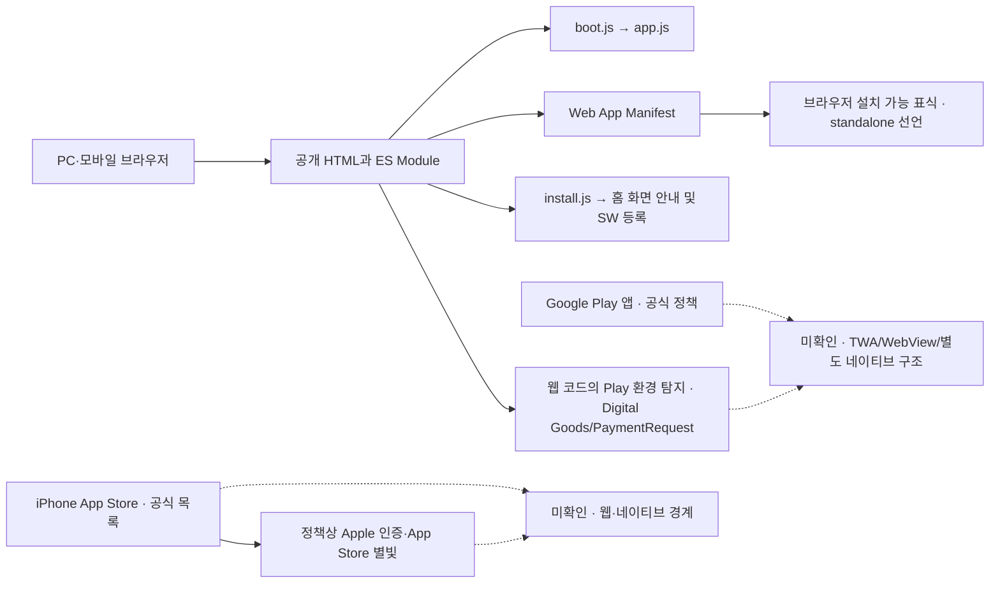
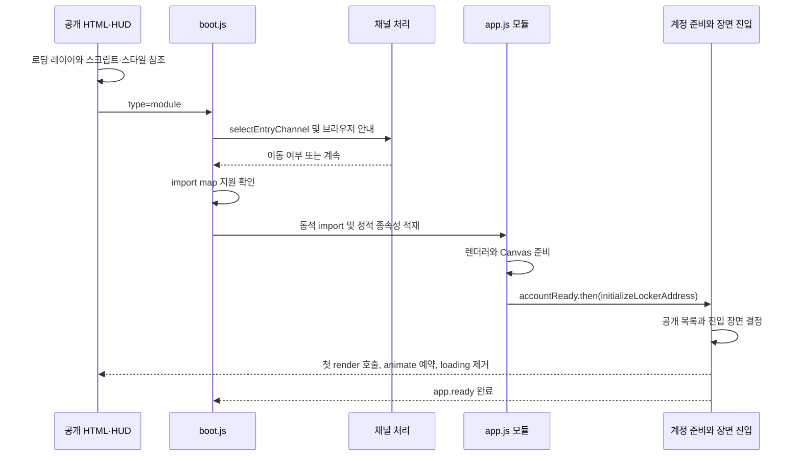

# 별꾹의 웹·PWA·앱 배포

확인일 2026-11-25 KST. **실행 관찰**은 REA가 격리 프로필에서 연 비로그인 공개 웹에 한정한다. **정적 코드**는 URL과 줄 번호를 붙인다. **공개 정책·마켓**은 운영자·공식 스토어의 설명이다. 네이티브 패키지나 운영 서버의 동작은 별도 증거로 다룬다.

## A. 배포 구조

실선은 브라우저 코드·실행 또는 공개 정책이 확인한 연결이다. 점선은 패키지와 브리지 결합부의 미검증 연결이다.

| 채널 | 확인된 동작 또는 공개 안내 | 미확인 |
|---|---|---|
| 일반 웹 | 공개 HTML의 `#app`, `#world`, 로딩 영역, HUD와 UI 대화 영역이 3D 앱의 시작점이다. 초기 HTML의 ES Module과 import map에서 `three`를 연결한 이전 관찰을 재사용했다. 이번 공개 접속에서도 `/boot.js?v=20261101-ios`와 manifest, CSS 요청 및 동적 앱 로딩이 관찰됐다. 이름의 `ios`는 웹 스크립트 쿼리 표식이다. [1차 HTML 근거](../01_Tech_Stack.md), [공개 홈](https://starkkuk.com/), [boot.js](https://starkkuk-media.asdfstudio-cs.workers.dev/builds/1e41c00bd11390449702df86/boot.js) 36~49행. | 현재 HTML의 원문 줄 번호, 실제 Safari/Android 브라우저 비교. |
| 설치형 웹 | manifest 본문은 `id=/`, `start_url=/`, `scope=/`, `display=standalone`, `lang=ko`, `prefer_related_applications=false`와 192·512px 아이콘 및 512px maskable 아이콘을 선언한다. 홈 화면 열기에서 일반 주소창이 없는 독립 표시 모드를 **요청**한다. 최종 모드는 브라우저·설치 환경에 달려 있다. [manifest.webmanifest](https://starkkuk.com/manifest.webmanifest) 2~15행. | 실제 설치, 브라우저 UI의 주소창, standalone에서의 첫 접속·업데이트, 플랫폼별 prompt 발생 여부. |
| Android | 2026-11-12 정책이 Google Play 앱, Play Billing 라이브러리, 구매 확인과 진단을 설명한다. 웹 소스도 환경 탐지와 별빛 상품 결제를 위한 브라우저 API 연동을 갖춘다. [별꾹 공식 정책](https://starkkuk.com/privacy.html#google-play), [play-support-client.mjs](https://starkkuk-media.asdfstudio-cs.workers.dev/builds/79ac4112e839d43578e9c947/play-support-client.mjs) 1~18·22·55~95행. | 이번 공개 검색에서 Play 상세 상품 페이지의 앱 식별자를 독립 확인하지 못했다. APK, TWA, WebView, Capacitor, 네이티브 플러그인, 앱 배포 지역·버전과 업데이트 경로는 미확인. |
| iOS | Apple 공식 해외 스토어가 앱 ID `6832807561`, iPhone iOS 16.4 이상, 인앱 구매와 별빛 상품을 표시한다. 별꾹 정책은 Apple 로그인, 1회 반복 구매 상품의 검증, 앱 내부의 회원탈퇴 요청을 명시한다. 한국 스토어 직접 열람은 도구 접근 제한이 있었다. [Apple App Store 공식 목록](https://apps.apple.com/no/app/%EB%B3%84%EA%BE%B9/id6832807561), [별꾹 공식 정책](https://starkkuk.com/privacy.html). | IPA, WebView/WKWebView 여부, StoreKit·브리지 내부 구현, 앱 버전과 라이브 웹 코드 배포의 결합, 한국 상품의 현재 결제 표시. |

공개 웹 본문에서 확인한 기기 기능은 앱 설치 유도, 파일 입력, 캔버스 다운로드, 지원 환경에서 파일 공유, 클립보드 복사와 외부 브라우저 이동이다. 조사한 worker와 설치 모듈에서 `push`, `notificationclick`, `PushManager.subscribe` 연결은 발견하지 않았다. 웹의 대화·방문 알림과 네이티브 푸시는 실행 경로가 다르며, 네이티브 푸시 구현 및 권한은 미확인이다. [install.js](https://starkkuk-media.asdfstudio-cs.workers.dev/builds/04ac9ef5e12baa98fef30b13/install.js) 9~68행, [sw.js](https://starkkuk.com/sw.js) 1~10행, [niche-photo.js](https://starkkuk-media.asdfstudio-cs.workers.dev/builds/9d462ae0f5de5c830fda95d8/niche-photo.js) 28~48행, [external-browser.js](https://starkkuk-media.asdfstudio-cs.workers.dev/builds/7e7908b7c54d55250e452830/external-browser.js) 19~31행.

## B. 최초 접속에서 첫 렌더까지

`selectEntryChannel`은 한국어 루트 또는 index에서만 자동 분기를 시도한다. 허용 쿼리, 링크 해시, 검색 로봇 여부를 먼저 검사한다. 수동 선택 → 같은 출처 국가 채널 응답 → 브라우저 언어 → 한국어의 순서이며, 국가 응답 대기는 기본 1,200ms다. `channelPath`와 `channelStorageKey`가 API 경로와 기기 상태 키를 언어별로 구분하고, `i18n.mjs`는 번역 조회와 HTML·오류 문구를 연결한다. 공유·초대·인증 복귀의 채널 보존 목적과 실제 서버 IP 판정은 각각 코드와 공식 정책의 범위다. [channel-entry.mjs](https://starkkuk-media.asdfstudio-cs.workers.dev/builds/6efd01555121fe0e7f65b45c/channel-entry.mjs) 12~44행, [channel-client.mjs](https://starkkuk-media.asdfstudio-cs.workers.dev/builds/9a4d2ac2d547be4a1f8aa637/channel-client.mjs) 1~32행, [channel-picker.js](https://starkkuk-media.asdfstudio-cs.workers.dev/builds/d031dd4c7a87911080a966ac/channel-picker.js) 3~29행, [i18n.mjs](https://starkkuk-media.asdfstudio-cs.workers.dev/builds/5aeaf3adaf1051c3af4dcdb7/i18n.mjs) 3~23행, [공식 정책](https://starkkuk.com/privacy.html).

`boot.js`는 외부 브라우저 안내를 먼저 띄울 수 있고, 열린 안내가 닫힌 다음 import map을 확인한다. `startupDiagnostic`은 코드와 오류 종류, 제한된 동일 출처 프레임을 표시한다. 장시간 로딩 안내 타이머는 30초이며, 앱 준비 전에 오류가 나면 재시작과 외부 브라우저 안내를 제공한다. 초기 HTML의 개인정보·설치·telemetry 스크립트는 별도 진입점으로 로딩된다. `app.js`의 준비 완료 시점은 단순 캔버스 DOM 삽입보다 뒤다. [boot.js](https://starkkuk-media.asdfstudio-cs.workers.dev/builds/1e41c00bd11390449702df86/boot.js) 7~49행, [app.js](https://starkkuk-media.asdfstudio-cs.workers.dev/builds/badddc113c1ef830a03b6dd9/app.js) 532~564·1195~1212·2752행.

## 설치 UX, 외부 브라우저와 결제

- `install.js`의 카드 표시와 실제 OS 설치는 별개 이벤트다. `beforeinstallprompt`를 저장한 경우 버튼에서 브라우저 prompt를 호출한다. 준비된 이벤트가 없으면 iOS 공유 메뉴, Android 메뉴, Safari Dock, Chrome/Edge 안내를 선택한다. `appinstalled`가 완료를 알리고 `display-mode`와 `navigator.standalone` 판정이 재권유를 제어한다. ‘나중에’는 브라우저 키에 기록되어 7일 동안 자동 제안을 미룬다. 화면이 바쁘면 5초 후 다시 검사한다. [install.js](https://starkkuk-media.asdfstudio-cs.workers.dev/builds/04ac9ef5e12baa98fef30b13/install.js) 7~69행.
- 브라우저 판정은 UA의 Instagram·KakaoTalk·NAVER 등과 iPad 터치 특성을 사용한다. Android의 Chrome intent·카카오 외부열기, iOS 메뉴/Chrome 스킴·복사 안내와 `pagehide/pageshow` 및 가시성 처리가 있다. `AbortSignal.timeout` 호환 분기도 있다. 이런 분기는 일반 웹 브라우저 안내 코드에 해당하며 앱 패키지의 WebView 구현이나 범용 네이티브 브리지의 증거로 쓰기 어렵다. [browser-compat.mjs](https://starkkuk-media.asdfstudio-cs.workers.dev/builds/54b3935e42ec8fc1b6d68e0b/browser-compat.mjs) 3~27행, [external-browser.js](https://starkkuk-media.asdfstudio-cs.workers.dev/builds/7e7908b7c54d55250e452830/external-browser.js) 12~52행.
- Play 지원은 유입·세션 표식과 Digital Goods API를 확인하고, 서버 상품 목록 및 기기 상점 정보, `PaymentRequest`, 구매 확인·소비 경로를 호출한다. 일반 웹에서는 이체·QR 안내 경로가 있다. Apple 경로는 공식 정책과 앱 마켓, 웹 계정 코드의 Apple 지원이 확인 범위다. 네이티브 StoreKit 호출부와 패키지-웹 업데이트 동기화는 미검증이다. [play-support.mjs](https://starkkuk-media.asdfstudio-cs.workers.dev/builds/2ae68e188b3efcf2ed1770e0/play-support.mjs) 10~89행, [play-support-client.mjs](https://starkkuk-media.asdfstudio-cs.workers.dev/builds/79ac4112e839d43578e9c947/play-support-client.mjs) 4~18·41~117행, [auth.js](https://starkkuk-media.asdfstudio-cs.workers.dev/builds/cd6d0eb0452f2c2bb42cc56a/auth.js) 81~132행, [9차 결제](Payment_Sponsorship.md), [Apple 공식 목록](https://apps.apple.com/no/app/%EB%B3%84%EA%BE%B9/id6832807561).

## 실행 증거

공개 홈을 Chrome/Chromium 158.0.8127.88의 새 헤드리스 프로필에서 1280×720 DPR1, 390×844 DPR3로 한 번씩 열었다. 두 환경에서 캔버스와 메뉴 버튼 가시성이 확인됐고 `manifest.webmanifest`와 `sw.js`는 200을 받았다. 좁은 뷰포트로 한 차례 추가 실행했으며 로딩 레이어가 사라졌다. 메뉴 클릭 대기는 세 실행 모두 시간 초과였다. 설치 안내 열기·닫기와 OS 설치, SW 활성 제어 여부는 미확인이다. 현행 배포 부트는 `1e41c00bd11390449702df86`, 앱은 `badddc113c1ef830a03b6dd9`에서 열렸다. 실기기는 사용하지 않았다. [실행 범위와 결과](../Architecture/10_Module_Coverage.md), [성능 및 캐시](Loading_Caching_Performance.md).
