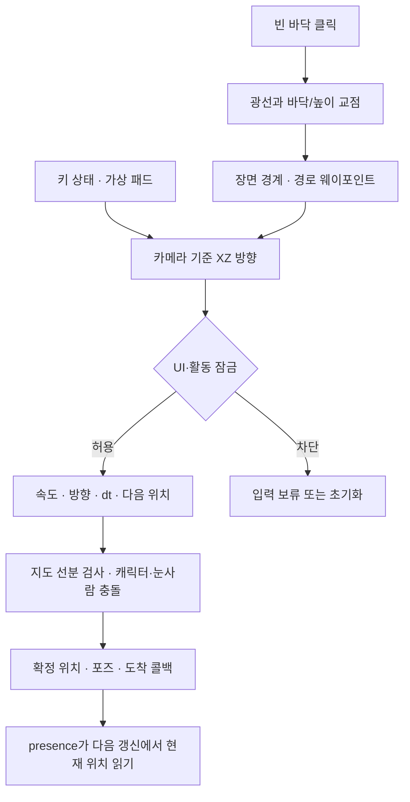
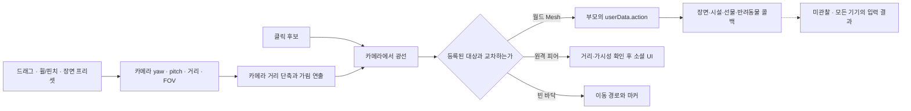

# 별꾹의 입력·이동·충돌·카메라

확인일 **2026-11-25 (한국시간)** · 8차 · [별꾹 공개 웹 클라이언트](https://starkkuk.com/)

DOM 이벤트에서 화면 좌표, 길 찾기, 3D 클릭과 카메라까지 공개 코드를 추적했다. 기존 초기 광장·패드·HUD 관찰을 재사용했다. 마우스·터치·키보드의 모든 조합이나 실제 충돌 제어를 재현하지 않았다. [화면 지도](../Architecture/Screen_Map.md) · [공간 보고서](World_Environment.md)

## F. 입력이 이동으로 변하는 순서

| 코드 위치 | 함수 입력과 처리, 반환·화면 효과 |
|---|---|
| [app.js](https://starkkuk-media.asdfstudio-cs.workers.dev/builds/2300b2b383d429b089959a6f/app.js) 2239~2263행 · `dragPad` / `resetMovement` / `screenDirection` | 키보드가 방향키와 WASD 상태를, 가상 패드가 길이 최대 1의 방향을 기록한다. 패드 중앙과 포인터 벡터를 폭의 .29 반경에서 잘라 스틱을 그린다. `screenDirection(x,y)`은 카메라 방향에서 y를 없앤 뒤, 앞 벡터와 위 벡터의 외적으로 옆 방향을 만들고 XZ 이동 벡터를 반환한다. |
| [app.js](https://starkkuk-media.asdfstudio-cs.workers.dev/builds/2300b2b383d429b089959a6f/app.js) 2285~2317행 · `pointRay` / 포인터 핸들러 | 화면 좌표를 NDC `[-1,1]`로 바꾼 뒤 `setFromCamera`로 광선을 만든다. 드래그·여러 터치는 카메라 회전·핀치 또는 선물 이동으로 나뉜다. 움직이지 않은 pointerup은 클릭 후보로 기록하고 실제 click에서 활성화해 새로 뜬 패널이 같은 탭을 받지 않도록 한다. |
| [app.js](https://starkkuk-media.asdfstudio-cs.workers.dev/builds/2300b2b383d429b089959a6f/app.js) 1136·2313·2541~2543행 · `walkTo` / 이동 프레임 | 바닥 광선 교점에서 야외는 지형 높이 평면으로 최대 네 번 다시 교차한다. 장면 좌표 제한 → 웨이포인트 저장 → 도착 콜백 등록 순서다. 매 프레임 `dt × speed`를 목표까지 거리와 비교하고, 확정 거리로 보폭 위상을 진행한다. 도착하면 마커를 끄고 콜백을 부른다. 직접 입력은 자동 이동과 별도 상태다. |
| [navigation.mjs](https://starkkuk-media.asdfstudio-cs.workers.dev/builds/0dc53911b1dadb58e3c01ecc/navigation.mjs) 19~70행 · `walkPath(from,to,scene)` | 장면별 탐색기에 위임하거나 직접 갈 수 있으면 최종점만 반환한다. 홀은 가구 모서리의 가시 그래프와 거리 우선 탐색, 일부 다른 장면은 가까운 격자의 A* 방식이다. 경로를 못 찾으면 빈 배열을 반환한다. |
| [navigation.mjs](https://starkkuk-media.asdfstudio-cs.workers.dev/builds/0dc53911b1dadb58e3c01ecc/navigation.mjs) 71~91행 · `canWalkBetween(a,b,scene)` | 홀의 가구 경계에서 선분의 진입·이탈을 각 축으로 검사한다. 다른 공간은 별도 경계 함수 또는 구간 샘플을 사용한다. 목적지가 비어 있어도 벽을 지나면 실패할 수 있다. |
| [world-movement.mjs](https://starkkuk-media.asdfstudio-cs.workers.dev/builds/0acd6ad644ad550302baa7f4/world-movement.mjs) 6~59행 · `arrivalPosition` / `resolveWorldMovement` | 진입 영역은 후보를 시험하고 실패하면 기본 위치에 둔다. 실제 이동은 장면 제한 → 피어 충돌 → 선분 검사로 통과시킨다. 기본 .1 단위의 이동 단계(최대 512개)에서 대각선이 막히면 x와 z만 각각 시도해 의도한 방향의 성분이 큰 쪽을 선택한다. 시작점 겹침에 대한 탈출 탐색이 있고 안전한 `{x,z}`를 반환한다. |
| [presence.js](https://starkkuk-media.asdfstudio-cs.workers.dev/builds/cb6a99e7c4103839707d0ab5/presence.js) 90~126행 · [app.js](https://starkkuk-media.asdfstudio-cs.workers.dev/builds/2300b2b383d429b089959a6f/app.js) 2531~2533행 | 피어를 원으로 근사해 겹침을 밀어내거나 안쪽 속도 성분을 제거한다. 정확히 겹친 피어의 방향은 ID 순서로 안정화한다. 재회 높이와 동행 상태에 별도 조건이 있으며 눈 마을은 눈사람 이동 제약을 더한다. 서버의 전체 충돌 검증은 미확인이다. |
| [app.js](https://starkkuk-media.asdfstudio-cs.workers.dev/builds/2300b2b383d429b089959a6f/app.js) 2247~2257·2317·2535~2543행 | 가시성, 포커스, pointercancel, pointercapture 상실과 UI 진입 시 눌림·패드·드래그 임시값을 초기화한다. 일부 대화상자와 활동은 프레임에서도 방향을 0으로 만든다. 취소한 선물 드래그는 기존 상태로 다시 그린다. |

## G. 카메라와 대상 선택

**선택 경로.** `hitAction`은 등록 대상과 숲 메모, 선물, 보이는 반려동물을 재귀로 검사한다. 숨겨진 부모와 가림에 해당하는 교차를 건너뛰고 부모 쪽에서 `userData.action`을 찾는다. 판·시설·층·추모함·선물 등은 `activateWorldInteraction`으로 분기하며, 피어 클릭은 별도 광선 검사와 상호작용 조건을 거친다. 수목원 등 일부 장면은 같은 반려동물 히트에도 제한된 분기를 둔다. [app.js 2271·2285~2313행](https://starkkuk-media.asdfstudio-cs.workers.dev/builds/2300b2b383d429b089959a6f/app.js) · [presence.js 75~88·267~268행](https://starkkuk-media.asdfstudio-cs.workers.dev/builds/cb6a99e7c4103839707d0ab5/presence.js)

| 코드 위치 | 입력과 동작, 수학과 예외 |
|---|---|
| [camera-rig.js](https://starkkuk-media.asdfstudio-cs.workers.dev/builds/4c30cab07bf2bd8a893903b3/camera-rig.js) 3~21·43~59행 · `createCameraRig(camera)` / `pose` | 타깃에 높이를 더하고 구면 단위 방향에 거리를 곱한다. yaw의 sin/cos가 X·Z 방향을, pitch가 높이와 수평 성분을 정한다. 광장은 거리 25·FOV 58, 천문관은 거리 20·FOV 60 프리셋이다. |
| [camera-rig.js](https://starkkuk-media.asdfstudio-cs.workers.dev/builds/4c30cab07bf2bd8a893903b3/camera-rig.js) 10~17·88~125행 · 거리 충돌과 `update` | 타깃 주변 좌우·상하로 나눈 광선을 벽에 쏜다. 가장 가까운 벽 앞까지 눈 위치를 즉시 당기고, 벽에서 나오면 거리 복원을 부드럽게 한다. 매우 좁으면 높은 구도를 시도한다. 결과 위치를 복사하고 `lookAt`과 투영을 갱신한다. |
| [camera-rig.js](https://starkkuk-media.asdfstudio-cs.workers.dev/builds/4c30cab07bf2bd8a893903b3/camera-rig.js) 23~42·68~86·96~114행 · 활동 구도 | 기존 yaw·pitch·거리·FOV를 보관하고 의식·달리기·카페의 목적 구도에 보간한다. 종료 시 저장된 구도를 복원한다. 일부 임시 뷰는 사용자 입력으로 취소할 수 있다. |
| [camera-obstruction-bounds.js](https://starkkuk-media.asdfstudio-cs.workers.dev/builds/4a115d105ad6d6317b2679af/camera-obstruction-bounds.js) 5~49행 · `geometryObstructionBounds` / `sceneryObstructionBlocks` | Box3를 월드 행렬로 변환해 가림 경계를 계산한다. 정적 인스턴스 배치 전에 논리적 벽·가구·나무의 경계를 확보한다. 제외 표시가 있거나 투명한 부품은 일부 거른다. |
| [camera-obstruction.js](https://starkkuk-media.asdfstudio-cs.workers.dev/builds/96dd8349a2b5869c4d1aca64/camera-obstruction.js) 77~110·187~260행 · `createCameraObstruction` | `prepare`는 가림 표시가 있는 Mesh에 재질 변형을 연결한다. `update`는 카메라↔초점 시선과 교차하는 가까운 블록 최대 6개를 유니폼에 반영한다. .2초/.3초로 보임/복귀를 완화하고, 활동 초점이나 사용 중인 층에 별도 보호 조건을 둔다. `release/clear`에서 원 재질을 복원한다. |
| [app.js](https://starkkuk-media.asdfstudio-cs.workers.dev/builds/2300b2b383d429b089959a6f/app.js) 1209~1211·2527·2549행 | 추모함 OrbitControls는 pan을 끄고 회전·거리 범위를 제한한다. 리사이즈에서 카메라 종횡비와 전용 위치/타깃을 맞춘다. 일반 장면은 별도 리그와 벽·셰이더 가림을 사용한다. |
| [placement.mjs](https://starkkuk-media.asdfstudio-cs.workers.dev/builds/8a32dcb052063facce2b2ae0/placement.mjs) 3~18행 · `shelfPosition` / `validPlacements` | 선반 직사각형 안으로 제한하고 방해물 원 안의 점을 둘레로 보낸다. 원과 뒤 벽이 만나는 부분에서 피타고라스 관계로 x를 보정한다. 최대 12개·고유 ID·카탈로그·유한 좌표/회전을 검사한다. 사람 경로 탐색과는 별도 계산이다. |

카메라 투영과 Mesh 교차, Vector3·Matrix4 연산, OrbitControls는 Three.js 측 기능이다. 클릭 목록과 기능 분기, 장면 경로, 원·벽 충돌, 시선 유니폼, 활동별 상태 복원은 앱이 구성한다.

**확인 범위.** 초기 HUD 외에 조작·충돌·복원은 코드 근거다. 네트워크 상황별 충돌 일관성과 기기별 카메라 감각은 미확인이다. 앱 `ev_e0372954d3510cc68d6bd8d96e538e4f2684c06a11a1751141fd933a88456f69`, 이동·카메라 `ev_c8009b841fd62bc727c2e04a0a6982c8d4b6df9b8603abf9387239e9232706e3`, 원격 피어 `ev_06758cbf1f01b6ca71d69ce5cd580051070a495fceec4420ac5bf5797b14cc80`를 사용했다. [활동과 종료 흐름](Activities_Events.md) · [실시간 접속](Realtime_Presence_Networking.md)
