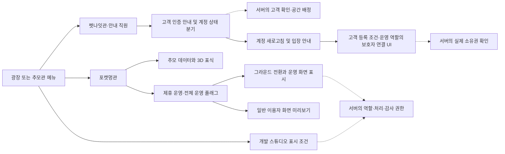

# 제휴 공간과 공개 운영 기능

2026-11-25 KST 확인. 9차 분석에서 일반 이용 안내, 제휴 고객 화면, 운영 역할별 화면 표시, 제작 검수 연결을 다룬다. 운영 기능은 공개 JavaScript의 역할과 존재를 확인하는 범위로 제한했다. 대상 계정, 사진, 고객 코드, 비공개 요청 본문, 관리자 페이지 실행은 관찰 범위 밖이다. REA 자료의 분류는 **관찰**(공개 화면), **코드 확인**(공개 JavaScript 본문), **공개 자료**(공식 정책 또는 보도), **추정**, **미확인**이다.

## 펫나잇

- **공개 자료.** 2026-11-20 보도는 펫나잇의 별꾹 공식 후원과 고객용 펫나잇관을 소개했다. 기사에서 일반 이용자의 공간 방문 가능성과 장례 고객의 추모 공간 배정은 서로 다른 이용 범위다. 장례 상담 대상 **5만 원 상당** 혜택은 기사에 나온 별도 제휴 안내다. 제휴 계약·정산액과 연결할 근거는 없다. [시민일보](https://www.siminilbo.co.kr/news/newsview.php?ncode=1160274111219343), [서울경제TV](https://www.sentv.co.kr/article/view/sentv202611200081), [3차 조사](../03_Service_Flow_Pricing.md)
- **코드 확인.** 전용관 빌더가 소개, 도움, 상점, 고객 인증 안내 직원을 클릭 대상으로 배치한다. 클릭 대상의 `userData.action`을 읽는 `activateWorldInteraction`이 `petnight-verify`에서 인증 대화상자를 연다. 공간 선택 메뉴에는 별도 `onPetnight` 콜백이 연결된다. 이 연결만으로 비로그인 방문 성공을 확정할 수 없다. [petnight-world.js](https://starkkuk-media.asdfstudio-cs.workers.dev/builds/59033aa044351908c46e2766/petnight-world.js) 5, 117~128행. [app.js](https://starkkuk-media.asdfstudio-cs.workers.dev/builds/2300b2b383d429b089959a6f/app.js) 2271, 2635행.
- **코드 확인.** `openPetnightVerification({onEnter})`는 이미 열려 있으면 포커스를 돌려준다. 안내 직원을 누르면 `canEnterPetnight()`, `isSignedIn()`에 따라 완료 화면, 로그인, 코드 입력으로 분기한다. 입력은 대문자로 바꾸며 HTML 양식 검증 통과 후에만 코드를 제출하는 분기가 실행된다. 버튼은 요청 중 비활성화되고 12초 타임아웃과 응답 파싱 오류를 처리한다. 성공 경로는 `refreshAccount()` 후 `verified(already)`로 화면을 바꾸고, 사용자의 후속 입장 버튼에서 `onEnter`를 호출한다. 진입 함수는 계정 갱신 및 공간 데이터 조회 후 `setScene('petnight')`를 호출한다. 실제 인증과 입장은 이번에 실행하지 않았다. [petnight-customer.js](https://starkkuk-media.asdfstudio-cs.workers.dev/builds/a4eeafe30447621e26141b4b/petnight-customer.js) 6~26행. [app.js](https://starkkuk-media.asdfstudio-cs.workers.dev/builds/2300b2b383d429b089959a6f/app.js) 1637~1645행.
- **코드 확인.** `selectNiche(id,claim=true)`와 분양 화면은 `canEnterPetnight()`와 `isPetnightManager()`를 구별한다. 일반 펫나잇 고객에 대해 화면이 안내하는 등록 한도는 펫나잇관 한 자리다. 운영 역할일 때만 미연결 보호자를 선택하거나 센터 관리 상태로 남기는 UI가 생긴다. 양식이 보호자 참조를 담아 `claimLocker`로 전달하므로 별도 제휴 계정과 추모 공간을 연결하는 클라이언트 데이터 흐름은 확인된다. 서버의 매칭 방식과 소유권 이관 규칙은 미확인이다. [app.js](https://starkkuk-media.asdfstudio-cs.workers.dev/builds/2300b2b383d429b089959a6f/app.js) 760, 2109~2115행. [auth.js](https://starkkuk-media.asdfstudio-cs.workers.dev/builds/638a587348d25d3c651a65c5/auth.js) [계정 보고서의 역할 판정](Authentication_Profiles.md).

## 포캣멍관과 포캣멍 그라운드

| 경로와 확인 등급 | 코드 흐름과 사용자에게 보이는 결과 | 검증 경계 |
|---|---|---|
| 광장 및 추모관 선택 메뉴 · 코드 확인 | 광장 시설의 `center` 분기 또는 `onPartner` → `openPartnerCenter()` → 동적 import → `createPartnerCenter({...})`. 메인 렌더러와 아바타를 전달하고 방 변경 시 presence와 브라우저 이력을 조정한다. [app.js](https://starkkuk-media.asdfstudio-cs.workers.dev/builds/2300b2b383d429b089959a6f/app.js) 2635, 2723~2741, 2781~2811행. | 로그인·운영 계정별 진입은 실행하지 않았다. |
| 추모 공간 · 코드 확인 | `open()`이 조회 결과를 받아 기본 방을 `hall`로 잡고, `refreshWorld()`가 센터 메타데이터와 추모 행을 `setData(center, memorials)`에 전달한다. `setData`가 등록된 공간 ID와 일치하는 기록에 소개·선물 표식을 생성한다. 편지 수가 0보다 클 때 마음 읽기 표식이 추가된다. [partner-center.js](https://starkkuk-media.asdfstudio-cs.workers.dev/builds/244ed923b69de2adc7a274fb/partner-center.js) 78, 230~234행. [partner-center-world.js](https://starkkuk-media.asdfstudio-cs.workers.dev/builds/2455010a6c580427a591d83e/partner-center-world.js) 245~258행. | 공개 코드의 데이터 연결이다. 개별 추모 기록이나 사진을 열지 않았다. |
| 그라운드 · 코드 확인 | `setRoom(next, remember=true)`가 `ground`에 `canManage()`를 요구한다. 조건을 통과한 분기에서 데이터와 공간 모듈을 병렬로 준비한다. 화면 번호와 전환 번호가 그대로인지 확인한 뒤 방·아바타·카메라·UI를 바꾼다. 목록 UI가 입양 관련 외부 안내 링크를 정의한다. [partner-center.js](https://starkkuk-media.asdfstudio-cs.workers.dev/builds/244ed923b69de2adc7a274fb/partner-center.js) 92~105행. [partner-ground-ui.js](https://starkkuk-media.asdfstudio-cs.workers.dev/builds/97b9de3e564b144c7c2f5de6/partner-ground-ui.js) 5, 19~36행. | 일반 방문객의 별도 경로와 역할별 최종 권한은 미확인이다. |
| 역할별 UI · 코드 확인 | `canManage()`는 `getAdmin() && !visitorPreview`, `canManageCenter()`는 `getGlobalAdmin() && !visitorPreview`다. `app.js`는 각각 `isPartnerCenterAdmin`과 `isAdmin`을 전달한다. `toggleVisitorPreview()`가 그라운드에서 동작하면 추모관으로 돌아가 일반 이용자 뷰로 전환한다. 그라운드의 추가·수정·삭제 UI는 관리 분기에 있다. [partner-center.js](https://starkkuk-media.asdfstudio-cs.workers.dev/builds/244ed923b69de2adc7a274fb/partner-center.js) 39~46, 79~89행. [partner-ground-ui.js](https://starkkuk-media.asdfstudio-cs.workers.dev/builds/97b9de3e564b144c7c2f5de6/partner-ground-ui.js) 19~36행. [app.js](https://starkkuk-media.asdfstudio-cs.workers.dev/builds/2300b2b383d429b089959a6f/app.js) 2799행. | 미리보기는 이 UI에서 운영 버튼을 숨기는 상태다. 실제 계정 역할 전환이나 접근 검증을 테스트하지 않았다. |
| 지상 렌더 적용 · 코드 확인 | `applyGroundPet(pet,removed)`이 목록을 갱신해 `groundWorld.setData(groundPets)`를 호출한다. `createPartnerGroundWorld`는 기본 고상세 대상 수 8개를 사용하고 거리·순위에 따라 근접 상세 모델 후보를 제한한다. [partner-center.js](https://starkkuk-media.asdfstudio-cs.workers.dev/builds/244ed923b69de2adc7a274fb/partner-center.js) 92행. [partner-ground-world.js](https://starkkuk-media.asdfstudio-cs.workers.dev/builds/c58ab9b7c390ab16d5c8d38e/partner-ground-world.js) 11, 23, 67, 98~100행. | 등록 성공, 실기기 성능 및 실제 이용자 동기화는 관찰하지 않았다. |

`refreshShared()`는 패널이 열렸거나 탭이 숨겨졌거나 전환·편집·헌화가 진행 중이면 점검을 건너뛴다. 열린 상태의 번호와 방을 기록한 뒤 버전 확인, 본문 조회, 상태 반영 순으로 진행한다. 버전이 같으면 본문 요청을 생략한다. `close()`는 번호를 갱신하고 보류 요청을 중단한다. `borrowAvatar()`가 아바타의 부모와 하위 파츠 변환을 저장하고 `restoreAvatar()`가 복구한다. 공유 렌더러를 쓰는 별도 공간이 메인 앱 상태를 훼손하지 않게 하는 연결이다. [partner-center.js](https://starkkuk-media.asdfstudio-cs.workers.dev/builds/244ed923b69de2adc7a274fb/partner-center.js) 107~121, 234, 283~285행.

## 운영과 개발 스튜디오의 경계

| 함수와 위치 | 역할, 입력, 결과 | 확인 범위 |
|---|---|---|
| `enterPlazaPlace`의 시설 분기, `createPlazaEntry` 연결 [app.js](https://starkkuk-media.asdfstudio-cs.workers.dev/builds/2300b2b383d429b089959a6f/app.js) 2723~2741행 | 현재 광장과 거리 조건을 점검하고 시설 종류에 따라 화면을 분기한다. 스튜디오 분기는 클라이언트의 `isAdmin`을 읽는다. | 공개 코드에 있는 UI 진입 조건만 확인했다. |
| `buildStudioFacade(group,place,sign)` [dev-studio/facade.js](https://starkkuk-media.asdfstudio-cs.workers.dev/builds/3122115618306157fdc71edc/dev-studio/facade.js) 3행 이후 | 공간 그룹, 배치 정보, 표지 콜백을 받아 스튜디오 외관을 구성하는 빌더다. | 외관 코드다. 운영 화면을 실행하지 않았다. |
| `createModelLibrary({...})`, `load`, `repeat`, `place`, `play` [dev-studio/models.js](https://starkkuk-media.asdfstudio-cs.workers.dev/builds/d963dfedf25bc50862250049/dev-studio/models.js) 35~45행 | 내장 모델 식별자를 로더에 전달하고 같은 식별자의 Promise를 재사용한다. 치수와 기준점을 맞춰 배치하거나 동일 재질·형상을 묶어 인스턴싱한다. 배치 모델의 클립 전환과 해제를 제공한다. | 모델 유틸리티의 존재는 운영자가 고객 제작물을 검수한다는 증거로 쓰지 않았다. 모델은 받지 않았다. |
| 제작·검수 화면의 역할 표시 [milk-skin-formation.js](https://starkkuk-media.asdfstudio-cs.workers.dev/builds/1b2fea7fa9d3f38f80df6532/milk-skin-formation.js), [milk-skin-review.js](https://starkkuk-media.asdfstudio-cs.workers.dev/builds/615fda2a30b8591a337453b7/milk-skin-review.js) | 사용자 요청과 별개로 공개 번들에 검수 화면과 조건부 역할 연결이 있다. 승인된 모델 참조가 실제 아바타에 적용되는 데이터 흐름은 제작 보고서에 정리했다. | 관리자 기능 실행, 서버 승인 판단 및 감사 로그는 미확인이다. [맞춤 제작 보고서](Custom_Model_Pipeline.md) |

공식 개인정보 처리방침에는 서비스 내 공개 범위, 결제 관련 처리 및 운영·보존 안내가 포함된다. 포캣멍 코드의 사진 참조 검사와 ID 연결만으로 권한을 검증할 수 없다. 펫나잇 인증 코드의 생성·만료·재사용 제한, 고객 데이터 매칭과 보유 기간, 파트너 전용 내부 계약 및 서버 감사는 미확인이다. [별꾹 개인정보 처리방침](https://starkkuk.com/privacy.html), [partner-center.js](https://starkkuk-media.asdfstudio-cs.workers.dev/builds/244ed923b69de2adc7a274fb/partner-center.js) 24~31행.

## G. 기업 제휴와 역할별 UI 연결

실선은 정적 코드 연결이다. 점선은 미검증 서버 경계다.

## 증거와 남은 확인

| 자료 | 적용 범위 |
|---|---|
| 이전 REA 본문 | `ev_62fed7fad22d9f5818742d34bf650ce26c02635f2d08b337cb010c0a33ddc9a6`, `ev_a853764ba872209ea712ee205cefd5220d0923c2a5e3748adecf8ce97e14e5c0`, `ev_62fed7fad22d9f5818742d34bf650ce26c02635f2d08b337cb010c0a33ddc9a6`, `ev_2886197f2dd864c5b2ae07e1fb3893cedb02eeb52ca7c56420551f1744ded40a`, `ev_60111e1832e4575f2febc7f631e337626ad3efeaf3834f9932d713e6955e5ee1`. [8차 공간 보고서](World_Environment.md) |
| 9차 REA 본문 | `ev_45c09f7b8031cde42c5dcbb64709805205796270f8c421717f8fb50b113e5643`. 포캣멍 그라운드 UI와 스튜디오 모듈의 정적 분석이다. |
| 공개 안내 | 2026-11-20 펫나잇 공식 후원 보도와 2026-11-25 정책 확인. 이 단계의 직접 UI 관찰은 가격 공개 안내 확인 범위에 한정되었다. [시민일보](https://www.siminilbo.co.kr/news/newsview.php?ncode=1160274111219343), [별꾹 개인정보 처리방침](https://starkkuk.com/privacy.html) |

10차에서는 비로그인 상태에서 제휴 메뉴의 진입 안내와 모바일 화면 전환을 읽기 전용으로 확인할 수 있다. 고객/운영 역할, 배정과 사진 권한은 공개 안내와 승인된 시험 환경에서 각각 검증할 항목이다.
