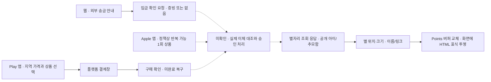

# 맞춤 제작 결제·별빛 후원·별자리 표시

확인일 **2026-11-25 (한국시간)** · 9차 · [별꾹 공개 웹](https://starkkuk.com/)

맞춤 제작은 아이별 제작 신청에 연결된 이체 확인 절차다. **별빛 후원은 별도 요청·구매·별자리 표시 흐름**이며, 보상 재화와 로컬 상점은 [가상 재화 문서](Virtual_Economy_Inventory.md)에 구분했다. 실제 송금·구매·환불·영수증 제출은 수행하지 않았다.

## 확인 가능한 가격과 결제 수단

| 경로 | 관찰·코드·정책 근거 | 현시점 미확인 |
|---|---|---|
| 맞춤 3D 제작 | 기존 비로그인 화면에서 베타 유료 전환과 약 1~2일 안내 관찰. 소스는 지원 아이를 고른 후 **기존 신청의 `payment.amount`**, 새 신청의 `data.price`, 없으면 **12,900원** 순으로 표시한다. 이체 안내·입금자명·캡처 확인 요청이다. | 11월 25일 공개 홈과 공개 자료에서 인증 후 현재 청구액을 확인하지 못했다. 베타 마감·무료 예외·할인·앱 내 제작 상품은 확인되지 않았다. |
| 일반 웹 후원 | 기존 비로그인 ‘별빛 → 별자리 등록’에서 카카오페이 QR·계좌이체·확인 요청을 관찰했다. 웹 폼에는 입금한 금액을 입력하도록 되어 있다. 코드의 1원~1억 원은 입력 검증 범위다. | 현재 최소 후원액을 정한 정책, QR 채널별 실제 가용 여부, 운영자 수익/정산 |
| Android 앱의 별빛 | 공개 코드에 Google Play 배포 맥락, 서버 상품 허용 목록과 Digital Goods의 지역화 가격, `PaymentRequest` 및 확인·복구가 있다. | 현재 국내 Play 실가격·상품 판매 여부. 스토어 상세 조회로 확인하지 못했다. |
| iPhone 앱의 별빛 | 공식 정책은 반복 구매하는 1회 상품이라고 설명한다. 기존 대만 App Store 상품 제목의 원화 표기는 1,000·5,000·10,000·30,000·50,000·100,000원이었다. | 제목의 원화와 실제 표기 통화는 다르다. 한국 스토어 가격 및 네이티브 StoreKit 실행은 미확인이다. |

[이전 서비스 흐름·가격](../03_Service_Flow_Pricing.md) · [pet-model-request.js 20·69~80·95행](https://starkkuk-media.asdfstudio-cs.workers.dev/builds/724d6a8dea87aaad1417f9f4/pet-model-request.js) · [play-support.mjs 70~82행](https://starkkuk-media.asdfstudio-cs.workers.dev/builds/ebf0c4b3891317cc9c1d0435/play-support.mjs) · [공식 개인정보 처리방침](https://starkkuk.com/privacy.html) · [App Store 대만](https://apps.apple.com/tw/app/%EB%B3%84%EA%BE%B9/id6832807561)

**맞춤 제작에 없는 결제 상태를 추가하지 않았다.** 제출은 이체 확인을 요청하는 새 신청 또는 기존 신청 수정을 저장한다. 별도 상점 주문 ID나 카드 청구 토큰을 맞춤 신청 폼이 보내는 근거는 확인하지 못했다. `busy`는 화면의 동시 제출을 막고, `version`은 기존 신청을 수정할 때 사용한다. 통신 실패가 발생하면 결과를 다시 확인하라고 안내한다. 네트워크 재시도에서 새 신청이 서버에서 항상 한 건만 만들어진다고 볼 수 없다. 입금 확인 이후 수정·취소는 고객센터 안내가 있다. 환불 금액·기한·자동 환불 정책은 공개 자료에서 확인하지 못했다. [pet-model-request.js 54·107~125행](https://starkkuk-media.asdfstudio-cs.workers.dev/builds/724d6a8dea87aaad1417f9f4/pet-model-request.js) · [pet-model-copy.mjs 36~39행](https://starkkuk-media.asdfstudio-cs.workers.dev/builds/a443b0eeaf6817eb5a6321b0/pet-model-copy.mjs)

## E. 별빛 후원과 별자리

실선은 공개 코드에서 확인한 연결, 점선은 정책 설명 또는 미검증 서버 경계다. 공개 재조회에서 받은 별 데이터를 화면에 반영하는 경로까지 확인했다.

### 웹 확인 요청·복구

| 코드 위치 | 함수와 처리 |
|---|---|
| [support.js](https://starkkuk-media.asdfstudio-cs.workers.dev/builds/4f012c7cc92c341c3cd61ee0/support.js) 11~65행 · `openSupport` / `refreshQrVisibility` | 웹이면 후원 안내·QR 뷰를 열고 설정 응답으로 가시성을 맞춘다. Play 맥락은 웹 이체 뷰 대신 Play UI를 연다. 열기·닫기 이벤트에서 앱 이동 입력, OrbitControls와 포커스를 조정한다. |
| [support.js](https://starkkuk-media.asdfstudio-cs.workers.dev/builds/4f012c7cc92c341c3cd61ee0/support.js) 77~125·130~169행 · `pollNotice` / `supportApi` / `showReport` | 로그인 회원의 자신의 이력과 보완 요청 안내를 구분한다. `pending`에 실제 보완 요청 시각이 있고 Play 제공자가 아닌 항목만 입금 정보 수정으로 보낸다. 이력은 `approved`, 승인 대기, `revokedAt`의 취소·환불을 표시한다. 회원 변경·401·숨김·닫힘을 정리한다. 이미 표시된 상태만으로 이체 대조 성공을 재현했다고 볼 수 없다. |
| [support.js](https://starkkuk-media.asdfstudio-cs.workers.dev/builds/4f012c7cc92c341c3cd61ee0/support.js) 170~219행 · `receiptFields` / `sameDraft` / 제출 핸들러 | 웹 후원은 캡처 첨부 또는 ‘캡처 없음’을 선택한다. 중복 입력을 줄이려고 준비한 이미지의 해시로 초안 동일성을 비교한다. 신규는 같은 필드의 응답 미확인 요청 ID를 재사용하며, 수정은 기존 ID·버전을 보낸다. 텍스트·메타 초안은 회원·수정 건으로 범위가 제한된 `sessionStorage`에 두고 증빙 이미지 원문은 현재 폼 메모리에 유지한다. |
| [support-receipt-input.mjs](https://starkkuk-media.asdfstudio-cs.workers.dev/builds/b07e38f2cfb63bedfcfa8125/support-receipt-input.mjs) 4~22행 · `prepareSupportReceipt` | 웹 후원 기본 모드는 20 MiB·16,777,216픽셀 입력 검사를 사용한다. 디코드·1,600px 캔버스·최대 420,000자 인코딩 후 SHA-256 키를 만든다. 맞춤 제작의 모델 모드는 입력 한도가 다르다. |
| [support.js](https://starkkuk-media.asdfstudio-cs.workers.dev/builds/4f012c7cc92c341c3cd61ee0/support.js) 219~247행 | 요청 진행 중 중복 제출 차단, 성공 시 초안 삭제·이력 재조회, 최신 회차에만 성공 메시지 표시. 실패는 연결 안내와 재시도, 401은 로그인 새로 확인, 보완 요청 버전 문제는 다시 읽는 경로로 이어진다. 실제 서버 중복 방지는 정책과 서버 검증의 문제다. |

### Play와 Apple 확인

- **Play 상품과 가격.** `detectPlayDistribution`은 배포 환경의 표시·리퍼러·세션 표식 또는 Digital Goods 접근 여부를 사용한다. 가격은 `load()`가 서버 허용 목록과 스토어 상세를 교차 확인한 뒤 표시한다. UI의 원화 분류값·정렬과 지역 결제창의 실제 표시 금액은 별개다. 준비 중 화면과 조건부 테스트 UI의 흔적은 확인했으며 테스트 구매는 실행하지 않았다. [play-support-client.mjs 1~18·55~75행](https://starkkuk-media.asdfstudio-cs.workers.dev/builds/79ac4112e839d43578e9c947/play-support-client.mjs) · [play-support.mjs 50~85행](https://starkkuk-media.asdfstudio-cs.workers.dev/builds/ebf0c4b3891317cc9c1d0435/play-support.mjs)
- **Play 공급자 응답.** `buy`는 진행 중, 계정, 복구 대상 여부를 확인한 후 결제창을 열고 반환된 토큰을 별꾹 확인 요청에 전달한다. 확인 응답의 값은 `credited/pending/refunded`이며 사용자가 결제창을 닫으면 로컬 결과 `cancelled`가 될 수 있다. `credited`여도 소비 확인이 남으면 재구매 대신 미완료 확인을 안내한다. [play-support-client.mjs 41~54·76~95행](https://starkkuk-media.asdfstudio-cs.workers.dev/builds/79ac4112e839d43578e9c947/play-support-client.mjs) · [play-support.mjs 18~31행](https://starkkuk-media.asdfstudio-cs.workers.dev/builds/ebf0c4b3891317cc9c1d0435/play-support.mjs)
- **복구와 중복 방지.** `recover`는 세션에 기억한 미확정 토큰과 스토어의 구매 목록을 집합으로 합친다. 계정·채널 불일치와 미확인 토큰 상태를 구분하고 재검증한다. 토큰 소비·확인·취소·환불을 중복 반영하지 않는 목적은 공식 정책에 명시돼 있다. 실제 정산과 서버의 원자성·멱등성은 검증하지 않았다. [play-support-client.mjs 26~50·96~117행](https://starkkuk-media.asdfstudio-cs.workers.dev/builds/79ac4112e839d43578e9c947/play-support-client.mjs) · [공식 개인정보 처리방침](https://starkkuk.com/privacy.html)
- **Apple.** 정책상 App Store가 결제수단을 처리하며 서비스는 거래·검증 및 취소 상태를 확인한다. 이는 웹 Play 클라이언트가 증명하는 범위와 다르다. 국내 앱 가격표, 복원 흐름의 정상 실행 및 환불 누락 복구는 미확인이다. [공식 개인정보 처리방침](https://starkkuk.com/privacy.html)

## 별빛 동산에 공개되는 값

`constellation.load()`는 입장·새로고침 동작에서 페이지별 항목을 읽고 `requestVersion`으로 이전 입장의 응답을 거른다. `constellationFamilyStars`가 그룹/추모함으로 별을 묶고 아이 키·서버에서 전달받은 스케일을 배치에 쓴다. `paint(items)`가 Points 버퍼를 새로 만들고 이전 Geometry를 해제한다. 카메라에 보이는 좌표는 HTML 이름표·방문 버튼으로 투영된다. 후원 확인 성공 응답을 이 씬에 직접 주입하여 실시간으로 바꾸는 경로는 조사한 코드에서 확인되지 않았다. 별자리 목록 재조회가 화면을 갱신하는 확인된 경로다. [constellation.js 123~153·174~191행](https://starkkuk-media.asdfstudio-cs.workers.dev/builds/0aa8fa22ac8269889ed9406d/constellation.js) · [constellation-layout.mjs 12~39행](https://starkkuk-media.asdfstudio-cs.workers.dev/builds/074c027c0173faf7d6e8ca1c/constellation-layout.mjs)

공식 정책은 승인 후 아이의 이름과 공개 추모함 링크를 표시하고 입금자명·금액·회원 ID나 일반 닉네임/아바타의 후원 표시는 공개하지 않는다고 설명한다. Play UI는 누적 등록액에 따라 별이 커진다고 안내하지만, 표시 스케일의 서버 산식은 미확인이다. 캠프파이어는 씬 안에서 장작·불의 시각 상태를 갱신하는 활동이며 결제 확인 호출과의 연결은 확인되지 않았다. [공식 개인정보 처리방침](https://starkkuk.com/privacy.html) · [play-support.mjs 6~9행](https://starkkuk-media.asdfstudio-cs.workers.dev/builds/ebf0c4b3891317cc9c1d0435/play-support.mjs) · [constellation-campfire.js 4~83행](https://starkkuk-media.asdfstudio-cs.workers.dev/builds/0be03f18397a5f42c91d254a/constellation-campfire.js)

**근거.** 기존 웹 UI 관찰과 앱 스토어 자료를 재사용했다. 후원·Play·별자리 정적 증거는 `ev_92489eb01f6b8d6c872c45b0669d46b6a26b18e49090f53bb54790756c5db6c7`, 별자리 앱 본문은 `ev_62fed7fad22d9f5818742d34bf650ce26c02635f2d08b337cb010c0a33ddc9a6`, 맞춤 증빙과 신청은 `ev_bf03d7aaa51a8ffb7ecefa534ded7854acdd5c2679ec687e7ac1cdf8598a8bb7`이다. 운영자 원가·순익·후원액·정산·환불 실제 처리 및 결제 완료·3D 반영 실측은 미확인이다.
