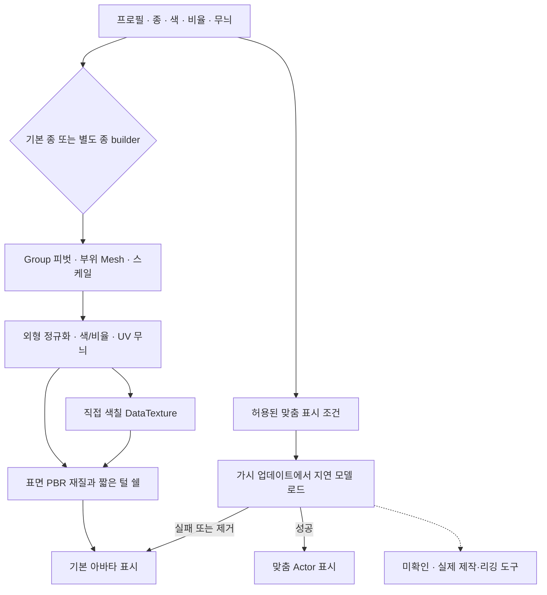
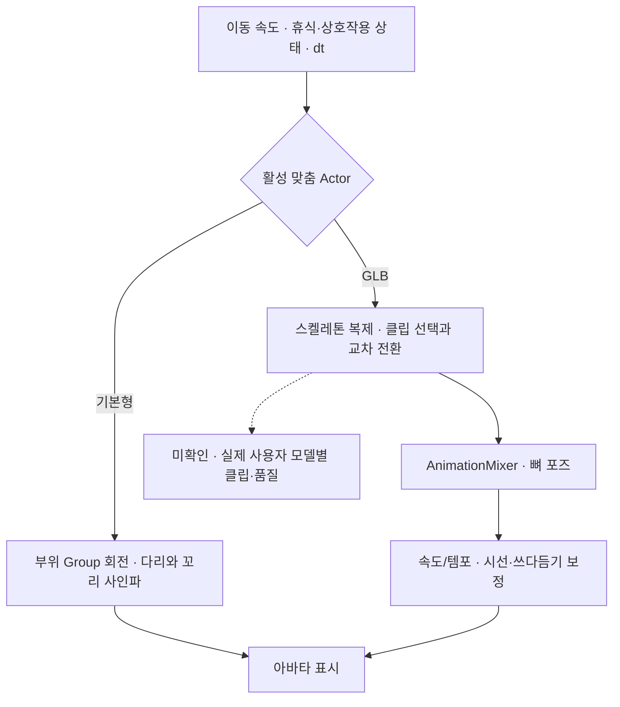

# 사람 아바타와 반려동물의 3D 모델·애니메이션

확인일 **2026-11-25 (한국시간)** · 8차 · [별꾹 공개 웹 클라이언트](https://starkkuk.com/)

[기존 캐릭터 조사](../02_Character_System.md)의 외형·맞춤 모델 상태를 바탕으로, 형태 계산과 프레임 내 포즈 적용을 따라갔다. 기존 초기 화면의 기본 캐릭터와 스크립트 로딩을 관찰한 범위를 재사용했다. 인증 후 색칠 저장, 맞춤 GLB와 클립 품질, 활동 상태는 별도 실행하지 않았다.

## 1. 계층과 좌표

**사람.** `buildGuardian(body)`는 받은 루트에 머리·몸통·팔·다리 그룹을 붙인다. 머리 메시·머리카락·눈은 패턴별 공용 기하와 재질을 쓰며, 상완 그룹이나 다리 그룹 아래 종아리·신발이 달린다. 예를 들어 팔 그룹을 어깨에 배치한 뒤 그 그룹의 자식 손을 아래로 이동시키면, 그룹을 회전할 때 손이 어깨 주위를 돈다. `poseHuman`은 장면에서 이 계층의 자세를 갱신하며 같은 계층은 원격 아바타 생성에도 사용된다. [avatar.js 6~40·134~180행](https://starkkuk-media.asdfstudio-cs.workers.dev/builds/e4716f71b2eb05fa15928960/avatar.js) · [app.js 1833·2545행](https://starkkuk-media.asdfstudio-cs.workers.dev/builds/2300b2b383d429b089959a6f/app.js) · [실시간 접속 보고서](Realtime_Presence_Networking.md)

**기본 반려동물.** `buildPetAvatar(profile, options)`는 먼저 절차적 기본형을 만들고 선택 조건을 충족하면 맞춤 로더를 연결한다. 개·고양이·햄스터·알파카는 공용 구체 변형과 피부 재질을 사용하되 몸통 비율, 다리·목·머리 피벗, 귀·꼬리 값을 다르게 둔다. 특수 종은 별도 builder가 몸체와 동작 정보를 돌려준다. [pet-avatar.js 39~53·117~181·184~215행](https://starkkuk-media.asdfstudio-cs.workers.dev/builds/3445e8a7e6c22ced351a4a69/pet-avatar.js)

| 함수와 위치 | 계산과 결과 |
|---|---|
| [pet-avatar.js](https://starkkuk-media.asdfstudio-cs.workers.dev/builds/3445e8a7e6c22ced351a4a69/pet-avatar.js) 117~140행 · `leg` / `ear` | 위치·길이·폭으로 피벗 그룹과 자식 Mesh를 구성한다. 공유 구체를 복제해 정점 좌표를 변형한다. 발 아래쪽은 넓어지거나 앞으로 나오고 귀의 위쪽은 좁아지거나 아래 부분이 굽는다. 귀 그룹의 z회전은 좌·우 부호가 다르다. |
| [pet-avatar.js](https://starkkuk-media.asdfstudio-cs.workers.dev/builds/3445e8a7e6c22ced351a4a69/pet-avatar.js) 62~114·144~181행 · `sculptHead` / `headPaint` | 머리 표면을 변형해 눈·코·입의 표현 위치를 계산한다. 구의 UV를 각도로 바꿔 표면 좌표에서 무늬 계산에 사용할 값을 얻는다. 선택 외형은 `applyPetAppearance`로 부위·비율에 적용하고, `petRenderSize`는 루트 전체 스케일을 설정한다. |
| [pet-avatar-extras.js](https://starkkuk-media.asdfstudio-cs.workers.dev/builds/352db75ecb339d15fef2788c/pet-avatar-extras.js) 32~83·84~165행 · `buildExtraPetAvatar` | 종이 등록돼 있을 때 부위 생성 도우미를 만들고 포유류 분기 또는 물고기·거북·닭·앵무·도마뱀 빌더를 실행한다. 구형 표면 UV를 색 배치에 쓰며 지느러미·등껍질·깃 장식을 부품으로 붙인다. |
| [pet-avatar-mammals.js](https://starkkuk-media.asdfstudio-cs.workers.dev/builds/ca2a133b175313a812d5d835/pet-avatar-mammals.js) 6~26·110~146행 · `buildMammal` | 기니피그·페럿·토끼·고슴도치로 분기한다. 부위 곡면의 링별 정점을 삼각함수로 계산한다. 고슴도치 가시 도형은 표면 방향의 단위 벡터로 회전시킨 인스턴스와 색 변화로 표현한다. |
| [pet-coat.js](https://starkkuk-media.asdfstudio-cs.workers.dev/builds/591bc2ccc48da07c7b4032d4/pet-coat.js) 3·33~81행 · `addShortCoat(mesh, options)` | 단일 재질과 UV가 있는 메시를 받아 6겹 쉘을 InstancedMesh로 만든다. 각 겹의 버텍스는 노멀 방향으로 밀고 비균일 스케일을 보정한다. UV 해시·고도·시선 각도·화면에서 보이는 세밀도를 섞어 픽셀을 가리거나 남긴다. Mesh와 해제 함수가 반환된다. |
| [pet-crayon.js](https://starkkuk-media.asdfstudio-cs.workers.dev/builds/b8caa5a2ba75961be010de8e/pet-crayon.js) 16~42행 · [pet-crayon.mjs](https://starkkuk-media.asdfstudio-cs.workers.dev/builds/a3f06f3498bf60ac7616386c/pet-crayon.mjs) 2~40행 | 색칠 가능한 부위의 UV를 표면 ID로 연결하고 필요한 경우에만 128×128 RGBA DataTexture를 만든다. 연속 UV점 사이에 브러시를 래스터화하며 같은 텍스처를 바탕과 털 쉘 셰이더에 혼합한다. 저장 표현의 획·점·표면 한도가 있고, 기존 그림 참조는 가시 렌더 경로에서 늦게 로드할 수 있다. 해제 시 원래 재질과 콜백을 복원한다. |
| [pet-customizer.js](https://starkkuk-media.asdfstudio-cs.workers.dev/builds/855cc44fc89a36f2b21ae765/pet-customizer.js) 25~64행 · `createPetCustomizer` | 선택 프로필의 초안 복제 → 슬라이더·색·부위 선택 → 미리보기 아바타 재생성 → 정규화한 외형을 저장 콜백으로 전달한다. Raycaster의 UV/부위 선택은 편집 모드에 따라 다르다. 임시 카메라는 Box3 크기를 FOV와 종횡비에 맞춰 잡는다. 취소·완료 시 모델, OrbitControls, 캔버스 위치와 원래 렌더러 크기·노출을 복구한다. |

**색·무늬·털의 구분.** 기본 색은 재질, 무늬는 기본 피부 맵과 표면의 색상 계산, 털은 바탕의 bump/sheen과 쉘 셰이더의 결과다. 색칠은 사용자가 UV 공간에 만든 별도 색 레이어다. UV는 면에 붙인 2차원 좌표이며, UV로 픽셀을 정하는 과정은 3D 형상을 변형하는 과정과 별개다. [pet-avatar.js 44~49·84~105·117~129행](https://starkkuk-media.asdfstudio-cs.workers.dev/builds/3445e8a7e6c22ced351a4a69/pet-avatar.js) · [pet-coat.js 41~79행](https://starkkuk-media.asdfstudio-cs.workers.dev/builds/591bc2ccc48da07c7b4032d4/pet-coat.js) · [pet-crayon.js 24~42행](https://starkkuk-media.asdfstudio-cs.workers.dev/builds/b8caa5a2ba75961be010de8e/pet-crayon.js)

**체형 보정과 사람 포즈의 예.** `applyPetAppearance`는 Mesh 이름과 부모 위치에서 부위를 결정한다. 몸통 폭·길이는 루트 자식의 X/Z 위치를 조정해 다리 간격도 함께 바꾸고, 머리·귀·꼬리에는 각자의 스케일을 적용한다. 얼굴은 마스크를 유지하고 색상이 지정된 일부 몸 부위는 원래 무늬 대신 단색 재질로 바꿀 수 있다. 사람의 `poseHuman`은 좌석에서 허벅지와 정강이를 꺾고, 보행 시 좌우 팔·다리를 반대 위상으로 움직이며, 운반 중 팔을 고정 각도로 둔다. [pet-appearance-model.js 7~47행](https://starkkuk-media.asdfstudio-cs.workers.dev/builds/297cc4e6c2fac531772a8436/pet-appearance-model.js) · [seating.js 1~11행](https://starkkuk-media.asdfstudio-cs.workers.dev/builds/f6157584c4acc3f84c5250e2/seating.js)

## D. 반려동물 생성과 외형 적용

## 2. 이동의 수학과 절차적 자세

1. `createPetCompanions`는 보여 줄 프로필·따라갈 대상과 루트를 관리한다. 사람의 yaw를 사용해 ‘옆’·‘뒤’ 오프셋을 월드 XZ 평면에 회전시킨다. 걸을 때 목표에서 몸체 좌표를 빼 이동 벡터를 얻고, 남은 거리 이하에서 `dt × speed`만큼 이동한다. 장애물이나 산책 경로가 있을 때는 안전한 발걸음으로 보정한다. [pet-companions.js 60~78·221~236행](https://starkkuk-media.asdfstudio-cs.workers.dev/builds/5fe19a95f540ae4cd25ee8ec/pet-companions.js)
2. 기본형의 다리 각도는 `sin(phase + offset) × strideAngle` 형태다. 네 다리의 대각선 쌍은 같은 위상, 반대 쌍은 π 차이여서 교차 보행이 된다. `abs(sin(phase))`가 몸체 높이의 양수 바운스를 만들고, 꼬리는 별도 빈도·진폭으로 회전한다. 달리기·되돌아오기는 속도·위상·진폭 일부를 바꾸고, 정지 시 다리 각도를 지수적으로 0에 가까이 보낸다. [pet-companions.js 237~250행](https://starkkuk-media.asdfstudio-cs.workers.dev/builds/5fe19a95f540ae4cd25ee8ec/pet-companions.js)
3. 휴식·앉기·물 마시기·냄새 맡기는 기본 자세 위에 동작별 변경을 적용한다. 렌더 단계에서 이전 보정 자세를 복원하고 새 보정치를 계산하므로 매 프레임 값이 누적되지 않는다. 원거리 원격 반려동물은 약 15Hz 자세 후보를 사용하지만 이동 보정과 표시 조건은 별도로 적용한다. [pet-companions.js 22~58·237~250행](https://starkkuk-media.asdfstudio-cs.workers.dev/builds/5fe19a95f540ae4cd25ee8ec/pet-companions.js)

## E. 기본형과 맞춤 GLB의 애니메이션

| 주요 함수와 위치 | 입력·출력, 클립과 오류 처리 |
|---|---|
| [pet-avatar.js](https://starkkuk-media.asdfstudio-cs.workers.dev/builds/3445e8a7e6c22ced351a4a69/pet-avatar.js) 184~215행 · `buildPetAvatar` / `updateCustom` | 승인 상태 또는 허용된 미리보기 조건에서, 실제 가시 업데이트에 맞춰 동적 import 및 모델 요청을 시작한다. 성공 시 원래 자식의 가시성을 꺼 맞춤 루트를 붙인다. 실패·메모리 제외·취소 경로에서 기본형을 유지·복원하고 일부 오류만 제한적으로 재시도한다. 이미 폐기된 뒤 완료한 모델도 해제한다. |
| [custom-pet-avatar.js](https://starkkuk-media.asdfstudio-cs.workers.dev/builds/057d202915dcdedf4e952f7e/custom-pet-avatar.js) 19~120·203~216행 · `inspectGLB` / `acquirePetModel` | 파일 헤더와 크기·장면 자원 한도를 확인한 뒤 GLTFLoader로 해석하고 캐시에서 용도를 임대한다. URL·파일·텍스처 세부 서버 규칙은 이번에 실측하지 않았다. 공용 소스 자원과 Actor 수명을 분리하고 임대 반환·우선순위 제외·dispose를 연결한다. |
| [custom-pet-avatar.js](https://starkkuk-media.asdfstudio-cs.workers.dev/builds/057d202915dcdedf4e952f7e/custom-pet-avatar.js) 121~162행 · `inspectRig` / `createModelActor` | 스킨이 있는 메시와 그 뼈를 식별하고 걷기 트랙에 실제로 움직이는 뼈가 네 개 이상인지 확인한다. 쓰다듬기 클립이나 머리 뼈와 같은 대체 가능성도 평가한다. `SkeletonUtils.clone`으로 모델을 복제하고 Box3 기반으로 중심·바닥·크기를 보정한다. 반환 Actor는 루트, 준비 상태, 치수, 업데이트 및 정리 함수를 제공한다. |
| [custom-pet-avatar.js](https://starkkuk-media.asdfstudio-cs.workers.dev/builds/057d202915dcdedf4e952f7e/custom-pet-avatar.js) 159~201행 · `AnimationMixer` 갱신 | 지정된 클립·이름 패턴으로 walk/trot/idle/pet/rest 트랙을 고른다. 보행 속도와 모델 스케일을 이용해 재생 속도를 조절한다. 걷기↔속보 전환은 페이드와 위상 전달, 조건부 발바닥 높이 보정이 있다. 클립이 없는 쓰다듬기·휴식에는 머리·꼬리 회전 보정이 가능하다. 믹서가 만든 포즈를 저장하고 그 위에 일시 조정을 적용한다. 정리 시 액션 중지, 믹서 루트 캐시 해제, 스켈레톤 해제를 순서대로 수행한다. |
| [pet-motion-settings.mjs](https://starkkuk-media.asdfstudio-cs.workers.dev/builds/4d89711d294b5863e59ea2e5/pet-motion-settings.mjs) 2~24행 · `normalizePetMotion` / `motionBoneGroup` | 각도·바닥·템포·보폭/부위 강도·개별 관절 보정을 허용 범위로 정규화한다. 코드의 보정은 클라이언트에서 별도로 처리한다. 공급 모델의 제작 원본·장비·도구를 보여주지는 않는다. |

호환 GPU 압축 확장 중 지원되는 것이 있으면 `petTextureLoader`는 KTX2Loader를 동적으로 읽어 렌더러 지원을 검증한다. 이 코드에서 실제 기기에 내려오는 변형 텍스처, 효과나 화질은 실측하지 않았다. [pet-model-textures.js 3~11행](https://starkkuk-media.asdfstudio-cs.workers.dev/builds/f0681877323a5639b914e43b/pet-model-textures.js)

GLB의 **Skeleton**은 피부 정점에 영향을 미치는 뼈 계층이다. **AnimationMixer**는 시간축의 여러 트랙을 평가하고 섞어 모델에 적용한다. 기본형의 다리 피벗도 계층이지만 해당 방정식은 Mesh의 회전값을 직접 바꾼다. 좌표가 먼저 이동하고 자세가 이를 따라가는 경로가 있으므로 클립의 전진 이동과 월드 이동을 중복 적용하지 않도록 트랙의 루트 변위 처리도 확인해야 한다. [custom-pet-avatar.js 150~185행](https://starkkuk-media.asdfstudio-cs.workers.dev/builds/057d202915dcdedf4e952f7e/custom-pet-avatar.js)

**미확인.** 실제 GLB의 본 수, 종별 클립 품질, 사진의 제작 도구와 원본 제작 과정, 메모리 절감 실측은 없다. REA 보완은 캐릭터 묶음 `ev_ce465912a6ecb1a7e58670a1578001c0da3fd801edd9b239046bad2f74ee9ea3`, 색칠·활동 `ev_dd3ff22f5bf64039493417f2d78b443ac0df87e9b407d946dc17f251aba78b78`, 사람 아바타 `ev_5c5d7fbc69d842aa4689b10e209b60c43fd0848e3216d43ef168fdb3c861d7ae`이다. 행 번호는 링크한 공개 빌드 기준이다. [8차 코드 실습](../Learning/ThreeJS_Code_Study.md)
