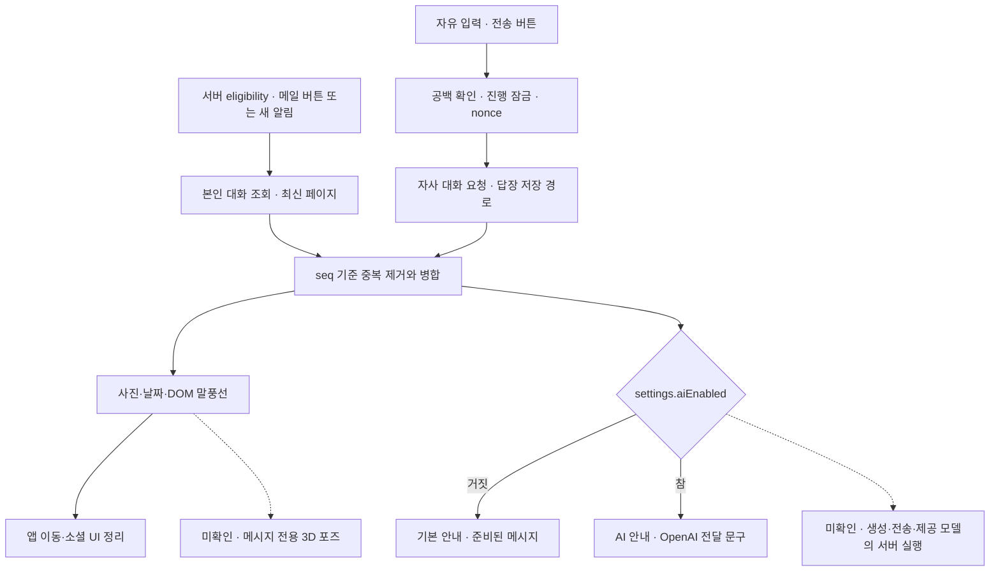

# 반려동물 대화 · ‘아이의 추억 메시지’

확인일 **2026-11-25 (한국시간)** · 9차 · [별꾹 공개 웹](https://starkkuk.com/)

**배포 코드와 공식 처리방침의 안내가 서로 다르다.** `settings.aiEnabled`가 없거나 거짓일 때의 기본 설정 문구는 준비된 메시지를 설명한다. 이 값이 참인 분기에는 AI로 만든 추억 답장이며 마지막 답장과 보호자 호칭이 **OpenAI**에 전달된다는 안내가 있다. 확인한 공식 개인정보 처리방침은 답장·편지의 분석 생성과 외부 AI 전송을 하지 않는다고 설명한다. 실제 서버 플래그, 이용자 적용 범위, 외부 전송 또는 제공자·모델의 실운영은 미확인이다. [pet-chat.js 8·16~17행](https://starkkuk-media.asdfstudio-cs.workers.dev/builds/0a5b2cc8aba470fa17f661ef/pet-chat.js) · [pet-chat-copy.mjs 2~7행](https://starkkuk-media.asdfstudio-cs.workers.dev/builds/51a5a5771859749cc4b2bc1f/pet-chat-copy.mjs) · [공식 개인정보 처리방침](https://starkkuk.com/privacy.html)

기능의 실제 브라우저 명칭은 ‘아이의 추억 메시지’이며 편지·추모글 시스템과는 별도다. 첫 초기 DOM에 모듈이 등록되는 근거는 기존 조사에서 사용했다. 대화 열기에는 읽음 변경이 따라올 수 있어 이 단계에서는 회원 대화창을 열거나 메시지를 전송하지 않았다.

## H. 입력·대화 기록·캐릭터 반응의 경계

## 진입·입력·기록 함수

| 함수·위치 | 입력과 호출 시점 | 상태·화면·오류 |
|---|---|---|
| [pet-chat.js](https://starkkuk-media.asdfstudio-cs.workers.dev/builds/0a5b2cc8aba470fa17f661ef/pet-chat.js) 6~11·32·44~46행 · `createPetChat` / `open` | 생성 시 메일 아이콘은 숨김이다. 자사 조회의 `eligible`가 참일 때 표시한다. 수동 클릭과 읽지 않은 메시지의 자동 진입이 모두 가능하도록 코드가 연결돼 있다. | `readLatest` 후 대화창을 열고 현재 기록과 아이 사진을 표시한다. 자동 열기는 탭 숨김·이동·다른 UI를 고려한다. 열린 뒤 `seen` 요청을 한다. 실제 서버 자격은 출석·로그인 실험으로 확인하지 않았다. |
| [pet-chat.js](https://starkkuk-media.asdfstudio-cs.workers.dev/builds/0a5b2cc8aba470fa17f661ef/pet-chat.js) 19~31·49~50행 · `draw` / 전송 핸들러 | 자유 입력 textarea 최대 3,000자. 폼 버튼 또는 Ctrl/⌘+Enter. IME 조합 중에는 단축키를 처리하지 않는다. 본문이 공백이면 제출을 막는다. | `sender`에 따라 DOM 정렬, 아이 사진과 표시 이름, 한국 시간으로 날짜·시각을 그린다. `kind==='support'`일 때는 서비스 안내 라벨이 붙는다. 선택지형 메시지 작성 UI는 확인되지 않았다. |
| [pet-chat.js](https://starkkuk-media.asdfstudio-cs.workers.dev/builds/0a5b2cc8aba470fa17f661ef/pet-chat.js) 12~18·49행 · `api` / `merge` / `pending` | 자사 `/api/pet-chat`을 통해 `action:'reply'`와 아이 참조·본문·nonce를 처리하는 경로다. 같은 초안을 재시도할 때 메모리의 요청을 재사용한다. 10초 요청 제한과 `sending` 잠금이 있다. | 성공하면 반환 메시지를 `seq`로 병합하고 같은 입력만 비운다. 오류 시 기존 텍스트와 안내를 남길 수 있다. 401에서는 기기를 로그아웃시키는 대신 이 패널의 사용자 상태·메시지·입력을 초기화하고 닫는다. 서버 중복 제거 여부는 미확인이다. |
| [pet-chat.js](https://starkkuk-media.asdfstudio-cs.workers.dev/builds/0a5b2cc8aba470fa17f661ef/pet-chat.js) 32~43·48행 · `readLatest` / 이전 대화 / `forgetLockers` | 로그인 기록에는 최근 메시지, 이전 페이지 존재 여부, 아이 목록과 설정이 사용된다. 오래된 기록의 첫 시퀀스를 기준으로 더 읽을 수 있다. | 이전 페이지를 위에 합쳐 스크롤을 보정한다. 소유 추모함 목록이 바뀌면 메모리의 메시지·해당 알림 키·열린 화면을 정리한다. 이 메모리 정리는 서버의 기록 삭제를 뜻하지 않는다. |
| [pet-chat.js](https://starkkuk-media.asdfstudio-cs.workers.dev/builds/0a5b2cc8aba470fa17f661ef/pet-chat.js) 43·47·51~59행 · `markRead` / `poll` / 설정 변경 | 코드의 폴링은 기본 20초(대화 자격) 또는 60초(미자격)로 예약하고, 가시성 복귀 시 확인한다. 자격이 있을 때 현재 장면 정보를 담은 `tick` 요청이 있다. 알림은 받기, 1시간 쉬기, 받지 않기로 설정한다. | 새 메시지·안 읽음 배지, 현재 표시 여부를 갱신한다. 탭 숨김에서 타이머 중지, 포커스가 필요한 작업 중 자동 표시 보류, 설정 변경 실패 시 이전 응답을 다시 표시한다. 하루 한 번 문구는 알림/아이 메시지의 안내이며 브라우저의 폴링 주기나 실제 서버 할당량과 구분한다. |
| [app.js](https://starkkuk-media.asdfstudio-cs.workers.dev/builds/2300b2b383d429b089959a6f/app.js) 2713행 · `onOpen`, 774·2077·2215행 | 대화창 진입 때 의식·이동·경로 표시와 근접 소셜 UI를 정리한다. 추모함 제거, 프로필 변경, 사진 저장 뒤 대화 자격을 다시 확인할 수 있다. | 반려동물 이름·사진은 2D 대화창에서 보인다. 대화 수신이 직접 Three.js 반려동물의 클립, 말풍선, 제스처를 바꾸는 호출은 확인되지 않았다. 산책 중 별도 3D 안내 말풍선은 앱 공통 렌더 경로에 있다. [app.js 2551행](https://starkkuk-media.asdfstudio-cs.workers.dev/builds/2300b2b383d429b089959a6f/app.js) |

## 두 메시지 안내와 개인정보

| 항목 | 확인된 근거 | 미확인 |
|---|---|---|
| 기본 메시지 | 설정 DOM의 기본 설명은 준비된 문장 1,000개 중 시간대·공간에 맞는 문장, 한국 시간 기준 하루 한 번, 여러 아이의 교대 표시를 안내한다. 답장은 실시간 응답을 돌려주는 용도가 아니라는 문구도 있다. | 실제 서버 문장 수와 선택 방식·제한, 메시지 생산 실측 |
| 조건부 AI | `reflectSettings`는 `settings.aiEnabled`에서 설명 문구를 변경한다. 조건부 한국어·영어·베트남어 안내는 이전 답장과 호칭으로 짧은 추억 답장을 만들며, 새 답장/생성 결과가 없으면 준비된 메시지를 쓴다고 설명한다. | 실제 플래그 대상, 서버의 생성 사용, OpenAI API 호출·모델명, 대화 원문 전달과 보존 |
| 안전 안내 | AI 안내는 반려동물의 말투를 빌린 추억 메시지라고 명시하며 실제 의사 전달과 구분한다. DOM에 알림 쉬기·끄기, 서비스 안내 분류가 있다. | 별도 위험 상황 감지, 상담 연결, 서버 안전 정책과 효과. `support` 라벨만으로 심리적 안전 시스템을 증명할 수 없다. |
| 대화 데이터 | 공개 정책은 메시지·답장·전송 시각·알림 설정을 기록 제공 목적으로 보관하고 당사자 열람과 고객지원 삭제 요청을 설명한다. 로컬 저장은 이 모듈 기준 마지막 자동 알림 시퀀스를 다룬다. | 데이터의 실제 보존 기한, 서버 권한 검증, 생성 플래그와 처리방침이 어떤 운영 상태를 설명하는지 |

[pet-chat.js 7~18·23~30·32~59행](https://starkkuk-media.asdfstudio-cs.workers.dev/builds/0a5b2cc8aba470fa17f661ef/pet-chat.js) · [pet-chat-copy.mjs 2~7행](https://starkkuk-media.asdfstudio-cs.workers.dev/builds/51a5a5771859749cc4b2bc1f/pet-chat-copy.mjs) · [공식 개인정보 처리방침, 시행 2026-11-12](https://starkkuk.com/privacy.html)

**정적 코드 근거** `ev_821196bf7ae53368c64af12b54f8fea83b8abeceebe3b2a9f0b216b224d874ab`, 기존 앱 연결 `ev_e0372954d3510cc68d6bd8d96e538e4f2684c06a11a1751141fd933a88456f69`. 공식 정책은 2026-11-25에 확인했다. 자사 URL까지만 브라우저 호출을 확인했으며, 이 구현에 이용자 데이터를 넣어 실험하지 않았다. 10차에서는 화면 폭에 따른 입력·포커스·키보드, 백그라운드 복귀, 개인정보 안내 버전의 불일치를 후속 확인 대상으로 삼는다.
