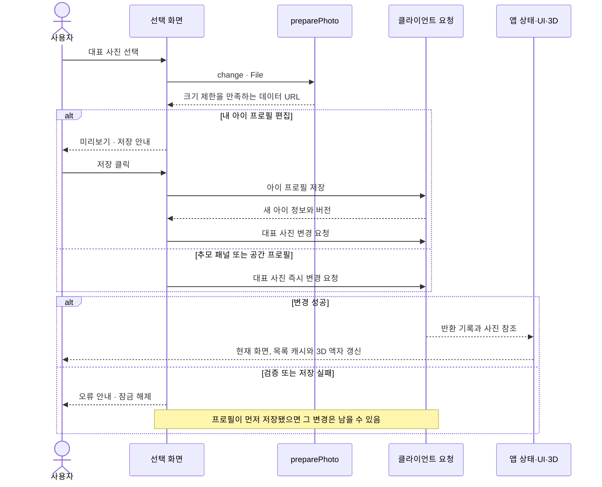
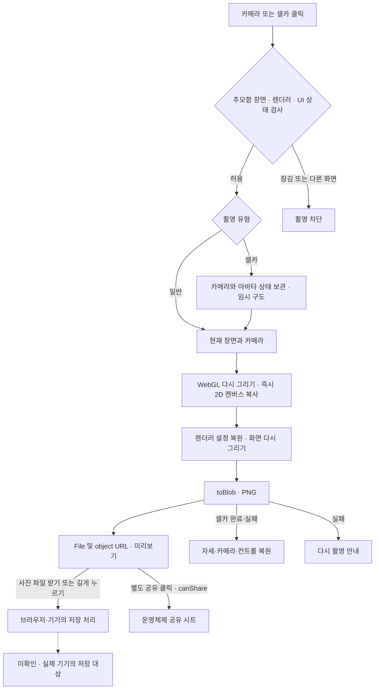

# 별꾹의 사진 전처리·전송·3D 캡처

확인일 **2026-11-24 (한국시간)** · [별꾹 공개 웹 클라이언트](https://starkkuk.com/) · 6차 코드 학습

## 같은 ‘사진’ 버튼에서 시작하지 않는 두 경로

| 구분 | 대표 사진 선택·저장 | 추모 공간 카메라·셀카 |
|---|---|---|
| 입력 | 사용자가 기기에서 선택한 `File` | 현재 Three.js 장면 또는 셀카 자세의 프레임 |
| 전처리 | 파일 바이트에서 형식 판별 → 디코드 → 2D 리사이즈 → WebP 또는 JPEG 데이터 URL | WebGL 다시 그리기 → 2D 캔버스로 복사 → PNG `Blob` |
| 저장 위치 | 클라이언트 코드의 추모 기록 변경 요청에 들어간다. 서버 파일 보존 방식은 미확인 | 브라우저·기기의 다운로드 또는 공유 대상. 촬영 경로에서 서비스 업로드 호출은 확인되지 않았다. |
| 결과 UI | 선택 화면의 미리보기 또는 추모 패널·3D 사진 액자 | 촬영 미리보기 대화상자와 해상도, 다운로드, 지원 기기의 공유 버튼 |
| 관찰 범위 | 기존 비로그인 화면에서 진입 조건과 추모 UI 일부만 확인. 실제 사진 선택·전송·반영 미관찰 | 초기 DOM에 컨트롤 및 미리보기 요소가 등록된 것을 확인. 촬영·파일 받기·공유 결과 미관찰 |

이 문서의 코드 확인은 기존 REA 증거와 추가 공개 JS 원문에 근거한다. 서버 요청이나 장면 캡처를 실험하지 않았다. 실제 사진과 글 본문은 분석 자료에 포함하지 않았다. 전체 추모 기록과 역할은 [추모 기록 보고서](Memorial_Gallery_Letters.md)에서 설명한다.

## B. 사진 선택과 저장 시퀀스

화살표는 공개 코드에 있는 호출이다. ‘클라이언트 요청’은 전송 코드의 경계이며 응답과 실제 저장 결과는 관찰하지 않았다.

### 선택·검증·인코딩

| 함수와 위치 | 입력 → 처리 → 출력 또는 오류 |
|---|---|
| [pet-profile-ui.js](https://starkkuk-media.asdfstudio-cs.workers.dev/builds/3a3f10267566a34e124eacc2/pet-profile-ui.js) 51~63행 · 사진 및 폼 핸들러 | 사진 선택 `click`으로 파일 입력을 연다. `change`에선 유효한 파일이 있고 잠금 상태가 아닐 때 `photoData`를 기다린다. 현재 편집 세대에만 `photoDraft`를 반영하고 ‘저장을 누르면’ 안내한다. 제거 확인은 초안을 `null`로 바꾼다. 폼 저장은 이름·날짜 확인 → 프로필 POST/PUT → 응답의 버전으로 사진 저장이다. |
| [memorial.js](https://starkkuk-media.asdfstudio-cs.workers.dev/builds/8303386815792b082ce80924/memorial.js) 31~42행 · `draw` 안의 사진 핸들러 | 소유자에게 ‘사진 등록’ 버튼을 연결한다. 파일 선택 뒤 현재 화면·진행 상태를 재확인하고 전처리한다. `PUT`으로 대표 사진을 교체하고 응답으로 패널을 다시 그린다. 예외는 패널 오류로 안내하며 입력값 초기화·잠금 해제는 `finally`가 맡는다. |
| [app.js](https://starkkuk-media.asdfstudio-cs.workers.dev/builds/2300b2b383d429b089959a6f/app.js) 2083·2145~2157·2211~2219행 · `uploadPhoto` / `savePetPhoto` | 공간 프로필의 파일 `change`는 즉시 저장 흐름으로 연결된다. 호출자는 추모함·아이·버전을 먼저 잡아 둔다. `savePetPhoto`는 편집 조건 확인 → 기존 기록 사용 또는 조회 → 변경 요청 → `applyMemorial` → 앱 저장과 관련 UI 갱신 순서이며 성공 여부를 불리언으로 돌려준다. 제거는 `photo:null` 전달이다. 실패는 토스트로 알려 준다. 계정 프로필 호출자는 이 불리언을 확인해 사진 저장 실패를 폼 오류로 전파한다. |
| [photo-input.mjs](https://starkkuk-media.asdfstudio-cs.workers.dev/builds/904f7c0ddf5b269cc8d5a851/photo-input.mjs) 3~21행 · `preparePhoto(file, options)` | 0바이트·용량 초과를 거른다. 최초 32바이트에서 JPEG·PNG·WebP·일부 HEIF 계열 헤더를 확인한다. 필요 시 MIME을 바로잡은 `Blob`을 만들고 `createImageBitmap`을 우선 시도한다. 실패하면 임시 URL의 `Image.onload/onerror`를 Promise로 기다린다. 크기를 확인해 흰 바탕의 2D 캔버스에 그리고 인코딩 문자열을 반환한다. 이미지 비트맵과 임시 URL은 `finally`에서 정리한다. |
| [photo-encoding.mjs](https://starkkuk-media.asdfstudio-cs.workers.dev/builds/a999c7e35755d788f901ef07/photo-encoding.mjs) 3~14행 · `encodePhotoCanvas` | 캔버스와 최대 문자열 길이, 품질 후보를 받는다. 크기 단계마다 WebP를 시도하고 브라우저가 WebP를 반환하지 않으면 JPEG로 대체한다. 허용 MIME과 문자열 길이를 확인한다. 실패하면 각 변을 약 80%로 줄이며 최초 포함 최대 4개 크기에서 시도한다. 모두 실패하면 이미지 크기를 줄이라는 오류를 낸다. |

**기본 대표 사진 입력 제한.** 공간 프로필 UI의 JPG·PNG·WebP, 20 MB 안내에 대응하는 기본 전처리 값은 파일 크기 **20 MiB** 및 출력 캔버스의 긴 변 **최대 640 px**다. 기본 데이터 URL은 접두어와 Base64를 포함해 **120,000자 이하**, 품질 후보는 0.78·0.65·0.52다. 디코더에 전달된 리사이즈 요청이 실제 디코드 크기에 영향을 줄 수 있으므로 이 값은 정확한 출력 해상도 보장이 아니다. HEIC 계열은 헤더 인식과 브라우저 디코딩 성공이 별개다. 사진 선택창의 `accept` 속성만으로 검증을 끝내지 않는다. [app.js 2145행](https://starkkuk-media.asdfstudio-cs.workers.dev/builds/2300b2b383d429b089959a6f/app.js) · [memorial.js 36행](https://starkkuk-media.asdfstudio-cs.workers.dev/builds/8303386815792b082ce80924/memorial.js) · [photo-input.mjs 3~21행](https://starkkuk-media.asdfstudio-cs.workers.dev/builds/904f7c0ddf5b269cc8d5a851/photo-input.mjs) · [photo-encoding.mjs 3~14행](https://starkkuk-media.asdfstudio-cs.workers.dev/builds/a999c7e35755d788f901ef07/photo-encoding.mjs)

**전처리 모듈 재사용.** `portrait:true`의 224×280 / 70,000자, 모델 사진의 100 MiB / 2,048 px / 900,000자, 광장·콘테스트의 20 MiB / 1,400 px / 400,000자는 옵션별 코드다. 위 대표 사진 호출부는 별도 옵션 없이 호출하며, 광장 업로더는 `board:true`를 명시한다. 출력 길이는 문자열 정책이다. 파일 용량이나 서비스의 실제 서버 저장 용량과는 별개의 수치다. 캔버스 재인코딩은 원본 파일을 그대로 전송하지 않는다는 근거다. 원본 메타데이터의 포괄적 삭제나 서버 보관 정책은 확인할 수 없다. [photo-input.mjs 3~21행](https://starkkuk-media.asdfstudio-cs.workers.dev/builds/904f7c0ddf5b269cc8d5a851/photo-input.mjs) · [plaza-boards-ui.js 78~79행](https://starkkuk-media.asdfstudio-cs.workers.dev/builds/57d83d47ccb6428364f3da4b/plaza-boards-ui.js)

### 응답, 캐시, 사진 액자

1. **요청과 응답.** `memorialRequest`는 대표 사진 변경을 `photo`와 버전 등이 들어 있는 JSON으로 작성한다. `photoSource`는 응답 표현을 허용된 서비스 상대 경로 또는 제한된 JPEG·PNG·WebP 데이터 URL로 제한한다. 데이터 URL 수신 필터의 150만 자 미만 조건은 업로드 인코더 제한과 별도다. `photoDeliveryURL`은 허용된 일부 공개 형식의 상대 경로만 사진 CDN 주소로 바꾼다. 형식 허용 목록은 접근 권한 보장이 아니다. [memorial.js 10~14·41~42행](https://starkkuk-media.asdfstudio-cs.workers.dev/builds/8303386815792b082ce80924/memorial.js) · [photo-source.mjs 1~9행](https://starkkuk-media.asdfstudio-cs.workers.dev/builds/7c1f7a010ec2d1faec8408c1/photo-source.mjs)
2. **현재 추모함.** `applyMemorial`이 배정과 버전을 대조한 뒤 아이별 대표 사진·썸네일을 갱신한다. 값이 달라지면 피드 캐시를 무효화한다. 선택된 아이의 `state.photo`도 갱신한다. `updatePhoto`는 사진을 가로 384 px의 비율별 캔버스에 맞춰 그리고 `CanvasTexture`로 3D 액자 재질에 올린다. 늦은 이미지 로드는 사진 버전과 메시 존재를 대조하며 이전 텍스처는 해제한다. 이미지 로드 오류나 빈 사진에는 대체 표시가 있다. [app.js 722~752·1849~1867행](https://starkkuk-media.asdfstudio-cs.workers.dev/builds/2300b2b383d429b089959a6f/app.js)
3. **홀의 다른 액자.** `createLockerPhotos`는 추모함과 아이로 키를 만든다. 등록된 참조가 있으면 직접 활용하고, 필요한 경우 선택적 사진 조회 경로를 사용한다. 이 경로는 채널 래퍼를 별도로 호출하는 `memorialRequest`와 달리 소스에서 루트 상대 URL의 `fetch`를 사용한다. 캔버스는 160×200 px에서 잘라 맞춘다. 근거리·시야 여유 범위·앞면 여부를 검사하며 거리가 45 미만인 대상을 우선 대상으로 삼고 50 이상이면 진행 요청을 취소하고 GPU 텍스처를 걷는다. `Map` 데이터는 180초 기준으로 재조회할 수 있고 256개를 넘으면 멀어진 항목부터 비운다. 256개는 모든 상황에서 강제되는 상한이 아니다. 동시 2건과 약 350ms당 2건 제한, 8초 타이머, HTTP 429의 재시도 지연이 확인된다. [locker-photos.js 7~24·42~74행](https://starkkuk-media.asdfstudio-cs.workers.dev/builds/bb7677c26d7a17ea7d835357/locker-photos.js)
4. **일부 실패.** 프로필 POST/PUT 성공으로 새 아이·버전이 먼저 반영된 뒤 사진 PUT이 실패할 수 있다. 사진 단계의 실패는 오류로 표시하고 재시도할 수 있는 편집 상태가 남는다. 두 저장을 한 번에 취소하는 트랜잭션은 클라이언트 경로에서 확인되지 않았다. 반대로 홀 썸네일 반복 로드는 실패한 항목을 지수형 지연으로 다시 시도하고, 화면이 숨겨졌거나 대상이 멀어졌다면 요청을 줄인다. [pet-profile-ui.js 54~63행](https://starkkuk-media.asdfstudio-cs.workers.dev/builds/3a3f10267566a34e124eacc2/pet-profile-ui.js) · [app.js 2083·2211~2219행](https://starkkuk-media.asdfstudio-cs.workers.dev/builds/2300b2b383d429b089959a6f/app.js) · [locker-photos.js 42~74행](https://starkkuk-media.asdfstudio-cs.workers.dev/builds/bb7677c26d7a17ea7d835357/locker-photos.js)

## D. 3D 촬영과 기기 저장

| 함수와 위치 | 입력 → 처리 → 출력 또는 오류 |
|---|---|
| [app.js](https://starkkuk-media.asdfstudio-cs.workers.dev/builds/2300b2b383d429b089959a6f/app.js) 2559~2569행 · `canTakeNichePhoto`와 연결 | 추모 공간, 선택 기록, WebGL 컨텍스트, 연출과 다른 패널 상태를 확인하고 장면·카메라·렌더러를 주입한다. 촬영 가능 여부와 일시적인 버튼 잠금 조건은 별개다. |
| [niche-photo.js](https://starkkuk-media.asdfstudio-cs.workers.dev/builds/8976452c83343942dffbf241/niche-photo.js) 8~27·28~53행 · `createNichePhotoUI` / `shoot(mode)` | 버튼·대화상자를 DOM에 등록하고 현재 장면에 따라 노출한다. 클릭으로 모드를 선택하고 중복 요청을 막는다. 세대·화면 조건을 다시 확인한 뒤 PNG 또는 JPEG 형식의 비어 있지 않은 Blob을 `File`로 묶고 object URL을 만든다. 다운로드 링크와 해상도를 갱신하며 종료·화면 전환 시 URL을 해제한다. 실제 하위 촬영 함수의 출력은 PNG다. |
| [niche-capture.mjs](https://starkkuk-media.asdfstudio-cs.workers.dev/builds/178e70744f12bb6706f3c2f5/niche-capture.mjs) 6~10·15~50·61~88행 · `captureDimensions` / `copyFrame` / `capture` | 장면 종횡비에 맞춰 긴 변 2,560 px·400만 픽셀과 실제 WebGL 버퍼·뷰포트·텍스처 한도의 최솟값을 적용한다. 렌더링 상태를 스냅샷하고 같은 렌더러로 다시 그린 다음, 버퍼 유지 옵션에 의존하지 않고 같은 동기 단계에서 2D 캔버스로 복사한다. 화면 크기·픽셀 비율·뷰포트·가위 영역·이전 렌더 타깃을 복원하고 필요한 경우 가시 화면을 다시 그린다. 메모리 계열 오류 때는 긴 변 1,920 px·2,304,000픽셀 한도로 조건부 재시도한다. 컨텍스트 손실과 XR 표시 중 촬영은 차단한다. |
| [niche-capture.mjs](https://starkkuk-media.asdfstudio-cs.workers.dev/builds/178e70744f12bb6706f3c2f5/niche-capture.mjs) 53~58·84~87행 · `encode(canvas)` | 콜백 기반 `canvas.toBlob`을 Promise로 감싼다. PNG를 기다리며 빈 Blob, 예외, 15초 제한을 실패로 처리한다. `capture`는 성공 시 `{blob,width,height}`를 돌려주고 마지막에 캔버스 크기를 줄여 메모리 해제를 돕고 작업 잠금을 푼다. |
| [niche-selfie.mjs](https://starkkuk-media.asdfstudio-cs.workers.dev/builds/67c6599771a6c97c23238257/niche-selfie.mjs) 25~66행 · `createNicheSelfie` / `capture(captureFrame)` | 아바타 계층의 변환, 카메라 투영, 컨트롤을 보관한다. 아바타 자세·스케일과 카메라 구도를 일시 변경한 뒤 같은 촬영 콜백을 호출한다. 완료·취소·오류 경로에서 이전 상태를 복원한다. 이 모듈 경로에는 기기 카메라 접근이 확인되지 않았다. |
| [niche-photo.js](https://starkkuk-media.asdfstudio-cs.workers.dev/builds/8976452c83343942dffbf241/niche-photo.js) 36~53행 · `sharePhoto` / `close` | `navigator.share`와 `canShare({files})`가 지원할 때 버튼을 보여 준다. 공유는 촬영 후 별도 클릭에서 실행한다. 사용자의 공유 취소는 오류 메시지를 띄우지 않고, 다른 실패는 파일 받기·길게 눌러 저장 안내로 보완한다. 개별 기기 공유 결과는 미확인이다. |

**용어.** `File`은 이름·형식이 있는 바이너리 객체다. `Blob`은 이름 없이 바이트를 담을 수 있다. 데이터 URL은 이미지 바이트를 텍스트에 넣을 수 있어 JSON 전송에 쓰이며, object URL은 현재 브라우저 안의 Blob을 가리키는 짧은 주소다. `CanvasTexture`는 2D 캔버스 그림을 3D 표면에 표시하는 텍스처다. WebGL 컨텍스트는 브라우저가 GPU 자원과 그리기 상태를 다루는 통로다.

## 확인된 사실과 미확인 항목

| 구분 | 판정 |
|---|---|
| 사진 선택과 서비스 요청 | 대표 사진 교체·제거를 위한 코드와 별도 프로필 저장 단계를 확인했다. 실제 기기의 디코딩 품질·서버 업로드·삭제는 미관찰이다. |
| 광장 사진 | 전처리 도구를 재사용하지만 광장 옵션과 게시물 요청을 별도로 사용한다. 광장 사진 노출·보관과 추모함 사진의 서버 저장 관계는 미확인이다. [plaza-boards-ui.js 27~34·78~79행](https://starkkuk-media.asdfstudio-cs.workers.dev/builds/57d83d47ccb6428364f3da4b/plaza-boards-ui.js) |
| 캐시와 사진 공개 | 화면·렌더용 캐시 정책을 확인했다. 누가 어떤 사진을 볼 수 있는지, 이전 사진 파일이 즉시 삭제되는지, 백업·CDN 보존 기간은 미확인이다. |
| 캡처와 공유 | 로컬 생성·공유의 코드와 초기 DOM 등록이 확인됐다. 실제 장면 판독성, 운영체제 사진 앱 저장 여부, 다른 앱으로 보내는 동작은 미관찰이다. |
| 추정 | 느린 기기에서 4백만 픽셀 캡처가 부하를 줄 수 있으며 저해상도 재시도는 그 영향을 줄이기 위한 코드로 해석된다. 기기별 메모리·성능 측정은 수행하지 않았다. |

기존 화면과 앱 연결 근거는 [화면 지도](../Architecture/Screen_Map.md)와 [모듈 인벤토리](../Architecture/Module_Inventory.md)를 재사용했다. 보완 정적 코드 캡처는 REA `ev_77cf6124a7da890a66a01dcbccef541df27e25ebb8b2b7bb1d2301f43a634afa`이다. 링크의 행 번호는 해당 공개 빌드 원문 기준이다.
