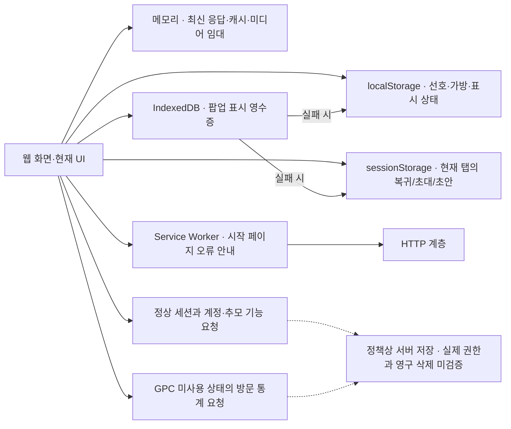

# 개인정보와 사용자 데이터 수명

확인일 2026-11-25 KST. 공식 처리방침 **시행일 2026-11-12**, 웹 런타임 앱 빌드 `badddc113c1ef830a03b6dd9`, 현행 대화 빌드 `cd4d8bfb2e95af4a301f2e49`와 안내 빌드 `2de9907e39e33bd1dbd60ab9`를 대조했다. 사용자 계정, 브라우저 저장소 값, 다른 사람의 사진·대화·모델·결제 내역을 열람하거나 저장하지 않았다. [공식 개인정보 처리방침](https://starkkuk.com/privacy.html), [app.js](https://starkkuk-media.asdfstudio-cs.workers.dev/builds/badddc113c1ef830a03b6dd9/app.js), [pet-chat.js](https://starkkuk-media.asdfstudio-cs.workers.dev/builds/cd4d8bfb2e95af4a301f2e49/pet-chat.js), [pet-chat-copy.mjs](https://starkkuk-media.asdfstudio-cs.workers.dev/builds/2de9907e39e33bd1dbd60ab9/pet-chat-copy.mjs).

## H. 기기 저장소와 서버 데이터

| 저장 계층 | 코드에서 확인한 데이터·수명 | 남아 있는 확인 |
|---|---|---|
| `localStorage` | 앱의 채널별 기본 상태·가방을 읽고, 조건에 맞는 기본 반려동물 정보를 정규화 후 저장한다. 외형·선물 상태·단축키 선택·언어·프롬프트 상태는 별도 키다. `save()`와 `storeBag()`에는 저장 실패 안내가 있다. 기본 상태에는 사진 참조/편지 필드가 있으나 전달받은 객체가 실제로 어떤 기기에서 어떤 값으로 남았는지는 검사하지 않았다. [state.mjs](https://starkkuk-media.asdfstudio-cs.workers.dev/builds/a3b1d88b0925d721cd7937e4/state.mjs) 25~26·43~55행, [app.js](https://starkkuk-media.asdfstudio-cs.workers.dev/builds/badddc113c1ef830a03b6dd9/app.js) 598·913·1175행, [hud-shortcuts.js](https://starkkuk-media.asdfstudio-cs.workers.dev/builds/929b1c699d4e6f8338a6e9f2/hud-shortcuts.js) 3·18~21·57~60행, [channel-entry.mjs](https://starkkuk-media.asdfstudio-cs.workers.dev/builds/6efd01555121fe0e7f65b45c/channel-entry.mjs) 3~9행, [install.js](https://starkkuk-media.asdfstudio-cs.workers.dev/builds/04ac9ef5e12baa98fef30b13/install.js) 7~16·45~49행. | 계정·채널 전환 및 로그아웃 후 남는 모든 키의 전체 목록, 기존 기기 데이터 삭제 결과. |
| `sessionStorage` | 로그인 후 돌아갈 추모함·프로필 복귀 주소, 외부 브라우저 안내 상태, 진행 중 가족 초대, 후원 폼/일부 결제 복구 메타데이터를 별도 경로로 유지한다. 사진 증빙 원본을 후원 입력 세션 키에 넣었다는 근거는 확인되지 않았다. [app.js](https://starkkuk-media.asdfstudio-cs.workers.dev/builds/badddc113c1ef830a03b6dd9/app.js) 532~538행, [auth.js](https://starkkuk-media.asdfstudio-cs.workers.dev/builds/cd6d0eb0452f2c2bb42cc56a/auth.js) 23~37행, [family-invite.js](https://starkkuk-media.asdfstudio-cs.workers.dev/builds/4acdc000a12079c76c638e65/family-invite.js) 7~8·19행, [external-browser.js](https://starkkuk-media.asdfstudio-cs.workers.dev/builds/7e7908b7c54d55250e452830/external-browser.js) 3~11행, [play-support-client.mjs](https://starkkuk-media.asdfstudio-cs.workers.dev/builds/79ac4112e839d43578e9c947/play-support-client.mjs) 26~34행, [후원 초안 분석](Payment_Sponsorship.md). | 세션 복원 및 서버 결제 상태의 실제 차이, 휴대폰·브라우저 종료 후 잔존 동작. |
| IndexedDB | `popup-once.mjs`가 `starkkuk-popup-receipts` v1과 `seen` 저장소를 열고, 키에 표시 여부를 기록한다. 한 readwrite 트랜잭션에서 읽고 기록해 여러 탭의 중복 알림을 억제한다. 장애 시 Web Storage와 메모리를 사용한다. 사이트 공지의 키를 만들 때 현재 회원 구분자와 공지 문구를 사용한다. [popup-once.mjs](https://starkkuk-media.asdfstudio-cs.workers.dev/builds/e7913c89edfb4c9117ddacc0/popup-once.mjs) 1~41행, [telemetry.js](https://starkkuk-media.asdfstudio-cs.workers.dev/builds/065ad84158c7bb39c938fa29/telemetry.js) 14~24행. | IndexedDB 전체 인벤토리·만료 정책·실제 사용자 값은 미검증. |
| Cache Storage와 HTTP 캐시 | 조사한 서비스 워커의 처리 범위는 루트 탐색과 실패 안내다. 그 안에 Cache Storage 기록 경로는 없다. 앱의 ETag/304는 메모리 목록 캐시이며, 이 사실로 브라우저의 HTTP 캐시 저장이나 모든 앱 데이터 캐시를 배제할 수 없다. [sw.js](https://starkkuk.com/sw.js) 1~10행, [locker-feed.js](https://starkkuk-media.asdfstudio-cs.workers.dev/builds/59f6a087dbd27f69d544cc4e/locker-feed.js) 8~35행. | 사이트의 등록·활성 컨트롤러 및 Cache Storage 실시간 열람 미검증. |
| 서버·쿠키 | 정책은 로그인 세션 및 로그인 요청 확인 정보, 서비스 저장, 결제 검증, 운영 로그의 목적을 설명한다. 로그인 세션 최대 30일, 로그인 요청 확인 최대 10분은 정책상 한도다. 사진·편지·모델 파일에 대한 모든 서버 경로·백업 시점·실제 데이터 파기 결과는 공개 코드로 알 수 없다. [별꾹 개인정보 처리방침](https://starkkuk.com/privacy.html). | 실제 쿠키 값, 로그, 유지 기간 준수, 계정 간 접근 권한과 서버의 실제 처리는 미검증. |

## 계정 연결, 로그아웃, 가족과 삭제

- `auth.js`의 `refresh()`는 계정 응답을 `cache:'no-store'` 및 8초 제한으로 읽고 오류 안내를 갱신한다. 로그아웃 버튼은 성공 후 채널 홈으로 이동한다. 연결 UI는 현재 계정과 세션을 다시 확인하며 종료 시 타이머와 in-flight 요청을 중단한다. 연결 코드가 만료되거나 계정이 바뀌면 현재 코드·확인 토큰·요약 데이터를 버린다. 현행 웹에는 조건부 토스 계정 연결 UI도 있다. 실제 연결 및 서버 데이터 병합 정책은 미검증이다. [auth.js](https://starkkuk-media.asdfstudio-cs.workers.dev/builds/cd6d0eb0452f2c2bb42cc56a/auth.js) 66~80·108~123행, [account-link-ui.mjs](https://starkkuk-media.asdfstudio-cs.workers.dev/builds/36e555caa7872847b53f5e47/account-link-ui.mjs) 19~66·77~98·138~139행.
- 가족 초대는 소유자에게 보이는 진입과 가족 초대받은 사용자의 미리보기·로그인·참여 흐름을 분리한다. 해시에서 받은 초대 표식은 세션에 보류 후 주소에서 제거하는 처리와, 완료·일부 오류에서 세션 참조를 제거하는 처리가 있다. 편집과 공동 관리 범위를 화면에 안내하고, 실제 서버의 허용·철회·계정 간 권한은 기기 코드만으로 판정하지 않는다. [family-invite.js](https://starkkuk-media.asdfstudio-cs.workers.dev/builds/4acdc000a12079c76c638e65/family-invite.js) 7~8·13·18~32행, [5차 계정과 소유권](Authentication_Profiles.md).
- 회원탈퇴 UI의 미리보기는 채널별 추모함·나무·가족 링크·게시물·등불·꾹키 수 합계를 표시한다. 명시 확인 후 요청이 결과 불명확이면 보류 화면과 상태 재조회로 전환하고, 완료 응답은 완료 안내와 홈 이동으로 연결된다. 앱 코드가 본인의 로컬 키를 전부 없애거나 백업이 즉시 제거된다고 볼 증거는 없다. 운영자 정책은 고객지원 삭제 요청과 본인 확인, 삭제 제한 사유, 정기 백업의 7일 만료 뒤 다음 정리에서 제거를 명시한다. [account-deletion-ui.mjs](https://starkkuk-media.asdfstudio-cs.workers.dev/builds/624cdc9e5c8a09b36aca9cf8/account-deletion-ui.mjs) 9~51행, [auth.js](https://starkkuk-media.asdfstudio-cs.workers.dev/builds/cd6d0eb0452f2c2bb42cc56a/auth.js) 114~117행, [공식 정책](https://starkkuk.com/privacy.html).

## 공개 범위·통계·대화

| 항목 | 서로 다른 근거와 경계 |
|---|---|
| 사진·편지·추모글, 후원 표시 | 공식 정책은 추모함에 등록한 사진·편지·추모글이 방문객에게 보일 수 있고, 같은 공간의 방문 이름·아바타 위치도 함께 보인다고 설명한다. 승인 후원의 공개 항목과 신청자·운영자만 보는 결제 증빙은 별도다. `photo-source`/모델 URL 검증과 UI 가림은 공개 코드의 참조 처리이며 실제 서버 ACL 검증은 미확인이다. [정책](https://starkkuk.com/privacy.html), [6차 미디어](Photo_Media_Pipeline.md), [9차 맞춤 모델](Custom_Model_Pipeline.md). |
| 운영 통계의 전송과 보관 | GPC(개인정보 선호를 브라우저에서 전달하는 표식)가 거짓인 공개 코드에서 임의 이벤트 ID, 페이지 경로, `document.referrer`와 UTM을 `keepalive` 방문 전송에 넣는다. 공식 정책은 외부 페이지 전체 주소·검색어와 통계용 IP를 **저장하지 않는다**고 안내한다. 코드에 나타난 입력과 서버가 기록하는 필드는 서로 다른 검증 대상이다. 서버의 가공·저장은 확인하지 않았다. 별도 `site-stats.js` 조회는 문서 숨김 시 취소할 수 있다. [telemetry.js](https://starkkuk-media.asdfstudio-cs.workers.dev/builds/065ad84158c7bb39c938fa29/telemetry.js) 9~17·26~32행, [site-stats.js](https://starkkuk-media.asdfstudio-cs.workers.dev/builds/ce99c035a180af240bb71eb3/site-stats.js) 26~75행, [정책](https://starkkuk.com/privacy.html). |
| 운영 로그와 안내 | 공식 정책의 웹 운영 로그 보관, 회원 접속·신고·차단과 방문 통계 기간은 목적마다 다르다. 공개 앱의 `privacy-notice.js`는 로딩 요소가 없어지면 Google Play 처리 변경 안내를 표시하고 닫기 선택을 기기에 기록한다. 모든 데이터 처리에 포괄 동의를 받는 기능으로 해석할 수 없다. [공식 정책](https://starkkuk.com/privacy.html), [privacy-notice.js](https://starkkuk-media.asdfstudio-cs.workers.dev/builds/5ba686bd277c8cc01d43ba50/privacy-notice.js) 2~28행. |
| 대화와 외부 AI | 현행 `pet-chat.js` 17행은 `settings.aiEnabled`에 따라 안내를 고른다. 안내 모듈 3~7행은 활성 경우 마지막 답장과 호칭을 OpenAI에 보내 생성한다는 문구와 준비된 메시지 경로를 담는다. 공식 정책의 대화 항목은 답장·편지 분석 생성 및 외부 AI 전송을 하지 않는다고 설명한다. 앱 코드의 조건부 안내와 정책의 차이가 10차 배포에서 재확인되었다. 실제 계정의 값, 외부 AI 전송, 이용 범위, 적용 일자는 미확인이다. [pet-chat.js](https://starkkuk-media.asdfstudio-cs.workers.dev/builds/cd4d8bfb2e95af4a301f2e49/pet-chat.js) 8·16~18·32~49행, [pet-chat-copy.mjs](https://starkkuk-media.asdfstudio-cs.workers.dev/builds/2de9907e39e33bd1dbd60ab9/pet-chat-copy.mjs) 3~7행, [공식 정책](https://starkkuk.com/privacy.html). |

공개 로그인·탈퇴 기능의 존재와 정책 문구를 검증 근거로 삼았다. 계정 작업·가족 초대 소비·대화 전송·관리자 처리를 실행하지 않았으며 서버 데이터의 영구 삭제나 개인정보 처리의 적합성은 관찰 범위 밖이다.
