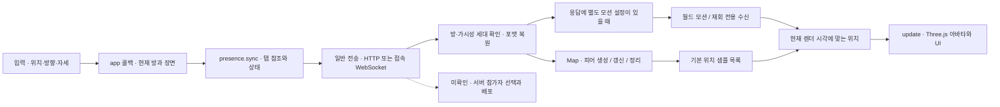
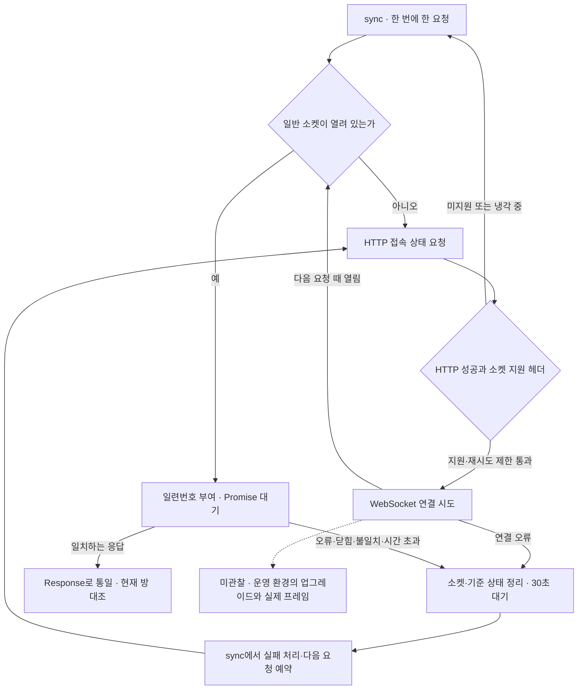
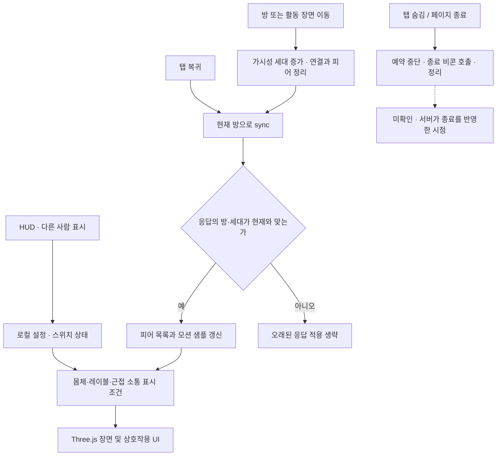

# 별꾹 실시간 접속·전송·원격 아바타

확인일 **2026-11-25 (한국시간)** · [별꾹 공개 웹 클라이언트](https://starkkuk.com/) · 7차 분석

**실행 증거는 초기 HTTP 응답까지다.** 기존 비로그인 네트워크 기록에는 `POST /api/presence` 200 두 건이 있다. WebSocket의 업그레이드 성공, 프레임, 자동 전환·복귀, 여러 사용자의 동시 렌더링은 확인하지 못했다. 아래는 기존 증거 위에 배포 JavaScript의 분기를 읽어 정리한 것이다. 새 조사에서 소켓·서비스 API에 직접 접속하거나 특정 이용자의 위치를 수집하지 않았다. [기존 데이터 흐름](../Architecture/Data_Flow.md) · [기존 모듈 의존성](../Architecture/Module_Dependencies.md)

## 1. 첫 접속에서 원격 목록까지

| 함수·코드 위치 | 호출 시점 → 입력 → 반환 또는 반영 |
|---|---|
| [app.js](https://starkkuk-media.asdfstudio-cs.workers.dev/builds/2300b2b383d429b089959a6f/app.js) 2659행 · `connectPresence(...)` 조립 | 앱이 현재 위치·방·표시 장면·자세·접속 준비·계정 표시 정보·렌더링 대상 장면을 콜백으로 주입한다. 같은 함수가 광장·일반 방·수목원 채널과 별도 활동 장면의 입력을 읽을 수 있다. `isReady`는 주소 상태 준비 또는 제휴 공간 상태를 확인한다. |
| [presence.js](https://starkkuk-media.asdfstudio-cs.workers.dev/builds/cb6a99e7c4103839707d0ab5/presence.js) 35~74·198~205행 · `connectPresence` | 탭 방문 참조 준비, 원격 객체 맵과 모션 시계·전송 모듈 생성, 소셜 UI 연결, 가시성/페이지 수명 이벤트 연결 순서다. 마지막에 `sync()`를 예약하거나 실행하고, 이후 앱이 사용할 `update`·`changeScene`·`disconnect` 등의 인터페이스를 반환한다. |
| [presence.js](https://starkkuk-media.asdfstudio-cs.workers.dev/builds/cb6a99e7c4103839707d0ab5/presence.js) 129~145행 · `payload` / `sync` 앞단 | `payload`는 탭 참조, 표시 이름, 장면/방, 좌표·방향·좌석·활동, 위로·촛불 플래그와 지원 포맷 등의 객체를 반환한다. 특수 활동에는 높이·점프 등의 값이 추가된다. `sync`는 숨김, 요청 진행 중, 준비 상태, 예약 시각을 확인한 뒤 현재 방·세대와 함께 전송을 시작한다. 응답 코드·형식과 도착 시점의 방·세대를 대조한다. |
| [presence.js](https://starkkuk-media.asdfstudio-cs.workers.dev/builds/cb6a99e7c4103839707d0ab5/presence.js) 147~190행 · 응답 적용 | `self`와 역할, 접속 상태, 서버 시계, 특수 채널, 소셜 이벤트, 표시 인구를 갱신한다. 응답 목록에서 자기 자신·다른 방을 제외하고 거리가 가까운 순으로 정리한다. 일반 피어 수 한도는 코드상 모바일 24·기타 30이며 일부 장면은 24를 지정한다. 역할에 따른 제한 예외와 별도 서버 목록이 있으므로 이 수치로 실제 방 정원을 판단할 수 없다. |
| [presence.js](https://starkkuk-media.asdfstudio-cs.workers.dev/builds/cb6a99e7c4103839707d0ab5/presence.js) 127·158~176행 · 원격 아바타 생성·제거 | 피어 ID를 키로 `Map`에 기록한다. 새 피어는 기본 사람 아바타 계층을 복제해 소지품 일부를 제거하고, 레이블·상호작용 표시를 붙여 현재 세계에 추가한다. 이름·성별·역할이 바뀌면 기존 객체와 레이블을 갱신한다. 응답 목록에서 제외된 피어는 부모 장면에서 제거하고 전용 레이블·머티리얼 리소스를 정리한다. |
| [presence.js](https://starkkuk-media.asdfstudio-cs.workers.dev/builds/cb6a99e7c4103839707d0ab5/presence.js) 266~299행 · `refreshIdentity` / `changeScene` / `update(dt,camera)` | 표시 정보 변경은 전송 연결을 닫고 다시 동기화한다. 장면 이동은 세대를 올리고 기존 피어·전송·모션·소셜 상태를 비운다. 프레임 갱신은 샘플 위치를 선택하고 3D 객체 및 상호작용 버튼을 갱신한다. [app.js 2023·2535·2549행](https://starkkuk-media.asdfstudio-cs.workers.dev/builds/2300b2b383d429b089959a6f/app.js) |

**세 종류의 식별자.** 채널별 `sessionStorage`에 유지하는 무작위 탭 참조는 접속·상호작용 문맥을 전달하는 값이다. 응답의 `self`와 각 피어의 `id`는 현재 접속 목록 및 활동의 연결 키다. 로그인 회원 식별은 계정 모듈에서 가져오는 별도 상태다. 방문 이름은 채널별 로컬 저장소의 닉네임, 탭 참조로 고른 기본 이름, 로그인과 소유 기록의 이름·관계로 구성한 표시 이름을 순서에 맞게 사용한다. 펫나잇·역할 표시는 응답 상태에 따라 별도로 바뀐다. 이 경로로 표시 이름을 회원 ID에 역매핑하거나 서버가 탭 참조를 어떻게 검증하는지 확정할 수 없다. [presence.js 35~41·70~74·147~155·207~220·265~266행](https://starkkuk-media.asdfstudio-cs.workers.dev/builds/cb6a99e7c4103839707d0ab5/presence.js) · [visitor-names.mjs 3~28행](https://starkkuk-media.asdfstudio-cs.workers.dev/builds/ab7c5a7d53f5bdacafc39328/visitor-names.mjs) · [계정과 소유권 분석](Authentication_Profiles.md)

**방과 장면의 차이.** `getRoom()`은 통신에 쓰는 방, `getScene()`은 실제 화면 문맥이다. 수목원의 채널은 서로 다른 방 값으로 매핑되고, 추모함은 진입 전 위치의 방 값을 유지할 수 있지만 `getScene()==='niche'`일 때 피어 표시 목록은 비워진다. 활동 장면은 좌표와 카메라, 원격 객체를 붙일 세계까지 바꿀 수 있다. [app.js 2659행](https://starkkuk-media.asdfstudio-cs.workers.dev/builds/2300b2b383d429b089959a6f/app.js) · [presence.js 129·144·158~160행](https://starkkuk-media.asdfstudio-cs.workers.dev/builds/cb6a99e7c4103839707d0ab5/presence.js)

## C. 접속 → 이동 전송 → 원격 캐릭터

실선은 입증된 코드 연결이다. 실제 전송 성공이 관찰된 것은 도입부의 HTTP 두 건이다.

## 2. HTTP·소켓·스냅샷

| 계층 | 조건과 역할 | 실패·복구 |
|---|---|---|
| 일반 HTTP | [presence-transport.mjs](https://starkkuk-media.asdfstudio-cs.workers.dev/builds/157cf728c4c673d5eb3c3ae2/presence-transport.mjs) 23~31행 · `request(data)`가 채널 경로의 `POST /api/presence`를 7초 제한으로 호출한다. 소켓 준비 전·미지원에도 쓰이며 재회 장면의 기본 접속 정보 교환은 이 HTTP 분기를 이용한다. | 성공한 HTTP 응답의 `x-presence-socket: 1`일 때만 일반 소켓을 시도할 수 있다. 실제 헤더 값과 업그레이드 성공은 미확인이다. |
| 일반 접속 WebSocket | [presence-transport.mjs](https://starkkuk-media.asdfstudio-cs.workers.dev/builds/157cf728c4c673d5eb3c3ae2/presence-transport.mjs) 4~21·25~32행 · `connect`는 같은 채널 경로를 `wss:` 또는 `ws:`로 바꾸고 소켓을 연다. 열린 소켓에 요청별 일련번호를 붙이며 동시에 하나의 Promise를 기다린다. `onmessage`는 현재 소켓·번호·대기 요청을 확인하고 JSON 또는 복원된 스냅샷을 HTTP와 같은 `Response` 모양으로 넘긴다. | 생성 오류, 닫힘/오류, 응답 번호 불일치나 파싱 실패, 7초 타임아웃은 연결 정리와 30초 재시도 대기 조건으로 이어진다. 현재 실패 요청은 상위 실패 경로로 반환된다. 이후 요청에서 열린 소켓이 없으면 HTTP를 쓴다. |
| 월드 위치 전송 | [world-motion-client.mjs](https://starkkuk-media.asdfstudio-cs.workers.dev/builds/4293c00ac29158a11c0c4b6c/world-motion-client.mjs) 4~44행 · `configure(value)`가 접속 응답의 설정을 받아 별도 소켓을 구성한다. 일반 월드에서 `update`가 방·노출·일시정지·송신 버퍼를 확인한 후 바뀐 좌표와 방향을 전송한다. `sample(id)`은 수신한 위치의 보간값 또는 `null`을 반환한다. | 코드에는 프레임 송신 최소 66ms 간격, 수신 신선도 2.2초, 닫힌 후 1.5초 대기가 있다. 접속 응답을 통해 다시 구성되므로 1.5초 자체가 실제 연결 재개 시간을 보장하지 않는다. 유효 샘플이 없으면 피어의 기본 접속 샘플을 사용한다. 설정 값과 실제 전송 주기는 미관찰이다. |
| 재회 전용 위치·활동 | [reunion-realtime.js](https://starkkuk-media.asdfstudio-cs.workers.dev/builds/14ec48c5e3d7e431bfae6d22/reunion-realtime.js) 5~48행 · 전용 설정과 채널이 있을 때 일반 위치 경로와 별도의 소켓 및 현재 채널 메시지를 사용한다. 위치·높이와 점프, 함께 하는 활동 상태를 클라이언트에서 해석한다. 일반 접속 HTTP의 목록·역할과 함께 이용될 수 있다. | 연결 후 최근 수신 2초, 코드상 송신 최소 50ms 간격과 버퍼 검사, 닫힌 후 1.5초 대기가 있다. 데이터가 유효하지 않으면 무시하거나 기본 스냅샷으로 돌아간다. 실제 소켓·특수 활동은 미관찰이다. |

### 스냅샷, 델타, 순서와 재시도

1. **스냅샷**은 한 시점의 상태 묶음이다. `unpackPresence`는 포맷 2의 배열에서 ID, 위치, 방향, 좌석, 갱신 시각과 플래그를 객체로 읽는다. 비트 플래그는 여러 참·거짓 값을 정수 하나에 담는 기법이다. 같은 모듈에 반대 방향 `packPresence`도 있으나, 공개 브라우저의 응답 소비 경로는 `unpackPresence` 호출로 확인했다. [presence-protocol.mjs 1~10행](https://starkkuk-media.asdfstudio-cs.workers.dev/builds/31fcd953f5b855dfc6b18d97/presence-protocol.mjs) · [presence.js 137~151행](https://starkkuk-media.asdfstudio-cs.workers.dev/builds/cb6a99e7c4103839707d0ab5/presence.js)
2. **델타**는 직전 스냅샷을 기준으로 변경된 필드와 삭제·교체 정보를 전달하는 구조다. `applyPresenceDelta(previous, packet)`는 전체 패킷이면 그 값을, 델타면 직전 기준과 행 변경을 합친 새 객체를 반환한다. 기준이 없거나 행 조건이 어긋나면 오류를 던진다. 소켓을 닫으면 기준을 비운다. 모듈의 생성 함수에는 방·자기 식별이 달라지면 전체 패킷을 만드는 분기가 있다. 실제 서버가 어떤 주기로 전체/델타를 보내는지는 미확인이다. [presence-delta.mjs 1~29행](https://starkkuk-media.asdfstudio-cs.workers.dev/builds/0a906949d59b7ed7a6d85134/presence-delta.mjs) · [presence-transport.mjs 5~21행](https://starkkuk-media.asdfstudio-cs.workers.dev/builds/157cf728c4c673d5eb3c3ae2/presence-transport.mjs)
3. **중복과 순서**는 서로 다른 층에서 처리한다. 일반 소켓은 대기 요청에 정확히 맞는 번호를 요구하며 늦거나 중복된 패킷을 정상 응답으로 결합하지 않는다. 화면 전환은 방·세대를 검사한다. 각 위치 버퍼는 앞서 수용한 시각과 같거나 이전인 샘플을 추가하지 않는다. 소셜 이벤트는 별도 ID를 기억해 중복 표시를 막는다. 이 조건이 서버 전체의 순서 보장을 뜻하지는 않는다. [presence-transport.mjs 11~21·26~28행](https://starkkuk-media.asdfstudio-cs.workers.dev/builds/157cf728c4c673d5eb3c3ae2/presence-transport.mjs) · [presence.js 135~145행](https://starkkuk-media.asdfstudio-cs.workers.dev/builds/cb6a99e7c4103839707d0ab5/presence.js) · [presence-motion.mjs 32~40행](https://starkkuk-media.asdfstudio-cs.workers.dev/builds/c1c26e9f7fa75a3ce4a68e74/presence-motion.mjs) · [social.js 100~118·143행](https://starkkuk-media.asdfstudio-cs.workers.dev/builds/85ceca4c296ca59271744cf0/social.js)
4. **폴링**은 클라이언트가 주기적으로 요청하는 방식이다. 기본 500ms를 사용하며 허용되는 서버 제안 구간은 500~1,500ms다. 월드 모션 연결은 기본 접속 동기화 간격 선택에 1,000ms 경로를 쓴다. 429의 재시도 안내, 네트워크 예외의 0.5초부터 최대 5초 백오프 등을 완료 후 예약에 반영한다. 짧은 장애에서 이전 아바타를 잠시 유지하나 첫 성공 전·마지막 성공 15초 경과·일부 거부 응답은 상태 비우기로 갈 수 있다. 코드의 15초는 브라우저 정리 조건으로 확인했다. 서버 TTL과 실제 간격은 미측정이다. [presence.js 130~145·191~199행](https://starkkuk-media.asdfstudio-cs.workers.dev/builds/cb6a99e7c4103839707d0ab5/presence.js) · [presence-motion.mjs 1~5행](https://starkkuk-media.asdfstudio-cs.workers.dev/builds/c1c26e9f7fa75a3ce4a68e74/presence-motion.mjs)

## D. WebSocket 실패와 HTTP 복귀

이 그림은 일반 접속 전송의 분기다. 30초는 일반 소켓을 다시 시도할 수 있는 시점이며, 그동안 HTTP 접속 갱신이 반드시 30초 멈추는 것은 아니다. 월드 모션·재회 전용 소켓에는 각각 별도의 재구성·기본 샘플 경로가 있다.

## 3. 보간·장면 갱신과 화면 수명

| 함수·코드 위치 | 입력에서 화면까지 |
|---|---|
| [presence-motion.mjs](https://starkkuk-media.asdfstudio-cs.workers.dev/builds/c1c26e9f7fa75a3ce4a68e74/presence-motion.mjs) 8~40행 · `createMotionClock` / `addMotionSnapshot` | 수신 시각, 서버 시각과 왕복 시간을 이용해 렌더 시각을 계산한다. 기본은 1.5초 이상의 버퍼 지연 범위를, 빠른 모션은 120~300ms 범위를 계산한다. 피어마다 최근 샘플을 최대 12개 유지한다. 6초 넘는 간격, 급격한 위치 변화 또는 재설정 세대 변화 때 기존 궤적을 비울 수 있다. |
| [presence-motion.mjs](https://starkkuk-media.asdfstudio-cs.workers.dev/builds/c1c26e9f7fa75a3ce4a68e74/presence-motion.mjs) 42~89행 · `sampleMotion` / `createMotionSampler` | 렌더 시각 앞뒤 샘플을 찾아 좌표를 비율로 섞는다. 방향은 각도의 경계에서 짧은 회전 경로를 택한다. 샘플이 더 오지 않을 때 조건부로 최대 180ms 앞을 예측하고, 예측 보정값은 서서히 감쇠시킨다. 특수 점프의 높이는 시간 함수로 평가한다. |
| [presence.js](https://starkkuk-media.asdfstudio-cs.workers.dev/builds/cb6a99e7c4103839707d0ab5/presence.js) 273~299행 · `update` | 기본 위치 대신 전용 모션 샘플이 있으면 우선한다. 실제 3D 몸체 좌표와 방향은 프레임 시간으로 완화하고, 이동 거리·앉음·촛불과 지형 높이로 자세를 맞춘다. 사용자 이름은 카메라 방향을 바라보도록 조정한다. 기본 샘플이나 전용 샘플의 지연 추정과 실제 사용자가 느끼는 지연은 구분한다. |
| [avatar.js](https://starkkuk-media.asdfstudio-cs.workers.dev/builds/e4716f71b2eb05fa15928960/avatar.js) 117~131행 · `createAvatarRenderBudget` | 카메라 시야 절두체와 거리로 자세 갱신·그림자 비용을 조절한다. 화면 가까이는 매 프레임 후보, 먼 가시 피어는 1/30초, 시야 밖은 0.2초 기준이며 변화 시 즉시 갱신할 수 있다. 이동 좌표를 부드럽게 만드는 과정과 자세 갱신 비용 제어는 별도다. |
| [presence.js](https://starkkuk-media.asdfstudio-cs.workers.dev/builds/cb6a99e7c4103839707d0ab5/presence.js) 75~126·267~270행 · `canInteract` / `pickInteraction` / `resolveMovement` | 카메라 앞 거리와 시야, 가림, 현재 UI, 대상의 상호작용 가능 상태를 확인한다. Three.js `Raycaster`로 가시 아바타를 고른 뒤 대상 ID로 소셜 메뉴를 연다. 위치 겹침과 이동 경로의 충돌은 별도 함수로 다룬다. 피어 렌더의 숨김 설정에 맞춰 충돌까지 끄는 분기는 이 호출에서 확인되지 않았다. [app.js 2295·2309·2549행](https://starkkuk-media.asdfstudio-cs.workers.dev/builds/2300b2b383d429b089959a6f/app.js) |
| [player-visibility.mjs](https://starkkuk-media.asdfstudio-cs.workers.dev/builds/b1b578b0a82ab7befa475967/player-visibility.mjs) 1~4행 · `otherPlayersVisible` / `setOtherPlayersVisible` | 로컬 저장된 표시 설정을 읽고 새 불리언을 저장하며 DOM 이벤트를 보낸다. HUD의 스위치는 라벨과 `aria-checked`를 맞춘다. 원격 몸체와 일부 이름·소셜 표시는 이 값을 참조한다. 숨기기 옵션에서 접속 요청을 중단하거나 서버에 숨김을 등록하는 코드 경로는 확인되지 않았다. [hud-menu.js 60행](https://starkkuk-media.asdfstudio-cs.workers.dev/builds/0e5af2d2eae1750b3f989600/hud-menu.js) · [presence.js 44~57·278·296행](https://starkkuk-media.asdfstudio-cs.workers.dev/builds/cb6a99e7c4103839707d0ab5/presence.js) · [social.js 124~126·141행](https://starkkuk-media.asdfstudio-cs.workers.dev/builds/85ceca4c296ca59271744cf0/social.js) |

`visibilitychange`에서 탭이 숨겨지거나 `pagehide`가 발생하면 `leave`는 가시성 세대 증가, 예약 취소, 지원 브라우저의 종료 비콘 호출, 피어·연결 정리를 수행한다. 탭이 다시 보일 때 동기화를 시도한다. 비콘을 호출해도 서버 수신·정리 성공까지 보장되지는 않는다. 명시적 `disconnect`는 등록된 수명 이벤트도 해제한다. [presence.js 127~128·191~205·272행](https://starkkuk-media.asdfstudio-cs.workers.dev/builds/cb6a99e7c4103839707d0ab5/presence.js)

## E. 표시 설정·방 이동·화면 갱신

## 확인된 사실·추정·미확인과 8차 연결

- **실행 관찰.** 초기 접속 상태 HTTP 요청 2건의 200. 동일 페이지를 여러 탭으로 열거나 다른 사용자의 좌표를 수집하는 검증은 수행하지 않았다.
- **코드 확인.** 기본 접속 요청의 HTTP·일반 소켓 분기, 월드 모션과 재회 전용 추가 전송, 스냅샷 복원, 순서·세대 검사, 탭 수명·피어 정리, 렌더링 위치 보간.
- **추정.** 기본 접속 정보를 느린 주기로 유지하고, 모션 전용 수신이 있는 환경에서 몸체 움직임을 더 자주 갱신하려는 설계로 읽힌다. 전송 효율과 체감 품질은 측정하지 않았다.
- **미확인.** 실제 소켓 활성화 기준, 서버 권한·정원·참가자 정렬·브로드캐스트 구현, 위치 보관, 운영 환경 빈도와 장애 복구율. 화면 옵션과 실제 네트워크 가시성의 차이는 클라이언트에서 확인되는 범위만 기술했다.

8차는 `app.js`의 장면 교체·월드 히트·렌더 루프, `plaza-world.js`와 `plaza-entry.js`의 클릭 대상과 시설 진입, `presence.js`의 가시성과 충돌 순서에서 시작한다. 재회·별자리·제휴 공간의 전용 월드 연결점은 정적 코드에서 확인했으며, 실제 위치·카메라·포즈의 시각 결과는 후속 검증 대상이다. [app.js 1921~2023·2271·2535~2549·2659행](https://starkkuk-media.asdfstudio-cs.workers.dev/builds/2300b2b383d429b089959a6f/app.js) · [plaza-world.js 174~177행](https://starkkuk-media.asdfstudio-cs.workers.dev/builds/f71da449ab11b071c789ad08/plaza-world.js) · [plaza-entry.js 3~25행](https://starkkuk-media.asdfstudio-cs.workers.dev/builds/26612745a41aa3a485239c79/plaza-entry.js)

**증거.** 기존 초기 캡처 `ev_e8e4a74b0ad89f009cd896d4d38573ee8cb6e03418c2bdd911dda03a3f21cc28` 및 이전 접속 코드 증거 `ev_2fa62100d46ca5cdaa95b62db5cb34a56749e8862823f7d35cb57687f3fc3219`를 재사용했다. 보완 소스는 기본 접속·포맷·보간 `ev_06758cbf1f01b6ca71d69ce5cd580051070a495fceec4420ac5bf5797b14cc80`, 앱 `ev_e0372954d3510cc68d6bd8d96e538e4f2684c06a11a1751141fd933a88456f69`, 추가 전송 `ev_0e92ec95fa2325ea0d5a25d51e23fefc47a5f624bfe804fca88e1a918905e511`, HUD `ev_2241549dc30da633b2991e7f753fbedf616198cf9745cb49d54b43f40ae546ce`, 표시 이름·렌더 예산 `ev_5c5d7fbc69d842aa4689b10e209b60c43fd0848e3216d43ef168fdb3c861d7ae`이다. 행 번호는 각 URL 배포본 기준이다.
