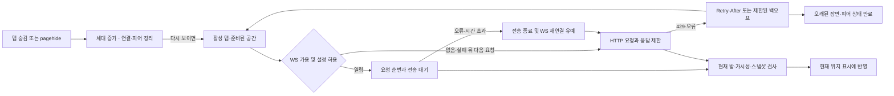
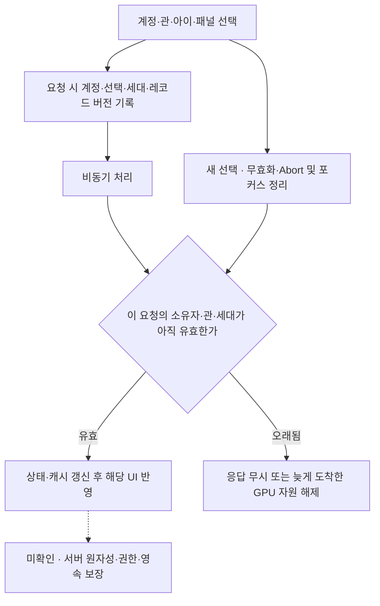

# 네트워크·화면 장애 및 데이터 복구

확인일 2026-11-25 KST. 이 문서는 **공개 코드로 보인 복구 경로**를 설명한다. 공개 브라우저에서 장애를 일부러 만들거나 쓰기 또는 계정 전환을 수행하지 않았다. 동시성·실패 사례의 실제 실행 검증은 외부 통신 없는 [독립 실습](../Learning/Labs/10_Mobile_Runtime/README.md)에 한정한다.

## F. 네트워크 장애와 상태 복구

`createPresenceTransport`는 기능 활성 조건과 재연결 시각을 보고 WebSocket을 준비한다. 열린 연결에서 순번을 붙이고 하나의 대기 요청을 유지한다. WS의 대기 제한과 HTTP 타임아웃은 코드상 7초다. WS 오류·닫힘의 일부 경로는 30초 재연결 유예를 정하고 연결을 정리한다. HTTP는 가용 WS가 없을 때의 요청 경로이며, 실패한 WS 요청의 같은 전송이 즉시 HTTP로 재주문된다고 볼 수는 없다. 예시로 재회 장면은 HTTP를 택한다. 실제 WS 네트워크 주기를 실측하지 않았다. [presence-transport.mjs](https://starkkuk-media.asdfstudio-cs.workers.dev/builds/157cf728c4c673d5eb3c3ae2/presence-transport.mjs) 4~33행.

`sync`는 요청의 방과 `visibilityEpoch`를 기억한다. 429의 `Retry-After`와 일반 실패에 500ms 시작·최대 5초의 백오프 경로가 있다. 짧은 실패에는 마지막 상태를 유지할 수 있고, 그 코드가 사용하는 만료 경계는 15초다. `leave`는 탭 숨김과 `pagehide`에서 세대를 증가시키고 예약·연결·피어를 정리한다. 지원 브라우저에서 종료 비콘을 요청한다. 탭이 보이면 현재 방의 동기화를 시도한다. 비콘의 서버 수신·재접속 성공은 개별 네트워크 사실이다. [presence.js](https://starkkuk-media.asdfstudio-cs.workers.dev/builds/59d9f0b49f2ec6ffd1900960/presence.js) 131~158·191~205행. [실시간 분석](Realtime_Presence_Networking.md)

## G. 계정·화면 전환과 응답 채택

| 단위 | 실제 변수와 복구 범위 |
|---|---|
| 계정/공개·개인 관 조회 | `locker-feed.js`의 `generation/accountKey/activeHall`, 요청 객체 `AbortController`, 응답의 세대를 추적하는 `WeakMap`. 관 전환 때 보류 요청을 끊고, `isCurrent`가 현재 계정과 번호를 확인한다. 일부 상세는 현재 배정과 버전 조건을 추가로 본다. [locker-feed.js](https://starkkuk-media.asdfstudio-cs.workers.dev/builds/59f6a087dbd27f69d544cc4e/locker-feed.js) 8~35·39~95행. |
| 장면/선택/주소 | `lockerNavigation`과 `lockerSelection`, BFCache(뒤로가기에서 살아 있던 문서 복원)의 `pageshow.persisted` 및 주소 복구 번호. `refreshLockers`가 이전 관 응답을 계속 그리지 않도록 검사한다. 저장된 좌표와 카메라 리셋·라우팅은 각각 장면의 조건을 따른다. [app.js](https://starkkuk-media.asdfstudio-cs.workers.dev/builds/badddc113c1ef830a03b6dd9/app.js) 496~564·809~835·1922~1982·2878행. |
| 선택된 추모 기록 | `loadSelectedMemorial`의 `memorialRevision`과 선택 ID. `applyMemorial`는 응답의 배정·설정 버전과 반려동물 버전을 검사한다. 저수준 쓰기가 서버에서 성공했어도 최신 선택 화면에 자동 표시된다는 보장은 없다. [app.js](https://starkkuk-media.asdfstudio-cs.workers.dev/builds/badddc113c1ef830a03b6dd9/app.js) 723~755행. |
| 도구 상태/일시 정지 | 조이스틱은 focus/blur/pagehide/pageshow/visibilitychange에서 초기화한다. Canvas 취소가 눌린 포인터·드래그·핀치·선택을 정리한다. 포인터는 플랫폼 수명 이벤트에 따라 처리하며 네이티브 앱의 백그라운드 복귀를 관찰하지 않았다. [app.js](https://starkkuk-media.asdfstudio-cs.workers.dev/builds/badddc113c1ef830a03b6dd9/app.js) 2240~2258·2318행. |
| 화면 그래픽 장애 | WebGL context loss 이벤트에 기본 동작 방지, `contextLost` 설정, 사진과 이동 취소, 부트 오버레이 이벤트가 있다. restored에서 `contextLost` 해제와 리사이즈, 부트 상태 제거를 호출한다. 메인 렌더 흐름은 숨김·contextLost 분기를 둔다. 시스템 GPU 리셋 뒤 모든 텍스처를 재구성하는지나 복구 성공률은 미확인이다. [app.js](https://starkkuk-media.asdfstudio-cs.workers.dev/builds/badddc113c1ef830a03b6dd9/app.js) 1205~1208·2536행, [boot.js](https://starkkuk-media.asdfstudio-cs.workers.dev/builds/1e41c00bd11390449702df86/boot.js) 20~35행. |

## 데이터 일관성 사례 A–J

아래의 **서버 필요 조건**은 검증된 구현을 뜻하지 않는다. 서버에 쓰기나 장애 주입은 수행하지 않았다.

| 사례 | 발생 조건과 확인된 클라이언트 복구 | 서버 필요 조건 및 미확인 |
|---|---|---|
| A. 사진 성공 뒤 UI 갱신 실패 | `savePetPhoto`가 수정 결과를 받고 `applyMemorial`에서 배정·버전을 검사한다. 사진 참조 캐시를 무효화하고 현재 동물을 그린다. 화면을 옮겼으면 `uploadPhoto`가 기존 폼을 다시 그리지 않는다. DOM 갱신 오류라면 저장 성공 후에도 catch의 오류 안내가 가능하다. 자동 보상 삭제는 발견하지 않았다. 현재 기록을 여는 경로에 재조회가 있다. [app.js](https://starkkuk-media.asdfstudio-cs.workers.dev/builds/badddc113c1ef830a03b6dd9/app.js) 723~755·2212~2220행. | 쓰기 결과의 영속 보장, 조회 일관성과 UI 재시도 중 같은 사진의 중복 처리 규칙은 미확인. |
| B. 프로필 성공 뒤 사진 실패 | 프로필 폼의 submit은 `savePetProfile`, 파일 변경은 `uploadPhoto → savePetPhoto`인 별도 요청이다. 프로필은 목록에 반영하고, 사진 실패는 오류 알림 및 입력 잠금 해제·초기화다. 사진에 붙인 대상 ID와 버전이 사진 준비 중 낡을 수 있다. 프로필 롤백을 연결한 분기는 확인되지 않았다. [app.js](https://starkkuk-media.asdfstudio-cs.workers.dev/builds/badddc113c1ef830a03b6dd9/app.js) 897~907·2156·2212~2220행. | 동일 대상의 쓰기 버전과 재시도가 무엇을 보장하는지는 미확인. |
| C. 선택 중 타인이 자리 등록 | `claimLocker`의 `placementBusy`가 현재 UI의 중복 제출을 막는다. 실패하면 목록을 다시 읽고 오류와 현재 패널을 갱신한다. 이전 관 데이터는 별도 세대 필터를 통과해야 한다. [app.js](https://starkkuk-media.asdfstudio-cs.workers.dev/builds/badddc113c1ef830a03b6dd9/app.js) 809~839행. | 자리의 단일 배정, 충돌의 원자적 검증, 실제 사용자 경합 결과 미확인. |
| D. 모델 A 중 모델 B 선택 | 모델 교체에서 기존 액터를 해제할 수 있다. `buildPetAvatar`의 `disposed`와 요청 signal을 검사하며 늦은 액터를 즉시 해제하는 분기가 있다. 승인 조건을 만족하지 못하거나 일부 로딩 실패 시 절차적 모델이 표시된다. [pet-avatar.js](https://starkkuk-media.asdfstudio-cs.workers.dev/builds/a61b9ce5a1a1f3754dc842e6/pet-avatar.js) 184~215행, [custom-pet-avatar.js](https://starkkuk-media.asdfstudio-cs.workers.dev/builds/b8b364569998c23aa4780b9b/custom-pet-avatar.js) 98~118·203~216행. | 모델 버전이 어떤 시점부터 조회되는지와 교체 롤백은 미확인. |
| E. 이전 계정 응답 도착 | 조회 결과에는 요청 당시 계정과 세대가 연결된다. `invalidate`가 요청을 취소하고 UI는 `isCurrent` 결과를 확인한 뒤 적용한다. 모든 기능의 요청이 동일한 계정 가드를 공유하는지는 조사 범위 밖이다. [locker-feed.js](https://starkkuk-media.asdfstudio-cs.workers.dev/builds/59f6a087dbd27f69d544cc4e/locker-feed.js) 8~35·75~94행, [app.js](https://starkkuk-media.asdfstudio-cs.workers.dev/builds/badddc113c1ef830a03b6dd9/app.js) 789~839행. | 인증 토큰 만료·분리와 다른 계정 데이터 접근 차단은 서버 검증이 필요하다. |
| F. 결제 확인 응답 유실 | Play 클라이언트가 현재 회원·토큰과 미확정 기록을 보관한다. `recover`는 미완료 토큰과 기기 조회를 조합해 확인 경로를 재시도한다. 계좌 증빙에도 제출 상태 재조회가 있으며 카드 청구 재시도를 직접 실행하지 않았다. [play-support-client.mjs](https://starkkuk-media.asdfstudio-cs.workers.dev/builds/79ac4112e839d43578e9c947/play-support-client.mjs) 26~54·76~117행, [후원 복구](Payment_Sponsorship.md). | 결제 원장·토큰의 멱등 처리·환불 동기화 실제 보장 미확인. |
| G. 재화 차감 vs 인벤토리 | `kkuki-shop.js`의 구매 응답 조회는 현재 잔액·획득품을 서버에서 다시 읽는 구조다. 일반 가방·장식은 로컬 가방과 자리의 서버 버전이 따로다. 일부 배치 실패에서 재조회 후 이미 반영된 변경을 확인하고 임시 가방 상태를 복구한다. [kkuki-shop.js](https://starkkuk-media.asdfstudio-cs.workers.dev/builds/ae4b8e53f1fa7c7aaf794cb8/kkuki-shop.js) 4~34행, [app.js](https://starkkuk-media.asdfstudio-cs.workers.dev/builds/badddc113c1ef830a03b6dd9/app.js) 841~852·913·1046~1111행, [9차 재화](Virtual_Economy_Inventory.md). | 잔액 차감과 아이템 발급의 원자성·동시 구매 보장 미확인. |
| H. 장애 뒤 오래된 위치 | 오래된 방·가시성 요청을 제외한다. 짧은 중단의 마지막 상태 유지와 15초 만료가 있다. 시퀀스와 스냅샷 기준선은 WS 전송 및 모션 업데이트에서 구분된다. [presence.js](https://starkkuk-media.asdfstudio-cs.workers.dev/builds/59d9f0b49f2ec6ffd1900960/presence.js) 131~158·191~205행, [presence-transport.mjs](https://starkkuk-media.asdfstudio-cs.workers.dev/builds/157cf728c4c673d5eb3c3ae2/presence-transport.mjs) 6~33행. | 서버 위치 TTL·서버 시간·새로운 방 상태 전파의 실제 결과는 미관찰. |
| I. 장면 전환 뒤 이전 모델 로딩 완료 | `clearEnvironment`가 장면 소유 자원·효과를 정리한다. 액터 교체가 일어나면 취소/늦은 응답 폐기가 가능하다. 새 장면에서도 같은 모델 임대를 사용할 수 있으며 모든 환경별 비동기 빌더가 공통 번호 하나를 쓰는 근거는 없다. [app.js](https://starkkuk-media.asdfstudio-cs.workers.dev/builds/badddc113c1ef830a03b6dd9/app.js) 1382~1394·1828·1922~1982행, [pet-avatar.js](https://starkkuk-media.asdfstudio-cs.workers.dev/builds/a61b9ce5a1a1f3754dc842e6/pet-avatar.js) 188~215행. | 저장된 모델 접근 시점이나 클라이언트 밖의 중단 효과 미확인. |
| J. 대화창 닫은 뒤 응답 | 일반 `dialog.close`는 버튼에 포커스를 되돌리며 창 닫기만으로 `generation` 증가나 전송 abort는 확인되지 않는다. 해당 세대이면 진행 중 답장 응답이 메모리 메시지를 합칠 수 있다. 401·소유 추모함 변경의 초기화는 별도다. [pet-chat.js](https://starkkuk-media.asdfstudio-cs.workers.dev/builds/cd4d8bfb2e95af4a301f2e49/pet-chat.js) 12~18·32~50행. | 실제 답장 전송, 재개 UI, 서버 기록 및 중복 제거 미검증. |

공개 세션에서 네트워크 차단, GPU context loss 강제, 탭 숨김/복귀, 두 계정 경합은 검증하지 않았다. 코드 흐름과 독립 실행 시험을 구분해 다음 관찰에서 검증할 조건을 [10차 범위표](../Architecture/10_Module_Coverage.md)에 기록했다.
