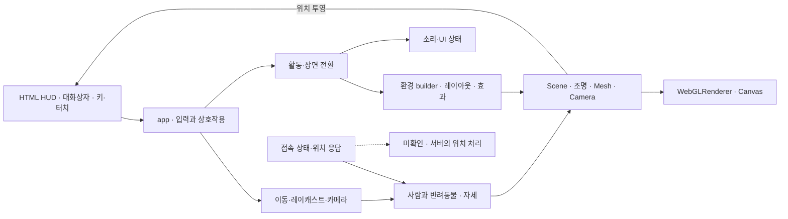
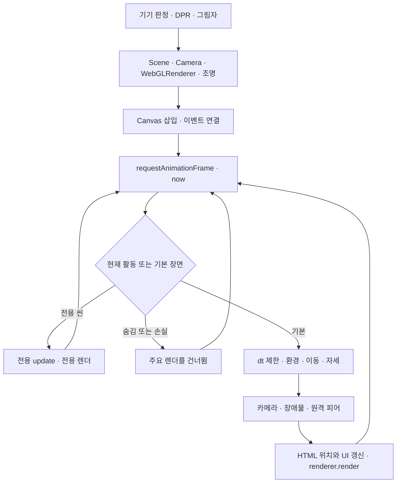
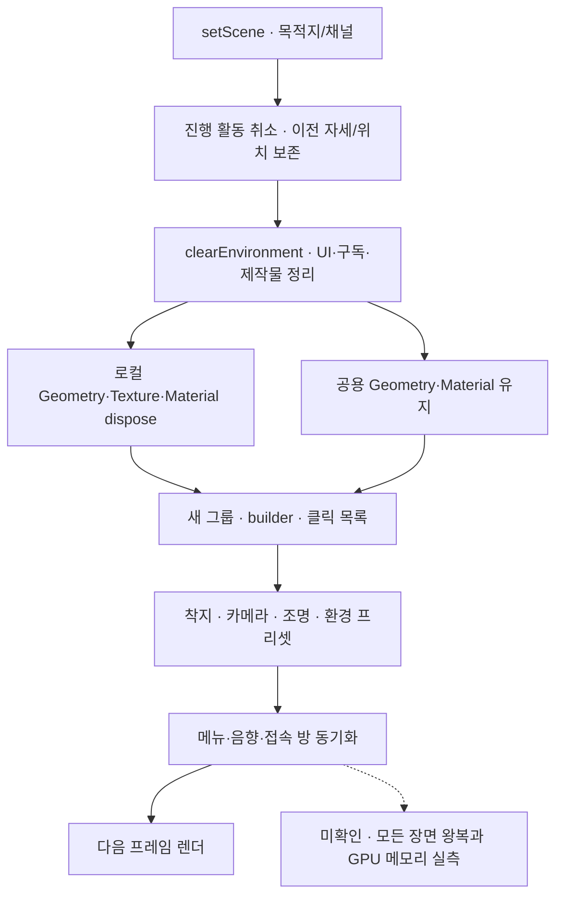

# 별꾹 Three.js 렌더링과 장면 수명

확인일 **2026-11-25 (한국시간)** · 8차 코드 학습 · [별꾹 공개 화면](https://starkkuk.com/)

초기 공개 화면에서 Three.js r180의 캔버스와 import map을 관찰한 [기술 스택 조사](../01_Tech_Stack.md)를 재사용했다. 이번 확인은 고정 버전 JS의 함수와 설정값에 근거한다. 모바일·PC 비교는 코드 분기다. 실제 화면별 품질, GPU 메모리, FPS와 컨텍스트 복원 성공률은 측정하지 않았다.

## A. 전체 3D 시스템 아키텍처

실선은 공개 클라이언트 연결이다. 점선은 확인하지 못한 구현 경계다.

## 렌더러 초기화와 설정이 보이는 방식

| 위치 | 값 또는 호출 | 화면에서의 의미 |
|---|---|---|
| [app.js](https://starkkuk-media.asdfstudio-cs.workers.dev/builds/2300b2b383d429b089959a6f/app.js) 1186~1192행 | `Scene`, 배경 `#e7eedf`, 같은 색의 선형 `Fog(80,160)`, `PerspectiveCamera(52, aspect, .06, 560)` | 원근 카메라는 먼 물체를 작게 보이게 한다. 52도는 수직 시야각, near/far는 잘라내는 거리다. 안개는 80~160 거리 구간에서 물체를 배경색에 섞으며 장면 전환에서 값을 바꾼다. |
| [app.js](https://starkkuk-media.asdfstudio-cs.workers.dev/builds/2300b2b383d429b089959a6f/app.js) 1194~1203행 · [render-profile.mjs](https://starkkuk-media.asdfstudio-cs.workers.dev/builds/cd18146b6d19e993d020232f/render-profile.mjs) 1~6행 | `antialias:true`, `alpha:false`, `powerPreference:'low-power'`. `SRGBColorSpace`, `ACESFilmicToneMapping`, 초기 노출 .95 | 안티앨리어싱은 윤곽의 계단을 줄이고, 불투명 캔버스는 배경 합성에 알파를 쓰지 않는다. low-power는 GPU 선호 힌트다. 톤 매핑은 큰 광량을 화면 범위로 압축하고 sRGB 출력은 화면 색 표현을 맞춘다. |
| [render-profile.mjs](https://starkkuk-media.asdfstudio-cs.workers.dev/builds/cd18146b6d19e993d020232f/render-profile.mjs) 1~6행 · [app.js](https://starkkuk-media.asdfstudio-cs.workers.dev/builds/2300b2b383d429b089959a6f/app.js) 2527행 | UA·터치 가능한 MacIntel·기기 메모리 4GB 이하의 조건으로 모바일 프로필 선택. 모바일 최대 DPR `max(1,min(1.5,sqrt(1500000/(w*h))))`, PC 최대 1.6, 실제 DPR과 다시 비교. 모바일 그림자 꺼짐 | DPR은 CSS 1px에 그릴 픽셀 수다. 같은 창에서 DPR을 2배 늘리면 면적 픽셀 수는 4배다. 1.5M은 스케일 산정 기준이며 1배 하한 때문에 절대 픽셀 상한은 아니다. 리사이즈에서 투영·렌더 버퍼를 다시 설정한다. |
| [app.js](https://starkkuk-media.asdfstudio-cs.workers.dev/builds/2300b2b383d429b089959a6f/app.js) 1213~1217행 | 반구광 .32, 주 방향광 3.5·보조 방향광 .65, PC에서 2048² `PCFSoftShadowMap`, 그림자 직교 범위 ±45, near .5 / far 110, bias와 normalBias | 반구광은 위·아래 색으로 면을 부드럽게 채운다. 방향광은 일정 방향의 광원이다. 그림자 맵 필터링이 경계를 부드럽게 보이게 한다. bias는 표면이 자기 그림자를 잘못 받는 현상과 그림자 위치 사이의 균형을 맞춘다. |
| [app.js](https://starkkuk-media.asdfstudio-cs.workers.dev/builds/2300b2b383d429b089959a6f/app.js) 1269·1281~1305행 | 표면에는 색·normal·roughness 맵을 별도로 사용한다. 반복 래핑, 색 맵만 sRGB, anisotropy 최대 8. PMREM용 임시 씬에 큰 발광색 면을 놓고 환경 텍스처를 생성한다. | normal map은 면의 광반응을 바꿔 요철처럼 보이게 한다. roughness는 반사 퍼짐을 바꾼다. 환경 텍스처는 금속·유리·바닥이 공통 조명 환경을 반사하도록 돕는다. 임시 장면의 Geometry와 Material, PMREM 생성기는 정리한다. |
| [app.js](https://starkkuk-media.asdfstudio-cs.workers.dev/builds/2300b2b383d429b089959a6f/app.js) 1983~2021행 | 공통 실내·실외 프리셋 후 장면별 광색·강도·안개·노출을 덮어쓴다. 예를 들어 천문관 노출 .99·반구광 .9, 숲결 중정 노출 .96·반구광 .8 | 같은 재질이라도 장면별 명암·색이 달라진다. 환경 강도는 PMREM 반사에, 노출은 톤 매핑 전후의 밝기 표현에 각각 영향을 준다. |
| [app.js](https://starkkuk-media.asdfstudio-cs.workers.dev/builds/2300b2b383d429b089959a6f/app.js) 1203·1209~1211·2551행 | `#world`에 캔버스를 넣고 DOM HUD를 겹친다. 추모함은 OrbitControls, 다른 세계는 앱 카메라 리그를 사용한다. 위치를 `project(camera)`로 투영해 반려동물 말풍선 CSS 좌표 계산 | 3D 좌표가 바뀌어도 일반 HTML 버튼의 접근성·폼을 사용할 수 있다. 화면의 말풍선은 3D 앵커를 따라가지만 DOM에서 그린다. |

## B. 초기화와 프레임 갱신

`animate(now)`는 다음 RAF를 먼저 등록한다. 일반 루프의 `dt`는 밀리초 차이를 초로 바꿔 최대 .05초로 제한한다. 나무집·숨바꼭질의 .1초, 재회의 .25초, 캐릭터 편집의 .05초는 별도 분기다. 큰 프레임 간격을 전부 이동에 반영하지 않아 일시 정지 후 큰 점프가 줄어든다. 하늘·프리뷰 같은 일부 처리 후 분기하므로 탭 숨김에서 모든 코드가 중단된다고 볼 수 없다. [app.js 2535~2549행](https://starkkuk-media.asdfstudio-cs.workers.dev/builds/2300b2b383d429b089959a6f/app.js)

1. 기본 장면에서 환경·발자국/의식·반려동물 상태를 갱신하고 제한된 방향 입력을 이동·포즈로 연결한다.
2. 지형 높이와 자세를 합친 뒤 추모함의 OrbitControls 또는 월드 리그를 갱신한다. 환경 가림 처리, 원격 아바타, DOM 근접 힌트와 시설 UI가 최신 장면을 읽는다.
3. 한 프레임을 렌더하고, 특정 활동이 열리면 그 활동의 업데이트 경로가 일부 기본 작업을 대신한다. 델타 타임과 접속 폴링 간격은 따로 계산된다. [app.js 2535~2553행](https://starkkuk-media.asdfstudio-cs.workers.dev/builds/2300b2b383d429b089959a6f/app.js) · [실시간 접속 보고서](Realtime_Presence_Networking.md)

## H. 장면 전환과 리소스 정리

| 함수·위치 | 입력·출력과 작업 순서 |
|---|---|
| [app.js](https://starkkuk-media.asdfstudio-cs.workers.dev/builds/2300b2b383d429b089959a6f/app.js) 1921~2023행 · `setScene(name,{groveDestination})` | 현재 활동·의식·입력 상태를 정리하고 필요한 경우 이전 좌표·yaw를 보관한다. 선택 이름과 DOM의 `data-scene` 갱신 → 기존 장면 제거 → builder 분기 → 이동 패드·아바타 가시성, 스폰·카메라 설정 → 장면별 광원·안개·효과 → 음악과 `presence.changeScene()` 처리 순서다. 이 함수의 핵심 출력은 장면과 UI에 적용한 변경이다. |
| [app.js](https://starkkuk-media.asdfstudio-cs.workers.dev/builds/2300b2b383d429b089959a6f/app.js) 1381~1393행 · `clearEnvironment` / `disposeRenderGroup(root)` | 시설·전시·창·활동에 자체 정리 콜백이 있으면 먼저 호출하고, 방의 텍스처·클릭 대상·가림 정보·스냅샷을 초기화한다. 그룹을 순회하면서 공용 Geometry와 Material을 제외하고 로컬 자원을 Set에 모아 중복 해제를 줄인다. 인스턴스별 GPU 자원도 정리하고 그룹을 떼며 새 환경을 추가한다. |
| [app.js](https://starkkuk-media.asdfstudio-cs.workers.dev/builds/2300b2b383d429b089959a6f/app.js) 1221~1229·1543행 · [static-batch.js](https://starkkuk-media.asdfstudio-cs.workers.dev/builds/29617a6f29e55d9c6b62567d/static-batch.js) 3~46행 | 색별 Material Map과 영구 기본 기하 재사용. `batchEnvironment`는 가림용 경계를 확보한 후 `batchStatic`을 호출한다. 정적 리프를 공간 셀·기하·재질·그림자·레이어 등으로 묶고 같은 조건 3개 이상을 `InstancedMesh`로 바꾼다. 동적·클릭 대상·스킨·일부 투명 객체는 남긴다. |
| [static-batch.js](https://starkkuk-media.asdfstudio-cs.workers.dev/builds/29617a6f29e55d9c6b62567d/static-batch.js) 11~46행 · `freezeStatic` | `inverse(rootWorld) × meshWorld`로 배치 부모 기준 변환을 구한다. 원래 벽이 일부 카메라 광선 검사에 쓰일 수 있어 분리 후 월드 변환을 보존한다. 인스턴스 묶음의 경계 상자·구를 계산하고 정적 객체 행렬 업데이트를 끈다. 이는 셀별 뷰 절두체 제외를 가능하게 하는 구조다. 실제 draw call 감소량은 미측정이다. |
| [app.js](https://starkkuk-media.asdfstudio-cs.workers.dev/builds/2300b2b383d429b089959a6f/app.js) 1205~1207·2527·2535행 | WebGL 손실 이벤트에서 기본 동작을 막고 손실 플래그, 카메라 촬영과 입력을 정리한다. 복원 이벤트는 플래그를 되돌리고 리사이즈와 사용자 정의 이벤트를 실행한다. 코드상 복구 경로이며 장시간 운용과 기기별 복구는 미실험이다. |
| [avatar.js](https://starkkuk-media.asdfstudio-cs.workers.dev/builds/e4716f71b2eb05fa15928960/avatar.js) 117~131행 · [presence.js](https://starkkuk-media.asdfstudio-cs.workers.dev/builds/cb6a99e7c4103839707d0ab5/presence.js) 273~299행 | 원격 아바타 위치는 프레임 보간으로 부드럽게 움직인다. 자세 계산은 카메라 절두체·거리·상태 변화에 따라 줄인다. 그림자 켜기/끄기 기준에 거리 차이를 둬 경계에서 반복 전환되는 비용을 줄인다. |

**Geometry·Material·Texture의 수명.** Geometry는 위치와 면 데이터, Material은 빛과 표면의 계산 규칙, Texture는 표면에 쓰이는 이미지 또는 계산한 픽셀이다. 여러 Mesh가 공유하는 자원을 한 Mesh가 사라질 때마다 해제하면 다른 Mesh에도 영향이 간다. 이 클라이언트는 공용 기본 도형과 일부 재질을 제외하고 장면 자원을 해제한다. `material.map` 이외의 전체 GPU 캐시 추적이나 장시간 누수는 확인하지 않았다. [app.js 1221~1229·1283~1305·1381~1393행](https://starkkuk-media.asdfstudio-cs.workers.dev/builds/2300b2b383d429b089959a6f/app.js)

**확인 범위.** 실제 관찰은 초기 캔버스·Three.js 표시와 기존 요청에 한정한다. 시각적 효과 설명은 설정값과 렌더 개념에서 도출한 해석이다. 장면별 제작 방식은 [공간 보고서](World_Environment.md), 코드 실습은 [Three.js 교재](../Learning/ThreeJS_Code_Study.md)에 연결한다. 보완 REA는 앱 `ev_e0372954d3510cc68d6bd8d96e538e4f2684c06a11a1751141fd933a88456f69`, 렌더 프로필·정적 배치 `ev_c8009b841fd62bc727c2e04a0a6982c8d4b6df9b8603abf9387239e9232706e3`, 원격 아바타 `ev_5c5d7fbc69d842aa4689b10e209b60c43fd0848e3216d43ef168fdb3c861d7ae`이다. 행 번호는 공개 배포본 기준이다.
