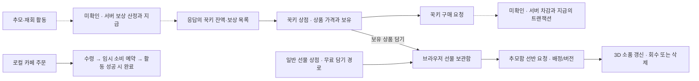

# 가상 재화·보상·상점·인벤토리

확인일 **2026-11-25 (한국시간)** · 9차 · [별꾹 공개 웹](https://starkkuk.com/)

코드에서 확인한 네 가지 상태는 **서버 꾹키 잔액·상품 보유 목록**, **브라우저 선물 보관함**, **서버 추모함 선반·장식**, **로컬 카페 주문**이다. 화면의 ‘구매’가 같은 단어여도 저장하는 상태와 결제 수단이 다르다. [후원·결제 문서](Payment_Sponsorship.md) · [활동과 연출](Activities_Events.md)

기존 출석 안내와 8차의 선물·카페·눈사람 연결을 재사용했다. 9차에서 실제 재화 보상·소비·카페 주문·선물 배치·삭제를 실행하지 않았다. 현재 시점에 서버 카탈로그의 모든 가격·잔액을 표시된 값으로 검증하지 않았다.

## F. 획득·소비·인벤토리

점선은 서버 지급·저장 내부를 검증하지 못한 연결이다. 잔액 표시, 로컬 선물, 3D 배치의 데이터가 같은 원장인지로 확대해 해석하지 않는다.

## 1. 꾹키와 출석·활동 보상

| 함수 및 위치 | 사용자 이벤트·입력에서 화면까지 |
|---|---|
| [attendance.js](https://starkkuk-media.asdfstudio-cs.workers.dev/builds/382ca375e51f93b43db2c0b0/attendance.js) 15~19·23~47·50~86행 · `load` / `remember` | 서버 출석 응답의 `day, progress, completedToday, totalDays, rewardCookies, lastReward`로 출석판을 그린다. 자기 추모함의 추모를 하루 단위로 누적해 **7일마다** 보상을 안내하며, 기본 표시 금액은 **30꾹키**다. 서버 응답의 보상 값이 있으면 그 값을 사용한다. 비밀 선물은 예정/예약 표시가 있으며 지급 물품은 미확인이다. |
| [attendance-copy.mjs](https://starkkuk-media.asdfstudio-cs.workers.dev/builds/ae95360b169a03e150d40f3c/attendance-copy.mjs) 2~4행 · [app.js](https://starkkuk-media.asdfstudio-cs.workers.dev/builds/2300b2b383d429b089959a6f/app.js) 2615·3025~3031행 | 앱은 추모 결과의 `attendance`를 `remember`에 넘긴다. 출석판 버튼 자체는 로그인 또는 내 추모함 이동을 요청한다. 로컬 환경에는 서버가 정한 날짜의 완료·‘오늘 그만 보기’ 상태를 둔다. 이 로컬 값으로 꾹키를 지급하지 않는다. |
| [kkuki-shop.js](https://starkkuk-media.asdfstudio-cs.workers.dev/builds/ae4b8e53f1fa7c7aaf794cb8/kkuki-shop.js) 34~53행 · `checkReward(serverNow, canCelebrate)` | 재회 완료 콜백 이후 꾹키 상태를 최대 6회 확인하고, 코드상 최근 12초 기준의 `kind==='rainbow'` 보상 레코드를 찾는다. 요청을 다시 시도하는 최소 대기 경로는 1.5초다. 실제 저장된 응답의 `delta`와 잔액으로 표시하며 연출 종료까지 기다릴 수 있다. [app.js 2927행](https://starkkuk-media.asdfstudio-cs.workers.dev/builds/2300b2b383d429b089959a6f/app.js) |
| [kkuki-reward.js](https://starkkuk-media.asdfstudio-cs.workers.dev/builds/08d1eaa1aeba288ac43c1d1a/kkuki-reward.js) 5~29행 · [kkuki-catalog.mjs](https://starkkuk-media.asdfstudio-cs.workers.dev/builds/17a6258121f0ca55c259feb1/kkuki-catalog.mjs) 1~13행 | `show({delta,balance})`는 화면 보상 알림과 타이머를 관리한다. 카탈로그의 `KKUKI_REWARD=10`은 배포된 상수다. 실제 지급 숫자는 응답에서 표시하므로 모든 재회 완료가 10꾹키를 지급한다고 단정할 수 없다. |
| [daily-activities-copy.mjs](https://starkkuk-media.asdfstudio-cs.workers.dev/builds/fd7e68acd397b8a4028c0b6b/daily-activities-copy.mjs) · [app.js](https://starkkuk-media.asdfstudio-cs.workers.dev/builds/2300b2b383d429b089959a6f/app.js) 3037~3055행 | 활동 알림 문구와 이동 콜백이 집·산책·수목원·재회·행사에 연결된다. 알림 문구나 목적지 분기만으로 해당 활동 전부가 재화를 지급한다고 볼 수 없다. |

## 2. 상점 결제와 보유 상태

`createKkukiShop({getAccount,requireAccount,onUse})`는 로그인 후 서버의 `balance, items, owned, rewards`를 읽어 상점을 그린다. `load(body)`가 요청을 보내며, 계정과 요청 번호를 대조해 늦은 응답을 거른다. 카드를 고르면 상세 버튼이 ‘구매’, ‘꾹키 부족’, ‘담기’로 바뀐다. 잔액이 모자라면 신규 구매 버튼을 비활성화한다. 구매의 진행 잠금과 성공 후 응답 적용은 클라이언트에서 확인했다. 동시에 여러 기기에서 차감할 때 원장이 한 번만 갱신되는지는 미확인이다. [kkuki-shop.js 4~33행](https://starkkuk-media.asdfstudio-cs.workers.dev/builds/ae4b8e53f1fa7c7aaf794cb8/kkuki-shop.js)

| 카탈로그의 배포값 | 코드상 꾹키 |
|---|---|
| 구름 위 낮잠 / 달빛 오르골 / 무지개 약속 / 꾹꾹 쿠키 접시 | 20 / 30 / 40 / 50 |
| 햇살 꽃바구니 / 냥냥 츄르 세트 / 꼬순 간식 상자 | 35 / 25 / 30 |
| 리본 곰인형 / 별밤 랜턴 / 파스텔 마카롱 | 40 / 45 / 35 |

이 표는 공개 정적 카탈로그의 예다. 실제 상점 화면은 응답의 `value.items`를 사용한다. 카탈로그의 `activityOnly:true` 항목은 보통 선물 상점 목록에서 제외된다. 보유 상품을 ‘담기’하면 앱 콜백이 새 가방 UID를 만들고 로컬에 저장한다. UI에 다시 담을 수 있다고 안내하며 이 콜백에서 새 꾹키 차감 요청은 발견되지 않았다. 꾹키 충전·현금 교환, 재화 양도, 외부 결제와의 연결은 확인되지 않았다. [kkuki-catalog.mjs 2~13행](https://starkkuk-media.asdfstudio-cs.workers.dev/builds/17a6258121f0ca55c259feb1/kkuki-catalog.mjs) · [kkuki-shop.js 19~30행](https://starkkuk-media.asdfstudio-cs.workers.dev/builds/ae4b8e53f1fa7c7aaf794cb8/kkuki-shop.js) · [app.js 2965~2971행](https://starkkuk-media.asdfstudio-cs.workers.dev/builds/2300b2b383d429b089959a6f/app.js)

## 3. 보관함·선반·장식·카페의 상태 경계

| 구분과 함수 | 보관·소비·복구 |
|---|---|
| **보통 선물 가방** · [gift-inventory.js](https://starkkuk-media.asdfstudio-cs.workers.dev/builds/3e343dcd26613f728b8fbd42/gift-inventory.js) 36~50·80~105행 · [app.js](https://starkkuk-media.asdfstudio-cs.workers.dev/builds/2300b2b383d429b089959a6f/app.js) 912·1026~1044·2851~2865행 | `purchase`가 실제로 호출하는 것은 `pickup(type)`이다. 근접한 상점·활동 전용 제외·가방 12개 조건을 확인하고 로컬 가방에 새 UID를 담는다. 저장 실패 때 신규 항목을 가방에서 되돌리는 분기가 있다. 로컬 삭제는 가방에서 빼고 UI를 갱신한다. `run`은 진행 중 작업과 이미 닫힌 대화상자의 응답을 관리한다. |
| **선반 배치·회수** · [app.js](https://starkkuk-media.asdfstudio-cs.workers.dev/builds/2300b2b383d429b089959a6f/app.js) 840~852·1046~1111·2299행 · [placement.mjs](https://starkkuk-media.asdfstudio-cs.workers.dev/builds/8a32dcb052063facce2b2ae0/placement.mjs) 3~18행 · [gift-trash.js](https://starkkuk-media.asdfstudio-cs.workers.dev/builds/a2082f899c3d2a59a6b800f1/gift-trash.js) 6~34행 | 가방에서 대상을 선택하고 선반으로 이동한 뒤 배치 배열에 UID·좌표·회전을 연결한다. 위치·최대 12개에는 별도 규칙이 있다. 추모함 버전·배정과 함께 서버 변경 요청 경로를 탄다. 재조회로 실패/응답 유실 뒤 새 항목 반영 여부를 확인할 분기가 있다. ‘다시 집기’는 가방 복귀와 선반 수정의 양쪽 단계를 사용한다. 드래그 휴지통은 히트 대상·종료 이벤트의 UI 처리이며 실제 제거는 앱 콜백으로 넘어간다. |
| **추모함 장식** · [locker-decor-catalog.mjs](https://starkkuk-media.asdfstudio-cs.workers.dev/builds/5e90e636f79ad29e2f5b2a9f/locker-decor-catalog.mjs) 2~43행 · [locker-decor-ui.js](https://starkkuk-media.asdfstudio-cs.workers.dev/builds/ff3d4d8e5bd1f481498a4537/locker-decor-ui.js) 47~78행 · [app.js](https://starkkuk-media.asdfstudio-cs.workers.dev/builds/2300b2b383d429b089959a6f/app.js) 2573~2595행 | 조명·시트지·소품과 표시 가능한 슬롯을 정의하고 장식 초안을 미리 그린다. 허용 키·품목·마크 범위를 검사한다. 서버 요청은 추모함의 `decor`와 배정·버전을 사용한다. 여기에 별도 현금 청구 또는 꾹키 가격 적용을 발견하지 못했다. |
| **눈사람** · [app.js](https://starkkuk-media.asdfstudio-cs.workers.dev/builds/2300b2b383d429b089959a6f/app.js) 2643~2653행 · [snowman-world.js](https://starkkuk-media.asdfstudio-cs.workers.dev/builds/bdeb8cb1f562d80bf31b7a1c/snowman-world.js) 43~50·81~124행 | 만든 소품은 가방에, 공터 배치는 다른 위치 기록 경로에 연결된다. 획득과 공터 쓰기를 하나의 재화 거래로 검증하지 않았다. |
| **카페 주문·소비** · [cafe-orders.mjs](https://starkkuk-media.asdfstudio-cs.workers.dev/builds/fe07f6b01966ca78f4f037e8/cafe-orders.mjs) 1~12·29~63행 · [cafe-ui.js](https://starkkuk-media.asdfstudio-cs.workers.dev/builds/2547aff0b02a21609b47c886/cafe-ui.js) 11~45행 · [app.js](https://starkkuk-media.asdfstudio-cs.workers.dev/builds/2300b2b383d429b089959a6f/app.js) 2699~2705행 | 로컬 주문은 계정 키별로 복원한다. 준비 기본 20초, 최대 보존 2시간, 준비/수령/폐기 전이가 있고 저장 실패는 로컬 UI에서만 보일 수 있다. 소비는 `beginUse` 예약 → 연출 수행 → `finishUse(token,completed)`이다. 연출 실패 시 사용 완료 플래그를 남기지 않는다. 이 경로에 서버 현금 결제나 꾹키 차감 호출은 확인되지 않았다. |

**트랜잭션의 경계.** 로컬 가방과 서버 선반을 서로 나눠 저장하면 두 단계 사이에서 오류가 날 수 있다. 앱은 가방 UID, 배정, 버전과 재조회를 써서 결과를 확인하는 분기를 둔다. 브라우저 코드의 복구 장치는 여러 장치의 잔액 차감·보유권 추가를 서버가 원자적으로 수행한다는 증거가 아니다.

**출처와 미확인.** 재화·출석 `ev_3f3dd41a22e66160691dab0cf0c5b8b48d2a46b27abd98476111339ee5dbfc93`, 선물·카페 자료 `ev_45c09f7b8031cde42c5dcbb64709805205796270f8c421717f8fb50b113e5643`, 앱 `ev_e0372954d3510cc68d6bd8d96e538e4f2684c06a11a1751141fd933a88456f69`와 [장면 상호작용의 이전 기록](Activities_Events.md)을 사용했다. 서버 원장, 중복 지급 정책, 현재 실가격, 지급/차감/복구 성공과 실제 운영 비용은 미확인이다.
