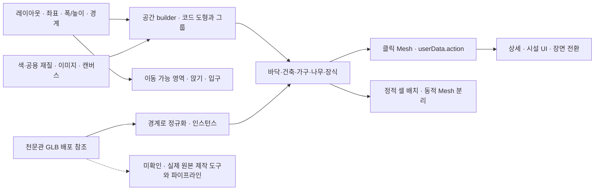

# 별꾹의 3D 공간과 환경 제작 방식

확인일 **2026-11-25 (한국시간)** · 8차 · [별꾹 공개 웹 클라이언트](https://starkkuk.com/)

초기 광장·캔버스 관찰과 시설 목록은 [화면 지도](../Architecture/Screen_Map.md)에서 재사용했다. 아래는 공간 이름, builder, 레이아웃, 생성 코드, 이동·UI 접점을 대조한 결과다. 모든 공간을 방문하거나 모델을 요청하지 않았다. GLB 표시는 스크립트가 참조하는 공개 환경 파일의 로딩 코드다.

## C. 공간과 환경 오브젝트의 생성

레이아웃은 좌표와 치수 같은 데이터를, builder는 그 값으로 씬에 추가할 Mesh·Material·그룹을 만든다. 실제 벽이나 가구 Mesh를 이동 충돌에 그대로 사용하지 않고 별도의 이동 경계·카메라 가림·클릭 목록을 둘 수 있다. 아래 표의 **공통**은 해당 장면의 기본 builder에서 확인한 것이다. **외부 모델 미확인**은 조사한 빌더에서 해당 환경의 GLB 로딩이 확인되지 않았다는 범위다. 별도 전시·캐릭터·지연 경로까지 포함한 전수 부재 판정은 아니다.

## 주요 공간 · 제작, 렌더링, 기능 연결

| 공간과 생성 위치 | 바닥·건축·가구·장식 / 재질과 효과 / 외부 모델 | 이동·클릭·UI / 최적화 |
|---|---|---|
| **광장** · `createPlaza → buildPlaza`. [app.js](https://starkkuk-media.asdfstudio-cs.workers.dev/builds/2300b2b383d429b089959a6f/app.js) 1791행 · [plaza-world.js](https://starkkuk-media.asdfstudio-cs.workers.dev/builds/f71da449ab11b071c789ad08/plaza-world.js) 10~177행 · [plaza-layout.mjs](https://starkkuk-media.asdfstudio-cs.workers.dev/builds/b090ae853a7fe76b6c69527f/plaza-layout.mjs) 4~81행 | 기본 Mesh, 지붕 Extrude, 주택·홀 파사드, 길·판. 포장·도로 및 표지는 2D 캔버스에서 무늬를 그린다. 공개 본문에서 광장 기본 건물의 외부 GLB 미확인. | 가로·세로 직사각 장애물과 이동 경로 레이아웃. 판, 홀 입구, 오늘의 별, 상점 인접 버튼 및 지도 이동. 100 단위 정적 셀, 동적 표지·작은 썸네일 갱신. |
| **일반 추모관·기억의 집** · `createHall → buildHall`. [app.js](https://starkkuk-media.asdfstudio-cs.workers.dev/builds/2300b2b383d429b089959a6f/app.js) 1651행 · [architecture.js](https://starkkuk-media.asdfstudio-cs.workers.dev/builds/558a0e46d0078cb91d4146b0/architecture.js) 5~165행 · [hall-layout.mjs](https://starkkuk-media.asdfstudio-cs.workers.dev/builds/e449349a663bb4f1b5350268/hall-layout.mjs) 3~57행 · [vault.js](https://starkkuk-media.asdfstudio-cs.workers.dev/builds/072b9e757b0ec0f428b0f5c7/vault.js) 3~4행 | 돌·대리석 UV를 바닥 위치에 맞추고, 상자 벽·가구와 곡선 천장·끝벽을 생성한다. 천장 곡선은 반타원 형태이며 버퍼의 꼭짓점·인덱스로 그린다. 수납칸과 장식을 반복한다. 외부 모델 미확인. | 수납칸 접근점과 좌석, 선물 카운터, 위로·의식 대상. 카메라용 얇은 천장 경계. 40 단위 배치, 동적 점광원 4개를 근거리 앵커에 재배치한다. |
| **햇살동산** · `createMeadow → buildMeadow`. [app.js](https://starkkuk-media.asdfstudio-cs.workers.dev/builds/2300b2b383d429b089959a6f/app.js) 1635행 · [meadow.js](https://starkkuk-media.asdfstudio-cs.workers.dev/builds/69c7941950a2aebf2a6a2383/meadow.js) 13~57·59~89행 · [meadow-layout.mjs](https://starkkuk-media.asdfstudio-cs.workers.dev/builds/4a4cc7b0bdef42e32ce88e11/meadow-layout.mjs) 8~22행 | 20단 양측 테라스는 상자, 중앙 경사는 BufferGeometry. 원통·구로 나무와 꽃을 반복해 만든다. 외부 모델 미확인. | 높이 함수와 단차 경계, 선물대·자리 클릭. 정적 셀 24, 공통 이름표·사진 갱신. |
| **별빛해변** · `createBeach → buildBeach`. [app.js](https://starkkuk-media.asdfstudio-cs.workers.dev/builds/2300b2b383d429b089959a6f/app.js) 1633행 · [beach.js](https://starkkuk-media.asdfstudio-cs.workers.dev/builds/62e6eeef35cacf93097dfc2c/beach.js) 4~163행 · [beach-layout.mjs](https://starkkuk-media.asdfstudio-cs.workers.dev/builds/cc1e6c612add50f447c6a5e5/beach-layout.mjs) 10~24행 | 해안·모래·파라솔, ShaderMaterial 물과 파도 진행 유니폼. 절차적 반복 배치. 외부 모델 미확인. | 모래 높이 및 영역, 좌석·추모 자리·선물. 공통 배치 24, 물·환경음은 동적 갱신. |
| **구름마을** · `createCloud → buildCloud`. [app.js](https://starkkuk-media.asdfstudio-cs.workers.dev/builds/2300b2b383d429b089959a6f/app.js) 1631행 · [cloud.js](https://starkkuk-media.asdfstudio-cs.workers.dev/builds/144b6cb45b656bb3fbba0b10/cloud.js) 5~68행 · [cloud-layout.mjs](https://starkkuk-media.asdfstudio-cs.workers.dev/builds/b575c2f194656ffcd02aaad6/cloud-layout.mjs) 1~2행 · [cloud-atmosphere.mjs](https://starkkuk-media.asdfstudio-cs.workers.dev/builds/d8282d9253d6feedfec46306/cloud-atmosphere.mjs) | 섬과 교량, 집·벤치·꽃나무, 구형 구름 덩어리와 절차적 분위기. 모서리의 구름을 인스턴스로 묶는다. 외부 모델 미확인. | 섬·다리 위를 걷는 경계와 좌석·선물·추모 대상. 시점/집중 지점 기준으로 주변 구름과 빛 위치를 업데이트한다. |
| **무지개너머 마을** · `createRainbow → buildRainbow`. [app.js](https://starkkuk-media.asdfstudio-cs.workers.dev/builds/2300b2b383d429b089959a6f/app.js) 1629행 · [rainbow.js](https://starkkuk-media.asdfstudio-cs.workers.dev/builds/137c19064f871ac905c5b2e1/rainbow.js) 5~176행 · [rainbow-layout.mjs](https://starkkuk-media.asdfstudio-cs.workers.dev/builds/a27e05555c936ee24d669744/rainbow-layout.mjs) 1~12행 | 섬·다리와 곡선 장식, 나무와 꽃을 기본 도형 또는 버퍼로 조합한다. 안쪽의 하늘 구면, 지평면 안개, 장식 인스턴스. 외부 모델 미확인. | 연결된 통로·플랫폼과 좌석·추모 대상. 셀 24 및 종류별 소품 묶음. 재회 활동과 일반 기념관 장면의 구분이 필요하다. |
| **햇살눈꽃 마을** · `createSnow → buildSnow`. [app.js](https://starkkuk-media.asdfstudio-cs.workers.dev/builds/2300b2b383d429b089959a6f/app.js) 1627행 · [snow.js](https://starkkuk-media.asdfstudio-cs.workers.dev/builds/725222def04f98878dafbf7f/snow.js) 7~161행 · [snow-layout.mjs](https://starkkuk-media.asdfstudio-cs.workers.dev/builds/e489beb821eadfc93d8e5d4d/snow-layout.mjs) 7~65행 | 눈 바닥·굴곡 길, 원뿔/구형 나무와 겨울 장식. 묘역 바닥과 나무 반복에 InstancedMesh, 효과 모듈에서 눈을 갱신한다. 외부 모델 미확인. | 길 좌표와 눈사람 충돌 분기, 눈 돌봄·눈사람 활동 진입. 빌더 내부 셀 12와 외부 공통 배치, 사전에 카메라 경계 확보. |
| **달콤구름 마을** · `createCandy → buildCandy`. [app.js](https://starkkuk-media.asdfstudio-cs.workers.dev/builds/2300b2b383d429b089959a6f/app.js) 1625행 · [candy.js](https://starkkuk-media.asdfstudio-cs.workers.dev/builds/829ae3cd3eb7894703598c65/candy.js) 13~32·32~217행 · [candy-layout.mjs](https://starkkuk-media.asdfstudio-cs.workers.dev/builds/4a3a7cbe6afc076bbbce2fe3/candy-layout.mjs) 1~12행 | 반복하는 사탕 장식·섬·집·길을 도형과 버퍼로 구성한다. 그라데이션 하늘 재질, 장식 인스턴스. 외부 모델 미확인. | 플랫폼 결합 경계와 좌석·추모 자리·선물, 셀 24. |
| **숲결 중정** · `createForest → buildForestHall`. [app.js](https://starkkuk-media.asdfstudio-cs.workers.dev/builds/2300b2b383d429b089959a6f/app.js) 1649행 · [forest-hall.js](https://starkkuk-media.asdfstudio-cs.workers.dev/builds/ec5b1fe6c943e66626bef9ad/forest-hall.js) 5~196행 · [forest-layout.mjs](https://starkkuk-media.asdfstudio-cs.workers.dev/builds/55116729873fb85bfe58144d/forest-layout.mjs) 11~52행 | 벽·목재·식물·장식을 기본 도형이나 곡면으로 구성한다. Geometry 병합과 인스턴스, 배경 점광원을 함께 쓴다. 외부 모델 미확인. | 수납 블록·통로와 카메라 가림 박스, 숲 메모·좌석·추모. 장식·식물 집합은 병합/인스턴스 처리한다. |
| **달빛이 머무는 정원** · `createMoonlight → buildMoonlight`. [app.js](https://starkkuk-media.asdfstudio-cs.workers.dev/builds/2300b2b383d429b089959a6f/app.js) 1623행 · [moonlight.js](https://starkkuk-media.asdfstudio-cs.workers.dev/builds/a14fb7dc3422d5ca61b65f47/moonlight.js) 7~74행 · [moonlight-layout.mjs](https://starkkuk-media.asdfstudio-cs.workers.dev/builds/5cc1812fcdf3278119bd5507/moonlight-layout.mjs) 1~12행 | 섬과 길, 집·수목의 기본 도형, 평면 물 셰이더와 가산 블렌딩 반딧불 Points. 외부 모델 미확인. | 섬·통로 경계, 추모·좌석. 동적 물·파티클과 정적 장식 배치(장식 48, 공통 24)를 분리한다. |
| **기억서재** · `createLibrary → buildLibrary`. [app.js](https://starkkuk-media.asdfstudio-cs.workers.dev/builds/2300b2b383d429b089959a6f/app.js) 1609~1619행 · [library.js](https://starkkuk-media.asdfstudio-cs.workers.dev/builds/947551657d599684369cdfec/library.js) 71~174행 · [library-layout.mjs](https://starkkuk-media.asdfstudio-cs.workers.dev/builds/28298076f10d296ba43c6077/library-layout.mjs) 20~24행 | 책장·소품·좌석을 도형과 절차적 패널로 그린다. 독서등의 점광원/조도와 소리 모듈이 연결된다. 외부 모델 미확인. | 실내 제한 경계, 카메라 벽, 추모함 및 좌석. 공통 셀 24, 동적 조명 콜백. |
| **천문관** · `createObservatory → buildObservatory`. [app.js](https://starkkuk-media.asdfstudio-cs.workers.dev/builds/2300b2b383d429b089959a6f/app.js) 1593~1605행 · [observatory.js](https://starkkuk-media.asdfstudio-cs.workers.dev/builds/d0ff6a1cb737ee74f0aff3f1/observatory.js) 4~84행 · [observatory-layout.mjs](https://starkkuk-media.asdfstudio-cs.workers.dev/builds/0268ce033ee1093a16ae6f1e/observatory-layout.mjs) 15~31행 | 기본 층·좌석·스위치·별 표식은 코드 생성. 돔, 아케이드, 난간, 계단, 천체 모형 5종 로더를 확인했다. 이미지 로딩과 다른 GLB 객체 합성은 아래 참조. | 층별 공간·홀, 아트리움 통과 제한, 층 버튼 및 셀 24. 별도의 국소 카메라 가림과 지연 모델의 가림 등록. |
| **함께 산책·공원/마을** · `createGarden → buildGarden`. [app.js](https://starkkuk-media.asdfstudio-cs.workers.dev/builds/2300b2b383d429b089959a6f/app.js) 1793행 · [garden.js](https://starkkuk-media.asdfstudio-cs.workers.dev/builds/658e736a8a4a6728ee418b72/garden.js) 6~48행 · [garden-village.js](https://starkkuk-media.asdfstudio-cs.workers.dev/builds/3e71dade61856b01858ff310/garden-village.js) 5~33·142·210행 · [garden-layout.mjs](https://starkkuk-media.asdfstudio-cs.workers.dev/builds/75c40c84594bf0a944ab732b/garden-layout.mjs) 19~38행 | 기본 파크, 잔디 인스턴스 4,500개와 나무 잎 인스턴스, 원형 장식·물, 3D 마을과 가구. 건물·상점은 Geometry와 재질 조합. 외부 모델 미확인. | 정해진 경계와 경로, 산책·안기·타기·돌봄·카페, 구역 클릭. 공용 배치와 움직이는 환경·일부 NPC 분리. |
| **수목원 3채널** · 초록·솜빛·반딧불이. [app.js](https://starkkuk-media.asdfstudio-cs.workers.dev/builds/2300b2b383d429b089959a6f/app.js) 1977·2659행 · [grove.js](https://starkkuk-media.asdfstudio-cs.workers.dev/builds/c531b74924095b7f5bf72a41/grove.js) 13~109행 · [grove-layout.mjs](https://starkkuk-media.asdfstudio-cs.workers.dev/builds/f393165c350b75300085c724/grove-layout.mjs) 2~24행 · [arboretum.js](https://starkkuk-media.asdfstudio-cs.workers.dev/builds/bcbb0a0f0760230c21d74596/arboretum.js) 8~98행 | 공통 잔디·벤치·나무, 채널마다 팔레트/장식, 식생·개화·열매와 광점. 인스턴스 용량을 필요에 따라 교체한다. 외부 모델 미확인. | 방 ID와 채널 매핑, 격자·추가 슬롯의 수목 좌표, 나무 가까이 가기·쉬기·나무집. 격자 수는 레이아웃 값이며 실제 개방 공간 수가 아니다. |
| **나무집** · 지연 `createTreeHome → createTreeHomeWorld`. [app.js](https://starkkuk-media.asdfstudio-cs.workers.dev/builds/2300b2b383d429b089959a6f/app.js) 2623행 · [tree-home.js](https://starkkuk-media.asdfstudio-cs.workers.dev/builds/bacb744aa9b616aa612cf114/tree-home.js) 12~78행 · [tree-home-world.js](https://starkkuk-media.asdfstudio-cs.workers.dev/builds/27820546dbe9ecc06c2ac717/tree-home-world.js) 5~45행 · [tree-home-layout.mjs](https://starkkuk-media.asdfstudio-cs.workers.dev/builds/290d1777080cb0a31391a466/tree-home-layout.mjs) | 전용 세계에 나무·바닥·실내 소품, 캔버스 그림, 선택 물체. 외부 환경 GLB는 미확인. | 나무 키로 입장하고 전용 이동·UI·카메라로 넘어간다. 그룹 내부 정적 인스턴스, 쓰기/열람 기능은 입장 코드만 확인. |
| **개별 추모함 상세** · `createNiche`. [app.js](https://starkkuk-media.asdfstudio-cs.workers.dev/builds/2300b2b383d429b089959a6f/app.js) 1727~1789·1849~1867행 | 관의 테마에 맞는 근접 배경·액자 Plane·광원·촛불과 편지판. 사진과 문자는 캔버스 텍스처로 표시한다. 적용된 맞춤 반려동물만 별도 GLB 경로가 있다. | 클릭 포인트는 편집 상태에 따라 노출. 가까운 전용 카메라, 사진·편지·장식·선물 UI. 동적 액자 텍스처는 버전 확인과 기존 Texture 해제. |
| **펫나잇관** · `createPetnight → buildPetnightHall`. [app.js](https://starkkuk-media.asdfstudio-cs.workers.dev/builds/2300b2b383d429b089959a6f/app.js) 1637행 · [petnight-world.js](https://starkkuk-media.asdfstudio-cs.workers.dev/builds/59033aa044351908c46e2766/petnight-world.js) 5~94행 | 정원·창 프레임과 유리 평면, 아치 천장 버퍼·Catmull-Rom 곡선을 따라 만든 Tube 뼈대. 환경 외부 GLB는 미확인. | 제휴관 진입 분기, 선물·자리와 벽 충돌 연결. 셀 16, 낮은 폴리곤 식재와 정적 그룹. |
| **포캣멍 센터와 지상 공간** · `createPartnerCenter`. [app.js](https://starkkuk-media.asdfstudio-cs.workers.dev/builds/2300b2b383d429b089959a6f/app.js) 2797~2805행 · [partner-center.js](https://starkkuk-media.asdfstudio-cs.workers.dev/builds/244ed923b69de2adc7a274fb/partner-center.js) 78~113·230~234·262~286행 · [partner-center-world.js](https://starkkuk-media.asdfstudio-cs.workers.dev/builds/2455010a6c580427a591d83e/partner-center-world.js) 18~54행 | 전용 Scene·안개와 돌 바닥·황동·벽, 좌표 기반 Mesh를 그룹별 InstancedMesh로 굽는다. 센터와 지상 모드가 전환된다. | 다른 장면·방·카메라와 원격 갱신 콜백. 입장 경로와 공개/역할별 차이를 코드에서만 확인했다. 비공개 요청은 수행하지 않았다. |
| **카페·베이커리·상점·시설** · [plaza-layout.mjs](https://starkkuk-media.asdfstudio-cs.workers.dev/builds/b090ae853a7fe76b6c69527f/plaza-layout.mjs) 16~25행 · [plaza-world.js](https://starkkuk-media.asdfstudio-cs.workers.dev/builds/f71da449ab11b071c789ad08/plaza-world.js) 58~109행 · [app.js](https://starkkuk-media.asdfstudio-cs.workers.dev/builds/2300b2b383d429b089959a6f/app.js) 2723~2747행 | 광장 ‘별꾹 베이커리’, ‘우리 아이 펫샵’, ‘마음 마트’는 파사드·도로·표지에 연결. 산책 구역 카페와 가구·NPC는 마을 builder/UI 연결. 광장 시설마다 별도 실내 Scene인지 확정하지 않았다. | 입구 선택·걷기 후 UI/장소 분기. 메뉴, 쇼핑, 배달/휴식 처리. 역할 전용 개발실은 코드 후보로 기록하고 일반 공개 이용은 미확인. |
| **별자리** · 지연 `createConstellation`. [app.js](https://starkkuk-media.asdfstudio-cs.workers.dev/builds/2300b2b383d429b089959a6f/app.js) 2827~2831행 · [constellation.js](https://starkkuk-media.asdfstudio-cs.workers.dev/builds/0aa8fa22ac8269889ed9406d/constellation.js) 13~72행 | 전용 Scene, 잔디 인스턴스, ShaderMaterial 별과 Points, 캠프파이어 관련 오브젝트. 일부 별 점군은 기본 프러스텀 제외를 끈다. | 전용 위치·고도와 조작, 별 선택·휴식/불 피우기 경로. 열기/닫기 시 월드·HUD·presence 전환. 실제 후원 상태는 미확인. |
| **숨바꼭질** · 지연 `createHideSeekGame`. [app.js](https://starkkuk-media.asdfstudio-cs.workers.dev/builds/2300b2b383d429b089959a6f/app.js) 2993~2997행 · [hide-seek-game.js](https://starkkuk-media.asdfstudio-cs.workers.dev/builds/06af66f17571e9c52b6b533a/hide-seek-game.js) 15~36·72~116행 | 전용 World와 조명, 숨기 장소·경계·효과를 모듈로 전달한다. 전용 월드의 하위 표면/도형은 세부 미확인. | 조작·시간·발견 대상, 이동과 접속 모션 갱신을 자체 유지. 업데이트에서 별도 렌더 속도 제한 조건. |
| **재회·우리 아이 보러가기 활동** · 지연 `createReunionGame`. [app.js](https://starkkuk-media.asdfstudio-cs.workers.dev/builds/2300b2b383d429b089959a6f/app.js) 2913~2951행 · [reunion-game.js](https://starkkuk-media.asdfstudio-cs.workers.dev/builds/210d8082448b2a57f3c90804/reunion-game.js) 19~53·215~296행 | 경로 발판, 구름과 꽃, 도착선에 인스턴스; 가벼운 반복 도형과 전용 조명. 외부 환경 GLB는 조사 경로에서 미확인. | 전용 3D 움직임과 점프·카메라·피어 상태, 시작/종료와 UI 복원. 조건부 기능을 일반 추모관으로 합치지 않는다. |
| **조건부 별도 페이지/이벤트와 포털** · 성당·사찰 의식, 집짓기, 등불축제, 공 활동, 여행/경연 표지. [app.js](https://starkkuk-media.asdfstudio-cs.workers.dev/builds/2300b2b383d429b089959a6f/app.js) 2879~2887·2951~2957행 · [travel-portal.js](https://starkkuk-media.asdfstudio-cs.workers.dev/builds/762c88805d8d936f8f378a27/travel-portal.js) 15~27행 · [construction/event-portal.js](https://starkkuk-media.asdfstudio-cs.workers.dev/builds/dd48762431153a0ddd87e4e3/construction/event-portal.js) · [chapel/portal.js](https://starkkuk-media.asdfstudio-cs.workers.dev/builds/eea144a5496178034282aa39/chapel/portal.js) · [temple-ceremony/entry.js](https://starkkuk-media.asdfstudio-cs.workers.dev/builds/3a40a65e8804655eb248e086/temple-ceremony/entry.js) 5~34행 | 앱 안 포털/표지와 별도 문서 전환을 확인했다. 별도 문서 안의 건축, 에셋과 렌더러까지는 입증되지 않았다. 의식 공지에는 시간 단계·갱신이 있다. | 계정·이벤트·노출 조건을 코드에서 확인. 입장·공식 운영 상태 및 서버 일정 검증은 별도다. |

## 환경 GLB가 섞이는 지점과 공통 레이어

1. **천문관.** `place(id,size,poses)`는 라벨로 지정한 GLB를 비동기 로드하고 Box3로 원래 폭·높이·깊이와 중심을 계산한다. 바닥과 중심을 맞춰 크기를 정규화하고, 각 부품의 행렬을 배치할 좌표·yaw와 합성해 InstancedMesh의 변환으로 저장한다. `Promise.allSettled`로 5종의 완료·일부 실패를 나누고, 장면 종료 후 돌아온 자원은 해제한다. 코드의 그룹 이름에 제작 도구를 연상시키는 접두사가 있으나 Maya·Blender·AI 제작 여부를 입증할 제작 이력으로 볼 수 없다. [observatory.js 5~7·61~84행](https://starkkuk-media.asdfstudio-cs.workers.dev/builds/d0ff6a1cb737ee74f0aff3f1/observatory.js)
2. **보조 표면.** `createRoomSurface({scene,getTime})`는 지원하는 장면 키가 설정되면 공통 데이터·텍스처를 읽는 경로가 있다. 압축된 기하·인스턴스 배열과 인쇄용 셰이더를 로컬 표시로 변환한다. 장면 변경 때 이전 작업을 취소·정리한다. 원격 사진이나 모델 본문을 조회하지 않았으며 실제 화면에서 어느 오브젝트로 나타나는지는 미관찰이다. [room-surface.js 8~35·37~65·69~103행](https://starkkuk-media.asdfstudio-cs.workers.dev/builds/199afdda12028e5d860b32ba/room-surface.js) · [app.js 2021·2535행](https://starkkuk-media.asdfstudio-cs.workers.dev/builds/2300b2b383d429b089959a6f/app.js)
3. **소품의 시각적 역할.** 표지·시설판은 CanvasTexture로 글씨와 전시 사진을 올리고, 기본 도형은 색·PBR 재질을 공유한다. 움직이는 물·눈·별·조명은 정적 배치 바깥에서 유니폼·위치·인스턴스 행렬을 갱신한다. 환경 효과와 사운드 연결은 [활동·환경 효과 문서](Activities_Events.md)에 기록했다. [plaza-boards-world.js 7~40행](https://starkkuk-media.asdfstudio-cs.workers.dev/builds/b2842ee2f9e04ad927430932/plaza-boards-world.js) · [정적 배치와 자원 정리](Three_Rendering.md)

**배치와 가시 거리의 구체 예.** 구름 계열 레이아웃 공장은 섬의 회전·반경을 적용해 월드 좌표를 만들고, 원·직사각형·캡슐 형태를 걸을 수 있는 면과 장애물 인덱스에 삽입한다. 포캣멍 지상 공간은 근처 대상을 상세 모델로, 멀리 있는 대상은 부품별 인스턴스로 그린다. 상세 템플릿의 첫 생성 수를 프레임에서 제한하고 제거된 항목의 상세 노드를 정리한다. [cloud-layout-factory.mjs 3~13·40~78행](https://starkkuk-media.asdfstudio-cs.workers.dev/builds/ed55fe1865705663953823f8/cloud-layout-factory.mjs) · [partner-ground-world.js 59~75·96~115행](https://starkkuk-media.asdfstudio-cs.workers.dev/builds/c58ab9b7c390ab16d5c8d38e/partner-ground-world.js)

**근거와 남은 범위.** 기존 공개 광장 관찰과 관 목록을 재사용했다. 보완 REA는 관·야외 빌더 `ev_7c4bc06be8718166b109d740c78c4d683e005ed0e109a86648dae401bde8aee6`, 추가 환경 `ev_7e55282eb6e469386bdc6434d48c0cd8159c2a81adfe7cd26abcecf6848b704c`, 레이아웃 `ev_46d0bcdb17f4c6a21abcb98eb44fa9af9d39a29f633d77e360e6e596494f5645`·`ev_734383d01b35402d2ae3ccf9159f2d6f236cc59080b256b69fa7790e9fc9dd15`, 지연 공간 `ev_62fed7fad22d9f5818742d34bf650ce26c02635f2d08b337cb010c0a33ddc9a6`·`ev_2886197f2dd864c5b2ae07e1fb3893cedb02eeb52ca7c56420551f1744ded40a`이다. 각 공간의 실제 충돌·소리·기기 성능, 관리자 전용 시설, 별도 페이지의 자원은 미확인이다. [3D 모듈 범위표](../Architecture/3D_Module_Coverage.md)
